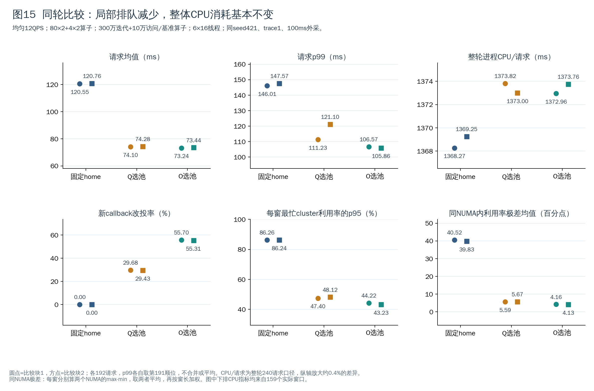
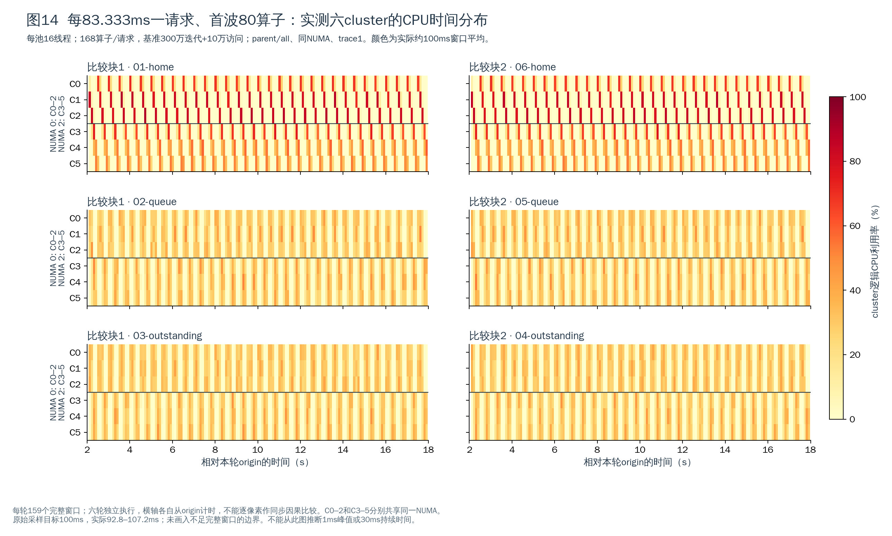

# 4021：同一量化负载的 CPU 时间窗、请求时延与算子改投

**这次六轮补采已完成，可以补上本负载逐 cluster 的 CPU 时间序列，不需要为同一目的重跑。** 在 regular 12 QPS、每请求首波 80 个算子、每池 16 worker 的合同下，同 NUMA 借出将请求均值从约 120.6 ms 降至 73.2–74.3 ms，而整轮 CPU/完成请求只增加约 0.27%–0.41%。新增曲线显示：96 个逻辑 CPU 的平均利用率仍约 17.3%–17.5%，变化主要是单个时间窗内的工作分布更均匀。

O 的两次请求 p99 都低于 Q，同时约一半普通后继重新选到其他池；Q 几乎仅在首波改投。该差异值得纳入策略选择，但**同为 high=1 不代表 Q/O 在相同压力阈值触发**，也没有隔离后继改投本身的收益。本次更新结论和证据，不修改调度实现或默认阈值，不自动补全其他负载的 CPU 矩阵。

## 1. 本轮究竟运行了什么

| 维度 | 固定合同 |
|---|---|
| 资源 | 6 个经过核对的 cluster；CPU 分区 `0-15;16-31;32-47;192-207;208-223;224-239`；前 3 个位于 NUMA 0、后 3 个位于 NUMA 2；共 96 个逻辑 CPU |
| 池与线程 | 每 cluster 一个 Folly 子池，每池 16 worker，名义容量 C=16；六池是此次资源选择，不是架构固定池数 |
| 请求到达 | regular 12 QPS，计划每 83.333… ms 到达一个请求；每轮 240 个请求，入口 RR 确定固定 home；并非 8 请求成组到达，命令中的 burst 参数在 regular 模式不生效 |
| 请求内计算图 | home 初始化 → 80 条各深度 2 的分支链 → join → 4 条各深度 2 的新分支链 → join；168 个业务算子，加 init 和两个 join，共 171 个 callback |
| 扇出与依赖 | 初始化逐个提交首波 80 个 stage0；每个 stage0 完成自身计算后提交该分支 stage1，不等待其余分支的 stage0；全部分支完成后才推进 join |
| 计算工作 | 每算子基准 3,000,000 次迭代、100,000 次随机读写访问；task 级整数 ±25% 抖动，hash 约 1/8 选中者再乘 4；普通档为 225万–375万迭代、7.5万–12.5万访问，4 倍档为 900万–1500万迭代、30万–50万访问 |
| 数据依赖 | branch-rw，每分支 64 KiB；同一分支两级消费同一可写数据；84 个分支共 5.25 MiB/request，第二波使用新的分支数据 |
| 实际固定工作 | seed=421；全程共 168,026,400,000 次迭代、5,600,880,000 次访问，即每请求平均 700,110,000 次迭代和 23,337,000 次访问；各轮逐 request checksum 和逐算子工作一致 |
| L2 路由 | parent/all、chunk=1、high=1、min-gain=0、max-hops=4，只允许同 NUMA 借出；home 不执行 L2 评分；Q/O 对每个新 ready callback 判断位置，不搬移已排队工作 |
| 外部等待 | 无同步阻塞、无异步等待；max-inflight=16、内存上限 512 MiB；本轮实测 peak-inflight=2 |
| 观测 | 六轮统一 trace=1；原 CPU 评分采样关闭；独立外部采集器按 100 ms 读取 CPU 时间；这不是 CPU 信号驱动的调度策略实验 |
| 正式范围 | 计划到达 `[2,18)` 秒的 192 个请求，窗口后完成仍计入；CPU 使用两次读取括号完全位于相同范围内的完整窗口 |

每轮实际全程均为 240/240 成功、失败或拒绝 0，cohort 为 192/192，角色记录 32,832=192×171。六次工作合同审计均通过；采集器退出码均为 0、无 capture error。CPU 每 cluster 有 159 个完整有效窗口，约 15.90 秒，覆盖率 99.36%–99.38%；边缘未覆盖部分没有补零或插值。

顺序为 `home → Q → O → O → Q → home`。前后三格分别使用自己的 home，保留两组结果，不平均两次 p99。单轮报告中的“没有唯一 home 配对”是只传单个目录时的预期输出；结尾两个三格报告正常形成四个有效对比。`matrix suite=unknown` 表示该脚本没有旧 matrix 父元数据，不表示本轮合同未知；完整命令、仓库提交和二进制 SHA256 已记录。

## 2. 请求时延与 CPU 代价：六轮绝对值

请求 mean/p99 属于 192 个计划 cohort 请求；CPU/完成请求属于整轮 240 个请求；改投统计属于 cohort 的全部 callback，三者不能交换分母。

| 比较块/轮次 | 策略 | mean ms | p99 ms | callback 等待 p99 ms | 整轮 process CPU/完成请求 ms | 改投数/32,832 | 改投率 |
|---|---|---:|---:|---:|---:|---:|---:|
| 1 / 01 | home | 120.549 | 146.012 | 39.433 | 1368.269 | 0 | 0% |
| 1 / 02 | Q | 74.097 | 111.234 | 10.314 | 1373.819 | 9745 | 29.681% |
| 1 / 03 | O | 73.243 | 106.573 | 7.595 | 1372.960 | 18287 | 55.699% |
| 2 / 06 | home | 120.756 | 147.571 | 39.273 | 1369.249 | 0 | 0% |
| 2 / 05 | Q | 74.283 | 121.098 | 10.338 | 1373.002 | 9664 | 29.435% |
| 2 / 04 | O | 73.441 | 105.859 | 7.614 | 1373.757 | 18159 | 55.309% |

| 比较块 | 候选/home | mean 相对变化 | p99 相对变化 | CPU/完成请求相对变化 |
|---|---|---:|---:|---:|
| 1 | Q/home | −38.53% | −23.82% | +0.406% |
| 1 | O/home | −39.24% | −27.01% | +0.343% |
| 2 | Q/home | −38.49% | −17.94% | +0.274% |
| 2 | O/home | −39.18% | −28.27% | +0.329% |

O 相对 Q 的均值分别少 0.854/0.842 ms（约 1.15%/1.13%），p99 少 4.661/15.239 ms；CPU/请求差分别为 −0.063%/+0.055%，方向不一致。两轮 O 的 p99 较接近，Q 的 p99 波动更大，但每轮仅 192 个请求，nearest-rank p99 是第二大值。这里只能报告已观察的差异，不能由两次运行确认生产尾延迟稳定性，或将 p99 的变化全部归因于观测信号。

## 3. 首波和普通后继分别发生了什么

每轮首波 stage0 的分母为 15,360=192×80；普通后继的分母为 16,128=192×84。以下“改投”严格指新 callback 的 source context 与 chosen pool 不同，不是内核线程迁移，也不是已有任务被工作窃取。

| 轮次 | 首波改投率 | 普通后继改投率 | 首波平均等待 ms | 普通后继平均等待 ms |
|---|---:|---:|---:|---:|
| 01 home | 0% | 0% | 15.166 | 30.685 |
| 02 Q | 63.359% | 0.081% | 2.551 | 4.213 |
| 03 O | 67.474% | 49.095% | 2.480 | 4.039 |
| 04 O | 67.454% | 48.338% | 2.483 | 4.057 |
| 05 Q | 62.858% | 0.056% | 2.526 | 4.223 |
| 06 home | 0% | 0% | 15.168 | 30.708 |

Q 的两次总改投中，首波分别占 9732/9745 和 9655/9664，普通后继仅 13/9 次。O 的普通后继改投分别为 7918/7796 次，其中 2781/2741 次从其他池回到 request home。它们仍是 parent 模式中的普通 LocalSpill 选择，不是打开了专门的 ReturnHome 模式：parent 表示优先实际父池，不表示禁止以后选回 home。

因此，**同一请求内不仅首波算子在均衡，后继也重新评估并可改投**；但两种信号会产生非常不同的实际强度。O 比 Q 多出的约 8500 次总改投主要来自普通后继，均值额外改善约 0.85 ms。不能断言这些额外后继改投全部有用或全部浪费，因为 Q/O 的首波改投比例也不同。要单独回答“后继是否应继续均衡”，需固定 O 和其他合同，对 `balance-at=fork/all` 做有限消融；目前不自动下发该实验。

等待计时从选池之后的 `submitted_ns` 到 callback 开始，可能包含 Folly 交接与内核调度等待，不是纯 Folly 队列停留。算子 CPU/wall 平均值约 8.14/8.16 至 8.16/8.19 ms，包含算子内部提交后继；两者差额不能直接叫作精确 runq 等待。

### 为什么同一个 high=1 不能证明 O 的信号质量更好

本轮 Q 评分为 `(Q+R)/16`，O 评分为 `(O+R)/16`，严格大于 1 才搜索。Q 只观察其队列接口报告的未领取工作代理；O 覆盖进入底层add前已登记、尚未完成的 callback，包括已经开始而尚未返回者；总池的短时路由预留另记为R。若一个池已有 16 个执行中的 callback，Q 可能接近 0，O 仍约为 16；此时新任务对两个评分的作用显然不同。

所以两者使用相同数值阈值，控制的对象却不同。当前比较回答的是“这两个具体评分与参数组合的整体效果”，不能把它提升为“等压力、等迁移预算下 O 必然优于 Q”。若下一步确实要选择信号，应先说明优化目标和可接受改投/CPU 代价，再分别校准少量阈值，不能仅复制数值或因 O 多改投就立即增加门控。

## 4. 新采集的 CPU 时间窗如何解释

定义每个窗口的 `M=max(六个 cluster 利用率)`。表中 M 的 p95 是 159 个窗口最大值的 p95，不是六个 cluster 各自 p95 的平均；同 NUMA 极差先分别计算两个 NUMA 内三个 cluster 的最大值减最小值，对两个NUMA等权平均，再按实际有效窗长加权。

| 轮次 | 96 CPU 时间加权平均利用率 | M 的时间加权均值 | M 的窗口 p95 | M 的窗口最大值 | 同 NUMA 极差均值（百分点） |
|---|---:|---:|---:|---:|---:|
| 01 home | 17.369% | 70.689% | 86.262% | 89.471% | 40.521 |
| 02 Q | 17.307% | 36.505% | 47.403% | 51.271% | 5.588 |
| 03 O | 17.354% | 35.051% | 44.219% | 47.242% | 4.165 |
| 04 O | 17.457% | 34.953% | 43.232% | 46.280% | 4.125 |
| 05 Q | 17.537% | 36.800% | 48.121% | 52.504% | 5.670 |
| 06 home | 17.312% | 69.926% | 86.243% | 87.612% | 39.832 |

总平均利用率相近，而同 NUMA 内不均匀程度明显降低，和同 NUMA 借出、callback 等待下降的机制一致。所有策略 cross-NUMA 改投为 0，这轮没有验证跨 NUMA 的收益。两个 NUMA 之间仍可能同时出现一个忙、一个闲，这是固定 RR 到达相位和禁止跨 NUMA 的合同结果，不能以全机绝对均匀作为本轮目标。

采集口径为 `Δ(user+nice+system+irq+softirq)/SC_CLK_TCK/实际窗口秒数/16`，guest 不重复计入；idle/iowait/steal 单列。cluster 数据包括这些 CPU 上的所有活动，含采集器和潜在干扰，并非仅 executor 线程。被测进程在同范围的平均 CPU 当量为 home 约 16.44–16.45、Q/O 约 16.52；进程计量使用自己的读取边界，不应从各 cluster 行重复累加进程值。

采集器记录的 CPU 时间每轮约 0.543–0.567 秒，其口径包含启动/采样/循环和序列化前分析，不含最后文件输出及终端打印。它是另一个进程；整轮被测 process CPU/请求不包括它，cluster 利用率已包含它。该计量说明成本非零，没有采集器开/关对照，因此不能精确估算其对时延的扰动。

这里补齐的是约 **100 ms 时间窗平均**。实际间隔使用测量值，出现约 92.8–107.2 ms 的变化；采样迟到最大约 5.05 ms，不能按固定 100 ms 分母重新计算。曲线不能还原 1 ms 微突发，也不能据此判定 30 ms 满载持续时间或设定 3 ms 压力门控。CPU 窗口选在 `[2,18)` 内，但可包含更早请求剩余执行；晚完成的 cohort 请求也可能消耗窗口外 CPU，故不能将 scope CPU 除以 192 冒充 cohort CPU/请求。

## 5. 与已有结论如何衔接

4014 的 seed421 与本轮具有相同工作摘要、到达 hash、checksum、迭代及访问数；其 home/Q/O mean 为 120.613/74.247/73.418 ms，p99 为 148.814/108.796/106.183 ms。本轮再次观察到约 38%–39% 的均值收益。

不过 4014 为 trace=0、没有本次外部 CPU 采样，4021 为 trace=1 并加入采集器，执行批次也不同。二者只能作同负载趋势复验，不能跨批配成净收益或观测开销实验，也不能将 4021 的 CPU 曲线填到 4014、96 QPS、异步或 128 worker 结果上。

对真实业务的指导保持为：每个实际核实的 cluster 一个子池，高层总池保持 request home，在新 ready 算子投递时允许同 NUMA 借出；保留 Q/O 等可替换观测实现，根据实际 callback 生命周期识别压力。历史无绑定四池 trace 支持关注微突发与局部服务分布，不能给这里的 Q/O 赋值或推导生产阈值。此轮 T=C=16，不能回答原始“每池约 128 worker、绑定 16 个逻辑 CPU”的所有问题。

## 6. 下一步与交付状态

1. 将本轮曲线、请求和角色表纳入最终报告，保存目标机原始 CSV、metadata、构建标识；现有终端回传已足以完成此次分析，无需再次外传相同结果。
2. 不为补齐该负载 CPU 视图重跑六轮；不自动扩展到全部 seed、线程、到达、异步或阈值矩阵；不据本轮改 C++ 策略或默认参数。
3. 如果下一项明确决策是减少 O 的普通后继改投，才预先确定 mean/p99、CPU/请求和改投预算，并设计 O 的 fork/all 或少量 gain 对照。若目标是正式生产 p99 验收，需当地独立重复与 SLO，当前两次同 seed 不能代替。
4. 生产不可联网或不可访问不妨碍交付。当地仍按[分阶段手册](PRODUCTION_AGENT_PLAYBOOK.md)或[纯提示词](PRODUCTION_AGENT_PROMPTS_ONLY.md)先探索实现，再作可回退集成和验收；不要求重新采集生产 trace 才能继续。

原始证据为 `4021.log`（SHA256 `3c4ddb56862e28e3827fb8c25a1e9a06fb5f7dd43b4a2d152630417abf212436`）。归档见[结构化结果](../results/review/4021_summary.json)及[CPU 窗口 CSV](../results/review/4021_cpu_windows.csv)，窗口派生公式见[统计实现](../reports/final_review/cpu_window_metrics.py)。复现合同和命令保留在[CPU 采集指南](../reports/final_review/CPU_CAPTURE_GUIDE.md)，该指南现在用于复现，不是新的待执行任务。
