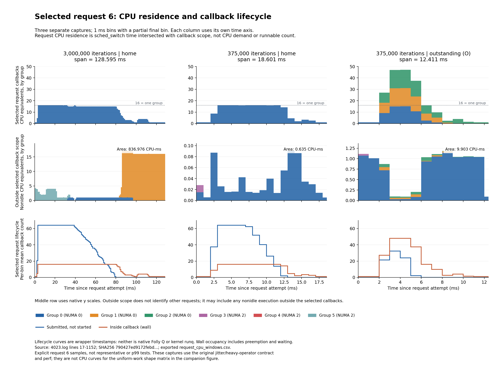
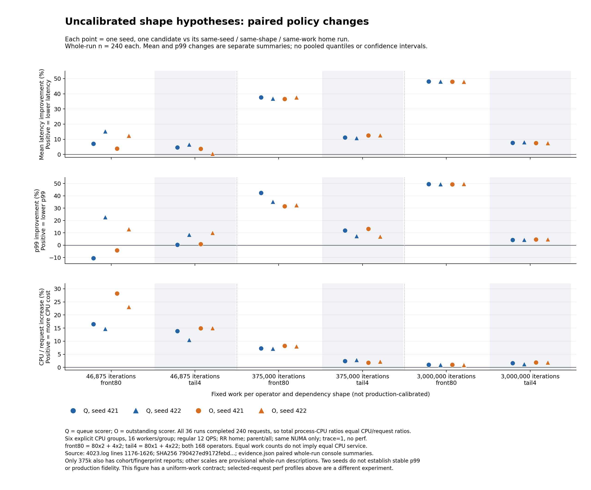

# 4023：请求内CPU恢复结果与工作量/图结构敏感性

**本轮确认了demo的实际服务形状，以及均衡收益对工作量和依赖结构的敏感性；没有完成真实业务相似性验收。** 三份既有采集已恢复解析，36轮形状实验也已回传。已执行的实验保留为有边界的机制证据，不因此前撤回必做建议而丢弃；也不将其升级为生产负载标定。本轮不修改负载默认值、调度算法或阈值。

## 1. 输入、统计范围与可复核性

输入为`4023.log`，SHA256 `790427ed9172febde1c9cdcc538783dd789e5347bf298cec0ca7b523206ffd1c`，1629行。数据整理与复算入口见[4023交付目录](../reports/4023/README.md)。本地没有目标机原始trace或任务CSV，只复核回传的JSON、逐窗数据、命令和报告。

| 输入部分 | 来源行 | 可以复算 | 不能混用的范围 |
|---|---|---|---|
| 3份请求CPU profile | 17–1152 | 3份摘要、1127行窗口、面积/时间窗/分区合计/累计服务点 | 每轮显式选request6；不是请求样本分布、不是p99 |
| 375000迭代的12轮 | 1176–1553 | 全240请求摘要；计划到达[2,18)秒的192请求cohort；角色、路由和工作指纹 | 请求时延用192请求，进程CPU/请求仍为整轮240请求 |
| 46875及3000000迭代各12轮 | 1575–1627 | 命令、全240请求mean/p99、进程CPU、改投、在途峰值 | 尚未回传同口径cohort与角色/工作指纹报告，仅作初步全轮描述 |

36轮均报告completed=240，共8640请求。375k完整报告另确认每轮240/0成功/失败或拒绝、cohort192/192，同图同seed的三策略工作指纹、fixed-work前缀与checksum一致，8个home配对被报告接受。其余两档只有固定迭代总数与arrival_hash等摘要一致，不能冒充已复核逐算子工作。未打印矩阵的git/binary标识，不根据“Already up to date”猜测执行版本。

三个profile成功输出说明目标工具通过了其源hash、时钟、切换链、TID、CPU归属与范围检查。6个cluster的请求区间均被完整括住，左/右各96个开放边界区间被排除。这里没有在本地重新验证目标原文件hash。驻留与callback CPU计时相差0.16%–0.37%，有助于核对计量一致性，不证明中断影响为零或绝无不可见缺失。

## 2. 两类实验的负载合同不同

共同资源是所选六cluster各一池，每池16 worker、16逻辑CPU；两组NUMA分别为0和2。请求regular 12QPS、RR home，同home计划间隔500ms；parent续接、all提交点选池，仅同NUMA借出，high=1、gain=0、hop=4。

**请求CPU采集**按前轮冻结的采集合同描述（4023未重新导出完整metadata），保留原`80×2+4×2`图，每算子task级±25%扰动，约1/8乘4，branch-rw 64KiB，无外部等待。三份目录分别为3M home、375k home、375k O；每轮24请求，只展示request6。开启trace1和perf，所以是服务形状诊断。

**形状矩阵**关闭上述工作扰动，两个图都为168业务算子、171 callback、84份64KiB分支数据（5.25MiB）。每轮240请求，trace1、无perf，无同步阻塞或异步恢复：

```text
front80：init → 80条深度2的分支 → 整波join → 4条深度2的分支 → join
 tail4：init → 80条深度1的分支 → 整波join → 4条深度22的分支 → join
```

| 每算子迭代/访问 | 每请求迭代 | 每请求读数、写数（各自） |
|---|---:|---:|
| 46875 / 1563 | 7875000 | 262584 |
| 375000 / 12500 | 63000000 | 2100000 |
| 3000000 / 100000 | 504000000 | 16800000 |

1563是整数取值，不是12500严格除8。各档QPS相同，改变工作量也改变平均压力，不能声称控制了平均CPU利用率。两图保持计数，不保持实测CPU成本、关键路径或分支复用强度；tail4仍是未校准假设。两个seed按块打乱策略顺序，范围不是置信区间。

**不能把采集部分的375k/3M曲线当作矩阵同名档位的曲线。** 两者扰动、观测开销和统计范围均不同；本轮形状矩阵没有新的逐毫秒CPU曲线。

## 3. 请求内CPU：持续服务与积压已经可见



三个面板分别使用本次请求的真实时间范围，没有把128ms压缩成与13ms相同的持续时间。图中的CPU是callback边界与sched_switch驻留相交的面积/桶宽；范围外服务单列，不能直接称其他请求。底部是callback生命周期计数，不是Folly Q或内核runq。

| 显式request6 | 3M home | 375k home | 375k O |
|---|---:|---:|---:|
| attempt→完成 ms | 128.594 | 18.601 | 12.410 |
| callback计时CPU ms | 1360.530 | 182.367 | 194.899 |
| callback调度驻留 CPU·ms | 1362.722 | 182.941 | 195.613 |
| 1ms窗最大CPU当量 | 16.000 | 15.986 | 47.088 |
| >8 CPU当量的连续桶时长 | 82ms，[3,85) | 11ms，[2,13) | 6ms，[2,8) |
| >16 / >32 CPU当量时长 | 0 / 0 | 0 / 0 | 4 / 3ms |
| 累计50% / 90% / 99%服务所在窗末 ms | 46 / 83 / 115 | 9 / 13 / 17 | 5 / 7 / 11 |
| 提交尚未开始的callback，最大桶均值 | 64.028 | 64.078 | 32.279 |

由此可以确认：

- 3M home的本请求在[3,33)ms连续30个1ms桶都获得home cluster至少95%的CPU驻留，同时存在大量已提交未开始callback；>8当量持续82ms。原3M模型的压力确实持续数十毫秒，不能当作已验证的1–2ms自消化负载。
- 375k home也不是只有1ms服务：>8当量持续11ms，累计90%服务到第13ms窗口。缩短工作量改变了服务持续尺度，仍不能仅凭“更短”认证贴近真实trace。
- 375k O的本请求驻留分布于同NUMA的pool0/1/2，分别55.436/64.981/75.196 CPU·ms，其余池为0。这直接展示了**请求内算子分散执行**；不是仅在请求入口换home。峰值升到47.088当量、服务更早交付，同时实际CPU成本增加。
- home的`>16=0`是硬资源上限，不是“没有过载”。提交未开始的计数涵盖用户态交接与领取前等待，不能称纯Folly队列或纯内核排队。

单个375k样本O比home完成更早约33.3%，callback计时CPU增加约6.9%。没有该对采集的逐算子指纹回传，这只是同预定合同的样本对照，不能给出总体收益或生产p99。累计服务99%也不是请求p99。

3M home请求期间，96个选定CPU上另有836.976 CPU·ms非idle驻留在本请求callback范围之外，说明同期确实还有服务。该范围包含其他callback、executor框架及其他线程；没有完成TID/request/phase关联，**不能把它直接认定为旧请求后期与新扇出竞争，更不能据此证明同cluster干扰**。

## 4. 同工作档内的策略比较：图结构和工作尺度会改变收益



本图统一使用每轮全240请求控制台摘要。每个点是一个seed相对同图home的变化；没有合并p99或绘制置信区间。CPU代价为进程总CPU/完成请求，**不是CPU利用率**，也不是实时CPU曲线。

下面先用375k较完整的192请求cohort展示绝对值，斜杠顺序为seed421/422；CPU列使用各自整轮240请求，明确分列。

| 图 / 策略 | cohort mean ms | cohort p99 ms | 整轮CPU/请求 ms | cohort callback改投率 |
|---|---:|---:|---:|---:|
| front80 home | 12.980 / 13.014 | 14.626 / 14.616 | 141.232 / 141.376 | 0 / 0 |
| front80 Q | 8.097 / 8.246 | 9.837 / 9.897 | 151.515 / 151.545 | 30.00% / 29.68% |
| front80 O | 8.243 / 8.116 | 10.159 / 9.736 | 152.901 / 152.720 | 53.57% / 54.38% |
| tail4 home | 24.500 / 24.439 | 25.984 / 26.499 | 135.402 / 135.038 | 0 / 0 |
| tail4 Q | 21.719 / 21.764 | 22.888 / 23.923 | 138.626 / 138.846 | 29.16% / 29.14% |
| tail4 O | 21.455 / 21.328 | 23.189 / 23.920 | 137.799 / 137.996 | 31.58% / 31.58% |

front80的Q/O均值下降约36%–38%，tail4只有约11%–13%。后者同样多的算子和固定工作计数，却有更长的依赖路径，且后半段只允许4条链并行。它支持“策略收益依赖图结构”这个机制结论，不能证明这张图更像生产或定位了唯一的性能原因。

全部三档的初步全240请求比较如下；范围是两个seed各自配对的最小–最大值。时延“下降”为正，CPU“增加”为正。375k的全轮数值与上表cohort不可混算。

| 迭代数 / 图 | Q均值下降 | O均值下降 | Q CPU增加 | O CPU增加 |
|---|---:|---:|---:|---:|
| 46875 / front80 | 7.01%–15.29% | 3.89%–12.43% | 14.78%–16.48% | 23.12%–28.25% |
| 46875 / tail4 | 4.64%–6.63% | 0.43%–3.68% | 10.51%–13.90% | 14.95%–15.00% |
| 375000 / front80 | 36.84%–37.65% | 36.64%–37.62% | 7.19%–7.28% | 8.02%–8.26% |
| 375000 / tail4 | 10.86%–11.21% | 12.45%–12.73% | 2.38%–2.82% | 1.77%–2.19% |
| 3000000 / front80 | 48.10%–48.17% | 47.99%–48.05% | 1.02% | 0.91%–1.03% |
| 3000000 / tail4 | 7.71%–8.18% | 7.44%–7.55% | 1.28%–1.63% | 1.86%–1.91% |

46875/front80的p99有反号：seed421中Q恶化10.49%、O恶化4.09%；seed422分别改善22.70%、13.11%。因此不能声称小工作量也稳定改善尾延迟。此档尚无trace0对照及控制callback成本分解，CPU增幅不能全归因于选池、缓存或观测之一。每轮192/240请求的p99只涉及顶部约2–3个请求，两个seed不足以认证稳定尾部收益。

同样固定计数，tail4 home的进程CPU比front80 home少约4.1%–7.2%，再次证明等计数不是等实耗CPU。不能将跨图时延差全部归为并行度，也不能用更低CPU声称cache已经优化。

## 5. 算子路由与请求竞争：本轮能看到的边界

375k/front80的普通后继每轮cohort有16128个：Q改投81/90个（0.50%/0.56%），O改投7220/7487个（44.77%/46.42%）。Q后继平均等待0.529/0.528ms，O为0.525/0.523ms；请求均值没有一致赢家。**该配置下更多后继改投没有对应一致的额外时延收益**，但未逐次证明这些改投无效，首波落点也不同，尚不能孤立归因于后继规则。

375k/tail4的Q/O普通后继和后波stage0改投均为0。初始80项的平均等待从home约1.81ms降至Q/O约0.39–0.41ms，后继等待本来已接近零。本轮这一图主要检验孤立扇出的分散，没有展示后期被新请求挤压后重新均衡的机制。

| 档位 | 已观测请求在途峰值 | 对请求间竞争的含义 |
|---|---|---|
| 46875 | 12轮全部为1 | 没有请求生命周期重叠，不能研究旧请求与新扇出竞争 |
| 375000 | 11轮为1；tail4 home seed422为2 | 大多数仍为孤立请求；一次峰2不能证明阶段竞争覆盖充分 |
| 3000000 front80 | 1–2 | 仅说明部分轮次有生命周期重叠 |
| 3000000 tail4 | 6轮均为3 | 提供进一步离线分析的样本；还需要阶段×实际池联合时间线确认共享资源 |

本轮T16、16逻辑CPU且无阻塞，不能外推为超配128worker时Q也足够。Q得分`(Q+R)/C`与O得分`(O+R)/C`同用high=1，不代表相同有效压力阈值；比较的是完整策略配置，不是单独的信号准确率。当前保留Q基线和O候选，不据本轮改生产默认或加入3ms门控。

## 6. 对真实业务相似性与影响的分级判断

| 结论层级 | 当前支持程度 |
|---|---|
| 局部宽扇出在单cluster上形成等待，向同NUMA其他cluster投递可更早交付服务 | 本轮demo有直接时序证据；与用户业务问题相关 |
| 收益随工作量、依赖结构变化，小工作量的CPU代价占比可能增大 | 三档/两图提供受控假设证据；具体比例限于本合同 |
| 80×1+4×22比原图更接近真实业务 | 不支持。两者都缺复杂局部join/再扇出与跨阶段数据融合，新图没有历史trace校准 |
| 已覆盖旧请求长期执行对新扇出的同池竞争 | 不支持。低两档基本无重叠，3M只有在途峰值，未有阶段/资源归因 |
| 当前毫秒曲线已匹配现场微突发 | 不支持。现场是未绑核池级服务、无request标记；本轮是受限CPU上的显式单请求profile，阈值和分母不同 |
| 可推荐真实业务收益、最优观测量、线程数或迁移阈值 | 不支持。真实的依赖、阶段背景、阻塞、超配及缓存代价仍未确定 |

历史生产trace的峰前/峰后背景、再次突发间隔及同期服务分析尚未返回，本日志不能替代它。既有历史均值/峰值和本轮曲线只允许提出与排除部分假设，不能唯一确定真实DAG。即便将来池级曲线接近，也仍有多个请求结构能产生同样曲线。

## 7. 下一步：只补现有结果的离线审计，不新增压测矩阵

1. 继续等待或执行[旧trace定向提示词](TRACE_TEMPORAL_SHAPE_PROMPT.md)。只依赖历史文件/可信中间序列，无需生产访问或新采集；它回答模型时间约束，不直接选DAG。
2. 现有375k矩阵的报告已齐，不必重跑。为避免用全轮摘要替代正式cohort，请对已完成的另外两档补打印下列报告。只读已有结果，无需编译或启动demo：

```bash
(
set -eu
cd /home/bty/rank_demo/executor_demo
for d in shape-46875-fixed-01 shape-3m-fixed-01; do
  python3 experiments/affinity/report.py results/local/"$d"/seed-* \
    --warmup-seconds 2 --window-seconds 16
  python3 experiments/affinity/flow_report.py results/local/"$d"/seed-* \
    --warmup-seconds 2 --window-seconds 16
done
)
```

3. 保存全部原始CSV/perf文件。下一项有价值的专门分析是从已有3M tail4目录关联request阶段、提交/开始/结束及实际池：在新请求首波提交时，区分旧请求后期的已提交未开始与callback占用，并检查双方是否落在同一cluster或同NUMA借用范围。该联合归因尚未交付；现有report/flow补打不能自动完成它。若需要实际on-CPU归属，再评估现存采集是否足够，不先承诺重采。

本轮已有数据足以给出上述阶段结论，不需要为了“跑满覆盖”继续追加seed、线程或阈值矩阵。原36轮作为明确标注的结构敏感性证据保留；新的真实相似模型仍须根据业务事实、历史时间约束和未知维度分开设计。
