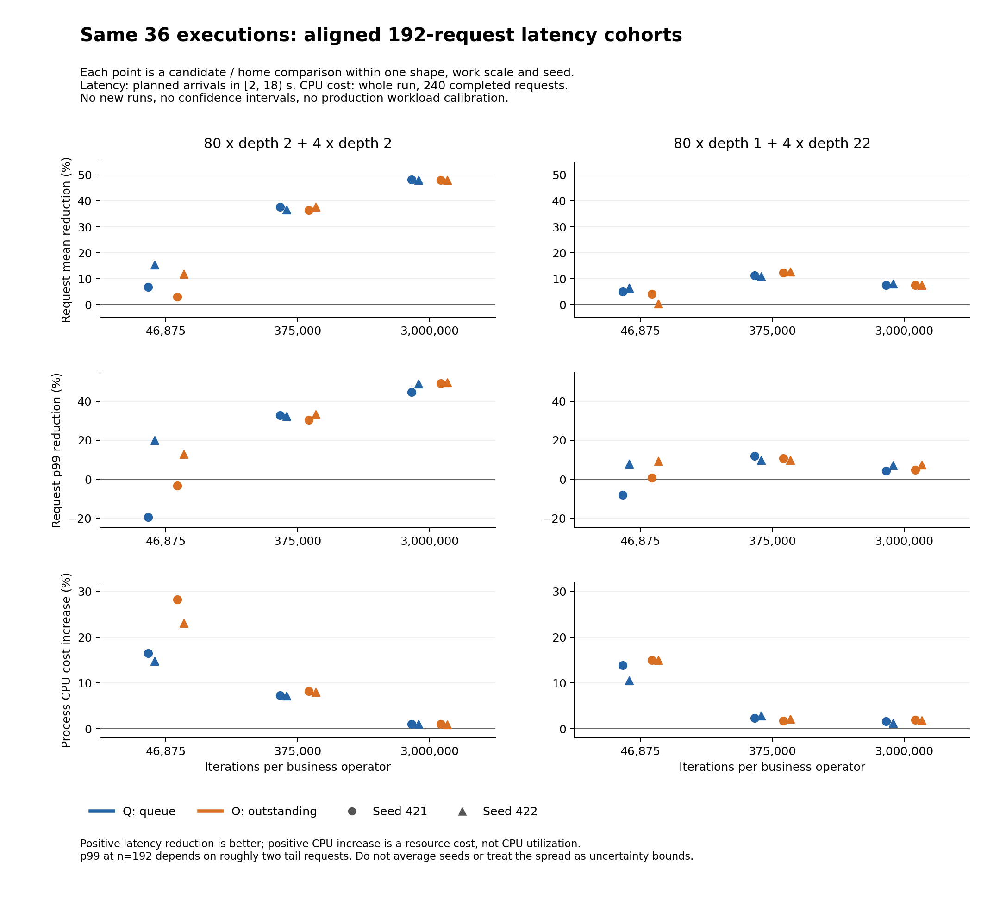
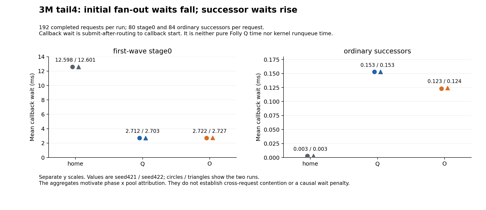

# 4024：统一统计范围后的策略收益与后继等待

**4024补齐了原36轮实验的报告，没有新增压测。** 三档工作量、两种图现在都能按同一192请求窗口比较。均衡收益随工作量和依赖结构变化的结论保持；小工作量的p99不稳定性更明确。新增的重要线索是：3M的四条深链图中，首波等待下降、后继等待上升，需要使用现有任务CSV做阶段与实际池的联合分析。

本轮不调整负载、调度算法或参数。两种图仍是结构敏感性假设，均未通过真实业务相似性验收。目标始终是每个已核实的硬件cluster一池；历史四池配置只是旧trace的采集条件。

后续状态：[4025](TARGET_V2_4025_REVIEW.md)已返回历史服务时间报告；它支持补充背景与复发覆盖，但仍不能标定唯一生产图或在线阈值。本页保留4024结果本身的范围。

## 1. 本次补齐了什么

输入`4024.log`共711行，SHA256为`702778049dc293ee6f2d2cc96f0a722a8db260d8a7247b49f9bf579192d781b9`。它仅运行report和flow_report，补出46875、3000000两档各12份cohort和角色报告；375000档沿用4023。所有24份进程CPU总量、请求在途峰值与4023逐项一致。新增16个候选/home配对的工作指纹、arrival hash、checksum和fixed-work前缀一致，角色数量及改投数量守恒。

因此现有执行仍是36轮、8640个完成请求；每轮计划到达[2,18)秒的192请求全部完成，共6912个cohort请求。重复导出不增加样本量。报告记录的失败/拒绝为0，跨NUMA改投为0。本地复核终端摘要，没有取得目标原CSV、二进制或构建标识；配对指纹一致不等于独立重放了全部原始任务。

数据、源行号、24个配对及图表在[交付目录](../reports/4024/README.md)。4023原全240请求结果保留；下文请求时延统一使用192请求，CPU成本仍使用整轮240请求，两个范围不相减、不混合生成p99。

## 2. 请求怎样到达、执行和选池

共同资源为六个cluster，每池16 worker、16逻辑CPU；前三池NUMA0，后三池NUMA2。每轮240请求、regular 12QPS，全局计划间隔83.333ms，RR选home，同home间隔500ms。不是入口burst；80路微突发来自请求内部。

```text
定时到达 → beginRequest/RR固定home → init在home初始化84份64KiB数据
  → 提交第一波80条分支 → 每个前驱完成后提交本分支后继
  → 全波join → 提交第二波4条分支 → 链式后继 → 全波join → 完成

每次ready callback提交：
  home策略：投request home
  Q/O策略：parent为候选源池 → 读负载并计入预留R
          → 本池可接纳则留本池，否则寻找同NUMA有足够收益的池
          → 入选池的Folly队列 → worker领取并开始callback → 完成/再提交
```

front80为`80×深度2 + 4×深度2`；tail4为`80×深度1 + 4×深度22`。两者均168业务算子、171 callback，分支数据共5.25MiB。后继真实消费同分支数据；仍只有链和整波barrier，没有补出任意局部join、多父数据融合等复杂DAG。

| 每算子迭代 / 访问次数 | 每请求迭代总数 | 每请求读次数和写次数，各自 |
|---|---:|---:|
| 46875 / 1563 | 7875000 | 262584 |
| 375000 / 12500 | 63000000 | 2100000 |
| 3000000 / 100000 | 504000000 | 16800000 |

没有task扰动、长任务倍增、同步阻塞或异步等待；trace=1、无perf。初始化的数据量保持固定。固定迭代相等不意味着CPU成本相等。此合同与4023三份保留task扰动且开启perf的request6 profile不同，不能用那三份1ms曲线充当本矩阵实时CPU。

L2在`all`提交点逐算子选择，续接为`parent`，仅同NUMA，high=1、gain=0、hop=4。Q分数为`(Q+R)/C`，O为`(O+R)/C`；Q是底层队列未领取代理，O是包装器已接纳未完成callback，R是尚未交接的预留。相同high不代表相同有效压力门槛。这里比较完整配置，不是孤立比较信号准确性。没有把已在Folly队列中的任务搬走。

## 3. 统一192请求窗口的结果



下表范围是两个seed各自与同图home配对的最小–最大值，不是置信区间。均值下降为正代表完成更早；CPU增加为正代表资源成本增加，不能称CPU利用率上升。完整绝对值也保留两个seed，不平均p99。

<!-- TABLES_BEGIN -->
| 每算子迭代 / 图 | Q均值下降 | O均值下降 | Q CPU增加 | O CPU增加 |
|---|---:|---:|---:|---:|
| 46875 / front80 | 6.78%–15.35% | 3.14%–11.84% | 14.78%–16.48% | 23.12%–28.25% |
| 46875 / tail4 | 5.01%–6.37% | 0.32%–4.09% | 10.51%–13.90% | 14.95%–15.00% |
| 375000 / front80 | 36.64%–37.62% | 36.49%–37.64% | 7.19%–7.28% | 8.02%–8.26% |
| 375000 / tail4 | 10.95%–11.35% | 12.43%–12.73% | 2.38%–2.82% | 1.77%–2.19% |
| 3000000 / front80 | 48.08%–48.18% | 47.95%–48.04% | 1.02%–1.02% | 0.91%–1.03% |
| 3000000 / tail4 | 7.60%–8.06% | 7.51%–7.55% | 1.28%–1.63% | 1.86%–1.91% |

斜杠顺序为seed421 / seed422；不对p99取平均。

| 每算子迭代 / 图 / 策略 | 请求mean ms | 请求p99 ms | 整轮CPU/请求 ms | callback改投率 |
|---|---:|---:|---:|---:|
| 46875 / front80 / home | 4.013 / 4.534 | 5.255 / 6.341 | 22.472 / 23.093 | 0.00% / 0.00% |
| 46875 / front80 / Q | 3.741 / 3.838 | 6.275 / 5.077 | 26.175 / 26.505 | 29.89% / 30.35% |
| 46875 / front80 / O | 3.887 / 3.997 | 5.424 / 5.528 | 28.821 / 28.432 | 54.11% / 54.47% |
| 46875 / tail4 / home | 6.085 / 5.853 | 7.717 / 7.752 | 21.513 / 21.561 | 0.00% / 0.00% |
| 46875 / tail4 / Q | 5.780 / 5.480 | 8.344 / 7.145 | 24.503 / 23.828 | 28.28% / 28.39% |
| 46875 / tail4 / O | 5.836 / 5.834 | 7.665 / 7.038 | 24.729 / 24.795 | 31.11% / 31.18% |
| 375000 / front80 / home | 12.980 / 13.014 | 14.626 / 14.616 | 141.232 / 141.376 | 0.00% / 0.00% |
| 375000 / front80 / Q | 8.097 / 8.246 | 9.837 / 9.897 | 151.515 / 151.545 | 30.00% / 29.68% |
| 375000 / front80 / O | 8.243 / 8.116 | 10.159 / 9.736 | 152.901 / 152.720 | 53.57% / 54.38% |
| 375000 / tail4 / home | 24.500 / 24.439 | 25.984 / 26.499 | 135.402 / 135.038 | 0.00% / 0.00% |
| 375000 / tail4 / Q | 21.719 / 21.764 | 22.888 / 23.923 | 138.626 / 138.846 | 29.16% / 29.14% |
| 375000 / tail4 / O | 21.455 / 21.328 | 23.189 / 23.920 | 137.799 / 137.996 | 31.58% / 31.58% |
| 3000000 / front80 / home | 78.045 / 77.698 | 83.466 / 83.007 | 1038.958 / 1039.061 | 0.00% / 0.00% |
| 3000000 / front80 / Q | 40.440 / 40.344 | 46.066 / 42.365 | 1049.547 / 1049.661 | 29.53% / 29.57% |
| 3000000 / front80 / O | 40.551 / 40.441 | 42.420 / 41.773 | 1049.669 / 1048.488 | 51.73% / 51.46% |
| 3000000 / tail4 / home | 154.096 / 154.541 | 161.445 / 165.880 | 963.704 / 964.808 | 0.00% / 0.00% |
| 3000000 / tail4 / Q | 142.384 / 142.088 | 154.677 / 154.165 | 979.442 / 977.167 | 29.26% / 29.32% |
| 3000000 / tail4 / O | 142.524 / 142.868 | 153.835 / 153.729 | 982.120 / 982.724 | 31.12% / 31.17% |
<!-- TABLES_END -->

可以确认：

- front80的Q/O均值收益从46875档约3%–15%，到375000档约36%–38%，到3000000档约48%。相对CPU代价从约15%–28%降到约1%。不能将这些离散点当作连续性能拐点或生产阈值。
- tail4在375000档均值改善约11%–13%，在3000000档约7.5%–8.1%；相同算子计数的较深依赖路径限制了整体收益。跨图还改变数据复用和实际CPU成本，不是严格的单一并行度消融。
- 46875/front80，Q的p99在seed421恶化19.41%，在seed422改善19.93%；O分别恶化3.22%、改善12.82%。46875/tail4的Q也反号：8.344对7.717ms，恶化8.12%；另一seed改善7.83%。此前全240请求该tail4配对略有改善，是统计范围不同，不能覆盖统一窗口的新结论。

每轮192请求的nearest-rank p99是第191个顺序统计量，主要取决于顶部约两个请求。两个seed不能证明稳定尾部收益。最小工作量档的init callback CPU仍约2.3–2.8ms，包含数据初始化和首波投递；业务算子均值约0.10–0.15ms。缩小业务工作并未同比缩小init，因而请求组成改变。init与已开始的首波可能重叠，不能把其均值直接当成可相减的关键路径成本，也不能将全部CPU增幅归于选池或cache miss。

## 4. 算子级均衡：新证据不是只有入口换池

3M front80中每轮有16128个普通后继。Q只改投135/130个（0.84%/0.81%），O改投6615/6527个（41.02%/40.47%）。后继平均等待Q为3.560/3.584ms，O为3.543/3.537ms。请求mean Q略低；请求p99 O则两seed均较低：42.420/41.773ms，对Q的46.066/42.365ms。

因此本档应表述为：**O有更多后继改投，没有均值优势，但两个样本的p99偏向O；尚不能隔离后继改投的因果贡献。** 两策略首波落点也不同，不能说这些额外改投全部无效，更不能由两点宣布O最优。

3M tail4中，84个普通后继全部属于后波四条链。这里出现了更值得追查的变化：



| 角色 / 指标 | home，seed421/422 | Q，seed421/422 | O，seed421/422 |
|---|---:|---:|---:|
| 初始80个stage0平均等待 ms | 12.598 / 12.601 | 2.712 / 2.703 | 2.722 / 2.727 |
| 普通后继平均等待 ms | 0.003 / 0.003 | 0.153 / 0.153 | 0.123 / 0.124 |
| 普通后继改投数 / 16128 | 0 / 0 | 9 / 3 | 6 / 3 |
| 后波stage0改投数 / 768 | 0 / 0 | 0 / 0 | 0 / 0 |

请求整体更早完成，同时后继等待上升。这纠正了“尾链总是无等待”的过度概括。O还有507/509个普通后继记录`InsufficientGain`，不能把未改投全部解释为本池没有压力。

但这些是角色聚合，不含新旧请求相遇时刻。等待从选池后的submitted到callback start，既不是纯Folly排队，也不是纯内核runq等待。不能将角色平均等待累加成request关键路径，或断言增加的约0.12–0.15ms由新请求造成。下一步只读联合分析正是为了区分“同一时段且同一资源”与单纯生命周期重叠。

## 5. 仍未解决的代表性问题

| 问题 | 当前证据 |
|---|---|
| 是否补齐所有三档的统一统计、角色与工作指纹 | 是，仍为原36轮 |
| 是否有请求重叠 | 46875全部12轮峰值1；375000的11/12轮峰值1；3M tail4六轮峰值3 |
| 是否证明旧请求后期与新扇出同池相撞 | 尚未；3M tail4的后继等待提供了分析线索 |
| 是否新增请求内实时CPU | 没有；callback wall occupancy不等于on-CPU，峰52/53也不能当CPU数 |
| 是否匹配真实trace的微突发和持续背景 | 4024未包含历史补证；后续4025提供时间约束，仍未完成模型校准 |
| 是否可选定生产负载、阈值或worker数 | 不支持；本轮T16、无阻塞不能代表128worker、异步恢复或复杂生产DAG |

历史trace仍只能约束池级服务的均值、峰、持续时间、峰间背景与复发节奏。没有request/operator标记就不能唯一反推图宽深或跨请求阶段。目标机图模型的机制结论成立，不等于生产收益已证实。不能用更高均衡收益作为挑选“真实模型”的准则。

## 6. 下一步：已有数据的联合时间分析

本次已有目录的report/flow补打已经完成，不必重跑。继续使用[历史trace定向提示词](TRACE_TEMPORAL_SHAPE_PROMPT.md)分析旧文件；没有要求访问生产、重新采集或读取生产源码。

新增只读分析器和运行命令见[阶段重叠分析指南](REQUEST_PHASE_OVERLAP_GUIDE.md)。它使用现有3M tail4六轮的requests/tasks CSV，关联新请求首波提交与旧请求后波的实际池，分别统计已提交尚未开始、callback内的wall占用及同NUMA暴露。可以识别同资源相遇和等待的关联，不能替代sched_switch证明CPU竞争或因果效应。

结合后续4025的时间约束、等待现有CSV联合结果期间，保留两种图为已标注假设，不新增压测矩阵、不改变默认图或门控阈值。后续若确认覆盖不足，再明确需要补的依赖、持续背景或请求相撞合同，而不是凭空调整宽度与深度。
