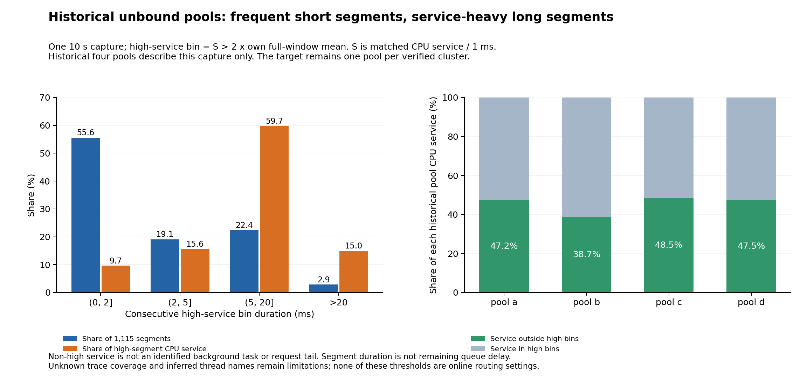

# 4025：真实轨迹的服务特征与分级压力门控设计

**建议进一步细化为“即时策略基线＋可选分级门控”的对照设计，但目前不替换默认策略，也不能直接采用3ms或2C为生产阈值。** 4025支持同时关注瞬时尖峰、持续高服务、峰间服务和重复突发。4024及历史实验又表明迁移有成本、收益依赖工作量和图结构；这为亲和与等待之间的取舍提供了理由。它们尚未测出哪些在线信号和阈值能稳定改善生产p99。

这里的主线仍是每个已核实硬件cluster一个子池。历史四个未绑定CPU的executor池不决定目标池数，也不按4→6等比例变换负载。

## 1. 轨迹到底观测到了什么

4025复用了既有10秒、每池10000个1ms桶的服务序列，没有重新扫描trace。输入summary哈希为`2a9a9adc00250cd49b3e2be05990ac92515e62c8b02eb10995340ff6dc3cc04d`；本次终端日志SHA256为`21cf4d7d8a9c5fffec298b4a96946fb67c4dab725cbcdd92a38ea7c99722c6ff`。整理和复算见[证据目录](../reports/4025/README.md)。

定义`S=桶内匹配on-CPU时间之和/桶宽`，单位为逻辑CPU当量；高服务桶是`S > 2×本池整个10秒的均值`。这是事后服务分类，既不是Folly Q、包装器O、完整runnable N，也不是容量过载判据。

| 观察对象 | 本次可支持的事实 | 对业务的解释边界 |
|---|---|---|
| 服务不只发生在尖峰里 | 四池均值4.364–7.093 CPU当量；非高桶均值1.939–3.865；非高桶承载各池38.679%–48.533%的已观测服务 | 不宜只覆盖“完全空闲后一个孤立脉冲”；不证明始终存在独立后台任务或它属于旧请求尾链 |
| 高服务持续尺度不同 | ≤2ms片段按次数占多数，>5ms片段承载多数高段服务面积 | 应覆盖短尖峰和持续段；不能把段时长叫算子时间、排队时间或剩余工作 |
| 高服务反复出现 | 高段之间非高间隔p50为11–15ms；起点间隔p50为16–20ms | 是服务复发节奏，不是request到达间隔或业务QPS |
| 各池常常错峰但其他池也在工作 | 至少一个池high的4280个共同桶中，3550个仅一个池high，约82.94%；源池high时其余池服务合计p50为11.809–14.713 CPU当量 | 提供寻找可借资源的动机，不证明目标池空闲；历史未绑核池也不对应独占cluster |



1115个完整高服务段按时长复算如下。面积是实际观察到的服务，不是排队需求或可节省的时间。

| 连续高服务时长 | 段数 / 占比 | 总持续时间 ms / 占比 | CPU服务面积 CPU·ms / 占比 |
|---|---:|---:|---:|
| ≤2ms | 620 / 55.61% | 782 / 15.47% | 12839.880 / 9.67% |
| >2–5ms | 213 / 19.10% | 842 / 16.66% | 20744.953 / 15.63% |
| >5–20ms | 250 / 22.42% | 2562 / 50.68% | 79299.487 / 59.74% |
| >20ms | 32 / 2.87% | 869 / 17.19% | 19859.979 / 14.96% |

**>5ms只占25.29%的事件，却承载74.70%的高段服务。** 不能依据“短事件多”就推断大部分成本可忽略。5055ms是四池段时长之和，不是系统连续高负载5055ms。此前外部agent的“92%两毫秒自愈”使用不同且未核实的N/事件定义，本轮没有验证那个说法。

1111对相邻高段中，间隔≤5ms有363对（32.67%），≤10ms有506对（45.54%），≤30ms有780对（70.21%）。这使“低谷是否重置”“EWMA退潮尾巴”“前次busySince是否泄漏到下一次突发”成为必要反例。不能据此指定每隔13ms生成一个request。

5/10ms合桶后段数减少、间隔变长，说明识别受分辨率和阈值影响；这些不是独立重复实验。1ms分桶不能精确确认连续3ms的在线压力，也不能提供亚毫秒释放条件。

## 2. 哪些结论需要收紧

- 日志S24称“持续背景真实且很重”，应改为“非高时段仍贡献显著服务”。是否每一时刻都有背景、是否来自旧request、是否CPU计算或其他工作，均无法归属。
- S24称时长集中2–20ms，按事件数并不准确；应表述为“次数偏短，服务面积偏向持续段”。
- S19表头漏了一个三元组的名称；本轮仅使用明确标注的服务列和可守恒的整数计数，不把无标签三元组当W或runnable。S17/18的valid似为前后窗口计数且边界分母不清，暂不据其计算成对比例或置信度。
- `coverage=unknown`、线程名推断池映射、未匹配切出1310条、排除歧义等待96378条等限制仍在。完整保存10000桶不等于完整采集真实活动；本地只复算返回表，没有重验原序列或解析器。

现有明确列已足以给出上述方向判断，无需为了门控设计重扫大trace。若以后要使用前后窗口或等待列，只需持有分析产物的agent澄清表头、分母和少量原行，不要求访问生产或新采集。

## 3. 与历史实验合起来意味着什么

| 实验证据 | 对分级门控的启示 | 不能推出 |
|---|---|---|
| 4024最小46875档，Q/O额外进程CPU约10%–28%，部分p99改善反号 | 减少低收益改投有价值；应该观察CPU成本与request尾部而不只看迁移率 | 所有短尖峰都应等待，或等待3ms一定更好 |
| 4024 3M front80中即时Q/O mean改善约48%；4021扰动模型也有明确借出收益 | 需要保留对宽扇出、明显积压的快速响应，不能对全部算子统一延迟 | 用最终峰值预知大浪，或绑定后的服务能像未绑核时一样迅速交付 |
| 4024 3M front80 O比Q后继改投多，但mean无优势、两个seed p99偏向O | 持续性可以独立控制是否重选；需分别评估mean、p99、CPU和后继改投 | 额外后继改投全部无效，或O已全场景最优 |
| 4024 3M tail4首波等待12.6→2.7ms，后继等待0.003→0.12–0.15ms | 必须检查借入后对旧请求后期的影响和目标负载，而非只保护源池 | 已证明新扇出导致尾链等待；仍需[已有CSV联合分析](REQUEST_PHASE_OVERLAP_GUIDE.md) |
| 4012/4016线程与信号比较没有稳定统一赢家；4020包含异步等待和恢复 | 保留Q基线、O候选、可替换观测；外部等待不计CPU ready压力 | O就是on-CPU，或本轮T16结果能外推到128worker |

因此应该细化**是否允许借出**的规则，并保留独立的**借到哪、借多少、后继留哪**规则。不宜一次把门控、EWMA选目标、回home和跨NUMA全部改变，然后把收益归于持续时间。

取舍的目标是：预期减少的本池等待，应超过目标等待及额外投递、cache/NUMA再热等带来的墙钟代价，同时总CPU成本在预算内。当前Q/O计数并不知道每项剩余工作，时间门控只是这一判断的近似条件，不是已算出的最优解。迁移率下降本身不构成收益，某个算子更快也未必缩短DAG关键路径。实验仍以整request时延和CPU成本为主，角色等待用于解释。

## 4. 候选架构：观测、门控、选目标分开

```text
业务ready callback / fork
  → 上下文确定request home与本分支preferred(parent或home)
  → pin / balance-at / hop等既有限制
  → 读取当前负载 + 该池有效的持续压力状态
  → PressureGate决定这次是否允许寻找借出目标
  → 当前目标保护 + 同NUMA优先 + 收益检查 + 预留
  → 原Folly add入队；后继仍走同一总池路径
```

PressureGate应为可替换接口，如`ImmediateGate`与`SustainedPressureGate`，不把计时状态藏在Scorer返回值里。Provider/Scorer继续负责读数及评分，ContinuationPolicy负责续接归属。**当前代码尚未实现PressureGate；本轮只细化可评审的合同，不声称分级策略已经通过性能测试。**

建议第一版持续计时使用裸`O/C`作为候选，不假定它是CPU需求；Q、I仍作辅助诊断。裸O不含尚未ready的图节点或已detach的外部等待，但包含同步阻塞和抢占。当前选池得分`(O+R)/C`保留为投递压力代理，R在交接期间与O可短暂重叠，不能拿它当无重复的精确N。紧急保护与目标前瞻还需考虑尚未提交的当前chunk；现有choose接口不携带本chunk大小，不能宣称已实现这项保护。

对于callback明显阻塞的业务，O过高只能说明占用多。应通过通用Provider区分可用的ready/CPU证据，或明确该计数门控仅限已验证的CPU阶段；不能为套用阈值把等待中的RPC请求数加入O。

Provider的字段需求还必须取门控与评分器的并集：现有QueueOnly路径可能不读取O，不能在Q排序上加O门控却把缺失值当0。现有`readLoad()`读取多个统计量，也不能未经专化就宣称门控只增加一次原子读。

## 5. 状态与门槛：慢确认、快停止、严重积压旁路

令`x`为选定信号的当前归一化读数，`L<M<H`分别为释放、普通忙、严重压力线，`D`为确认时间。需要的状态是CLEAR、PENDING、ARMED，加一个仅针对当前决策的严重压力旁路。

| 条件 | 状态处理 | 对本次新ready任务的动作 |
|---|---|---|
| `x > H` | 允许跳过D；不因一次尖峰永久锁存ARMED | 可寻找合格目标，仍受pin/hop/NUMA/目标保护/收益限制 |
| CLEAR且`x > M` | 记录一个新的有效压力代际和起点，进入PENDING | 未满足D时保持亲和；D=0作为即时消融 |
| PENDING且`x <= M` | 立即清除此段起点；不要求等到x<L | 重新升高时重新计时 |
| PENDING持续被有效采样为高、跨度≥D，当前仍`x > M` | 进入ARMED | 可寻找合格目标 |
| ARMED且`L < x <= M` | 首版保留有效滞回资格，但此区间不允许借出 | 本次留preferred；同一有效代际反弹至x>M时复用资格，无需重新等D |
| 当前`x <= L` | 停止新借出并使旧资格失效 | 不等待EWMA衰减，不自动把已迁分支搬回home |
| 状态过期、采样间隔过长、配置代际变化 | 不累计空洞、不复用旧起点；记录失效 | 回退已配置的即时基线并计数，不能把回退冒称门控收益 |

普通忙边界采用严格`>`，与现有`busyHigh`比较符对齐；恰好x=M仍不借出。ARMED的滞回不声称始终高于M，只有初次确认阶段采用连续有效高采样点；跌到L或状态失效后必须重新确认。若之后比较“任意跌至M即完全重置”的版本，应单列为另一门控合同。

“立即借出”是允许本次新任务选其他池，不是搬走已入队/已运行的任务。choose只发生在提交时：若80项一次投完，3ms后没有新ready提交，就没有门控可作用的任务；反之若裸O迅速超过2C，几乎全走严重旁路，也可能根本测不到D的价值。必须报告各路径实际影响的任务数。

尤其不能将“危险”理解为已证明CPU饱和。O计数危机只是保护假设，80个很短任务也可能触线。是否应当借出仍要看目标当前状态与收益，最后由固定工作对照验证。

线上只知道压力已经持续多久，不知道最终持续时间或剩余压力。持续3.1ms的事件在等待3ms后只剩0.1ms；因此不能拿本报告的完整段时长作为在线剩余收益。历史未绑CPU池的快速消化还可能依赖超过一个cluster的服务能力，绑定后不能假定会同样自愈。

## 6. 低扰动与并发正确性是实现难点

优先考虑单写者周期读取各池已有原子计数，维护持续状态，再发布紧凑快照。扫描成本随池数增长，不随几百个worker增长；不能把现有/proc逐TID CPU扫描改成亚毫秒热路径。提交路径读当前压力及快照，严重旁路和快速停止不等待下一次后台采样。

但**两次提交读数都高，不证明中间连续高**；定期采样也只能证明“连续采样点未见下降”。必须记录实际间隔、有效样本数、最大gap、样本年龄。保留这种近似语义，不能向业务宣称精确连续N(t)。

并发特别容易出错的场景是：线程A读到低值，稍后线程B读到新一轮高值，却复用采样器尚未重置的旧ARMED。候选实现应使用压力代际：低值观察首次使本代资格失效，采样器只能为一致的新代发布状态；过期、gap、配置切换同样使旧状态失效。快照需要一致读，限制重试次数并有可见回退；不能靠独立写busySince/armed两字段或每次竞争锁来声称正确且低扰动。生命周期钩子维护精确状态是另一实现，须单独衡量高频RMW和争用成本。

需要分别测：仅采样不开门控、启用门控、全量trace开关。指标包括每次提交CPU成本、整轮CPU/请求、门控样本有效率、fallback比例、状态翻转频率。减少迁移不代表CPU一定下降，也不代表request p99更好。

## 7. 目标、借出范围与回迁

1. 先看同NUMA合格候选，目标必须用当前有效读数和已发布预留保护；不能只用平滑负载的argmin。EWMA可用于合格候选的次级排序，但不能将刚忙起来的池当作空闲池。
2. 目标余量与minimum gain要同时满足。源很忙且同NUMA都忙时，应允许留本池、适用时由上层准入处理；不能借出到同样繁忙的池以美化迁移率。跨NUMA为单独开关和更高收益要求，不能由4025推断远端有空闲。
3. 先按现有逐任务/小chunk投递并重新检查，每个发送方发布R。预留只能缓解多个发送方扎堆，非事务快照不能保证绝不超配；批量保护需要把当前chunk规模纳入选择，不建议一口气迁整个request。
4. baseline继续`parent`：每条分支继承实际落池，request home不变。快释放只停止新的压力借出，不触发自动回home。`return-home`单独比较，沿用现有low与前置hop约束；当前没有独立的回迁gain检查，若新增需另做对照。pressure-release和return-low不可复用一个参数。

现有本地优先实现主要要求相对更低，尚不是严格的目标绝对余量保护：源2.0、本地1.99、远端0.2时，局部很小改善可能阻止继续看远端。候选应将“合格本地池”明确为同时满足投递后上限和收益，而非任意argmin；这项改造也必须用相同目标规则的即时组单独对照。不能把新增目标保护和D的收益混算。改变裸O与O+R的源信号口径时，也必须保留匹配口径的D=0组。

## 8. 初始探索值与有限验证顺序

下面是**待实现候选的实验起点**，不是当前CLI已有参数，也不是生产推荐默认。C只作声明逻辑容量归一化，不声称SMT的16线程等于16物理核心吞吐。生产当地agent先核对信号、阻塞与服务尺度再选择起点。

| 维度 | 建议的首轮起点 / 后续有限梯度 | 原因 |
|---|---|---|
| 当前锚点 | 现有即时O及Q，high=1，原目标规则不变 | 保留已知收益，不因门控引入其他变化 |
| 压力信号 | 候选裸O/C；Q、I诊断 | 避开R交接重复对持续计时的污染；仍非CPU需求 |
| 普通忙M / 释放L | M=1.0，L=0.75；后续分别试M=0.9/1.25 | 初值只是与当前容量尺度接近；0.9会在未达C前开始，不叫已排队 |
| 确认时间D | 先0与1ms；有可行动任务再试0.5/3ms | 3ms仅敏感性点；不能由1ms桶直接认证 |
| 严重线H | 先关闭与2.0比较；必要时1.5/3.0 | 单独测严重旁路，避免80路全部旁路后误判时间门控 |
| 采样 | D=1ms时先250us，max-gap=500us，至少跨4个采样间隔；实测间隔不合格则失效 | 不是/proc扫描；0.5ms确认需更细采样再单独验成本 |
| 目标与续接 | 当前负载保护、同NUMA、parent；暂不加EWMA或强制home平手优先 | 避免一次更改多个因素 |

阶段A是状态机/并发验证：阈值边界、0.2/1/3/10ms已声明压力输入、1/5/10ms低谷再起、采样丢失/乱序、配置代际、80路同时预留、拒绝回滚、阻塞反例、低谷与新高值并发。合成输入验证逻辑，不能冒充真实性能。

阶段B是固定工作性能消融：现有home与即时策略、只启用采样、D=0门控、D=1ms门控，先统一信号/阈值/目标/parent；确认有足够普通路径提交后，再单独加严重旁路、再改D，不一次全笛卡尔积。回传request mean/p95/p99、CPU/请求、改投/回迁、拒绝/lag，以及duration/emergency/释放/无目标/fallback各路径数量。p99正式结论需要更多独立重复和足够尾部样本，不能沿用192请求两seed作验收。

阶段C才引入尚缺的覆盖族：**持续非高服务叠加重复ready释放、旧请求后期与新请求首波同池/同NUMA相遇、同NUMA共同繁忙、退潮后再起。** 可以围绕2/5/20ms服务段和1/5/10/30/100ms间隔做少量机制探针，但这是现象尺度，不是生产算子CPU预算或request周期。固定迭代的DAG需经实测确认阶段服务；不能通过worker sleep冒充CPU背景，也不能强行填成80+4或四池模型。

新覆盖应保留复杂依赖与真实数据传递，分别把局部join/再次fork、持续计算或异步恢复列为假设；历史trace不能决定其唯一参数。先运行已有CSV的[阶段重叠分析](REQUEST_PHASE_OVERLAP_GUIDE.md)判定现有3M场景已经覆盖了什么，再为明确缺口设计新合同。4025使“背景＋复发”的覆盖理由更充分，并没有授权无依据替换原图。

当前交付完成了证据整合、候选门控合同、已有CSV分析器和指南。分级门控仍是下一项实现与验证工作，未向真实业务推荐收益百分比或固定生产阈值。
