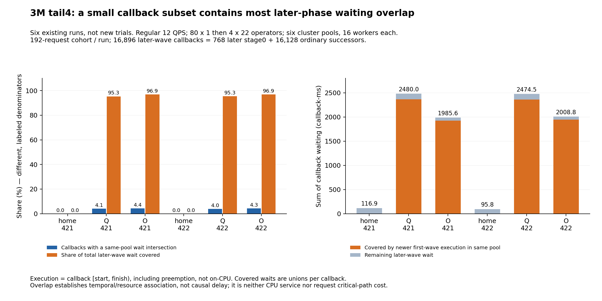
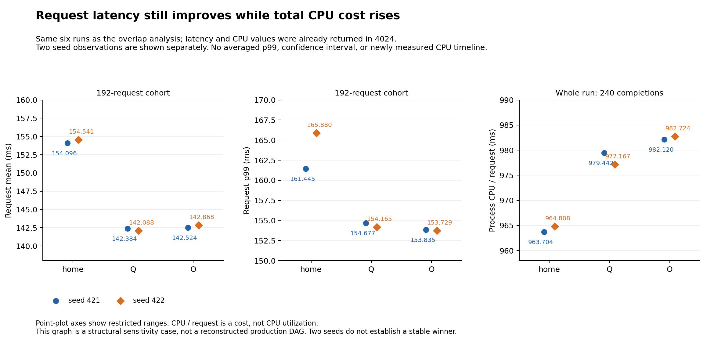

# 4026：新首波进入旧后期所在池，等待集中在哪里

**这次六份报告已完成所需的阶段/实际池联合核对，无需重复采集。** 在同一组3M、80×1+4×22实验里，Q/O借出使新请求首波与旧请求后期在同一实际池相遇；约4%的后期callback出现等待交集，这些交集覆盖约95%–97%的后期总等待。同时，请求整体mean和p99仍优于home。下一步应把目标池借入余量和源池持续压力门控分开实现、验证，不能只增加一个3ms等待条件。

本轮是已完成六次运行的离线解析，不是六次新实验。下述CPU成本和请求时延来自4024同名运行；4026没有新增on-CPU曲线。主线始终是每个已核实硬件cluster一个子池，当前资源范围为六池；历史未绑核四池仅是旧trace的采集条件。

## 1. 请求具体怎样到达、执行和选池

| 项目 | 本次六轮固定合同 |
|---|---|
| 到达 | regular 12 QPS，相邻请求计划间隔83.33ms；240个请求，分析计划到达[2,18)秒的192个请求 |
| 首波 | 请求初始化后，同时释放80条分支，每条1个业务算子；80个全部完成后join |
| 后波 | join之后释放4条分支，每条22个串行依赖算子；分支之间可并行，最后join |
| 工作量 | 总计80+4×22=168个业务算子，另有init及2个join，共171个callback；每业务算子固定300万迭代、10万访问；关闭工作量随机扰动、长任务倍率及同步/异步等待 |
| 数据 | branch-rw，每分支64KiB，shared=0；后继消费前驱修改的数据；不能据此宣称实测了cache miss或NUMA页驻留 |
| 资源 | 六个按cluster配置的不相交CPU集，共96逻辑CPU，每池16 worker，名义容量C=16；NUMA0/2各三池 |
| 请求级选池 | RR确定固定home，六池轮转，同一home每500ms接到一个计划请求 |
| 算子级选池 | home基线不借出；Q为(Q+R)/C，O为(O+R)/C；preferred优先实际parent，严格超过high=1才搜索；逐项chunk=1，仅同NUMA、min-gain=0、max-hops=4 |
| 记录 | trace1，两个工作seed421/422；相同固定工作和到达，策略分别home/Q/O；无本轮perf采集 |

同一请求内的算子确实逐项选池。并非仅在入口给请求选池；首波80个算子可进入多个同NUMA池，后继默认跟随实际父池，还可按同一规则重新选池。当前策略只放置新ready的工作，不搬运已经入队的callback，不迁移正在运行的算子。

```text
新请求 B 计划到达
  → RR 确定 home
  → 初始化 → 一次释放80个首波算子
                   │ 每次提交：选池 → 预留/交接 → Folly入队 → callback开始/结束
                   ├→ home
                   ├→ 同NUMA池 X ← 旧请求 A 的4条后期依赖链在此继续推进
                   └→ 同NUMA池 Y
  → 首波80个全完成 → join → 4条串行22段链 → join → 请求完成

本次核对：B首波与A后期是否同池，以及A后期的等待是否与B首波执行区间相交。
示意图说明所检验的机制，不是某个请求对的实测时间轴。
```

4024中这组首波callback平均CPU约6.20–6.27ms，普通后继约5.25–5.42ms；不是每算子100ms，也不是历史trace推测的0.85ms。固定迭代数保证对照工作量，不固定实际服务时间。该图保留分支串行依赖和整波barrier，但不覆盖任意多父融合和复杂生产DAG；它仍是结构敏感性场景，不能改称经过生产校准的负载。

## 2. 新报告测的是什么

输入为已有summary.json、requests.csv、tasks.csv。报告保留各文件SHA256，本地没有这六轮原CSV，无法再次核实原文件hash；可复算的终端证据及源行号见[4026交付目录](../reports/4026/README.md)。日志SHA256为`9e3a8d4c3b7d0c3c29727cd3ba77a55aaaead5532d016bb2ad54cfdca1cbcdf9`。

| 位置/量 | 定义与分母 | 不能解释为 |
|---|---|---|
| 提交时相遇 | 在选池后的submitted时刻，目的池存在计划到达更早请求的后波pending或executing；每轮15360个首波算子、192个新请求 | 选池前Q/O压力，或迁移导致的等待 |
| pending | submitted≤t<start，是路由后等待 | 精确Folly任务队列深度或内核runq |
| executing | start≤t<finish，callback墙钟占用，包含抢占 | 实际on-CPU、runnable或CPU利用率 |
| 反向等待交集 | 每个后波callback的[submitted,start)，与计划到达更晚请求首波的executing区间求交集并取并集 | 新首波造成的因果延迟 |
| 后波分母 | 192×88=16896，包括4个后波stage0和84个普通后继/请求 | 4024仅普通后继的16128个分母 |
| 等待面积 | 每callback交集长度求和，单位callback-ms；不同callback可以同时等待 | 墙钟时长、CPU·ms，或request关键路径惩罚 |
| 相遇/未相遇组均值 | 分组后计算完整callback等待，不只算相交部分；零等待归未相遇组 | 可直接相减得到迁移成本；等待越长本就越容易相遇 |

新旧请求严格按planned arrival排序，不按ID猜先后；相关的其他请求允许在cohort之外。pool要求实际chosen池相同；NUMA允许不同cluster。首波区间按“新请求、资源”合并；池范围和NUMA范围的资源分母不同，不能直接把两者区间总量作大小比较。反向等待交集则逐callback求并集，可核对同池交集不超过同NUMA交集。

## 3. 相遇已确认，而且集中在少量后期callback

下面每格依次为seed421 / seed422；保留两轮，不平均p99。

| 指标 | home | Q | O |
|---|---:|---:|---:|
| 首波提交时曾遇旧后期的请求/192，同池 | 0 / 0 | 128 / 128 | 128 / 128 |
| 首波提交时同池相遇占比，分母15360 | 0% / 0% | 21.18% / 20.89% | 20.25% / 20.01% |
| 后期等待与更新首波同池相交的callback/16896 | 0 / 0 | 691 / 668 | 742 / 726 |
| 上行callback占比 | 0% / 0% | 4.09% / 3.95% | 4.39% / 4.30% |
| 同池交集覆盖后期总等待的比例 | 0% / 0% | 95.31% / 95.32% | 96.94% / 96.89% |
| 相遇组完整等待均值ms | 无此组 / 无此组 | 3.421 / 3.531 | 2.594 / 2.681 |
| 未相遇组完整等待均值ms | 0.00692 / 0.00567 | 0.00718 / 0.00714 | 0.00377 / 0.00386 |



**95%–97%是等待交集面积占比，不是请求占比、CPU占比或已证明的延迟归因比例。** 两轮Q后期等待总计4954.556 callback-ms，其中同池交集4722.331；O总计3994.474，其中3871.101。O相遇callback反而更多，但等待面积更小，说明只统计相遇或唤醒次数不够，还应统计等待量和分布。

home没有同池交集，但同NUMA相遇仍为128/192。Q/O的同池等待覆盖已非常接近同NUMA覆盖，每轮额外同NUMA交集仅约0.81–1.21 callback-ms。该样例支持把这类等待定位到实际池范围，不能只说“同NUMA里有其他任务”。

128/192=2/3与本实验的规则到达及RR顺序相容：NUMA按三个相邻home分组，相邻请求间隔83.33ms，home基线平均约154ms，同home重访500ms。邻近请求可以同NUMA重叠，而不在同池；借出扩大了实际池集合。该2/3不是生产相遇概率。最大同时executing达到16也受到16worker上限约束，不能单独作为CPU饱和证据。

## 4. 局部等待代价与请求总体收益同时存在

| 指标，seed421 / seed422 | home | Q | O |
|---|---:|---:|---:|
| 请求mean ms，192请求cohort | 154.096 / 154.541 | 142.384 / 142.088 | 142.524 / 142.868 |
| 请求p99 ms，同cohort | 161.445 / 165.880 | 154.677 / 154.165 | 153.835 / 153.729 |
| 进程CPU/完成请求 ms，整轮240请求 | 963.704 / 964.808 | 979.442 / 977.167 | 982.120 / 982.724 |
| 首波平均等待ms | 12.598 / 12.601 | 2.712 / 2.703 | 2.722 / 2.727 |
| 普通后继平均等待ms，分母16128 | 0.003 / 0.003 | 0.153 / 0.153 | 0.123 / 0.124 |
| 全callback改投率 | 0% / 0% | 29.26% / 29.32% | 31.12% / 31.17% |



Q相对home均值下降7.60%/8.06%，p99下降4.19%/7.06%；O均值下降7.51%/7.55%，p99下降4.71%/7.33%。因此不能由后期等待增加推出“不应借出”。O对Q的p99优势仅0.54%/0.28%，mean及CPU成本则略高；两seed和每轮192样本不足以确立稳定赢家。

4026后期均值含88个算子/请求，而4024普通后继只含84个。将4024各角色三位小数均值按数量加权，与4026精确总等待的差均在8.448 callback-ms的舍入容差内，两份报告一致。也不能把上述交集面积除192后，直接从请求收益中扣去：并行分支等待不等于请求关键路径。

本轮没有实时CPU窗口，保留已有4021/4023各自合同的曲线。不能用进程CPU/请求补画利用率，也不能拿另一负载的曲线冒充本组六轮。

## 5. 对分层阈值设计的影响

4025说明历史服务段短长并存、峰间还有服务，支持研究持续性；4026说明借出目标可能已有旧请求后期，即使当前只有少量callback，随后还会产生依赖后继。这两件事应分别处理：

```text
业务提交 ready callback / 明确大小的batch
  → 确定home、parent和迁移权限
  → 源池资格：即时基线，或中等持续确认/严重旁路/快释放（候选）
  → 目标资格：当前压力 + 已有预留 + 本次批量是否合适（候选）
  → 同NUMA合格目标中比较收益；无合格目标才考虑获准的跨NUMA
  → 选择并发布预留 → Folly提交
  → 后继继承parent或按独立回home规则处理
```

当前代码已有相对评分和收益检查，但没有目标投递后的绝对上限；一个“比源池轻”的目标仍可被首波填满。`choose()`尚未收到本次chunk大小，选择与预留也不是原子事务。只让源池多等1ms或3ms，不能保证它获准后不再影响目标上的旧后期。严重旁路也不应绕过目标准入。

优先验证可关闭的目标借入余量，再在相同目标规则下测试持续门控。建议候选以(O+R+本次数量)/C作保守任务计数保护，先固定逐项提交；O/R交接可能短暂重复，并发发布也可导致超出读时估算，所以这是近似借入规则，不能叫硬容量或旧请求进度保证。同步阻塞时O并不等于CPU需求；未ready后继也不在O中。不能据当前后期宽度4就在生产固定预留4个槽。

继续保留Q对照、O候选、parent以及跨NUMA开关。快释放只停止新的借出，不是回home，也不是把已入队任务搬回。详细候选接口、成本、失败语义与有限实验见[目标借入保护的实现及实验合同](DESTINATION_ADMISSION_EXPERIMENT.md)。

## 6. 当前步骤完成，下一步有边界地推进

1. **离线补证到此闭合。** 六JSON、九项分析器测试及跨4024算术核对已返回，不再要求重复打印相同目录或追加同目的trace。
2. **负载合同保持。** 80×2+4×2和80×1+4×22都保留。前者检验宽并行收益，后者现在已经覆盖一种旧后期/新首波同池关系；都不是生产DAG回放。复杂依赖、异步和持续饱和的结论仍有各自边界。
3. **先做目标保护单轴干预。** 尚未实现的候选用关闭/1.0/0.75三档投递后任务计数比探索，先固定O、chunk1、parent、同NUMA和当前工作。不能用现有busy-high或min-gain冒充目标余量参数，也不能当前直接执行不存在的CLI。
4. **再做源压力时间干预。** 相同目标规则及同一信号下比较D=0/1ms；危机旁路另测，0.5/3ms只在结果有信息时展开。记录实际走各路径的提交数，避免全部旁路或没有后续提交却声称验证了持续门控。
5. **整体与阶段一起验收。** 比较请求mean/p99、CPU/请求、首波等待、后期等待分布和交集面积、改投量、无合格目标次数及失败/lag。若只是借出完全消失、局部等待下降而请求整体变差，不能宣布目标保护胜出。

这些是下一版受控干预的设计，不是已取得的优化结果。当前C++策略、默认参数和工作图未改；本轮不需要测试机重编或重跑。真实环境无需向这里联网，也无需为了完成这一步提供代码或新trace。现场仍应按每cluster一池、通用观测、可回退单轴验证推进，不能从本实验直接指定生产阈值。
