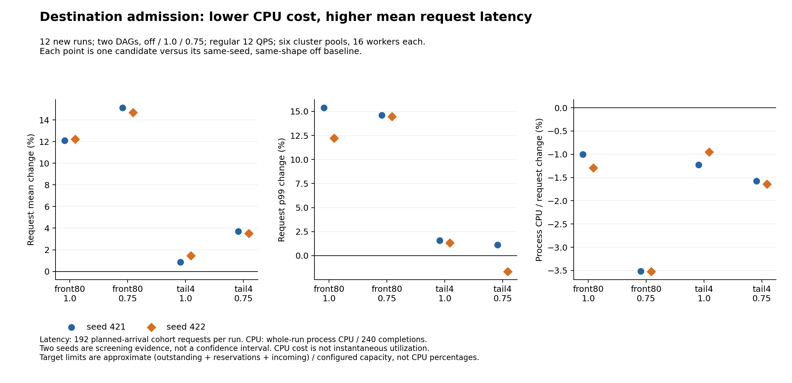
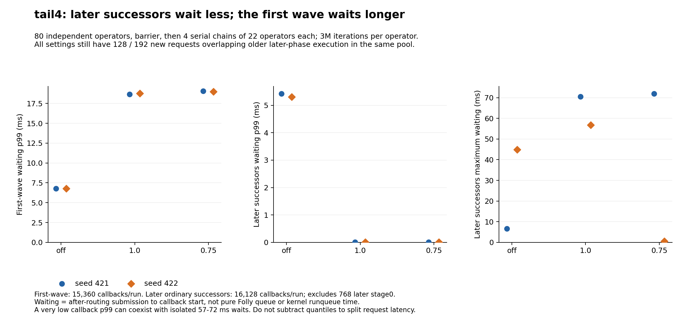

# 4027：目标保护降低后期等待，但尚未改善整体时延

**后续状态：本文提出的尾部补查已由[4028](TARGET_V2_4028_REVIEW.md)完成。当前筛选收束，默认保护继续关闭，无需再执行第5节命令。** 下文保留4027当时的结果及补查依据，不将4028离线详情计为新实验。

**12轮干预已完成，目标保护确实改变了算子放置，但两档上限都增加请求平均时延。默认继续关闭，不将1.0或0.75选为生产参数。** 深链图的普通后继等待p99从约5.3–5.4ms降至约0.008ms，首波等待p99却从约6.8ms升至约19ms。CPU/请求有所下降；这是需要明确业务目标才能选择的取舍，不是全面改善。

下一步只读检查现有12轮中极少数长等待和最慢请求，不重跑矩阵、不修改图、不立即叠加源池持续门控。保护组仍有约57–72ms的最大后继等待，足以要求在解释尾部前先核对原始callback上下文；关闭组也出现类似长等待，不能据摘要归因于新策略。

## 1. 本轮具体执行了什么

| 项目 | 合同 |
|---|---|
| 到达 | regular 12 QPS，相邻计划间隔83.33ms；每轮240请求；计划到达[2,18)秒的192请求作为时延cohort |
| front80 | 初始化后80条链同时ready，每链2个串行算子；全体join后4条链，每链2个串行算子 |
| tail4 | 初始化后80条链同时ready，每链1个算子；全体join后4条链，每链22个串行算子 |
| 业务工作 | 两图均168算子，另有init与2个join，共171callback；每算子300万迭代、10万次访问，branch-rw每次分支读+写；每分支64KiB，共84分支 |
| 工作扰动 | 无迭代随机扰动、长任务倍增、同步阻塞或异步恢复；相同迭代数不保证相同实测CPU时间 |
| 池和亲和 | 六个核实cluster各一池；CPU集0–15、16–31、32–47、192–207、208–223、224–239；NUMA0/2各三池；每池16worker，C=16 |
| L1请求 | RR固定home；同home每500ms再到一个计划请求 |
| L2算子 | 新ready callback每次选池；parent优先、all提交点、chunk=1、即时O、源high=1、gain=0、hop=4、仅同NUMA |
| 干预 | 新目标准入关闭/1.0/0.75，两个seed421/422，共12轮；其他选项固定，同一新构建重新跑off |
| 记录 | trace1，已有任务CPU和墙钟记录；未采perf或实时CPU序列 |

源码与分析器hash、同一二进制、实际资源、工作/checksum配对、全部完成及统计守恒均已在目标工具验收。回传显示6组功能测试通过、12轮各240请求完成、失败为0；cohort共2304请求。这里没有目标机原CSV，只能再次核对完整终端JSON和算术，不能独立证明那些原文件hash。[证据、逐轮CSV和图表](../reports/4027/README.md)保留原JSON和源行号，本地复算8组差值、完成701项检查。

## 2. 新保护在哪一步起作用

```text
request进入 → RR选home → ready算子逐项提交
    → preferred取实际parent，没有parent则home
    → 原即时O源压力判断
    → 枚举同NUMA候选目的池
        → 若开启准入：(O + R + 本次B) / C <= limit ?
        → 合格者再参与相对评分与收益检查
    → 选中目标：发布预留并交给Folly
    → 无合格目标：仍交给preferred
    → callback完成 → 后继ready → 再走上述路径
```

O是包装器已接纳/预留而尚未完成的callback，包含等待、执行、抢占和可能的阻塞；R为选池/批次投递期间的预留。本轮B=1。O/R交接可短暂重复，多个提交者也可能读取同一旧值；所以不是硬容量或CPU利用率。`target-limit 0`表示该新增规则关闭，仍执行即时O均衡，并不是home不借出的策略。

规则在总池内，对同一请求的算子逐次执行；业务无需感知多个Folly子池。没有搬走已入队callback，也没有对现有任务实施抢占或保证旧请求优先。默认关闭；ReturnHome模式虽有相应保护，本轮使用parent，未验证回home策略优劣。

开启组每轮41040次选择，与240×171一致；无合格目标分别出现：front80上限1.0为14420/14495，0.75为13557/13517；tail4为8331/8329与10241/10240。候选无效样本计数均为0，因此不是“规则从未触发”的无效对照。候选拒选数和决策数的分母不同，不相加。

## 3. 请求整体：更少CPU成本，更多完成时间

每格为seed421 / seed422；不平均各轮p99。时延取192请求cohort，CPU/请求为整轮进程CPU/240完成请求；改投率分母为cohort的32832callback，并非内核迁移率。

| 图 | 目标上限 | mean ms | p95 ms | p99 ms | CPU/请求 ms | callback改投率% |
|---|---|---:|---:|---:|---:|---:|
| front80 | 关闭 | 40.396 / 40.719 | 40.802 / 40.783 | 41.893 / 42.326 | 1049.033 / 1050.070 | 51.983 / 50.969 |
| front80 | 1.0 | 45.280 / 45.700 | 46.647 / 46.548 | 48.337 / 47.492 | 1038.523 / 1036.494 | 35.642 / 35.511 |
| front80 | 0.75 | 46.506 / 46.705 | 46.843 / 47.302 | 48.012 / 48.452 | 1012.121 / 1013.107 | 37.007 / 37.049 |
| tail4 | 关闭 | 142.972 / 142.627 | 153.318 / 152.524 | 154.844 / 154.813 | 981.631 / 980.875 | 31.241 / 31.174 |
| tail4 | 1.0 | 144.224 / 144.722 | 150.106 / 149.570 | 157.305 / 156.882 | 969.564 / 971.533 | 17.151 / 17.151 |
| tail4 | 0.75 | 148.244 / 147.635 | 152.078 / 150.463 | 156.571 / 152.272 | 966.182 / 964.799 | 12.473 / 12.476 |



front80中，1.0使mean增加12.09%/12.23%、p99增加15.38%/12.21%，CPU/请求减少1.00%/1.29%；0.75使mean增加15.13%/14.70%，CPU/请求减少约3.52%。其请求通常在下一个83.33ms到达前完成，缺少大规模跨请求后期竞争，因此它是限制首波并行代价的有效反例，不是生产低负载拟合证明。

tail4中，1.0使mean增加0.88%/1.47%、p95减少2.10%/1.94%、p99增加1.59%/1.34%，CPU/请求减少1.23%/0.95%。0.75使mean增加3.69%/3.51%，p99变化为+1.12%/−1.64%，方向不一致。两seed不足以验收稳定尾延迟，也不能将CPU下降完全归因于缓存改善：执行时间、路由、记录和新增判断统计的成本均在其中，没有cache miss计数。

## 4. 后期改善为什么没有变成整体改善

tail4普通后继均为第二波每链第2–22段，共192×4×21=16128callback；第二波stage0另有768个。front80的ordinary successors则混合第一波80个和第二波4个后继，不能将同名角色全部解释为后期。

| tail4指标，seed421 / seed422 | 关闭 | 1.0 | 0.75 |
|---|---:|---:|---:|
| 首波平均等待ms | 2.707 / 2.704 | 4.459 / 4.476 | 6.353 / 6.337 |
| 首波等待p99 ms | 6.781 / 6.764 | 18.668 / 18.752 | 19.045 / 18.990 |
| 普通后继平均等待ms | 0.126 / 0.130 | 0.0078 / 0.0072 | 0.0085 / 0.0036 |
| 普通后继等待p99 ms | 5.423 / 5.310 | 0.0081 / 0.0076 | 0.0083 / 0.0084 |
| 后波总等待callback-ms，含stage0 | 2035.47 / 2094.78 | 130.68 / 120.72 | 141.08 / 62.26 |
| 与旧后波同池同时executing的新请求数/192 | 128 / 128 | 128 / 128 | 128 / 128 |
| 新首波同池执行区间交集覆盖后波等待% | 96.99 / 95.00 | 2.19 / 5.10 | 10.22 / 4.31 |



同池相遇仍是128/192，而等待大幅改变，说明“是否相遇”不够描述竞争程度。此次有实际选池干预，支持目标保护会改变该场景的阶段等待取舍；但不能把交集下降全解释为避免了某一请求造成的延迟。执行区间仍是callback墙钟，含抢占，不是on-CPU。后波等待总量是多callback等待面积，不可直接除请求数从请求时延中扣除。

更严格的上限也不保证全图更少改投。front80从1.0收紧到0.75，首波改投从每轮6144降至约4608，但普通后继改投从约5500增至约7550，总改投率反而由35.5%–35.6%升到37.0%。这是parent续接、所有提交点重选和积压分布相互作用的实测结果；不能用单次选择的单调直觉替代全图观察。

## 5. 最大等待尚未解释，先查已有文件

tail4普通后继最大等待：1.0为70.45/56.81ms，0.75为71.92/0.50ms；关闭为6.59/44.81ms。对应请求最大时延，1.0为213.99/201.65ms，关闭为180.16/188.08ms。front80各策略也存在32–70ms左右的个别长等待。不能把它们删掉后宣称策略成功，也不能只因开启组发生就判为策略bug。

每轮192请求的p99只由极少尾部样本决定；16128个后继callback的p99更可以漏掉单个极端等待。两个分位数的分母和事件不是同一回事。到达lag最大值均低于0.076ms，入口迟发不足以直接解释几十ms的差异，但仍不能排除执行期间系统干扰。

下一步使用只读[尾部补查工具](../experiments/affinity/admission_tail_audit.py)：复核同一矩阵完整合同，输出每轮等待>1/5/20ms的数量及等待面积、最慢请求、最大等待及最大墙钟占用callback，并附可观测的同池墙钟执行交集。所有阈值仅用于离线汇总，不是调度阈值。保持全部原始样本，不截尾、不自动剔除。

```bash
(
set -eu
cd /home/bty/rank_demo/executor_demo
test "$(git branch --show-current)" = 'experiment/affinity-load-20261114'
git pull --ff-only origin experiment/affinity-load-20261114
python3 experiments/affinity/tests/admission_tail_audit_test.py
python3 experiments/affinity/admission_tail_audit.py \
  results/local/destination-admission-01 --top 3
)
```

不需要重编、启动负载、采perf或连接真实业务。成功输出13行JSON，复制回传即可；结果只从旧数据解析，不增加独立性能样本。同池执行墙钟交集不能告诉我们其他worker是否实际占满CPU，也不能区分Linux runq等待、任务队列、锁竞争和记录起点差异；若这一步留下必须区分的原因，再安排有明确对象的采集。

## 6. 对下一版策略的影响

1. **默认保持关闭。** 1.0保留为后期保护/整体代价候选，0.75不继续自动扩展。不能据当前样本指定生产阈值，也不需要改负载以追求正收益。
2. **目标保护不等于旧请求公平。** 它不识别request年龄、未ready后继或关键路径，对所有借入应用同一规则；全局硬性预留会限制本来可利用的并行。若未来引入进度或年龄感知，需要通用可获得信息、维护成本与明确验收目标，不把demo角色名写进生产调度器。
3. **源持续门控仍是独立问题。** 本轮没有实现或验证D=1/3ms、严重旁路或快释放。瞬间已提交的80个算子不会被迟到的门控搬走；加入持续门控前，必须证明存在相应提交机会并记录实际进入路径数。不能把1.0直接冻结成已选优目标基线。
4. **生产主线不变。** 每个核实cluster一个子池、总池封装、L1 request home和L2 ready算子放置、同NUMA优先；历史四池仍只是采集条件。这里只覆盖T16和两种同步CPU图，不替代超额线程、阻塞、异步或复杂生产DAG的专项结论。
5. **实时CPU仍需诚实留空。** 本轮CPU/请求不是利用率曲线。已有4021/4023曲线继续按自身合同使用；不将它们拼入本轮，不从均值补造时序。尾部补查若显示需要区分CPU服务和等待，再使用既有采集工具开展小范围配对。

此次工程只增加离线诊断与结果整理，不改变C++热路径、原有图、默认阈值或Folly。当前可以确认“目标保护有阶段效果、有整体代价”，不能确认“生产应开启保护”或“持续门控已经必要且有效”。
