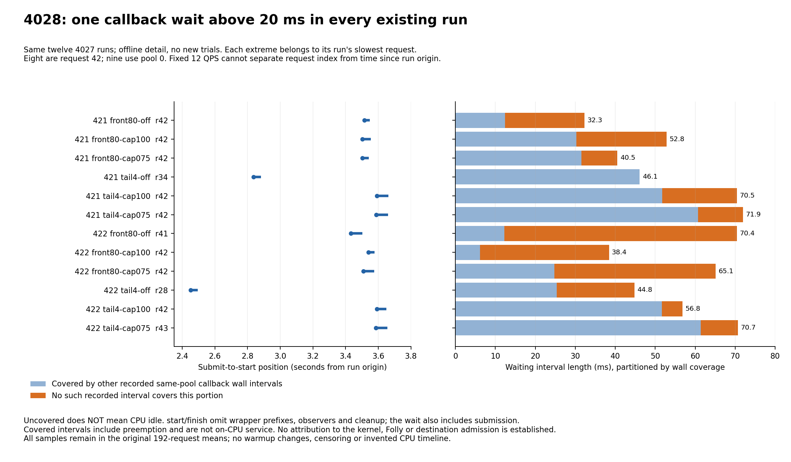

# 4028：长等待边界已核对，本轮目标保护筛选可以收束

**4028是4027同一批12轮的离线补查，不是12轮新实验。** 9项补查工具测试通过，13行JSON完整；执行构建、四个原始文件hash、工作/checksum、资源、配对标识和时延字段与4027逐轮一致。新增信息足以解释为什么局部callback p99很好却仍有最慢请求，尚不足以确定内核或Folly根因。

当前结论保持：两档目标保护确有后期等待收益，但请求整体mean均增加；默认继续关闭。**不要求再跑同一矩阵、再次打印相同CSV或重新采trace；不为了这次筛选追到每个长等待的根因。** 源持续门控仍是独立的未实现候选，不以此结果直接指定延迟或阈值。

## 1. 固定负载与新增观测

两图分别是80条深度2链、barrier后4条深度2链，以及80条深度1链、barrier后4条深度22链。均为168个业务算子、171个callback，每算子300万迭代与10万次访问、每分支64KiB、无工作抖动/长任务倍率/同步阻塞/异步恢复。regular12QPS、六个核实cluster各一池，每池16worker/C=16；NUMA0/2各三池。L1 RR；L2即时O、parent/all、chunk1、仅同NUMA。唯一干预为目标上限关闭/1/.75，seed421/422。

每轮240请求，分析计划到达[2,18)秒的192请求及其32832callback；CPU及准入统计仍使用整轮口径。补查预先使用等待>1/5/20ms阈值，输出每轮最慢3请求、最长等待/墙钟3callback及每角色最大等待。所有原始样本继续保留，没有更改warmup、截尾或重新计算“去掉异常后的主结果”。

本地再次完成2877项核对，包括与4027身份匹配、阈值和角色守恒、重复callback身份、墙钟区间算术、等待覆盖边界和8组均值分解。[证据及图表](../reports/4028/README.md)保留原JSON、源行号及可复算CSV。目标机原CSV仍未传到本地，文件hash只做回传间一致性核对，不冒充本地读取原文件。

## 2. 12轮各有一个极端等待，并且跨越不同策略路径

12轮**各有且仅有1个callback等待>20ms**，全部属于该轮最慢请求；8个是request42，9个实际投到pool0。以下“未覆盖”是等待区间中没有其他同池已记录callback的[start,finish)覆盖的总时间，不是CPU空闲时间，也不一定是一段连续间隙。

| seed／配置 | request／tag | 实际池 | 等待ms | 未覆盖ms | 原因 |
|---|---|---:|---:|---:|---|
| 421 front80 off | 42／134 | 0 | 32.307 | 19.878 | InsufficientGain |
| 421 tail4 off | 34／22 | 5 | 46.097 | 0.000 | LocalSpill |
| 421 front80 1.0 | 42／60 | 0 | 52.835 | 22.615 | NoEligibleTarget |
| 421 front80 0.75 | 42／1 | 0 | 40.514 | 9.015 | BelowBusyThreshold |
| 421 tail4 1.0 | 42／130 | 0 | 70.451 | 18.684 | BelowBusyThreshold |
| 421 tail4 0.75 | 42／129 | 0 | 71.919 | 11.193 | BelowBusyThreshold |
| 422 tail4 1.0 | 42／130 | 0 | 56.811 | 5.121 | BelowBusyThreshold |
| 422 tail4 0.75 | 43／33 | 0 | 70.708 | 9.369 | LocalSpill |
| 422 front80 1.0 | 42／168 | 0 | 38.419 | 32.247 | BelowBusyThreshold |
| 422 front80 off | 41／150 | 3 | 70.445 | 58.168 | InsufficientGain |
| 422 front80 0.75 | 42／88 | 0 | 65.117 | 40.358 | NoEligibleTarget |
| 422 tail4 off | 28／150 | 5 | 44.815 | 19.481 | BelowBusyThreshold |



这些callback开始执行后，只消耗5.307–5.470ms CPU、5.311–5.478ms墙钟。几十毫秒的主要异常位于submitted至start区间，不能称为这些算子自身执行了长计算。

原因分布是6个BelowBusyThreshold、2个InsufficientGain、2个LocalSpill、2个NoEligibleTarget，关闭组也有。**不能把异常直接归因于目标准入拒选。** 7个投递前Q=0，只说明一次读取时队列为空；后续仍可发生入队、被领取、抢占或同批任务竞争，不代表整个等待期间Q一直为0，也不能据此宣布Q无效。

极端等待位置集中在运行起点后约2.45–3.66秒，8个request42的计划到达是3.5秒。固定12QPS把序号与时间绑定，此批数据不能区分“第42个请求”还是“运行若干秒后”的关联。本次demo发生器与包装器核查未发现request42专用延迟、每轮一次长等待注入或3.5秒定时处理；trace在构造时预分配，observer按slot写入，文件在整轮排空后导出。该配置固定创建worker，不能把这些事件说成此时开始动态扩线程。关联是线索，不是已确定根因。

## 3. 等待边界：可以进一步缩小，但不能等同于runq

源码位置可直接复核：[RequestExecutor::enqueue](../experiments/affinity/include/executor_demo/RequestExecutor.h)、[BusinessExecutor::add](../experiments/dag/include/executor_demo/BusinessExecutor.h)、[发生器及依赖投递](../experiments/affinity/main.cpp)。

```text
选池、记录选择、发布R                    ← 当前callback等待计时之前
    submitted时间戳
      → 包装器context/activeWork处理
      → BusinessExecutor状态、O/P/work计数
      → Folly构造任务、实际入队及通知
      → worker取任务、上下文/观察器、包装器前缀
    start时间戳
      → 业务callback及后继投递
    finish时间戳
      → observer写行、TLS/计数清理、闭包析构、Folly收尾
```

提交者和worker的实际先后关系可以交叠，图不是单线程串行时序。当前wait包含多个阶段，未分别采集Folly enqueue完成、dequeue、内核wakeup/run切换；finish之后也存在未计入callback墙钟的工作。因此11/12等待中出现5.121–58.168ms未覆盖时间，**只能反对“这些时间一直由已记录的同池业务callback填满”的解释，不能证明CPU空闲、worker睡眠或某种内核问题。** 422/front80/1.0是具体例子：等待38.419ms，只有6.172ms被其他同池callback覆盖，覆盖区间最多4个callback同时存在。

现有记录还能给出一个不需要再取parent明细的保守下界。当前异步关闭，12个极端算子都由同request的父callback直接提交；子submitted在父[start,finish]内，父finish晚于子add调用返回。设该轮cohort所有callback的最大墙钟为M：

```text
父finish − 子submitted ≤ 父callback墙钟 ≤ M
子start − 父finish ≥ 子wait − M
```

所有父callback也属于同request/cohort，故M可直接取4028的global top-wall。12轮的`wait−M`均为正，约19.627–63.573ms。即至少这么长的延迟位于父finish之后，也位于子提交调用返回之后。**可以排除“整个长等待都耗在提交返回前”**，但提交返回后的任务仍可能排队、已被领取却未进入业务入口，或受worker未记录工作影响；这个下界不是纯队列等待，也不是纯runq时间。该推导仅适用本次直接父子投递合同，不能套到异步恢复或未知生产DAG。

## 4. 后期保护效果仍成立，单个最大值没有解释掉整体代价

tail4普通后继（每轮16128个）的等待>5ms数量：关闭为192/179个，1.0为1/1个，0.75为1/0个。目标保护确实减少常见的后继等待；保留下来的个别极端事件与较低的callback p99可以同时存在。此前首波等待增加和整体mean增加的对照结果继续成立。

为检验“是否只被一个最慢请求拖坏均值”，将完整192请求均值差作恒等分解：

```text
Δmean = (各轮最大请求时延之差)/192
      + (其余请求时延之和的差)/192
```

| 图／上限／seed | 完整Δmean ms | 最大值差/192 ms | 其余和差/192 ms |
|---|---:|---:|---:|
| front80／1.0／421 | 4.884882 | 0.071753 | 4.813128 |
| front80／1.0／422 | 4.981540 | −0.107150 | 5.088690 |
| front80／0.75／421 | 6.110192 | 0.005436 | 6.104756 |
| front80／0.75／422 | 5.986386 | −0.062743 | 6.049129 |
| tail4／1.0／421 | 1.251587 | 0.176183 | 1.075403 |
| tail4／1.0／422 | 2.095257 | 0.070721 | 2.024536 |
| tail4／0.75／421 | 5.271826 | 0.191271 | 5.080555 |
| tail4／0.75／422 | 5.008596 | 0.020862 | 4.987735 |

最大值项绝对值最多0.191271ms，其余项全部为正。因而不能仅用各轮单个最慢请求值的差解释1.25–6.11ms的均值代价。这是完整均值的算术分解，**没有删除样本**；最后一列不是剩余191请求的新平均，两轮最大值也不一定属于同一个request。它不是因果成本，不排除异常对其他请求传播影响；不能因此声称已经查清所有干扰。

## 5. 本轮到此收束，后续按问题触发

当前主线的决定已经具体：每cluster一池、总池封装、L1 request home/L2 ready算子放置、同NUMA优先继续保留；目标准入默认关闭，1.0留作“保护后期进度与整体代价”的候选，0.75不继续自动扩展。两图和工作量不调整，不把历史四个未绑核池作为目标架构。**本轮没有必须在测试机执行的新命令。**

| 后续确实需要回答的问题 | 有信息增益的下一步 | 不应从当前结果直接做的事 |
|---|---|---|
| 正式验收某策略的p99/SLO | 冻结负载、构建及统计合同，增加独立交错重复和尾部样本，保留最坏请求 | 平均两个p99，或把异常之后才选定的warmup当原结论 |
| 查清本次启动阶段长等待根因 | 在相同测试场景做有限同步诊断：明确投递/领取/业务入口边界，并记录worker调度状态；先核对目标实际Folly版本 | 单凭Q=0、墙钟空洞、request42就指定内核或库缺陷 |
| 验证源池持续压力门控 | 单独设计D=0对照、持续/严重旁路/快释放及路径覆盖；相同目标规则配对，记录实际受影响提交 | 把目标1.0当已选优、同时改目标/源/回迁或承诺能搬走已入队工作 |
| 将方法用于真实业务 | 复核当地cluster/SMT/容量、请求和算子标记、CPU/阻塞结构，再按单变量迭代 | 从两种同步图及历史未绑核trace指定生产阈值或预测收益 |

若仅为这轮策略筛选，上述根因诊断不是前置条件；继续增加同一CSV角色汇总也不会得到内核状态。当前可以同时承认机制取舍已验证、极端等待根因未归属。没有新增实时CPU序列，CPU/请求仍不能叫CPU利用率；没有把Folly任务队列与内核runq混在一起。

此次只整理证据和更新报告/指南，不修改C++、负载默认、策略参数或Folly，不新增性能样本。源持续门控尚未实现，生产最优阈值与SLO验收也仍未完成；本次完成的是目标保护有限筛选及必要尾部核对。
