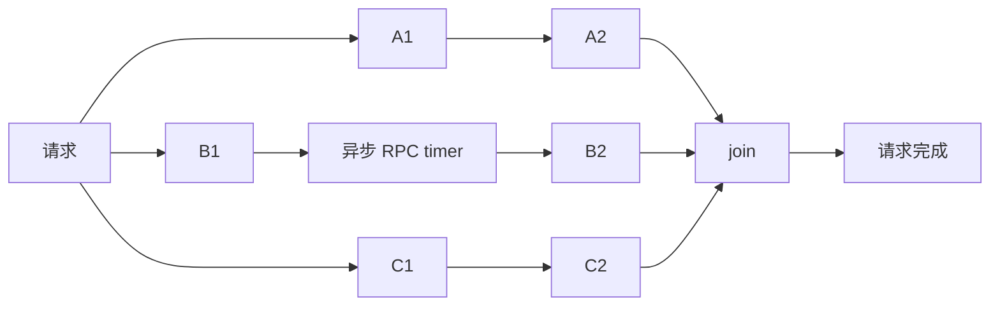

# 实验工程设计：从六个线程池到图级亲和路由

工程提供一个使用真实 Folly CPUThreadPoolExecutor 的合成 DAG 驱动，以及一个放在 Folly `experimental` 目录中的可选分组封装。主要目标是比较负载观测口径、请求亲和策略和 CPU 绑定范围对等待/时延的影响，并保留足够的原始数据供人工复核。本设计不能代表业务图执行引擎的完整替代品。

## 1. 实现边界与分层

```text
executor_demo
  开放到达请求发生器
    -> requestID round-robin home
    -> fanout 的独立链
       -> 每一步单独 submit
       -> 可选异步 RPC timer / continuation
    -> 所有链完成 -> 独立提交最终 join
  任务与请求记录、每秒统计、周期池快照、离线分析

folly/executors/experimental/AffinityExecutor.h
  显式 Hint + 负载快照 -> 选择目标组 -> 预留计数
    -> 原版 CPUThreadPoolExecutor::add
    -> 原版队列 / semaphore / RequestContext / worker
```

封装拥有多个独立 CPU 池；没有改写原有 `CPUThreadPoolExecutor` 默认行为、并发队列、Folly 的 futex 协议或 Linux 调度器。它也不从已运行的算子中途抢占，不搬运已入队闭包，不做后台 work stealing。所谓迁移是**在每次新就绪算子提交时改变目标池**。正在运行的线程不会被临时改绑到另一个 cluster。

生产首选把路由与 DAG 业务元数据放在业务调度层；本工程把复用的计数、亲和线程工厂和选池逻辑作为 opt-in Folly 封装，以便在两个位置都能接入。它刻意不是 `folly::Executor` 子类：提交可能被拒绝，并且需要显式 home/parent/fanout 提示，不能装作普通 `void add(Func)` 永远可接收任务。

## 2. 业务负载

每请求图由若干独立链构成，链尾汇聚到一个 join。fanout 范围、链长、每段 CPU 时间、随机抖动、少量长任务、RPC 概率/延迟均可配置。所有 CPU 阶段都单独入池，包括链上后继与最终 join；不会把整条链塞进同一个回调串行完成，因此能产生 executor 唤醒 executor 的场景。



CPU 工作是可重复的计算循环。默认 `--work-mode cpu` 按线程 CPU 时钟计预算，避免“sleep 100 ms”被错误当作 100 ms CPU 工作，也避免按墙钟截止的 busy loop 在争用时主动少做工作。计时循环本身有 CPU 成本，输出记录的是合成算子 CPU kernel 实际计量，微小预算场景下应单独测空载和计时扰动。固定 CPU 预算会在缓存访问变慢时执行更少迭代，因此它适合研究排队，不能用来证明局部性降低了服务 CPU 时间。`--work-mode iterations --iterations-per-us N` 固定迭代工作量，适合比较真实访问成本；N 默认 64，仅是合成比例，需在目标机独立校准，`work_target_us` 在该模式下是名义工作单位而非保证的 CPU 微秒。`--estimate-us N` 可固定路由估计；默认 0 使用合成算子的已知目标工作量，这比生产可获信息更理想，必须增加错误/固定估计对照。工作量随机值由 seed、requestID 和逻辑算子位置决定，不能依赖任务完成顺序重新抽随机数，否则不同策略会执行不同工作量。

RPC 模拟在独立定时器设施上延迟 continuation；executor 线程不为等待 RPC 而 sleep。它只模拟“CPU 段退出、外部事件到达、再次提交”，没有真实网络、下游排队、序列化和压缩，因此用于分离 CPU 排队与异步等待，不能外推 RPC 吞吐。

可配置每请求只读数据集，让不同算子访问同一请求的数据；要检验服务时间成本应配合 iterations 模式。当前初始化由请求发生器触及，没有按 home NUMA first-touch 或 `mbind`；只读数组也不能代表真实共享可变图状态、LLC 竞争或跨 socket coherence。跨 NUMA 代价参数仅影响**路由分数**，没有人为增加迁移 sleep 或伪造实际缓存代价。真实迁移成本必须在业务拓扑上实测。

发生器按等间隔计划时间开放到达，完成变慢不会自动降低目标 QPS。显式记录计划到达、实际发起和完成，支持观察发生器落后。达到请求 in-flight 上限时须计入 rejected/受限统计，不能静默推迟请求以制造低 p99。结束时停止新请求、排空已有 DAG 和 timer，不能只统计先完成请求就退出。

## 3. API 与不可变亲和提示

封装命名空间为 `folly::experimental`，核心是 `AffinityExecutor::Config / GroupConfig / Hint / Decision / Snapshot`。

| Hint | 含义 |
|---|---|
| `home` | 请求最初的亲和池，整个请求保持不变 |
| `parent` + `hasParent` | 直接前驱实际执行池；由回调拿到的 Decision.chosen 显式传递 |
| `isFanout` | 当前提交是否处在允许 fanout 决策的位置，由业务 DAG 判断 |
| `estimatedCpuUs` | 当前 CPU 阶段的预估 CPU 代价，正数 |

回调类型是 `Function<void(const Decision&)>`。目标池在回调执行前已经不可变地捕获到 Decision，回调提交后继时据此填 `parent`，不会读取另一个线程可能正在改写的“请求当前池”全局变量。

一个请求有多条分支时，各分支可能同时在不同池运行，故不能用一个可变 `currentPool` 表示整个请求。merge/join 没有唯一父池：demo 以触发 join 的链尾为 parent 的约定，是一个可复现但有偏的简化；生产可选择数据所有者、最大输入所在池、关键路径最后到达者，需单独实验。AIO continuation 必须保存真实 CPU 前驱的 pool；不能把 AIO 线程本身所属线程池当作数据亲和来源。home、parent 和 RequestContext 各有作用，三者不可混同。

## 4. 五种策略精确定义

`source = hasParent ? parent : home`，表示数据/执行来源；`preferred` 是本策略当前偏好的池；`chosen` 是最终池。

| CLI 策略 | preferred | 何时比较别的池 | 目标问题 |
|---|---|---|---|
| `home` | home | 从不 | 请求始终留在原池的基线 |
| `borrow` | home | 每次就绪提交 | 临时借用其他池，后继重新以 home 为偏好，允许回迁 |
| `sticky` | 有 parent 时为 parent，否则 home | 每次就绪提交 | 已迁移分支后继优先跟随实际前驱 |
| `fanout` | 有 parent 时为 parent，否则 home | 仅 `isFanout=true` | 仅扇出时分散，后续链条跟随前驱 |
| `least-load` | home 作为相等分数的初始偏好 | 每次就绪提交 | 忽略 NUMA 惩罚和收益阈值的激进参考 |

`borrow` 的“回迁”不是后台把运行中任务搬回 home，而是下一算子重新参与选择。当前实现没有独立的“home 忙/不忙水位”，忙由预测分数和最小收益阈值间接定义。默认阈值为零时，即使都很轻载也可能因细微分数差移动；生产不能把该默认值当成经过校准的回迁规则。

`fanout` 的标记由业务提供，库不能自动从 `add` 识别一次 request 的 400 个兄弟任务。demo 标记初始 fanout；一般 DAG 的每个局部 fork 若要再次平衡，需在相应位置标记。多级 fork、共享中间节点与任意多前驱依赖不是 demo 的完整图形覆盖范围。

迁移计数定义：`migrated = chosen != source`，包含借出和返回 home；`rerouted = chosen != preferred` 表示偏离本次策略偏好；`crossNuma` 比较 source 与 chosen 的已知 NUMA label。两者不能互换，否则 borrow 回迁会漏计。来源/目标 NUMA 未知时不能证明没有跨 NUMA 成本。

## 5. 选择分数、容量与抖动

三种 metric 都换算成 CPU 微秒/容量，以便与收益阈值比较：

- `work`：`(estimatedOutstandingCpuUs + incomingEstimatedCpuUs) / capacity`。
- `queue`：`Folly getTaskQueueSize() * incomingEstimatedCpuUs / capacity`。
- `pending`：`wrapper pending * incomingEstimatedCpuUs / capacity`。

`work` 的已开始任务保留全额估计直到回调结束，不估计剩余执行量。`queue` 观测 semaphore guess，能直接复现实测中“队列为零但 runnable 很多”的盲区；`pending` 排除已开始任务，但包含提交/唤醒/尚未进回调阶段。不同 metric 的分数不能当作经过校准的真实完成时间。

除 least-load 外，跨 source NUMA 的候选（包括 preferred 自身）增加 `crossNumaPenaltyUs`。候选的预测分数要优于 preferred，且同时通过 `minGainUs` 和 `relativeGain` 阈值才偏离 preferred；分数相同保持 preferred。这里实现的是单次决策收益阈值，**没有**驻留时间、冷却时间、每请求迁移预算或平滑采样迟滞。正式上线可加每分支迁移预算/冷却和同 NUMA 优先候选搜索，先测收益再增加复杂度。

`GroupConfig.capacity` 是可配置的有效容量，不应直接等同于线程数。demo 默认值为 `min(threads_per_pool, effective_mask中的逻辑CPU数)`，仅避免给线程很少的池高估并发上限，仍未校准 SMT、quota 或共享资源竞争；`--capacities` 可覆盖。对于互不重叠 cluster，可先按逻辑 CPU 计 CPU 时间容量，再用相同算子的单池测量修正；对于同 NUMA 三个池共享同一 mask，三个池不能各自宣称拥有整个 NUMA 的独占容量。demo 的估计用于受控比较，应检查 metadata 中的 mask 重叠和分配规则；有 SMT、频率变化、quota 和其他负载时更需校准。

只扫描 6 个池，复杂度 O(6)，通常无需模拟内核调度域。多个生产者同时读快照仍可能一起选中同一空闲池。实现先对目标 outstanding 做原子预留，再提交；后续选择可见新负载，但“读取全部候选再预留”不是跨池原子事务，不能完全消除 herd。可用随机化候选、power-of-two、分片预留等继续研究；不宣称本原型拥有最优全局分配。

## 6. 生命周期、容量与异常

每组底层线程数显式 `min=max`，避免动态线程创建/回收混入主要策略实验。线程工厂在线程进入 Folly worker 前设置 affinity，并通过启动握手传播绑定错误；绑定配置超出创建线程的 allowed mask 会拒绝。空 cpulist 沿用创建线程的允许范围。

计数状态转换为：

```text
validate / decision
  -> 原子预留 outstanding、work、pending
  -> 底层 add 成功
  -> 回调开始: inflight 加一、pending 减一
  -> 回调结束: inflight/work/outstanding 减少、completed 增加
```

多个字段的更新不是同一个事务；采样可能看到短暂不守恒，因此只在排空后断言精确守恒。统计多用 relaxed 原子；提交与 join 的生命周期握手还使用更强顺序，不能为了宣称“无原子开销”删除。提交分配/入队失败必须回滚所有已预留计数；回调异常由 guard 释放计数，failed 计数增加，随后按 Folly 路径处理。

`Config.maxOutstanding` 是每池 admission 上限，0 表示无限制。超限返回 false，绝不在有界队列空间上阻塞工作线程，因为“父任务塞满队列再阻塞提交子任务”可导致全池死锁。当前满池拒绝不会自动重试另一个池：这是明确的原型限制，生产如需 fallback 应在有界次数与相同 request deadline 下处理，避免无限重试和隐藏 overload。demo 的请求级 `max-inflight` 与这个任务级上限不是同一概念。

拒绝必须向 DAG 传播取消/失败并释放依赖等待与请求计数。不能丢掉一个子任务后仍永远等 join。析构前所有调用者必须停止使用对象；不能在自身回调中 `join()` 或析构。

`join()` 关闭外部提交，但允许已经在本 executor 回调中的父任务继续提交后继，所有组一起排空后才 join 线程。外部 AIO/timer 回调不被识别为内部父回调；**有异步 RPC 时必须先让完整请求图与 timer 排空，再调用 join**。这不是通用异步请求生命周期管理器。业务实际接入可在外层维护请求级 keepalive/关闭协议。

## 7. 输出与低扰动取舍

输出包括 `tasks.csv`（逻辑算子、阶段、worker_tid、时间、placement 与 admission 负载）、`requests.csv`（请求级工作量、完成/拒绝/时延）、`pools.csv`（周期队列/pending/inflight/work 等快照）、`seconds.csv`（按秒完成窗口的平均及 p99）、`workers.csv`（pool 到 TID）和 JSON 元数据/汇总。以当前程序产生的表头为字段契约，离线分析不假定单秒 p99 足够稳定。`seconds.csv` 在结束后按真实完成时刻分秒生成，不是实时刷新报表。

任务路径写预分配/请求自有记录，完成请求交给独立日志线程写文件，避免每个任务持全局 CSV 文件锁。日志和计量仍占用 CPU、内存及带宽，完整记录模式用于诊断。`--task-log 0` 仅关闭 task CSV 行写出，保留计时和内存记录；因此它只能衡量日志输出成本，不能代表无 instrumentation 的基线。正式低扰动模式还应实现抽样或仅直方图，再报告相对开销。已完成请求等日志线程写出后才释放 admission slot，日志吞吐也可能导致拒绝，应一并检查。每池快照还需要复制 TID 信息，不应用作每个提交的统计导出路径。任务 `cpu_us` 包围合成 CPU kernel，不包含后继提交、Folly 队列/唤醒、日志或 AIO 全部成本；其求和只是已记录算子的 CPU 秒，必须结合 per-TID `/proc` 或池 CPU 时间衡量 executor 总成本。关闭 task CSV 后，缺少任务级 CPU 样本不能被解读为 CPU 消耗为零。

本机 x86 小资源环境可以验证编译、功能、计数守恒、拒绝/异常、亲和绑定和现象；6 个逻辑池不能凭空构造 6 个真实 cluster。重叠 CPU mask、共享 quota 和单 NUMA 模拟数据必须在结果中显式注明。真实 ARM 机器的拓扑、SMT、内存放置和 PMU 事件必须重新采集。

## 8. 可检验的假设

| 假设 | 最小干预 | 支持证据 | 不能据此推出 |
|---|---|---|---|
| 请求集中扇出形成局部 CPU 拥塞 | 固定 CPU 工作集合，home 对比 borrow/fanout | 忙组 runqueue 或 pending 下降，完成尾延迟改善 | 任意生产图都应跨 NUMA |
| native queue 低估过量线程的压力 | 固定算力，逐步增加 threads | queue 接近零而 inflight/runqueue 增长 | 线程数越少必然越好 |
| CPU 代价比计数更能解释等待 | queue/pending/work 同负载比较 | 分层相关性、校准误差和尾延迟更好 | 估计误差对线上无影响 |
| 初次扇出平衡已经足够 | fanout 对比 sticky | 后继等待和 p99 接近、迁移更少 | 多级 fork/后续 RPC burst 也足够 |
| 后续重平衡有收益 | 加长链/长尾/RPC 后 sticky 对比 fanout | 后续拥塞下降，成本低于节约的等待 | 每次回调都应任意迁移 |
| home 回迁提高局部性 | borrow 对比 sticky，加入真实共享数据 | CPU/请求、cache/remote 指标与尾延迟改善 | 仅用参数化 penalty 就证明硬件收益 |

完整运行顺序、参数矩阵和本机结果由仓库的实验指南及 results 提供。每次改变一个主变量，保存 seed、commit、编译参数、kernel、allowed mask、quota、队列类型与 wake interval，并配对交错重复，才可以把这些假设逐步变成结论。
