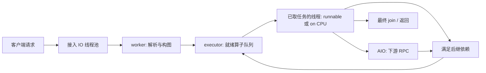

# 业务、CPU 与时延模型

> 历史版说明：本文对应首轮工程与结果。重新分阶段后的独立报告和当前实现以[阶段文档](../stages/01-business/README.md)为准；旧实验数据仍保留用于复核。

本文把“请求”“可运行算子”“线程”“CPU”分开建模。源码实现见 [Folly 唤醒与计量](folly-wakeup.md)，实验实现见 [设计](design.md)，上线前问题见 [人工复查清单](production-review.md)。本次对真实应用的分析是待实验验证的假设；文中的公式、合成负载和本机实验不能替代 ARM 业务机器的结论。

## 1. 请求经过的四层资源

依赖未满足的算子不在 executor 的就绪队列中；已发出 RPC、等待响应的逻辑任务也不必占用 executor 线程。因此请求数、就绪任务数、排队任务数、已开始任务数、存活线程数、可运行线程数和实际上 CPU 的线程数是不同量。

内核调度 Linux task/TID，不理解某 TID 正在执行的 requestID、图依赖、算子代价和数据归属。业务决定何时把哪个闭包交给哪个池；Folly 决定哪个消费者获得任务；内核决定可运行消费者何时在哪个允许的 CPU 上执行。内核可以迁移线程，但不能把池 A 中的闭包移动到池 B 的任务队列。亲和 mask 限制线程可选 CPU，也限制内核跨 cluster 借用空闲 CPU 的机会。调度域是在 CPU 集合间做线程负载均衡的机制，不是业务图调度器。[内核调度域说明](https://docs.kernel.org/scheduler/sched-domains.html)

## 2. 先校准“100 ms”和“50%”

令：

- 请求到达率 `λ = 12 requests/s`。
- `N` 为每请求**总 CPU 调用次数**，不是某一次的瞬间 fanout 宽度。
- `S_cpu` 为每次调用的线程 CPU 时间；`S_wall` 为开始至返回的墙钟时间。
- 请求 CPU 工作量 `W = Σ S_cpu`，单位 CPU 秒/请求。
- `C` 为相应允许 CPU 集合实际可提供的工作能力。用 CPU 时间记账时，需同时保留逻辑 CPU 数；用同一算法的吞吐归一化时，可得到有效计算能力，但二者不能混用。

若总调用次数真为 20–400，且每次平均**线程 CPU 时间**为 0.1 s，则每请求工作量范围为 2–40 CPU 秒；负载需求 `λE[W]` 的对应范围为 24–480 CPU 秒/秒。这里是两个端点场景，不是在未获分布时推算真实平均值。实际期望必须计算 `E[Σ S_i]`；仅在相应独立/同分布条件成立时才可替换为 `E[N] E[S]`。

按所述拓扑是 48 物理核心、若确有 2 路 SMT 则 96 逻辑 CPU。96 逻辑 CPU 的 CPU 时间账户上限约为 96 CPU 秒/秒；SMT 不会把 48 个物理核的任意工作负载吞吐保证翻倍。因此长期每秒 480 CPU 秒需求与该机器持续 12 QPS 不相容，必须重新确认调用数分布、100 ms 的计量口径、下游等待占比、统计窗口和完成吞吐。若只是 `steady_clock` 开始到结束测得 100 ms，其中仍可能包含被抢占、runqueue 等待、锁等待或同步 RPC，不能直接按 CPU 服务时间代入。

“整机 50%”还需确认分母、工具和窗口：按 96 逻辑 CPU 统计的 50% 与按 quota/容器配置统计的 50% 不同；整机还含 IO/worker/AIO 和其他进程。不同 SMT 竞争状态下，相同 CPU 时间占比也不保证相同有效吞吐。建议同时报告 executor 总线程 CPU 秒、整进程 CPU 秒、各 cluster 利用率、完成请求数、每请求 CPU 秒与 cgroup 的节流时间。cgroup 的 `cpu.max`、`cpu.stat` 与 `cpuset.cpus.effective` 可能让“看到的 CPU”不等于“可用算力”。[cgroup v2 CPU 和 cpuset 接口](https://docs.kernel.org/admin-guide/cgroup-v2.html)

线程 CPU 时间可在同一 TID 上用 `CLOCK_THREAD_CPUTIME_ID` 的差值测量；墙钟使用单调时钟。跨异步回调时不能直接用两个不同 TID 的线程 CPU 时钟作差，应在每段回调内分别累加。[Linux CPU 时钟定义](https://man7.org/linux/man-pages/man2/clock_gettime.2.html)

## 3. 平均空闲与局部拥塞可以同时发生

每请求的 home 池按 round-robin 分配，只保证**请求数量**近似均匀，不保证工作量、执行时间或任一短窗口均匀。两个请求可能分别有 20 与 400 个算子；两个相同大小请求的关键路径和 RPC 返回时刻也可能不同。一个 cluster 满载、另五个部分空闲，就能同时满足“局部被 CPU 限制”和“全机平均 50%”。

将几百个消费者固定在 8 物理核/可能 16 逻辑 CPU 的 cluster，不会提供几百路实际 CPU 并行。它会使任务迅速离开用户队列并进入很多线程的执行阶段，把等待转移到内核 runqueue。这解释了为何 native queue depth 近零仍可能很忙。线程多还可能增加上下文切换、缓存工作集竞争、栈与 TLS 内存；但不能只凭线程数断言是主因，必须测量。

对同一 cluster 上 `B` 个同时就绪、每个消耗 `s` CPU 秒的独立任务，全部完成至少需要处理 `B*s` 工作量。理想容量 `C` 下完成下界是 `B*s/C`，并且还不能低于最长单任务的执行约束。例如用理想 16 CPU 秒/秒记账，20 个 × 100 ms 需要至少 125 ms，400 个需要至少 2.5 s；真实 SMT、缓存和前台竞争会进一步改变结果。另一种便于验证的理想模型是假定恰有 c 个独占工作线程、每任务服务时间完全相同且无抢占，B 个同时就绪任务的第 j 个任务等待约为 `floor(j/c)*s`（j 从 0 起），整批完成时间为 `ceil(B/c)*s`。真实过量线程、SMT、依赖与并发请求会破坏这些前提，demo 用于测量偏离程度。上述例子用于检查量纲，不是预测业务时延。看到“扇出后满载约 30 ms”只说明一个局部窗口，不能由此还原整个 burst，也不能把 30 ms 全部归因为唤醒或亲和损失。

硬绑定 cluster 后 CPU 降约 4%、平均时延升约 1%；只绑 NUMA 后分别约 2%、0.5%，可同时由局部性改善和可借用 CPU 范围缩小解释，也可能是噪声、频率、流量构成或统计分母造成。需先注明“下降 4%”是相对比例还是 4 个百分点，使用相同请求集合、配对交错运行、多次重复与置信区间。当前证据不足以量化 cache 收益或确认因果关系。

## 4. 时延如何拆解

对于一个 CPU 回调，从提交到返回可分为：

`T_submit→finish = T_submit→start + T_start→finish`

`T_start→finish ≈ S_cpu + T_runnable_not_running + T_blocked + 其他记账差异`

`T_submit→start` 包含业务路由/提交成本、Folly 排队、唤醒等待、已唤醒尚未运行及取到任务后到包装器起点的小窗口。不能把该值直接命名为“纯用户态队列等待”。`wall - thread_cpu` 也不能直接命名为“runqueue 等待”：锁、睡眠、page fault 等可能占用其中一部分。

令 DAG 中算子 v 的就绪时刻是其所有前驱完成的最大值，CPU 调用的完成递推近似为：

`F(v) = max(F(u), u∈pred(v)) + Q(v) + S_wall(v)`

异步 RPC 等待需要作为单独事件/边的延迟加入。请求时延由图的最长完成路径决定，而不是所有算子时延的和。总 CPU 工作量相同的宽图、长链和长尾 join，时延对负载均衡的敏感度不同：宽图更可能受并行容量限制，长链更受关键路径单步延迟影响，join 会放大最慢分支的影响。800 ms 的少量长任务可能主导 p99，即使队列长度很短。

这里有两个应同时报告的目标：系统每秒完成多少请求/每请求用多少 CPU，以及单请求平均/p95/p99/最大时延。在吞吐已经受限时，只看完成请求平均值会漏掉还在排队的慢请求。

## 5. 负载不应只有一个计数

建议保留以下不同信号，不将其强行解释成同一概念：

| 信号 | 含义 | 主要盲区 |
|---|---|---|
| native `queue_depth` | 本版本底层 semaphore 的估计值 | 不一定是物理队列长度；经典 LifoSem 的已 handoff 任务会漏计 |
| 包装器 `pending` | 预留成功、尚未进入回调的任务 | 含提交过程小窗口；无法区分用户队列与唤醒后 runqueue |
| `inflight` | 回调已开始、尚未返回 | 包括被抢占和同步阻塞，不能当成 on-CPU 数 |
| `outstanding` | 预留成功、尚未完成 | 不区分长短算子；取消/提交失败须回滚 |
| 估计 CPU 工作量 | 未完成任务的 CPU 代价估计之和 | 依赖算子分类估计；本原型执行中不扣减已做工作 |
| 线程 CPU 增量 / 采样窗口 | 池实际获得的 CPU 时间 | 是历史量；不能单独描述未来就绪 burst |
| TID schedstat 的等待增量 | 内核 runnable 排队时间 | 需内核支持；聚合值不自动对应具体请求 |
| 请求关键路径/剩余 fanout | 业务还将产生的工作 | 通用线程池不知道，需要 DAG 提供 |

如果 executor 线程数远大于 CPU 数，`pending` 和 native queue depth 都可能很快归零，此时 `inflight`、工作量、CPU 时间和 runqueue 延迟尤为重要。若把线程数限制在实际并行能力附近，排队更集中在可观测的用户队列里，队列深度与等待通常更相关，但这仍不是任何负载分布下的保证。

## 6. 一个可解释的路由分数

设池 i 的有效容量为 `C_i`，其未完成任务的估计总 CPU 工作量为 `W_i`，新算子的估计工作量为 `s`。原型使用：

`work_score_i = (W_i + s) / C_i`

单位是微秒量级的工作清空时间估计，适合比较不同池。这不是严格的 FCFS 等待时间、完成时间或排队理论解：它保留已执行部分、忽略 active 剩余量差异、锁和 RPC，并受各池共享物理 CPU 的影响。长期可按算子类型维护 CPU 时间 EWMA，区分计算/内存/同步阻塞类别；也可估计 active 剩余工作，但预测误差必须作为实验的一部分。

作为基线，原型 `queue` 分数用 `native_queue_depth_i * s / C_i`，`pending` 分数用包装器 `pending_i * s / C_i`，二者有意忽略 inflight；新任务长度相同且同质服务时便于理解。这样可以直接比较原生 semaphore guess、真实尚未进入回调的计数和未完成工作量三个观测口径。生产若服务时间相差 8 倍以上，单纯计数会把一个 800 ms 任务和一个 10 ms 任务等同，预测力天然有限。

在稳定、明确观测边界下，可以检查 Little 定律 `L = λW`：例如 pending 的时间平均与调用到达率乘以 submit-to-start 平均值应接近。不能把某一瞬间队列长度直接当成未来等待；爆发窗口、不稳定积压、被拒请求和未排空末尾会使朴素代入不成立。经典 M/M/c 模型还要求泊松到达、指数服务等假设，本业务扇出、依赖和长尾明显违背这些条件，不能直接套 Erlang C 给精确生产预测。

## 7. 原子操作与低扰动

“允许读数有误差”并不允许对另一个线程正在修改的普通 C++ 整数无同步读取；这属于数据竞争，行为未定义。`volatile` 也不能修复。可以容忍**合法同步下的过时或不一致快照**，例如 `std::atomic<uint64_t>::load(memory_order_relaxed)`。Relaxed 省去不必要的跨对象顺序约束，但共享缓存行上的 RMW 仍有一致性流量，必须通过测量判断成本。

原型选择每池单独存放、按 64 字节对齐的原子计数（实际 cacheline 大小仍需在 ARM 机核验），用增减维护任务生命周期，路由只读快照；这比每次路由扫描几百个线程或读取 `/proc` 更容易控制成本，但不是“零开销”。分别读取 pending/inflight/outstanding 并非事务快照，过渡期可能不满足 `pending + inflight == outstanding`，不能用这些等式做并发正确性判断。单独 outstanding 预留计数用于容量边界。

更高吞吐版本可选每工作线程独占统计、批量发布到原子快照、每池/NUMA 分片、按 1/N 采样计时；普通 owner-only 计数在未同步时不能让别的线程直接读。若发布多个普通字段，需真正保证读写互斥/对象生命周期，例如不可变快照加安全回收；只在首尾读一个版本号不能使普通字段的数据竞争自动合法。路由近似统计不能替代任务队列发布、DAG 依赖计数和生命周期所需的 acquire/release 等同步。

## 8. 如何证明相关性以及何时接近因果

先在固定工作集合下画 admission 时负载与后续 submit-to-start 的散点/分桶分位数；随后看相同负载分桶中的请求端到端时延。按 fanout、CPU 工作量、长任务标记、池、RPC、运行编号分层，避免“图越大同时更忙也更慢”造成伪相关。相邻样本属于同一 request 或同一 burst，不能当独立样本无限提高显著性。

空池上的两个请求可能 admission 前队列同为 0，但自己的 fanout 分别是 20 和 400，最终时延仍截然不同。因此请求级预测必须包含自身即将产生的工作量/宽度；每子任务的 admission 样本可以观察本次 burst 逐步形成的压力，二者不是同一个采样点。

相关性可以由合成负载检验，策略收益必须通过干预比较：相同 seed 和 arrival schedule，交错比较 home/borrow/sticky/fanout/least-load、不同线程数和 affinity 范围，记录 offered/completed/rejected/unfinished、CPU/请求、队列等待、runqueue 等待和迁移。若减小线程数使 native queue depth 上升、p99 反而下降，这与“内核排队转移到用户队列、并发更可控”相容，不能误判为线程池更差。

12 QPS 每秒约 12 个样本，单秒 p99 基本接近最大值，适合作为波动指示，不适合检验 0.5% 或 1% 差异。正式比较需要累计数千到数万请求、多次独立运行、以请求或运行作重采样单元的置信区间；不要平均各秒 p99 来代替全体样本 p99。开放到达负载还应记录计划到达时间，避免发送线程自身变慢导致负载自动下降和 coordinated omission。
