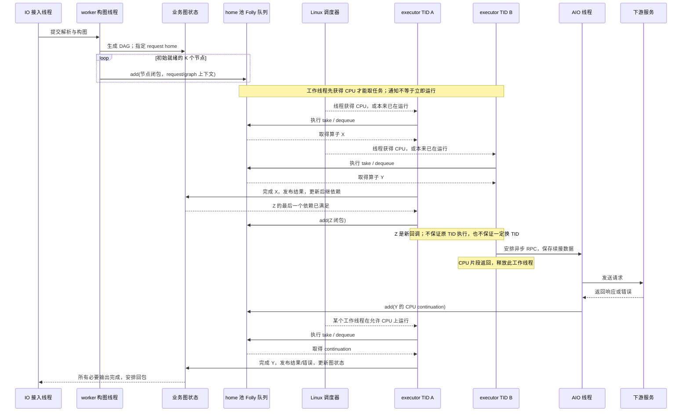
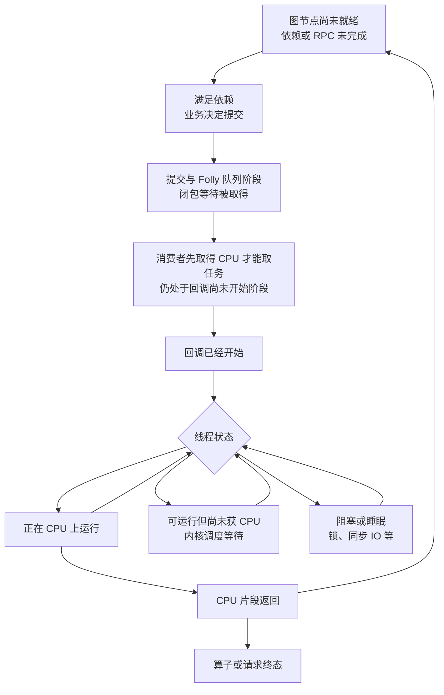
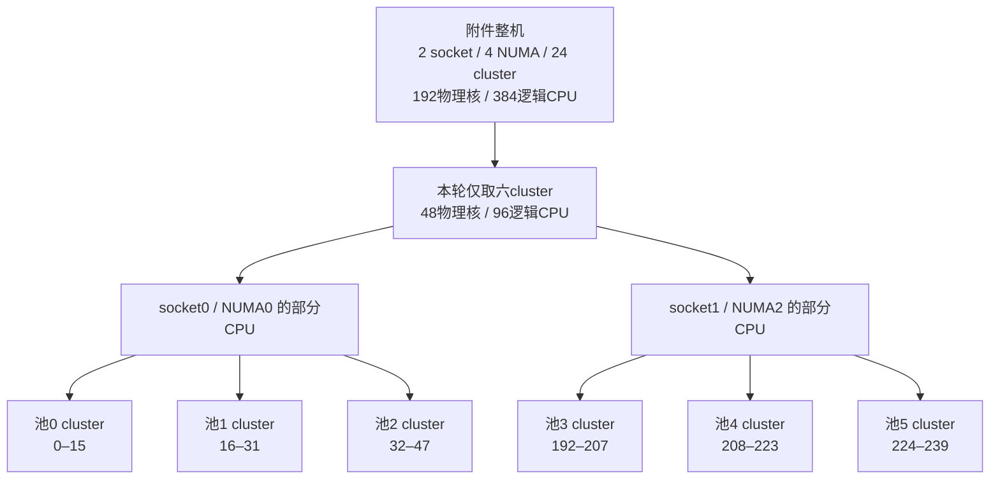

# 阶段 1 回顾：真实业务、资源边界与可验证命题

本文回顾用户最初描述的真实应用，以及后续拓扑、阶段 3 实验给业务模型补上的证据。结论是：**阶段 1 已足以支撑“先独立任务、后 DAG”的实验拆分；尚未完成真实生产系统的定量归因。** 已有报告正确区分了总 CPU 工作、瞬时扇出、线程数和硬件容量。本次补全异步请求时序、各类对象状态、实际整机与实验子集的区别，并把每项结论的证据边界写明。

本章没有生产代码调用栈，也没有完整生产请求追踪。下面的业务时序和伪代码是依据用户描述整理的模型，不表示已经审阅真实服务实现。实验代码只作为可重复验证这一模型的工程入口，不等同于生产实现。

相关资料：[原阶段 1 报告](../../../stages/01-business/README.md)、[业务落地复核表](../../production-review.md)、[历史负载模型](../../model.md)、[目标机资源约定](../../TARGET_TESTING.md)、[拓扑原始证据](evidence/topology.json)、[阶段 2 回顾](02-folly.md)、[阶段 3 回顾](03-experiments.md)。历史 `model.md`、`design.md` 包含首轮原型说明；当前实现和本轮实验条件以分阶段文档、实际命令和日志为准。

## 1. 完备性检查：已经理解什么，尚欠什么证据

“已知”包括用户提供的信息和目标机回传事实，两者在表中明确区分；“推断”是可检验的解释，不当作生产测量结果。

|问题|当前证据|分析是否足够|待确认项及影响|
|---|---|---|---|
|业务主路径|用户描述 IO 接入 → worker 解析/构图 → executor 计算，部分节点经 AIO RPC|足以划分资源和测量边界|真实构图、序列化、压缩、回包分别在哪个池；决定端到端时延中 executor 的占比|
|请求与池的关系|用户描述 6 池，request 轮询选 home，后续算子留在该池|足以定义 home 基线和集中扇出假设|实际业务是否存在特殊算子绕过 home、同步执行或其他 Executor|
|图规模|“初始扇出 20～400”与“共分发 20～400 次”均出现在描述中|已发现变量混淆，不能合并为一个参数|总节点数、初始宽度、最大就绪宽度、每节点提交段数的联合分布|
|100ms、700～800ms|用户称不含调度、等待的执行时间|足以设计量级对照，不能直接认定为线程 CPU 时间|具体计时点与时钟；墙钟计时仍可能含抢占、锁、缺页和同步阻塞|
|12 QPS|用户给出的整体应用压力|足以确定 DAG 初测请求率|是 offered、accepted 还是 completed QPS；是否稳定，是否有短时集中到达|
|每池几百线程|用户描述；阶段 3 另测每池 8/16/64/256|足以检查线程与 CPU 容量不匹配的机制|生产固定/动态线程数、最小值、最大值、空闲回收、队列类型及 Folly commit|
|硬件拓扑|原描述 48 物理/96 逻辑；附件实际整机 192 物理/384 逻辑|本轮实验资源边界已澄清|生产 executor 实际用哪些 CPU，是否等同本次六 cluster 子集，不能由附件自动认定|
|50% CPU|用户给出的平均值|只能说明某个统计口径下的长期平均|分母、窗口、进程范围、quota，以及逐 cluster 短窗口占用|
|cluster 绑定 CPU 降约4%、均值增约1%；NUMA 约2%、0.5%|用户强调波动大，定量不严谨|可提出局部性与峰值并行性竞争的假设|相对比例/百分点、同流量工作量、吞吐和未完成请求、重复间方差|
|约30ms cluster 满载|用户观察到调度轨迹中的局部窗口|支持存在瞬时局部压力|不能由此确定整个请求的 CPU 限制持续时间，也不能分离 Folly 唤醒与内核等待|
|原生 queue 能否作负载|阶段 2 源码审计；阶段 3 已有成本、条件分位数和配置对照|足以将 queue 作为首选低成本信号并标注边界|生产任务长尾、RPC回流和已有 inflight 是否导致额外预测误差|
|请求时延收益与跨池均衡|阶段 3 只测独立任务，未执行动态选池|足以把这项问题留到 DAG 阶段|需要 request、依赖路径、实际迁移、数据局部性和多请求重叠的干预对照|

所以这里的“阶段 1 完成”，是模型、变量、可检验假设和后续测量边界完整，并非所有生产未知项均已消除。重复做独立任务实验无法回答真实代码是否同步 RPC、内存 first-touch 在哪个 NUMA 等问题；这些应由生产配置和代码审阅补齐。

## 2. 场景视图：四种执行设施，三个调度层

```mermaid
flowchart LR
    client[客户端请求] --> io[接入 IO 池]
    io --> worker[worker CPU 池<br/>解析与构图]
    worker --> graph[业务图状态<br/>依赖计数与就绪节点]
    graph --> route[业务放置决策<br/>request home 池]
    route --> queue[Folly executor 池<br/>就绪闭包队列与通知]
    queue --> exec[executor 工作线程<br/>运行 CPU 片段]
    exec --> graph
    exec --> aio[AIO IO 池<br/>发送 RPC 与接收事件]
    aio --> remote[下游服务]
    remote --> aio
    aio --> continuation[续接状态变为就绪]
    continuation --> route
    graph --> done[图终态与结果汇总]
    done --> io
    io --> client
    kernel[Linux 调度器<br/>为可运行 TID 分配允许的 CPU] -.调度线程.-> io
    kernel -.调度线程.-> worker
    kernel -.调度线程.-> exec
    kernel -.调度线程.-> aio
```

图中不暗示每个请求一定执行一次 RPC；下游路径仅适用于相应算子。业务图管理“依赖何时满足、数据何时可用、任务放哪个池”；Folly 管理“闭包发布、工作线程取任务和等待通知”；Linux 管理“哪个可运行线程何时在哪个 CPU 运行”。这三层都影响时延，但它们的队列和调度对象不同。

|对象|标识或归属|何时存在/结束|不能与之混同|
|---|---|---|---|
|request|requestID，固定 home 池|接入至成功、失败或取消完成|一个 Folly 回调；同请求可同时有很多回调|
|逻辑算子|节点 ID、输入输出和依赖|输入就绪至逻辑结果完成|一次线程执行；异步算子可跨几个 CPU 片段|
|executor 回调/任务|提交序号、捕获的上下文与数据|提交至回调返回|一个 Linux TID；多个回调复用同一线程|
|Folly 队列项|某个池中的闭包包装对象|入队至被消费者取得|内核 runnable 线程；队列长度也不含所有未完成算子|
|executor 线程|TID、池、允许 CPU 集合|创建至退出|正在执行的任务或 on-CPU 状态；线程可阻塞、就绪或正在运行|
|内核 runqueue 项|可运行的 Linux 线程|可运行且尚未获 CPU 时参与调度|Folly 闭包；内核不理解图依赖或 request home|
|CPU|逻辑 CPU 编号与物理拓扑|硬件资源|线程；几百线程不产生几百份硬件容量|

还需区分两种“迁移”：内核把同一 TID 放到其 mask 内另一个 CPU；业务把一个新就绪闭包交到另一个池。前者不改变闭包所属池，后者也不要求把正在运行的线程改绑。当前生产描述的 home 模式没有后者。

## 3. 时序视图：初始扇出、后继提交、异步 RPC



这是线程角色时序，不保证具体 A/B 的分工。生产中 Future/Promise 的 continuation 可能由库的 Executor 绑定完成；必须核对 `via`、回调绑定和错误路径，才能判断续接是否确实回到 home executor。上述模型采用用户描述的“所有后继留在 request 池”作为基线。

“executor 唤醒 executor”至少包含三种不同路径：

1. 父回调完成后提交后继，另一个正在等待的工作线程获通知；需要内核将它调度起来。
2. 池内已有工作线程运行，它结束当前回调后从共享队列取得后继；可能不发生新的睡眠唤醒。
3. 下游响应由 AIO 触发，再向 executor 提交 continuation；此时触发者是 AIO 线程，不是原 CPU 前驱。

因此“后继不内联执行”不等于“每条依赖边都会触发一次 futex 唤醒”，也不等于“每次都必须换一个 TID”。详细 Folly 调用关系由[阶段 2](02-folly.md)核对。

业务伪代码如下。它表达原 home 模式；错误传播和对象生命周期仅标明要求，没有冒充完整可编译图引擎：

```cpp
// request 的 home 不随分支执行而改变。
onGraphBuilt(request) {
  request.home = nextRequestSequence() % 6;
  for (Node* node : request.initialReadyNodes())
    submitCpuSegment(request, node);
}

submitCpuSegment(request, node) {
  auto context = keepRequestAndInputsAlive(request, node);
  executor[request.home].add([context] {
    // 同一回调、同一 TID 内测量 CPU 与单调墙钟。
    auto result = runReadyCpuSegment(context.node);
    if (result.needsAsyncRpc()) {
      aio.startRpc(result.rpcInput(), [context](RpcResult response) {
        // 不占 executor 线程等待响应；错误也必须完成/取消对应图分支。
        if (response.failed()) failGraphBranch(context, response.error());
        else submitContinuationToHome(context, response);
      });
      return;
    }
    publishResultWithRequiredSynchronization(context.node, result);
    for (Node* successor : context.node.successors()) {
      // 只允许最后一个前驱使 successor 从未就绪变为就绪并提交一次。
      if (satisfyOneDependencyAndBecomeReady(successor))
        submitCpuSegment(context.request, successor);
    }
    completeRequestIfTerminal(context.request);
  });
}
```

生产需要确认的是“发布结果”和“依赖变为零”之间的 happens-before、并发失败/取消、RPC 超时、对象保活和关闭顺序，而非只核对选池函数。监控允许近似，不代表依赖计数和数据发布可去掉同步。实验对应模型位于 [DAG 驱动](../../../experiments/dag/main.cpp) 的 `makeRequest`、`startWave`、`submitNode`、join 和请求完成路径；它是合成图，不覆盖生产所有依赖/取消组合。

## 4. 状态视图：等待到底发生在哪一层



图是阶段划分，不能理解为“消费者无需 CPU 就能取任务”。工作线程从睡眠到取任务之前也会经历 runnable 等待；回调开始后还会反复被抢占。若某次 `add` 由已经运行的消费者及时处理，睡眠唤醒阶段可以不存在。原阶段1图将“取闭包 → 内核获得CPU”画在同一条逻辑链上，容易被误读为真实先后顺序；本次时序图明确先获得CPU才能执行 `take/dequeue`，补强这一处表达。

用 `t_ready`、`t_submit`、`t_start`、`t_end`、`t_rpc_done` 记录主要边界：

```text
业务就绪等待       = t_submit − t_ready
提交至开始         = t_start − t_submit
回调墙钟           = t_end − t_start
提交至完成         = (t_start − t_submit) + (t_end − t_start)
同一 CPU 片段耗时  = thread_cpu_at_end − thread_cpu_at_start
异步 RPC 等待       = 响应事件时刻 − 发起时刻
```

`提交至开始`包含提交路径、Folly 等待、通知/唤醒、消费者等待 CPU 和入口包装；没有精确 enqueue/dequeue 探针时，不应称为“纯 Folly 队列停留”。`回调墙钟 − 线程CPU`含 runnable 等待，也可能含阻塞、缺页及边界误差，不能直接命名为内核 runq 时间。跨 TID 的 continuation 必须逐段测线程 CPU 后求和，不能对两个不同线程的 CPU 时钟直接作差。

这也解释了为何每池几百线程会改变指标含义：许多闭包可以已进入回调但尚未完成，native queue 和 pending 下降，并不保证实际 CPU 压力下降。反过来，线程少时更多等待留在 Folly 提交至开始阶段，queue 变长也不必然意味着请求时延恶化。该机制是否发生、规模多大，需要相同 CPU 集和相同工作量的线程数对照。

## 5. 需求模型：总 CPU 工作、初始宽度与关键路径分别计算

令请求到达率为 `λ`；每个请求实际提交的 CPU 执行片段集合为 `V`；`N=|V|`。逻辑节点有异步续接时，`N` 可以大于逻辑算子数。令初始同时就绪宽度为 `K0`，后续时刻就绪宽度为 `K(t)`，每片段 CPU 时间为 `S_cpu(v)`。

```text
单请求 CPU 工作       W = Σ(v∈V) S_cpu(v)                  [CPU 秒/请求]
长期 CPU 时间需求       D = λ × E[W]                        [CPU 秒/秒]
整批独立任务工作        Wburst = Σ(k=1..K) S_cpu(k)         [CPU 秒]
```

`N`决定总量，`K0/K(t)`决定集中度和可用并行性。相同 `N=100` 的100节点长链和100个并行节点，CPU总量可相同，所需峰值并发和完成时延却不同。要比较“宽度影响”，保持总工作量不变；要比较“工作量影响”，独立改变预算或节点总数，避免一个参数同时改变两者。

正确需求量是 `λ E[Σ S_cpu(v)]`。若 `S`是“每请求内平均时长”且它与 `N`相关，不能擅自改成 `λ E[N] E[S]`；若使用跨所有执行片段的加权平均，则须明确其权重与观察窗口。只知道“20～400、平均100ms”还没有足够信息重建 `E[W]`。

**对原始数字的量纲检查：** 假定100ms确为每片段线程CPU时间，两个端点场景为：

|假设场景|每请求 CPU 工作|12 QPS 对应需求|
|---|---:|---:|
|所有请求均20次 CPU 片段|2 CPU秒|24 CPU秒/秒|
|所有请求均400次 CPU 片段|40 CPU秒|480 CPU秒/秒|

这不是实际平均需求的估计区间。原描述/本轮实验子集有96个逻辑CPU，CPU时间记账上限约96 CPU秒/秒；附件整机384逻辑CPU的记账上限约384 CPU秒/秒。480仍超过两个范围。因此“长期完成12QPS、全部请求均400次、每次真耗100ms线程CPU”不能同时成立；不能据此说真实业务数据错误，因为400可能是低频上界，100ms也可能有不同计时口径。

CPU 时间记账与固定有用工作的吞吐也要分开：两条 SMT 逻辑线程同时运行，各自累计 CPU 时间，并不保证相较一个物理核心得到两倍有效计算吞吐。阶段 3 的 CPU 预算模式用来控制这个记账量，不能直接证明 cache、SMT 或 NUMA 对固定真实算法效率的影响。

若一个池能持续得到 `C` CPU秒/秒，处理总 CPU 预算 `Wburst` 的理想排空下界为 `Wburst/C`；还要满足最长依赖路径的时间下界。以 `C=16` 为理想记账容量，100个100ms任务共10 CPU秒，整批至少约625ms才完成。该估算忽略预算分布、尾波、SMT执行效率和其他开销，不能代替单任务平均/p99的测量，更不是“每个任务均等待625ms”。

## 6. 拓扑视图：实验子集与整机分开描述

[附件 `topology.json`](evidence/topology.json) 报告整机2 socket、4 NUMA、24 cluster、192物理核、384逻辑CPU；每cluster 8核、SMT2、16逻辑CPU。L3共享CPU集合与cluster相同，报告容量23296KiB。它比最初文字描述的整体规模大；后续用户确认独占实验的是 `0-47,192-239` 这个48物理/96逻辑CPU子集。



|部署方式|单池允许范围|池与容量的关系|可检验的机制|
|---|---|---|---|
|none|每池均可使用六cluster的96逻辑CPU|六池共享同一总资源，不能算作6×96独占CPU|当其他池空闲且线程数足够时，一个池可使用更广CPU范围|
|numa|池0～2各允许0–47；池3～5各允许192–239|同组3池共享48逻辑CPU；没有开放整个NUMA节点|同NUMA范围可吸收单池短时集中负载|
|cluster|各池分别允许图中的16逻辑CPU|mask互不重叠，但仍有SMT、频率、内存和其他线程竞争|保持较小cache域，同时限制单池瞬时可用CPU|

`none`不是放开384CPU；`numa`不是放开整节点0/2。发生器和计量线程也在96CPU子集中，不能把其全部资源当作executor独占。两组实验NUMA同时分属不同socket，所以跨NUMA效应不能被解释成纯同socket NUMA差异。CPU affinity本身不指定内存页在哪个NUMA，也不自动搬迁已有页面；worker先触及的图数据位置仍需独立确认。

原始生产描述未确认 executor 的有效CPU范围是否就是这个实验子集。因此，实验能检验该资源划分下的机制，不能将96CPU分母直接套到生产“50% CPU”指标。

## 7. 亲和与时延：应区分的收益、代价和统计方法

固定cluster可能减少共享数据跨cache域访问、线程迁移和工作集干扰，也可能限制一个request扇出的可用CPU范围。这两个效应可以同时存在。局部性收益需要相同有用工作、代表性数据访问及CPU/请求或硬件事件证据；峰值容量限制则可先用相同CPU预算、不同mask比较。

原生产观察“CPU下降、时延上升”存在多种解释：相同完成吞吐下CPU/请求下降；完成变慢导致窗口内做了更少工作；部分线程被限制后平均占用降低；局部性改善与等待增加共同发生；或仅是流量和噪声差异。仅凭百分比无法选择其中一种。

Round-robin均匀的是请求个数。即便每池最终请求数相同，请求工作量、初始宽度、长尾节点和RPC返回相位仍可能不同。平均每池4 CPU秒/秒与某时刻16逻辑CPU全忙并不矛盾：长期平均抹平了突发。低QPS也不意味着低任务率，一个请求可以同时创建数百个就绪执行片段。

**请求时延沿依赖路径计算。** 对普通CPU片段，可用下面的理想化事件递推解释测量边界：

```text
Ready(v)  = max(Finish(u), u 是 v 的前驱)
Start(v)  = Ready(v) + 业务提交延迟(v) + 提交至开始(v)
Finish(v) = Start(v) + 回调墙钟(v)
请求完成  = 所有必要终态输出完成的最大时刻
```

RPC应作为单独等待事件/边，错误或取消也应形成图终态。实际延迟关键路径会随排队改变，未必等于仅按CPU预算找出的最长路径。不能把所有并行节点的排队时间相加作为request的“调度时间”；也不能把所有线程累计runq等待相加，称为请求经过的墙钟。

**Little定律仅连接同一边界下的平均量。** 若一段稳定观察中到达、完成、人口口径一致且边界在途项处理正确，可检查 `平均在途数 L = 到达率 λ × 平均停留时间 E[T]`。比如request的在途数配request端到端停留；尚未开始回调的pending配相同生命周期下的提交至开始。不能把native semaphore估计当成严格人口守恒计数，也不能把瞬时queue代入该定律求某任务p99。

有限窗口还要处理开始前已在途、窗口结束后才完成、拒绝和取消；高压持续积压时，简单稳态公式不适用。M/M/c等解析公式另有到达和服务分布假设，本场景批量扇出、依赖和长尾不满足时，最多作为受控参考模型。

**条件分位数是实验统计关系。** 阶段3估计的是固定配置、固定工作分布下 `Qp(时延 | 提交前queue所在分桶)`。它既不是通用的 `p99=f(queue)`，也不自动证明改动queue会因果改变时延。改变线程数、mask、自身预算或burst位置后，应分别分层、配对，不能把配置混在一个总体相关系数中。

## 8. 阶段 3 给业务假设补上了什么，仍不能证明什么

详细原始日志转录与数值在[阶段 3 回顾](03-experiments.md)，这里仅映射业务命题。

|业务命题|阶段3已经提供的证据类型|当前解释边界|
|---|---|---|
|同总量下，单池集中扇出能造成局部等待|smooth/spread/local同工作量对照|证明合成独立任务中的集中效应；不等于真实DAG请求收益|
|大量线程不能消除cluster CPU边界|固定cluster，8/16/64/256线程扫描；256线程三亲和对照|可观察等待在开始前/回调内的分布变化；无schedstats时不能精确归因runq|
|queue值得低成本采集|队列读取成本、不同桶的等待/完成分位数|成本来自特定探针；低成本不代表单指标覆盖所有负载阶段|
|同样queue阈值不跨配置通用|256线程none/numa/cluster相同queue桶出现显著不同等待|阈值至少应联系容量、线程和工作分布；还没有生产稳态阈值|
|平均CPU低不排除峰值瓶颈|低平均名义CPU需求与local burst的局部延迟并存|需要真实业务逐池/逐cluster数据才能量化生产贡献|
|放宽亲和可能降低独立任务时延|高线程同工作量亲和干预|未包含真实共享数据、内存放置和算法，不能证明生产应取消亲和|
|跨池均衡是否优于保持home|阶段3未运行动态跨池选路|须由DAG策略干预回答，queue相关性不能替代策略实验|

阶段3 CPU预算循环通过线程CPU时钟维持工作预算，频繁查询本身有开销；它不等于100ms真实算法。三次重复适合发现当前的大效应，不能认证生产0.5%～1%的改善；大量同burst任务也不能被当作同样多独立实验重复。

## 9. 进入 DAG 的充分条件与保留问题

阶段1已具备进入独立任务和DAG验证的必要模型：明确request/算子/CPU片段，分离总工作和宽度，解释home池与CPU域的关系，定义提交前/回调内/异步等待边界，且给出可独立改变的实验因素。阶段3已经执行相应基础干预并保存工作量、mask和完成状态证据。因此无需等所有生产信息齐全才进入DAG；下一阶段必须明确哪些参数是缩放、哪些机制尚未覆盖。

仍应按下列最小清单复核生产，避免把合成结果变成未经支持的上线结论：

1. **工作量口径**：同一请求的总节点、CPU片段数、初始/后续宽度、各片段CPU和墙钟，以及请求最终状态；特别澄清100ms和700～800ms。
2. **执行器口径**：实际Folly commit、队列类型、固定/动态线程配置、优先级、唤醒参数和异常/取消处理。
3. **资源口径**：IO/worker/executor/AIO各自allowed CPU与cgroup、真实生产分母、quota和短窗口cluster利用率；本实验前后未观察到限流不替代生产检查。
4. **数据口径**：图和共享数据的分配/首次触页线程、读写模式、NUMA页分布；相同request不必然代表所有算子共享同一可驻留cache的数据。
5. **等待口径**：抽样调用栈与短窗口调度证据，区分就绪后等待CPU、同步阻塞、真正异步等待和图依赖等待；常态轻量采样与诊断追踪分开。

这些保留问题不要求当前回顾改写DAG工程。它们确定后续结论的适用范围：独立任务阶段能说明受控负载下的队列、并发和亲和机制；真实请求级收益、回迁选择以及业务侧或Folly库侧的最终分工，需要DAG及代表性数据访问验证继续补证。
