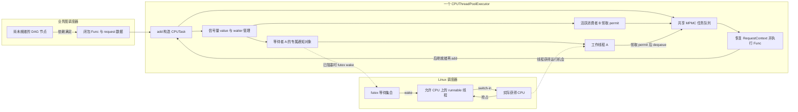
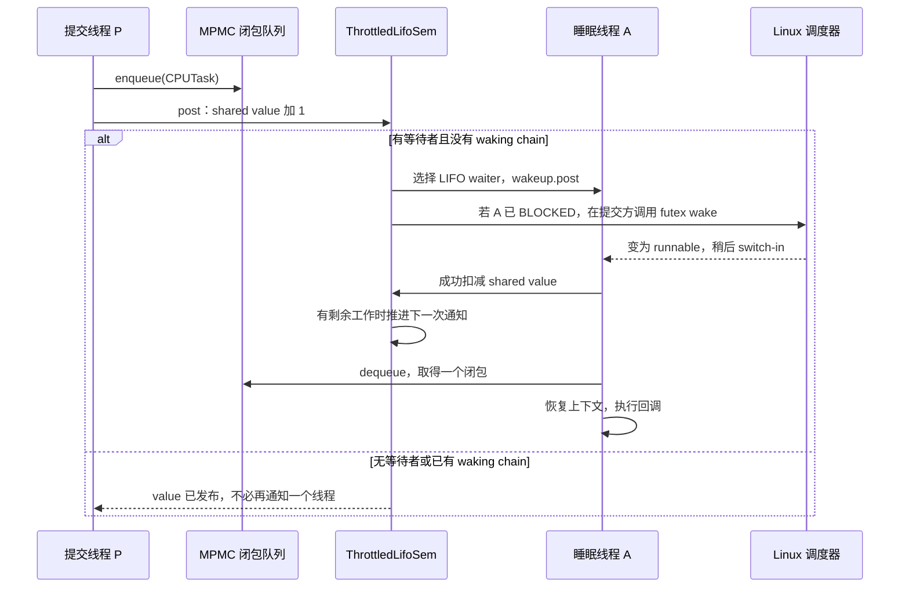
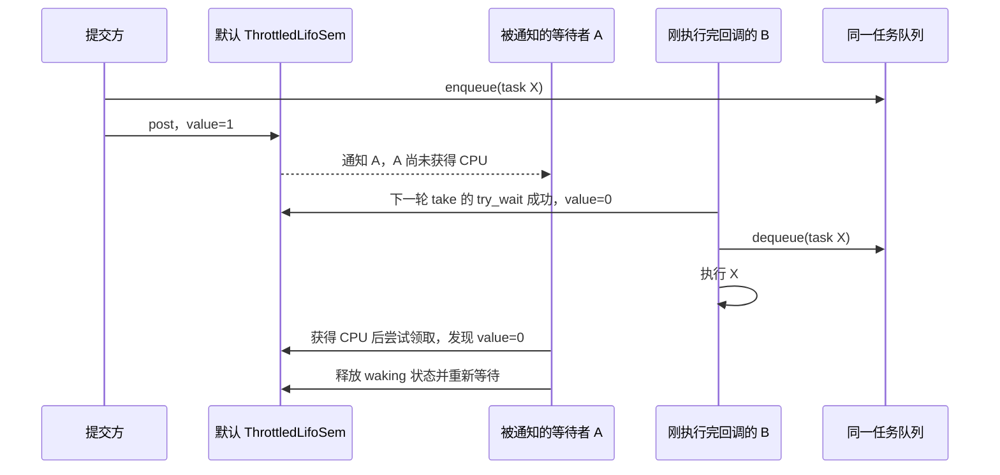
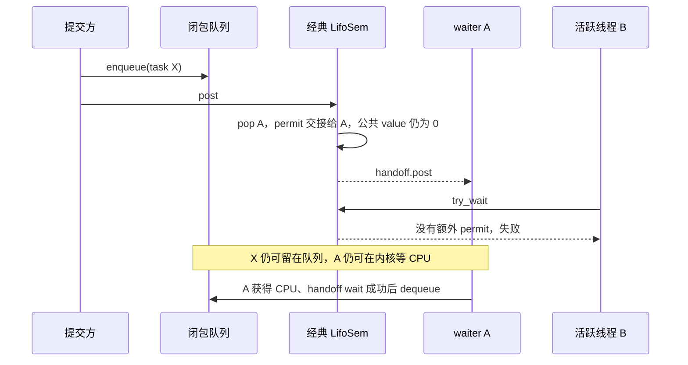

# 阶段 2 回顾：Folly 如何接任务、唤醒线程以及报告负载

本页按历史实验实际使用的 Folly 提交 `560e225e85229a3573061f66cab7e9207c98a9b0` 复核。旧[阶段 2 报告](../../../stages/02-folly/README.md)与[唤醒报告](../../folly-wakeup.md)引用上游基线 `c8c7adb72c6d73e2fced5ff5cebc96aa3ff65b2c`；本次对以下 executor、queue、semaphore 核心文件逐一比较，两提交无差异。本页不读取、修改后续实验性分组执行器的进行中实现。

**阶段 2 的核心机制分析已基本完备，足以指导阶段 3 的观测与解释。原生 queue size 是值得优先使用的低成本信号，但它计数的是队列协议中尚未领取的工作，不能单独代表线程池全部未完成工作、实际 CPU 占用或内核 runqueue。** 本次主要补齐图示、事件边界、底层票据发布等待，以及目标 ARM 上成本证据的适用范围。

## 1. 场景视图：任务、等待者和内核线程是不同对象



| 对象 | 里面放什么 | 谁管理 | 容易混淆之处 |
|---|---|---|---|
| 业务未就绪集合 | 依赖尚未满足的图节点 | 业务图调度器 | 尚未提交，不计入 Folly queue |
| Folly 物理任务队列 | `CPUTask`，包含 `Func`、上下文和任务元数据 | `BlockingQueue` 的实现 | 保存任务，不保存可运行 Linux 线程 |
| 信号量的 value | 可领取工作数量的协议状态 | `ThrottledLifoSem` / `LifoSem` | 不是另一份闭包队列；默认 `size()` 读这里 |
| 信号量 waiter 集合 | 等待节点及专属通知对象 | 信号量 | LIFO 描述等待线程选择顺序，不是任务执行顺序 |
| 内核 futex 等待集合 | 因某等待地址而睡眠的线程 | 内核 futex 子系统 | 与 runnable runqueue 不同 |
| 内核 runqueue | 可运行线程及调度状态 | Linux 调度器 | 不知道线程将领取哪个业务任务 |

工作线程从睡眠变为 runnable、获得 CPU、成功取得 permit、取出闭包、进入用户回调，是不同事件。进入回调之后还可以被抢占、再次等待 CPU。由此，**一个工作线程“被唤醒”既不保证已取到某个任务，也不保证正在执行。**

在原业务中，worker 线程、executor 中完成前驱的线程、AIO 收到 RPC 响应的线程，都可能成为 `add()` 的调用方；下面的机制不因提交方来自哪个池而改变。CPU 池本身不理解 DAG 依赖，也不会自动把一个 request 分散到其他 CPU 池。

## 2. 先锁定构造方式和默认配置

固定版本的默认值为：

| 项目 | 默认/实现 | 对历史实验的意义 |
|---|---|---|
| 默认普通任务队列 | `UnboundedBlockingQueue<CPUTask, ThrottledLifoSem>` | 不能用经典 LifoSem 的 handoff 语义解释所有 queue 读数 |
| 普通队列底层存储 | `UMPMCQueue<T, false, 6>` | 多生产者、多消费者、分段票据；与外层信号量分工 |
| `wakeUpInterval` | 0 ns | `Throttled` 名称不等于默认额外睡眠一段非零时间 |
| 默认动态线程开关 | `true` | 单整数构造参数是最大线程数，不能直接当作固定消费者数 |
| 单整数构造 | 初始传入 `(max=N,min=0)`；构造完成时 min 为 0 会改成 1 | 有动态增长/缩减路径；不能把它与 `(N,N)` 混为一谈 |
| 历史独立任务/成本实验 | 显式 `(N,N)` 固定最小、最大线程数 | 比较固定 N 个 worker，排除运行时扩缩池这一变量 |

源码：[默认开关、队列工厂及构造](https://github.com/bitianyuan123/folly/blob/560e225e85229a3573061f66cab7e9207c98a9b0/folly/executors/CPUThreadPoolExecutor.cpp#L33-L165)、[工厂默认间隔](https://github.com/bitianyuan123/folly/blob/560e225e85229a3573061f66cab7e9207c98a9b0/folly/executors/CPUThreadPoolExecutor.h#L82-L97)。

有界队列、自定义队列、显式 `makeLifoSemQueue()`、非默认 gflags 都可能改变具体路径。`BlockingQueue` 抽象只规定 `add/take/try_take_for/size` 接口；本页的 `size` 解释须与实际构造类型一起使用。

## 3. 提交与执行调用关系

下面是源码调用关系，不是对目标 ARM 运行录制出的调用栈。

```text
业务：依赖就绪 -> 选择目标池 -> 构造 Func
CPUThreadPoolExecutor::add(Func)
  add(Func, expiration=0, expireCallback={})
    RequestContext::saveContext()
    CPUTask -> ThreadPoolExecutor::Task
      保存 Func、context、priority、taskId
      enqueueTime = steady_clock::now()     // 此时还没有物理入队
    addImpl
      QueueObserver::onEnqueued            // 如配置
      registerTaskEnqueue
        TaskObserver::taskEnqueued          // 如配置
      判断是否可能需要增加线程，必要时持 KeepAlive
      taskQueue_->add(move(task))
        queue_.enqueue(move(task))           // 先发布任务
        sem_.post()                          // 后发布工作数量/通知
      若可能扩线程且 reusedThread=false，ensureActiveThreads()

CPUThreadPoolExecutor::threadRun
  initBaton.post / readyBaton.wait            // 线程启动握手
  while true:
    taskQueue_->take()                       // 固定池通常走这里
      sem_.wait()
      queue_.dequeue()
    或 taskQueue_->try_take_for(timeout)     // 可超时缩池/测试开关
    处理超时/poison 停止任务
    QueueObserver::onDequeued                // 如配置
    ThreadPoolExecutor::runTask
      idle=false
      startTime=now; waitTime=startTime-enqueueTime
      RequestContextScopeGuard 恢复 task.context
      TaskObserver::taskDequeued             // 名为 dequeued，但不是物理 dequeue 时刻
      过期则 expireCallback，否则 Func()
      runTime=now-startTime                  // 墙钟时间
      TaskObserver::taskProcessed
      恢复先前 RequestContext
      更新 processedTasks; idle=true
```

源码：[Task 构造与 runTask](https://github.com/bitianyuan123/folly/blob/560e225e85229a3573061f66cab7e9207c98a9b0/folly/executors/ThreadPoolExecutor.cpp#L84-L197)、[add](https://github.com/bitianyuan123/folly/blob/560e225e85229a3573061f66cab7e9207c98a9b0/folly/executors/CPUThreadPoolExecutor.cpp#L257-L295)、[addImpl](https://github.com/bitianyuan123/folly/blob/560e225e85229a3573061f66cab7e9207c98a9b0/folly/executors/CPUThreadPoolExecutor.h#L208-L237)、[worker 循环](https://github.com/bitianyuan123/folly/blob/560e225e85229a3573061f66cab7e9207c98a9b0/folly/executors/CPUThreadPoolExecutor.cpp#L341-L392)。

### 3.1 数据和上下文怎样到下一个线程

**无论是否通知特定 waiter，任务都先入队。** 移动到 `CPUTask` 中的闭包负责携带业务参数和对象句柄，队列协议负责发布闭包对象；`RequestContext` 保存、恢复 Folly 请求上下文。通知对象不携带 `Func`，permit 不与某一个闭包永久绑定。

```cpp
// 示意：生命周期与依赖更新由业务负责；省略失败、取消分支。
auto req = sharedRequest;
targetPool.add([req, nodeId] {
  runOperator(req, nodeId);
  for (auto next : releaseReadySuccessors(req, nodeId)) {
    choosePool(req, next).add(makeNodeClosure(req, next));
  }
});
```

这里没有把父线程栈迁移给子线程；也没有自动传播任意自定义 TLS。`shared_ptr` 保持对象存活，不替代可变共享数据的同步。Folly 上下文继承与业务 requestID 的跨池亲和规则亦是两件事。

`BlockingQueueAddResult::reusedThread` 仅辅助动态扩池判断。尤其 Throttled 的返回值表示 waiter 数是否足以覆盖当前 value，**并不承诺本次已发出一次 futex wake，也不返回“哪个 TID 将执行这个任务”。** [返回值接口](https://github.com/bitianyuan123/folly/blob/560e225e85229a3573061f66cab7e9207c98a9b0/folly/executors/task_queue/BlockingQueue.h#L39-L61)、[Throttled post 返回逻辑](https://github.com/bitianyuan123/folly/blob/560e225e85229a3573061f66cab7e9207c98a9b0/folly/synchronization/ThrottledLifoSem.h#L167-L195)。

### 3.2 优先级分支

`addWithPriority` 保存优先级并调用 `PriorityUnboundedBlockingQueue::addWithPriority`，将闭包入相应优先级子队列，然后对共享 semaphore `post`。消费者先获得 permit，再由 `PriorityUnboundedQueueSet::try_dequeue` 按子队列顺序取任务；优先级映射使 Folly 高优先级先被尝试。所有优先级共用的 `size()` 仍是 `sem_.valueGuess()`，不是按优先级或 request 的排队估计。

这是用户态任务选择优先级，不改变 worker 的 Linux 调度策略或优先级；历史阶段 3 没有依靠多优先级调度。[优先级队列](https://github.com/bitianyuan123/folly/blob/560e225e85229a3573061f66cab7e9207c98a9b0/folly/executors/task_queue/PriorityUnboundedBlockingQueue.h#L47-L96)、[底层按队列尝试](https://github.com/bitianyuan123/folly/blob/560e225e85229a3573061f66cab7e9207c98a9b0/folly/concurrency/PriorityUnboundedQueueSet.h#L90-L105)。

## 4. 默认 ThrottledLifoSem：通知一个等待者，不为它预留闭包

默认流程先增加共享 `value`。有 waiter、没有活动 waking chain 时，启动唤醒链；等待者按 LIFO 从等待列表中取出，通知它的 `SaturatingSemaphore`。被通知者获得 CPU 后仍要成功扣减共享 value；成功后若还有工作和等待者，继续通知下一位。

同一时间最多有一个 waiter 持有 waking 状态，**这不表示全池最多只有一个线程执行**。已取得 permit 的多个 worker 可以同时运行任务；唤醒链负责逐步激活更多消费者，活跃消费者同时可以走快路径。



图中 futex 请求发生在提交方执行的 `wakeup.post()` 内。默认 `wakeUpInterval=0`，不会故意增加非零间隔，但实际激活过程仍受运行机会、同步竞争和内核调度影响，不能理解为“提交 400 个任务时 400 个线程立即同时起跑”。[Throttled 的 post、waking chain 与消费](https://github.com/bitianyuan123/folly/blob/560e225e85229a3573061f66cab7e9207c98a9b0/folly/synchronization/ThrottledLifoSem.h#L167-L351)。

### 4.1 已活跃线程能否先拿走工作



这是合法竞争。A 收到通知不意味着它拥有 X；任务没有因此丢失或重复执行。若同时存在多个 permit，A/B 都可能合法 dequeue，各自得到的闭包由任务队列票据决定。

这里的 `try_wait` 是**尝试取得 permit**，不是无条件跳过信号量抢队列。默认 `BlockingQueue::take()` 只有在等待成功后才 `dequeue`。[外层 enqueue/post、wait/dequeue](https://github.com/bitianyuan123/folly/blob/560e225e85229a3573061f66cab7e9207c98a9b0/folly/executors/task_queue/UnboundedBlockingQueue.h#L32-L53)。

## 5. 可选经典 LifoSem：直接交接 permit，任务仍先入队

经典 `LifoSem::post()` 通过 `incrOrPop` 原子地选择：有 waiter 时 pop 一个节点并对其 `handoff` 通知；没有 waiter 时增加公共 value。前一种情况将 permit 直接交接给等待者，公共 value 不增加。



B 不能领取已经交接给 A 的唯一 permit；如果另有一次 post 给了 B 其他 permit，两者仍可并发取闭包，permit 不绑定具体 X。

**经典 LifoSem 的 `valueGuess()==0` 可以与“闭包已经入队、被通知的 A 仍未得到 CPU”同时成立。默认 Throttled 不应照搬此解释：只通知 A、A 尚未扣 value 且无人提前消费时，shared value 仍包含这份工作。** [经典 post](https://github.com/bitianyuan123/folly/blob/560e225e85229a3573061f66cab7e9207c98a9b0/folly/synchronization/LifoSem.h#L372-L409)、[等待及 valueGuess](https://github.com/bitianyuan123/folly/blob/560e225e85229a3573061f66cab7e9207c98a9b0/folly/synchronization/LifoSem.h#L507-L564)。

## 6. 主动取任务、spin 与物理队列内部等待

正常 worker 每次回调返回就再次 `take()`，有 permit 便继续，不需要先睡眠。无工作时先快路径尝试，然后可能有界 spin，最后阻塞；不是定时扫描所有池，也不是常态永久忙轮询。`try_take_for(threadTimeout)` 的 timeout 主要用于缩池，不是发现新任务必经的轮询周期。

默认 `WaitOptions::spin_max` 为 2 µs。Throttled 进入等待集合前可能 spin 共享 value；对专属 waiter 通知的慢路径明确使用 `spin_max(0)`，某些超时竞态恢复路径仍使用默认选项。不能将某文件旧注释中的 10 µs 当作所有路径的配置。[实际常量](https://github.com/bitianyuan123/folly/blob/560e225e85229a3573061f66cab7e9207c98a9b0/folly/synchronization/WaitOptions.h#L33-L55)、[Throttled 快路径](https://github.com/bitianyuan123/folly/blob/560e225e85229a3573061f66cab7e9207c98a9b0/folly/synchronization/ThrottledLifoSem.h#L113-L135)、[专属通知等待](https://github.com/bitianyuan123/folly/blob/560e225e85229a3573061f66cab7e9207c98a9b0/folly/synchronization/ThrottledLifoSem.h#L226-L261)。

本次补充一个容易遗漏的内部窗口：**外层 permit 已领取，不保证物理队列 `dequeue()` 马上返回。** `UMPMCQueue` 由生产者和消费者分别取得递增票据。生产者先领票据，再在该 Entry 构造对象并发布 Entry flag；消费者取得相应消费票据后等待该 Entry 的 flag。

```text
P1 取得生产票据 0，尚未发布 Entry 0 时被抢占
P2 取得票据 1，发布 Entry 1，完成 enqueue 并 post 外层 permit
C  取得这份 permit，却获得消费票据 0
C  等待 Entry 0 发布；P1 恢复后才能继续
```

这是根据固定源码构造的可行交错，**不是声称 ARM 历史结果已观测到此瓶颈**。默认普通队列内部 `MayBlock=false`，Entry flag 使用 `SaturatingSemaphore<false>`；未就绪时会先 spin，再以 yield 重试，而不是在该 Entry 上 futex 阻塞。外层没有任务时仍可正常阻塞。因此，“没有永久轮询空队列”与“内部发布竞态可能有 spin/yield”并不矛盾。[票据与 Entry 代码](https://github.com/bitianyuan123/folly/blob/560e225e85229a3573061f66cab7e9207c98a9b0/folly/concurrency/UnboundedQueue.h#L383-L430)、[票据领取及发布](https://github.com/bitianyuan123/folly/blob/560e225e85229a3573061f66cab7e9207c98a9b0/folly/concurrency/UnboundedQueue.h#L740-L776)、[MayBlock=false 等待分支](https://github.com/bitianyuan123/folly/blob/560e225e85229a3573061f66cab7e9207c98a9b0/folly/synchronization/SaturatingSemaphore.h#L273-L307)。

## 7. 用户态通知怎样进入内核，Baton 在哪里

默认 Throttled waiter 的通知对象为 `SaturatingSemaphore<>`；经典 LifoSem 默认 Handoff 类型也是 `SaturatingSemaphore`。CPU worker 的 `initBaton/readyBaton` 用于线程启动握手，不能画成每个任务必经的通知对象。`Baton` 自身同样有先通知无需 syscall、已等待才 futex wake 的分支，但不是本版本默认每任务 waiter 类型。[默认 Handoff](https://github.com/bitianyuan123/folly/blob/560e225e85229a3573061f66cab7e9207c98a9b0/folly/synchronization/LifoSem.h#L39-L42)、[Throttled waiter](https://github.com/bitianyuan123/folly/blob/560e225e85229a3573061f66cab7e9207c98a9b0/folly/synchronization/ThrottledLifoSem.h#L154-L157)、[启动 Baton](https://github.com/bitianyuan123/folly/blob/560e225e85229a3573061f66cab7e9207c98a9b0/folly/executors/CPUThreadPoolExecutor.cpp#L350-L355)、[Baton post](https://github.com/bitianyuan123/folly/blob/560e225e85229a3573061f66cab7e9207c98a9b0/folly/synchronization/Baton.h#L145-L183)。

```text
用户态 post：
  SaturatingSemaphore::post
    NOTREADY -> READY 成功：结束，通常没有 futex wake syscall
    已 BLOCKED -> READY：detail::futexWake
      futexWakeImpl -> nativeFutexWake
      syscall(FUTEX_WAKE_BITSET | FUTEX_PRIVATE_FLAG, 对应等待地址)

用户态 wait：
  ready 检查 -> 可选 spin -> 登记 BLOCKED
    MemoryIdler::futexWaitUntil
    返回后再次检查 ready/超时；处理竞态和虚假唤醒

Linux v6.12 普通 futex 的示例路径：
  futex_wake -> 匹配等待地址、bitset -> wake_up_q
    wake_up_process -> try_to_wake_up
      视路径选择 CPU / ttwu_queue / 可能远端 wakelist
      ttwu_do_activate -> activate_task / wakeup_preempt
      之后某次调度选中线程，才真正 switch-in
```

Folly 依据：[SaturatingSemaphore](https://github.com/bitianyuan123/folly/blob/560e225e85229a3573061f66cab7e9207c98a9b0/folly/synchronization/SaturatingSemaphore.h#L148-L333)、[Linux futex 调用](https://github.com/bitianyuan123/folly/blob/560e225e85229a3573061f66cab7e9207c98a9b0/folly/detail/Futex.cpp#L61-L78)。内核路径仅作为可复核示例，目标厂商内核要另核对：[v6.12 futex_wake](https://github.com/torvalds/linux/blob/v6.12/kernel/futex/waitwake.c#L149)、[wake_up_q](https://github.com/torvalds/linux/blob/v6.12/kernel/sched/core.c#L992)、[scheduler core](https://github.com/torvalds/linux/blob/v6.12/kernel/sched/core.c)、[fair 唤醒选 CPU](https://github.com/torvalds/linux/blob/v6.12/kernel/sched/fair.c#L8051)。

“精准”是 Folly 选择了具体等待对象；不是让操作系统立即运行指定闭包。通知先于阻塞时不必 syscall，故不能用“每任务一次 post = 一次 futex syscall = 一次上下文切换”估算开销。affinity 缩小线程可运行 CPU 范围；内核唤醒局部性启发式不认识业务 requestID，也不保证下一任务留在唤醒方 CPU。

## 8. 把负载信号放回同一条时间轴

```text
t0 业务预留 pending
t1 调用 add / 构造 CPUTask，Folly enqueueTime
t2 物理 enqueue 发布完成
t3 semaphore post 发布完成
t4 消费者成功领取 permit
t5 物理 dequeue 返回
t6 runTask：idle=false，Folly waitTime 截止
t7 用户包装回调开始：pending--，inflight++
t8 用户包装回调结束：inflight--，outstanding--
t9 runTask 完成：idle=true

提交前 queue 快照通常在 t1 之前；不是上述各时点的事务快照。
```

| 期间/状态 | 默认 Throttled native size 是否还代表这份工作 | 补充指标与解释 |
|---|---|---|
| 预留之后、物理入队之前 | 否 | wrapper pending 可包含；所以 pending 不是物理队列长度 |
| enqueue 已完成、post 尚未完成 | 否 | 有短协议窗口 |
| post 已完成，仅通知 waiter，permit 尚未被任何消费者领取 | 是 | 默认行为；经典 LifoSem 直接 handoff 时不在公共 value 中 |
| permit 已领取、dequeue 未返回 | 否 | 包括被抢占或内部票据发布等待 |
| dequeue 已返回、runTask / wrapper 尚未开始 | 否 | wrapper pending 可覆盖；原生 size 不覆盖 |
| 用户回调已经开始，正在运行/被抢占/同步阻塞 | 否 | inflight/outstanding 包含，三种状态需要额外区分 |

表格是单项工作状态说明，不意味着异步读取几个指标一定满足精确代数恒等式。提交、读取和消费可以并发；数值读完就可能过时。

停止时可能入队内部 poison 任务，过期任务则可能不执行正常用户回调。生产计数要覆盖这些状态；正常性能窗口应避开初始化与关闭，或者单独标记。不能仅在正常回调内减少 pending，而遗漏已过期、取消或提交失败的路径。

独立任务实验的 `submit-to-start` 包含入队、通知、首次调度等待及框架边界开销；不是纯粹的物理队列驻留。`start-to-end` 是回调墙钟，包含回调期间失去 CPU、同步阻塞等时间。Folly `TaskObserver` 的 `waitTime/runTime` 也分别是构造到 `runTask` 起点、`runTask` 中的墙钟差，边界与 demo 包装器并不完全相同。**不能将回调墙钟减去另一统计窗口的平均 CPU 时间来计算所谓 runqueue 等待。**

## 9. 各负载接口的真实实现、成本和盲区

| 获取方式 | 固定源码路径/成本结构 | 准确测到什么 | 缺少什么 |
|---|---|---|---|
| `getTaskQueueSize()` | CPU executor 直接调用 `taskQueue_->size()`；默认 `sem.valueGuess()`；O(1) | 当前队列协议的未领取 value 快照 | 不含已领取、执行中、未就绪节点；不含任务长度 |
| 默认 `ThrottledLifoSem::valueGuess()` | 一次 `state_.load()` 加 mask；未指定 memory order，使用 seq_cst | 低32位 shared value | 不是遍历物理队列；不是新增统计 RMW |
| 经典 `LifoSem::valueGuess()` | 一次 acquire load；head 为 waiter 链表则返回0 | 公共 value 的 guess | 已 handoff 的 permit 不含在内；源码不保证通用线性化契约 |
| `getPendingTaskCount()` | `threadListLock_` 共享锁，再调用 `getPendingTaskCountImpl`，CPU 实现仍读同一 queue size | 与 native queue 同一项信号 | 名称不意味着严格的全部未开始数；多了一把锁 |
| `numThreads()` | 读 `maxThreads_` | 配置上限 | 不是 busy/on-CPU |
| `numActiveThreads()` | 读 `activeThreads_` | 动态线程管理中的实际 active worker 数 | 不是执行中回调数，也不是 runnable 数 |
| `getPoolStatsLight()` | 共享锁 + O(T) 扫各线程 `idle` + queue size | 近似线程占用、pending | Light 仍扫描；idle 不是内核状态 |
| `getPoolStats()` | 上项外增加时钟、lastActive/processedTasks 等扫描 | 更完整的池统计 | 多字段不同步快照；T为几百时不能视为热路径免费查询 |
| `getUsedCpuTime()` | 共享锁 + 累加存活线程 CPU 时钟及已退出记账；O(T) | 历史实际 CPU 消耗 | 不是未来需求，不表示等待；不包含池外 IO/worker 的 CPU |
| wrapper pending | relaxed load；提交预留与回调开始更新 | 接纳至包装回调开始的任务数 | 不含已开始但等 CPU 的回调；失败/取消需补偿 |
| wrapper inflight | relaxed load；开始与结束更新 | 已开始且未返回的回调数 | on-CPU/runnable/blocked 混合 |
| outstanding/work estimate | O(1)快照（若维护累计量）；提交/完成更新 | 未完成数量或估计 CPU 预算 | 估计误差、已完成部分、同步等待可能影响含义 |

`activeThreadCount = activeThreads_ - idleAlive`，其中 `idleAlive` 是扫描得到的值。被唤醒但未进入 `runTask` 的线程仍可能 `idle=true`；回调里被抢占/阻塞的线程仍是 `idle=false`。因此忙线程比例不能直接回答“多少线程正在 CPU 上执行”。`PoolStats.threadCount` 是最大线程数，动态场景的 `idleThreadCount` 还会包含尚未实际创建的容量，读名字尤其容易误解。

`getUsedCpuTime()` 在 Linux 对每个线程调用 `pthread_getcpuclockid` 和 `clock_gettime`，无需业务自己遍历 `/proc`；退出时将 CPU 时间累计至 `pastCpuUsed_`。平台不支持时 API 契约允许返回0，须核验有效性。两次采样差分除以墙钟间隔得到该池消耗的“CPU秒/秒”；不要再把逻辑 CPU 个数无条件当作相同的物理计算容量。

源码：[queue 与 CPU pending](https://github.com/bitianyuan123/folly/blob/560e225e85229a3573061f66cab7e9207c98a9b0/folly/executors/CPUThreadPoolExecutor.cpp#L302-L304)、[pending 实现](https://github.com/bitianyuan123/folly/blob/560e225e85229a3573061f66cab7e9207c98a9b0/folly/executors/CPUThreadPoolExecutor.cpp#L402-L405)、[统计扫描、共享锁、线程 CPU 时钟](https://github.com/bitianyuan123/folly/blob/560e225e85229a3573061f66cab7e9207c98a9b0/folly/executors/ThreadPoolExecutor.cpp#L420-L499)、[CPU 累计和退出记账](https://github.com/bitianyuan123/folly/blob/560e225e85229a3573061f66cab7e9207c98a9b0/folly/executors/ThreadPoolExecutor.h#L376-L414)。

## 10. ARM 指标成本：保留原始值与测量口径

原始证据为 [0004.log](evidence/0004.log) 第337–375行，工程为 [metric_cost_bench](../../../experiments/metrics/main.cpp)。元数据 `completed=true`、`queue=default`、`threads=16`、`read_p99_is_batch_mean_not_individual_call=true`。以下直接抄录 `reads.csv` 的均值和批均值p99，不做基线相减、不将它转换成生产调用时延。

| metric | idle mean ns/call | busy mean ns/call | idle p99 batch-mean ns/call | busy p99 batch-mean ns/call |
|---|---:|---:|---:|---:|
| loop_baseline | 0.6 | 1.275 | 0.8 | 2.2 |
| native_queue | 1.94 | 3.22 | 2.2 | 3.8 |
| relaxed_one_load | 0.635 | 1.27 | 1 | 2 |
| relaxed_three_loads | 0.96 | 1.825 | 1.2 | 2.4 |
| pending_api | 24.495 | 27.5 | 24.6 | 28.2 |
| pool_stats_light | 30.345 | 53.595 | 30.6 | 56.6 |
| pool_stats | 63.615 | 127.175 | 65.4 | 130.4 |
| used_cpu_time | 3948.15 | 8243.05 | 3957 | 8358 |

每项40个样本，每个样本连续调用50次后取平均；CPU时间接口每批10次。因此 p99 是40个**批均值**的分位数，不能写成单次调用p99。这里 `pending_api` 是 Folly 的带锁 API，不是包装器 `pending.load(relaxed)`。

busy 模式先让16个消费者进入 CPU 循环，剩余任务积压；消费者直到测量结束才继续取任务。它提供忙主机背景，但不模拟持续高速 enqueue/dequeue 对同一 semaphore 缓存行的冲击。连续重复读取也容易处于缓存热状态。结果支持“native queue 在此条件下读取便宜”，**不证明跨 NUMA 高频路由读取、256线程扫描或完整插桩只花同样时间**。

更新实验同样保留原值；每个生产者10000次操作，两次重复：

| producer数 | shared fetch_add，重复0/1，ns/update | padded fetch_add，重复0/1 | 每64次发布到独占atomic槽，重复0/1 |
|---:|---:|---:|---:|
| 1 | 6.648 / 6.416 | 5.935 / 5.895 | 1.346 / 1.372 |
| 2 | 8.8245 / 8.966 | 3.396 / 3.1785 | 0.816 / 0.829 |
| 4 | 8.791 / 8.6415 | 1.653 / 1.6545 | 0.55325 / 0.512 |

这是总墙钟时间除以所有并发操作数，含启动屏障与join等待；并发增加时数值可下降，**不是某个线程一次更新的延迟**。所有最终计数正确。分片/批发布降低竞争与发布频率，但引入采样陈旧度，不能因此宣称“一个共享原子在任何场景都不可接受”。

## 11. 如何选择低扰动、较准确的负载信息

选择基线为 `getTaskQueueSize()`，以容量配置、任务分布和执行中工作作为解释条件。理由是它直接利用现有 semaphore，无需再给每个任务增加一份队列统计更新；历史成本与阶段3条件分位数也支持先使用它。

```cpp
// 示意：测量模式，无自适应负载均衡，读数随任务一起带到完成记录。
const auto q_before = pool.getTaskQueueSize();
const auto submit = steady_now();
pool.add([q_before, submit, record, work] {
  const auto start = steady_now();
  work();
  const auto end = steady_now();
  record(q_before, start - submit, end - submit); // 实际工程应避免热路径写文件
});
```

若增加 wrapper，示意生命周期如下；它用于说明指标，不能直接代替包含异常/取消语义的生产实现。

```text
submit:
  pending++ ; outstanding++ ; estimated_work += budget
  try add(callback)
  catch: 对三者补偿，并记录拒绝
callback入口:
  pending-- ; inflight++
callback所有退出路径:
  inflight-- ; outstanding-- ; estimated_work -= budget

若使用 Folly expiration / 独立取消路径：
  必须让未进入正常 callback 的任务也恰好补偿一次。
```

普通整数被一个线程修改时，另一个线程无同步读取，是 C++ 数据竞争；“允许误差”和 `volatile` 都不能使它合法。可以采用 relaxed atomic load；多个生产者共同加减则仍须合适的原子更新或其他同步。单独读原子与共享 `fetch_add` 的缓存一致性成本不同，不能一概称为“原子操作很贵”。

如果每任务共享更新确实成为瓶颈，可由每线程维护私有计数、低频发布到独占 atomic 槽，再汇总池快照。私有累计值不被别的线程直接读；发布槽使用原子或其他正确的发布协议。分片的代价是汇总开销和陈旧度，100ms后台快照可能错过30ms扇出峰值，不宜与提交点读数混用而不注明。

| 使用位置 | 首选 | 何时补充 |
|---|---|---|
| 每次提交的负载观测 | 原生 queue + 固定配置标识 | 无需为了“准确物理长度”立即修改 Folly |
| 每池低频健康观测 | 队列趋势、完成率、失败数、CPU差分、时延分布 | 必要时 Light stats；频率以实测成本决定 |
| queue=0 仍频繁高时延 | inflight/outstanding，与线程数/有效CPU容量联合解释 | 若是领取至回调开始的盲区，再评估 pending |
| 相同队列长度下随机长任务影响明显 | 任务类别/估计服务量 | 比较 work estimate 的增量预测力与额外写成本 |
| 区分 runnable 等待和阻塞 | 短窗口内核诊断，保留TID到池映射 | 不把 `/proc`/trace 放到每任务路由热路径 |

目前不能给跨 affinity 的统一 `queue >= X` 忙阈值。同样数量的任务对16、48、96个允许逻辑CPU的影响不同；SMT、同步阻塞、任务长短、已经执行中的并发还会改变关系。阶段3得到的是**给定配置和工作分布下的条件分位数**，而非只由 queue 决定时延的定律。

## 12. 完备性审计与未覆盖项

| 关键问题 | 旧报告覆盖情况 | 本次补足/结论 |
|---|---|---|
| 入队、通知、消费者调用关系 | 已覆盖主要路径 | 用场景图、调用关系及3个时序图展开；明确观察者时点不等于物理入/出队 |
| 精准通知是否绕过任务队列 | 已明确不绕过 | 补上上下文、对象生命周期与 `reusedThread` 返回值界限 |
| 默认 Throttled 与经典 Lifo | 已区分 | 必须保留；不能把经典 handoff 漏计泛化为默认路径 |
| 主动取任务/竞争 | 已覆盖外层 semaphore | 补 UMPMC 票据发布窗口与内部 spin/yield，避免“有permit就必定立即返回” |
| Baton 与常规任务等待 | 已纠正默认为 SaturatingSemaphore | 图示单列启动握手；不要依据旧版本经验画统一 Baton 链 |
| 用户态 busy、CPU与runqueue | 已区分 | 进一步按时间轴列盲区；不能仅凭active字段准确识别on-CPU |
| 负载读取成本 | 原先以结构分析和开发机证据为主 | 增补 ARM 原始读/写成本；保留批均值、缓存热、线程数限制 |
| “可以容忍误差所以不用atomic” | 已指出数据竞争 | 保留合法低扰动方案；区分读与写、共享与分片 |
| 源码版本与引用 | 已有固定上游版本 | 与实测提交核对核心文件无变化；新链接锁实际提交，内核示例明确版本 |
| 实际生产路径归因 | 未完成，且不能由源码独自完成 | 需要生产构造、队列、gflags、阻塞边界、目标内核及短trace核验 |

已有[开发机两次 perf 诊断](../../perf-diagnostic.md)直接观察到：在相同 CPU 范围增大消费者数，提交到开始的等待下降，而所有 worker 的 runnable 调度等待累加增多。这是开发机、带跟踪、小样本的机制证据，不能当作 ARM 的精确归因；其 `sched_stat_runtime` 事件量很大，不能声称跟踪扰动已被消除。

目标 ARM 历史日志显示 `schedstats=0`。`/proc/PID/task/TID/schedstat` 的字段依次用于CPU运行时间、runqueue等待时间和时间片数；使用时应做差并核验配置/启用状态，不能把不可用的等待零值当作无等待。需要时采集 `sched_wakeup` / `sched_switch`，还要覆盖已可运行线程被抢占后的再次排队；只有唤醒到首次运行不足以覆盖整个回调。字段依据：[Linux v6.12 schedstat 文档](https://www.kernel.org/doc/html/v6.12/scheduler/sched-stats.html#proc-pid-schedstat)。

**阶段 2 可以关闭“机制与观测接口选择”的分析目标，保留生产核验项；无需为了进入 DAG 而先改写 Folly 队列。** 尚未完成的是目标环境线程级调度归因、生产下游阻塞/取消路径核对、生产负载下指标额外开销，以及自适应路由阈值的验证。它们限制部署结论，不否定阶段3已建立的测量基础，也不阻塞独立进行的 DAG 研究。
