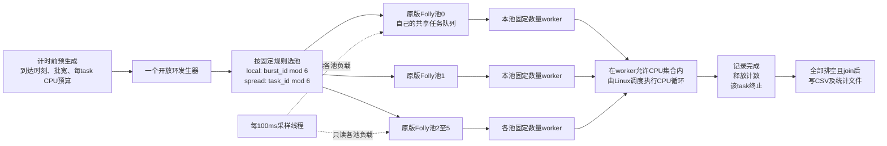
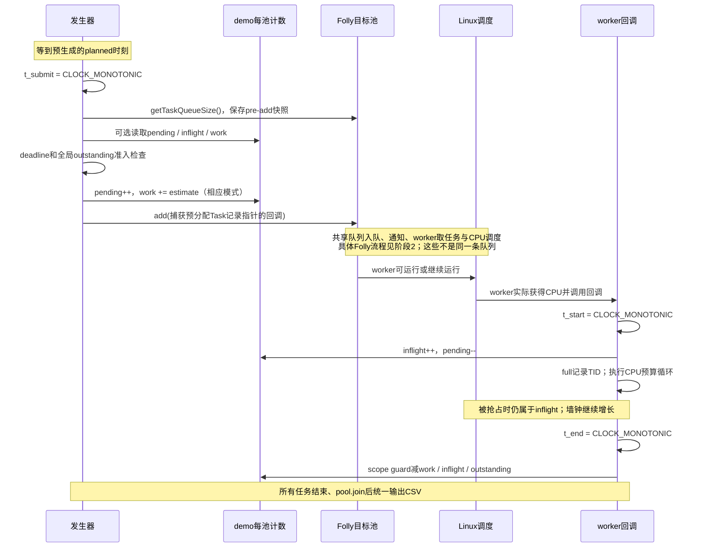
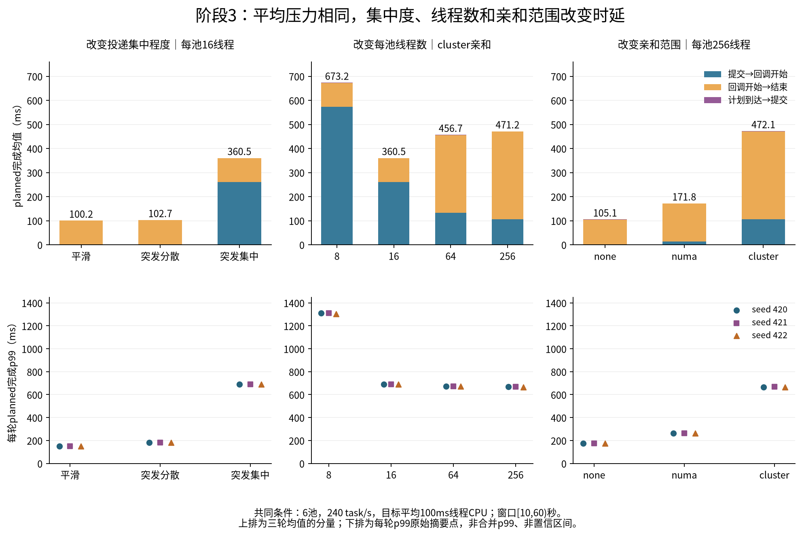
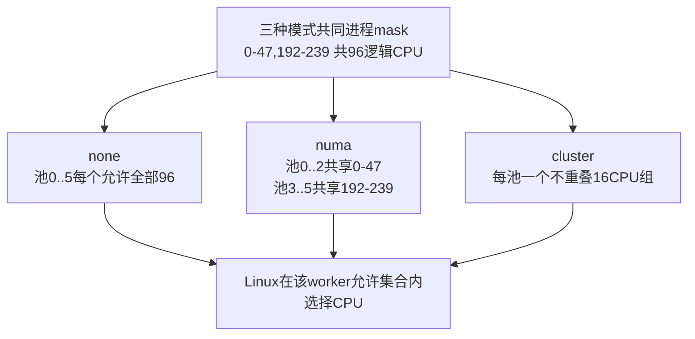
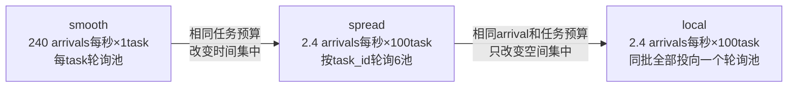
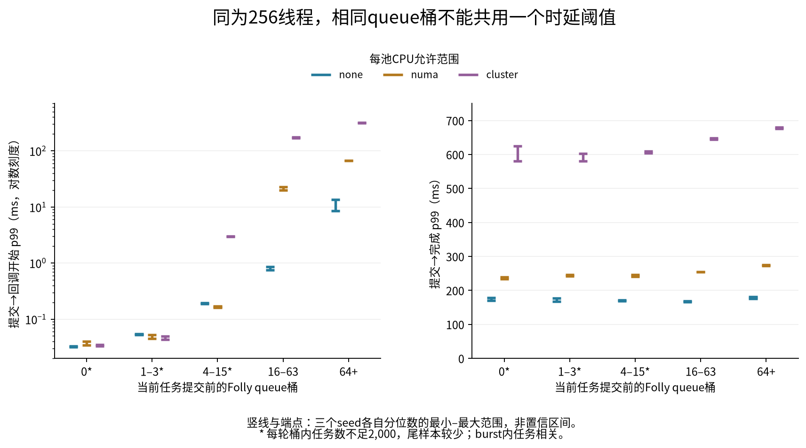

# 阶段3回顾：独立任务负载、调度与定量时延

截至用户提供的 `0005.log`，阶段3已形成完整的**初测证据链**：功能与资源一致性 → 平滑速率扫描 → 同需求的时间/空间集中对照 → 线程数量对照 → 高线程亲和对照 → 条件分位数与整轮留出预测。它足以进入DAG机制分析，尚不足以确定生产最佳线程数、通用队列阈值、可持续容量或0.5%级收益。

本文仅回顾阶段3。阶段4的DAG结果、后续路由策略不进入任何表格或结论，也没有为本次回顾修改或执行负载。

## 1. 证据范围和可复核交付

**ARM原始逐任务CSV未传回本会话。** 用户在目标机读取原始CSV并运行分析工具，提供终端日志；本报告核对的是这些终端输出、打印精度下的数字与对应代码。不能把终端摘要称为“已独立审阅所有ARM原始任务记录”。

|证据|内容|本回顾的使用方式|
|---|---|---|
|[0001.log](evidence/0001.log)|资源证据、构建测试、smoke、calibration|逐轮配置/状态/时延/趋势；两页calibration合计8轮|
|[0002.log](evidence/0002.log)|burst三角对照9轮、队列桶、配对结果|时间集中与单池集中的受控差异|
|[0003.log](evidence/0003.log)|burst预测与queue=0统计、线程对照12轮|比较指标预测增益、线程数取舍|
|[0004.log](evidence/0004.log)|高线程亲和9轮、指标读取/更新CSV|相同CPU并集下的亲和效应；读取成本|
|[0005.log阶段3摘录](evidence/0005.log)|前述三组的条件p50/p95/p99|仅已打印的跨seed范围；不补造逐seed分位数|
|[历史开发机结果](../../../stages/03-independent/RESULTS.md)|48轮主矩阵、16轮观测成本、留出预测|方法及工程验证，单列，不能并入ARM效果|

[逐轮可读附录](data/arm-runs.md)保留41轮主要数字；[arm_runs.csv](data/arm_runs.csv)保留配置、均值/p99、CPU、趋势、排空、flags等全部已打印RUN字段，**每行附日志名及起止行号**。其他原始终端提取如下：

- [139条逐轮队列桶](data/arm_queue_buckets.csv)：每个seed的桶内任务数、等待均值、完成均值/p99。
- [54条条件分位数范围](data/arm_conditional_ranges.csv)：按实验族、配置、queue桶分开的p50/p95/p99；范围不是置信区间，日志没有给范围端点所属seed。
- [30条留出预测结果](data/arm_prediction.csv)、[9条queue=0逐轮统计](data/arm_queue_zero.csv)、[7项配对对照](data/arm_contrasts.csv)。
- [16条接口读成本](data/arm_metric_reads.csv)、[18条更新成本](data/arm_metric_updates.csv)：保留原CSV字段，不改成另一种成本口径。
- [结构化证据JSON](data/arm_stage3_evidence.json)：上述各表、RUN原始行、源文件hash和提取计数。

[提取脚本](extract_stage3.py)只读取证据，不启动工作负载。可在仓库根重做：

```bash
python3 docs/reviews/stages-1-3/extract_stage3.py
```

数字来源分级：终端逐轮值可直接回查；本文“三轮平均”是对终端已舍入均值等权再平均，最多保留3位小数；精确配对差值优先引用目标机配对工具打印结果。不能用已经舍入到3位的表重新推出更多有效小数。

## 2. 实验中的“请求”是什么

本阶段没有原业务的request图。一个arrival是**一次独立任务批次**，一次产生K个没有依赖关系的CPU回调；任一回调结束后不会提交后继，也不会RPC或唤醒另一池的任务。主指标是task时延。程序虽能记录一批全部任务完成的burst时延，但已回传的主表不是burst/request的p99。



**阶段3没有动态负载均衡。** 负载读取仅用于记录；不会因queue变大改变选池，不搬动已入队任务，不窃取，不回迁。spread是投递前确定的静态分散对照，不能解释为在线负载均衡策略已获验证。none让Linux能在更宽CPU范围调度同一池的worker，也不等于Folly跨池搬任务。

发生器不是“完成一批再发下一批”的闭环。全部planned时刻先生成，循环等到绝对单调时刻后投递，前面的任务慢不会主动降低后续计划到达率。若发生器自身迟到，会保留planned→submit；当前批内逐task顺序提交也计入后面的task迟到。过慢时后续arrival可能追赶提交，而不会假装按实际投递率重新定义请求速率。

## 3. 负载生成、随机性和时间测量

### 3.1 可控工作量

实际ARM非smoke场景名义CPU预算100ms，先按均匀±50%生成（约50～150ms），`long-prob=0`，**没有700～800ms长算子尾部**。`mean-normalization=exact`再按比例调整整轮有限任务预算，使总和严格等于 `N×100000μs`；smoke同方法但均值1ms。此控制避免“变亲和/线程的同时工作量也不同”。归一化会引入有限样本相关性，绝对端点也可能略偏离50/150ms。

CPU工作不是sleep。`work()`反复做256次xorshift，再读`CLOCK_THREAD_CPUTIME_ID`，直到当前线程CPU时间达到本task目标。抢占期间不消耗CPU预算，墙钟会继续增长。该循环包含频繁CPU时钟读取，ARM日志中system CPU占比不低；这是合成工作负载的一部分，不能当真实算子指令、缓存或内存带宽特征的替代品。

到达、宽度、CPU预算、估计误差用分开的随机流。相同seed、相同总任务数和服务参数时，smooth/spread/local使用同一逐task预算序列；local/spread还保持同一planned序列。smooth与burst的到达时刻本来就不同，配对契约对此明确放宽。所有ARM性能RUN打印相同二进制SHA256：

`f4efe69dbd41f053324f25b5b8080ddf8afe4950c1357bbbf7a6b4677c7c0fc9`

**整轮预算配平不保证裁剪cohort预算恰等于100ms。** 例如seed420的60秒配置，在[10,60)内均值为100131.474μs；终端将240×该均值显示为约24.032 CPU秒/秒。这是cohort目标需求，不是测得CPU能力，也不是24.032%的CPU使用率。

### 3.2 投递与回调的计量时序



|口径|定义|可以/不能解释什么|
|---|---|---|
|投递迟到|submit−planned|发生器调度、批内前序投递等；保留其影响避免只看实际入队后时延|
|开始前等待W|start−submit|含负载读取、准入、add、Folly等待/通知、Linux调度、回调入口；不是精确容器驻留时间|
|回调墙钟X|end−start|CPU循环及入口计量、抢占等；不能直接标成纯计算或runq等待|
|提交完成L|end−submit=W+X|同一task内可精确相加；均值可相加，p99不能相加|
|计划完成P|end−planned|主配对口径，包含迟到；P=L+投递迟到|
|线程CPU|full模式工作段线程CPU差|不同于完整回调/进程CPU，亦不是内核调度等待|
|进程user/system CPU|运行采样区间的getrusage差|包含发生器、采样、worker、排空/join；不含初始化及最终CSV输出|

日志的callback CPU均值是**整轮**，callback wall均值是分析cohort；即使相近，也不能直接相减并声称得到cohort抢占时间。当前仅有终端字段，不能重算同一窗口的CPU差。

### 3.3 负载观测不是调度条件

|字段|本demo含义|读写与局限|
|---|---|---|
|native_queue|投递当前task前读取Folly默认队列已有状态|近似用户态指标，非内核runq；不计已开始回调，不能看见随后尚未提交的整个burst|
|pending|准入后、尚未进入回调的task数|含add之前短窗口与被通知但未进入回调的任务；relaxed读写，和其他字段非同一原子快照|
|inflight|已进入回调、尚未结束的task数|被抢占仍计入；不是此刻在CPU上运行的线程数|
|work|尚未完成任务完整estimate之和|完成时才扣全额，不随进度减少；当前estimate=合成已知target，是理想信息|
|周期queue sum|100ms定时采样时六池queue和|不是投递时的单池queue；可能错过burst短峰，不能与逐task桶直接对等|

`none/queue/counters/full`四种插桩均保留时间戳、安全准入原子和CPU工作自身的时钟；full额外记录上述所有字段、TID和线程CPU。当前ARM calibration用queue，其余独立性能组用full，**不能把不同插桩组直接当只改变到达率的严格对照**。

任务记录在开始前预分配，每task独占一行，worker不写磁盘CSV。全局`max-outstanding=8192`为非阻塞准入上限，与选池无关；`max-planned-tasks=2000000`限制预生成记录；超过`duration+60s`排空期限才协作取消。返回非零、失败、拒绝、删失、采样丢弃等必须单独报告。这41轮均打印完成守恒，无拒绝/取消/失败或采样截断。



图为逐轮已打印均值的等权汇总，具体逐seed结果以附录为准；不能将均值分解当作p99分解。

源码定位：[`makeTasks()`与`work()`](../../../experiments/independent/src/main.cpp)第261、309行；`run()`第338行起；投递循环第408行、回调入口第432行；[runner](../../../experiments/independent/scripts/run_matrix.py)的`make_schedule()`和`execute()`负责同repeat内case随机排序、seed=420+repeat及清单记录。

## 4. 池和亲和性：保证比较的是同一组资源

六个池均为原版`CPUThreadPoolExecutor`，`minThreads=maxThreads=T`，运行中不弹性扩缩。自定义ThreadFactory在worker开始执行Folly线程体前调用`pthread_setaffinity_np`设置mask。池内线程共享允许集合，不逐个固定到某个逻辑CPU；T=8也不等于已保证每物理核只占一个SMT sibling。

|池|cluster允许CPU|numa允许CPU|NUMA标签|
|---|---|---|---:|
|0|0–15|0–47|0|
|1|16–31|0–47|0|
|2|32–47|0–47|0|
|3|192–207|192–239|2|
|4|208–223|192–239|2|
|5|224–239|192–239|2|

none：每个池均允许`0–47,192–239`；进程整体也由taskset限制为这一96逻辑CPU并集。**none没有额外得到机器其余CPU。** numa中的三个池共享一个48逻辑CPU集合，不能给每个池分别计48再相加。目标拓扑的SMT逻辑数不能当等量物理核或实测吞吐。



发生器和采样线程也留在整个实验集合中，未额外获得集合外CPU；worker限制不意味着NUMA内存绑定。本阶段没有显式first-touch数据布局、远端内存或缓存工作集，因此观察不到真实业务数据亲和收益。

目标机提供的前后拓扑记录可见cgroup v1 CPU quota=-1、无隐藏祖先，限流计数为0；实验子集由用户确认独立使用。此证据排除了已观察到的配额限流，不能仅由两个快照证明期间不存在所有系统扰动。低扰动主试验未开启逐线程schedstat/调度追踪。

## 5. 实际执行矩阵：不能把生成计划当成执行结果

共有**41轮ARM独立任务运行**，另有一轮指标微基准运行及离线统计。非smoke共38轮；主要三组机制对照共30轮。smoke不用于性能排名。

|实验族|实际改变项|固定的关键条件|时长；cohort|seed/轮数|实际证据|
|---|---|---|---|---|---|
|smoke|none/numa/cluster|6池×16线程；6 arrivals/s×20；1ms均值；full|3s；[0,3)|420；3轮|0001:274–301|
|calibration|120/240/480/720 tasks/s|cluster；6×16；K=1；100ms；queue|30s；[10,30)|420、421；8轮|0001:309–391|
|burst|smooth、spread100、local100|cluster；6×16；240 tasks/s；100ms；full|60s；[10,60)|420–422；9轮|0002:48–124|
|threads|每池8/16/64/256|cluster；local100；2.4 arrivals/s；100ms；full|60s；[10,60)|420–422；12轮|0003:170–269|
|high deployment|none/numa/cluster|6×256；local100；2.4 arrivals/s；100ms；full|60s；[10,60)|420–422；9轮|0004:114–189|
|metrics-t16|8种读取；3种更新模式×1/2/4 producer|只用0–15；原版默认队列；16 worker|读每项40批；更新每producer10000次|更新2 repeat；非时延矩阵|0001执行命令；0004:336起结果|
|留出预测|自身预算、queue、pending、queue+inflight、work+inflight|只复用burst 9轮CSV，同配置整轮留出|同[10,60)|每case 3折；不是新压测|0003:31–119|
|条件分位数|queue桶0/1–3/4–15/16–63/64+及all|复用burst/threads/high deployment共30轮|同[10,60)|每配置3个seed范围|0005阶段3前缀|

平均压力三角对照的实际含义：



local100时每416.67ms来一批，每个池每2.5秒才轮到一批。其约24 CPU秒/秒全机名义需求并不高，但一批短时只使用一个cluster的16逻辑CPU范围。这个选择刻意隔离局部峰值能力，并不复制原业务12 request/s×20～400算子的总需求。

**已经计划但本次ARM未给出结果的项目：** 完整none/numa/cluster×线程数笛卡尔矩阵；高线程的逐级持续容量扫描；K=20/400；Poisson到达；同均值固定/均匀/长尾服务分布；工作量估计误差；固定迭代四档插桩成本；长时间/7seed确认。`prepare_target_validation.py`打印“7 phases、65 planned runs”只是生成文件；不能声称65轮均已跑完。此次未执行这些项不阻止进入DAG，但它们对应的结论也不能提前声称。

## 6. 实际结果与解读

所有ARM原始逐轮主要值集中于[可读附录](data/arm-runs.md)，下列汇总用于解释。除另行说明，表中均值为各轮均值等权平均，p99为各轮p99最小～最大，不是合并p99、误差条或置信区间。

### 6.1 功能和速率扫描：证明低排队区域，不是容量上限

smoke三轮均360task成功；planned均值约1.264～1.282ms、p99约2.180～2.257ms。3秒、单seed、1ms工作仅证明池/mask/记录流程可执行，不能据此决定none/numa/cluster优劣。

calibration的8轮如下。单位ms，均值/p99均为原终端值而非再聚合；线程16、cluster、queue模式保持不变：

|task/s|seed|planned均值|planned p99|submit→start均值|submit→start p99|回调wall均值|
|---:|---:|---:|---:|---:|---:|---:|
|120|420|99.863|148.386|0.013|0.025|99.797|
|120|421|99.753|149.173|0.012|0.018|99.684|
|240|420|100.566|148.879|0.013|0.019|100.498|
|240|421|100.299|148.589|0.012|0.018|100.231|
|480|420|100.255|149.050|0.012|0.019|100.190|
|480|421|100.295|148.655|0.012|0.020|100.228|
|720|420|100.256|149.124|0.020|0.021|100.174|
|720|421|100.344|148.899|0.018|0.024|100.261|

120～720tasks/s的20秒窗口中，等待主要是十几微秒，完成率追上到达率，无持续明显队列增长。最高720×100ms=72 CPU秒/秒名义需求也没有找到饱和拐点；不能说“容量等于720”，也不能仅以96逻辑CPU推导ρ=0.75并宣布有25%余量。每轮30秒、2seed不足以认证长时间可持续容量。

大多数入口queue=0，没有方差时相关系数null是合理结果，不是“队列无预测价值”。r720-r0仅2个queue=1～3任务，不能用极少数非零样本建立可靠高负载曲线。

### 6.2 同均值压力：空间集中比本轮时间集中影响大

|配置|planned均值ms|planned p99范围ms|等待均值ms|回调wall均值ms|
|---|---:|---:|---:|---:|
|smooth|100.177|148.564～149.029|0.012|100.111|
|spread100|102.722|180.648～183.399|2.246|100.178|
|local100|360.460|690.684～691.584|260.262|100.100|

目标机配对输出：smooth→spread均值+2.545737ms；spread→local+257.737142ms，均为3个seed配对的描述性结果。spread每池每批约16～17task，刚接近16个worker，因此少数任务形成等待尾部；local把100task集中到16worker的一个池，大部分差异出现在开始前等待，回调wall仍约100ms。

这组对照清楚支持“平均CPU需求相同也会因局部突发产生更大时延”；它不证明某个动态策略有效，更不量化生产缓存亲和损失。smooth与spread改变了到达集中和固定映射细节，解释时以三角设计控制的主差异为准，不把相关系数当独立因果证明。

### 6.3 更多线程：等待会下降，完成平均值可能变差

|每池线程|planned均值ms|planned p99范围ms|等待均值ms|回调wall均值ms|投递迟到p99范围ms|
|---:|---:|---:|---:|---:|---:|
|8|673.163|1305.256～1311.969|572.980|100.082|0.126～0.177|
|16|360.456|690.779～691.533|260.264|100.100|0.120～0.162|
|64|456.684|671.457～673.550|132.081|323.674|6.838～9.517|
|256|471.242|666.091～668.057|106.038|364.119|9.699～12.428|

8→16增加消费者，能够使用更多允许CPU，明显改善。16→64/256后Folly开始前等待减少，但回调墙钟大增，planned平均反而增加约96/111ms；p99则小幅下降。**不能以队列变短、等待变短代替业务完成时延改善，也不能给一个“最佳线程数”而省略均值与尾部目标。**

全体task的planned p50也从t16约358～360ms升至t256约510～512ms；等待p99却从约573～575ms降到300～306ms。高线程改变的是分布形状，不能只看一项分位数。

这符合过量可运行线程争用有限CPU的外部表现；没有调度追踪时，不将callback wall−100ms全部写为Linux runq，也不声称单独测出了上下文切换成本。投递迟到p99高于1ms的flags应保留。以上同组比较保持full不变，不能说full导致这些差异；但真实高线程低插桩场景是否同幅度仍需另测。

### 6.4 256线程时扩大允许CPU集合：强亲和峰值限制可见

|亲和|planned均值ms|planned p99范围ms|等待均值ms|回调wall均值ms|
|---|---:|---:|---:|---:|
|none|105.106|173.234～175.026|0.895|104.116|
|numa|171.797|263.828～264.807|13.573|158.126|
|cluster|472.097|664.734～668.246|105.894|365.159|

同一CPU并集、同线程数、同local100任务：none可将这一池的worker分布到96逻辑CPU；numa限制48；cluster限制16。相对none，numa的planned均值+66.690163ms，cluster+366.991081ms。cluster相对none约261ms的均值增量出现在回调开始之后，其余主要在开始前等待及迟到。必须同时看等待和运行阶段wall。

全部工作量和完成数一致，且无观察到的配额限流，支持“硬绑小cluster压低局部峰值并行能力”的解释；不过这些是100ms合成CPU回调，没有真实数据集，不能由此否定生产数据局部性收益。全机平均约24 CPU秒/秒的需求也不能反证cluster内瞬时拥塞。

none前后半均值有约3～5%的改善趋势，即使工具没有触发告警也应保留。大幅差异足够指导下一阶段机制验证；不因此认证严格稳态，更不能据这些短轮次评价0.5%波动。

### 6.5 负载与p时延的定量关系：已经得到条件表，不是通用公式

要回答的问题是：在固定部署、T、服务分布和到达模型X下，经验条件分位数

`Q_p(wait | native_queue所属桶, X)`、`Q_p(submitted或planned完成时延 | 同一桶, X)`。

不能把 `p99≈queue×平均算子时间/CPU数` 当成已验证公式：并行度、剩余工作、线程调度、批内位置与后续突发都影响它。本次给出的是条件表及其跨seed变化，信息比单一Pearson/Spearman更直接。

以high deployment的**queue≥64桶**为例，以下数值为逐轮分位数范围：

|亲和|等待p50 ms|等待p95 ms|等待p99 ms|提交完成p99 ms|
|---|---:|---:|---:|---:|
|none|0.908～0.937|4.668～6.998|8.596～13.572|176.099～181.262|
|numa|33.913～36.551|59.664～61.718|67.400～67.546|272.067～274.417|
|cluster|229.364～232.695|297.951～300.791|313.930～316.825|676.422～679.841|



图中范围是各seed的分位数最小～最大，不是置信区间。

同一个`queue≥64`分桶在不同CPU范围下有显著不同的时延。因此queue可以成为低成本候选信号，但阈值需要配置和工作分布背景；不同实验族的同名桶不可直接混池训练。这里是较宽分桶，各配置桶内具体queue分布未必相同，不能将该表解释成对精确相等queue值的因果效应估计。

固定cluster、256线程时，桶内变化仍很明显：

|入口queue|每轮task数|等待p99 ms|提交完成p99 ms|解释|
|---|---:|---:|---:|---|
|0|120|0.033～0.035|581.142～624.703|立即开始也可能被随后提交的同批任务竞争拖长；数量相当于每批一条，尾样本少|
|4～15|1556～1619|2.940～3.018|603.284～609.160|开始前较快，不保证完成较快|
|16～63|6124～6346|167.625～176.667|643.763～647.688|开始前积压和执行期竞争同时存在|
|64+|3549～3831|313.930～316.825|676.422～679.841|后提交任务等待更长，关联很强|

另一个盲点来自spread16：queue=0的每轮约1.19万任务中，等待>1ms约3.305%～3.400%，该桶等待p99约56.547～57.226ms。它不等于“queue恒无效”；说明瞬时队列读数不覆盖已经取出但未完成的工作、通知与获得CPU等阶段。

这些桶还和批内提交顺序、该批并发状态相关，不能将任务数直接当独立重复数。`LOW_TAIL`只是n×1%<20的提示，没标记也不保证精度。queue=0每轮120task时，p99接近仅一两条极端样本；不能对581与625ms进行精细策略排名。工具按整轮分别取nearest-rank分位数，随后报告范围，不平均每秒p99、不合并不同配置、不丢掉窗口末尾慢完成。

### 6.6 队列信息是否值得替换：看留出增益和成本

burst数据每case三轮：轮流用两轮训练、一整轮测试，避免同一burst随机分到训练和验证。简单标准化线性模型含自身已知target，预测非负；以下为**等待预测MAE**，不是时延p99：

|输入（均含自身target）|local16 MAE ms|spread16 MAE ms|smooth16 MAE ms|
|---|---:|---:|---:|
|仅自身target|155.5971|4.2873|0.0040|
|queue|15.0648|3.9781|0.0040|
|pending|15.0864|3.9716|0.0040|
|queue+inflight|11.8472|4.2029|0.0040|
|work+inflight|7.8767|4.4800|0.0040|

local中queue已经显著解释排队；pending没有显示额外优势；queue+inflight及理想work进一步改善本模型误差。所有case和完成预测的完整30条结果在[原始预测表](data/arm_prediction.csv)。spread中work+inflight反而比target-only误差更大，smooth基本没有可预测的等待变化，不能只挑local的最好结果。新增work的增益只针对这类规则、同配置实验；预算提前已知、且保留全额未完成工作，不是生产可直接获得的准确剩余CPU。

指标微基准在ARM的一个16CPU组、16worker上执行：

|接口/动作|空闲热读均值ns/call|CPU忙且积压热读均值ns/call|
|---|---:|---:|
|loop baseline|0.600|1.275|
|native_queue|1.940|3.220|
|一个relaxed load|0.635|1.270|
|三个relaxed load|0.960|1.825|
|Folly pending API|24.495|27.500|
|light pool stats|30.345|53.595|
|完整pool stats|63.615|127.175|
|pool used CPU time|3948.150|8243.050|

读测试每项40批，通常每批50次，CPU time每批10次。原CSV中的p99是**批均摊成本的分位数**，不是单次调用p99。热缓存批测、读期间计数基本不变，不能代表跨NUMA高频写入的共享cacheline，也不能代表256worker或完整业务插桩。

更新4producer时，shared_fetch_add聚合wall/总更新数为8.791和8.6415ns/update，padded_fetch_add为1.653和1.6545，每64次发布为0.55325和0.512；这是整体吞吐口径，非单次延迟。每64次发布会滞后，并且读端要扫描多个槽。不要简单扣除baseline或把这些结果称“原子操作必然昂贵”。允许近似并不允许并发普通变量数据竞争；低扰动实现仍须安全原子、分片/发布或既有接口。

这批支持优先保留native_queue及其低成本读取；是否增加计数取决于预测或实际调度收益。**ARM尚缺固定迭代、四档插桩的完整成对扰动实验**，不能宣称full免费或已完成生产计量方案定型。

## 7. 历史开发机验证必须单列

开发机实际记录为4逻辑CPU、单NUMA、约7.5GiB内存；两个CPU人工分区`0,1;2,3`不是ARM物理cluster。历史报告中“目标ARM尚未运行”是其写作时状态，现已由0001～0005补充目标证据，原文件仍保留历史语境。

|已保存实验|条件|结果及原始入口|
|---|---|---|
|独立主矩阵48轮|none/人工分区×每池1/8线程×400/1600/3200task/s×K=1/20×seed 20261114/20261115；3s；1ms±50%，2%×8长尾|249600task；全成功；[逐轮分析](../../../results/staged/analysis/independent-main-analysis.md)、[命令manifest](../../../results/staged/analysis/independent-main-manifest.json)|
|四档插桩16轮|2池×2线程、人工分区；1200task/s、K=1、3s；固定迭代512 iterations/μs；none/queue/counters/full×seed 20261214～20261217（数字仅为随机种子）|57600task；全成功；[逐轮JSON](../../../results/staged/analysis/observer-summary.json)、[汇总](../../../results/staged/analysis/observer-summary.md)|
|留出预测|主矩阵同case整轮互换训练/测试|[预测报告](../../../results/staged/analysis/independent-prediction.md)，不能跨ARM配置外推|
|工程测试|解析、守恒、拒绝、取消、窗口/分位数、配对契约、工具输出等|属于功能有效性，不能算额外性能重复|

当时两分区各1线程、3200task/s时，名义需求约3.65 CPU秒/秒而最多2个回调并行，平均时延约1247～1263ms，明确过载。该数据用于验证趋势和分析流程，不能把其相关性当稳态排队模型证据。开发机完整四档CPU差也有负值、非单调顺序，表示短轮次噪声而非“计量省CPU”。

保存的[原始观测压缩包](../../../results/staged/raw-observations.tar.gz)和[校验和](../../../results/staged/artifact-checksums.sha256)可供复算开发结果；这不改变ARM仅收到终端摘要的事实。新旧矩阵在分布归一化、到达形态和时长上不同，不将其直接合并拟合一条负载曲线。

## 8. 分析方法和阶段完成判断

每个实验按以下顺序解释：

1. 核对输出完成、计数守恒、二进制、CPU并集、实际线程数、预算与seed契约。
2. 检查planned/完成率、前后半窗口、queue趋势、投递迟到、排空和失败，避免只看一个p99。
3. 将planned时延分成迟到、开始前等待、回调wall；只在同口径均值上相加。
4. 在固定配置内看queue桶条件分布和留出误差，再比较受控改变产生的整体差值。
5. 显式保留任务相关性、小尾样本、短轮次、测量扰动与未知系统原因。

|问题|当前覆盖度|可下结论的范围|
|---|---|---|
|queue是否低成本且有用？|已有源代码、ARM热读、条件表和留出预测|低成本候选；local16中解释力强；不是通用充要忙闲判据|
|平均负载低会不会局部排队？|有240task/s三角对照|同预算下单池burst显著放大等待和完成尾部|
|更多线程会不会改善？|8/16/64/256受控对照|非单调；均值与p99、等待与执行wall有取舍|
|cluster硬绑会不会限制峰值并行？|同资源、256线程三种亲和|合成独立任务中效应很大；未量化真实数据局部性收益|
|负载与p50/p95/p99关系何时可得？|现已获得分配置/分桶范围|这是已完成的经验关系；逐seed条件表仍在目标机JSON，非本地已有原始任务数据|
|生产普适阈值/最佳池大小？|不完备|需实际服务分布、容量与SLO及DAG干预验证|
|0.5%～1%收益、长期容量？|不完备|3seed短pilot无CI，未定有效容量和长期稳定区间|
|初始/后继扇出、依赖、RPC、回迁？|阶段3有意不覆盖|由阶段4独立分析，不能把本阶段静态spread等同对应策略|

**结论：阶段3作为“隔离机制并建立定量分析方法”的验收已经基本完备，可以进入DAG。** 不必为了补齐所有独立任务组合而阻塞下一阶段；但应把未验证项目作为结论边界保留。若后续要落地queue阈值、增加work计数或宣称小幅CPU收益，再有针对性补充固定迭代计量成本、长尾/估计误差、长期负载扫描与更多独立重复。

这一判断没有要求另一agent停止DAG，也没有修改其工程。可交付的阶段3成果是：独立可运行工程、受控对照设计、41轮目标机终端证据、逐轮可复核表、条件分位数与预测/成本权衡，以及明确的适用边界。
