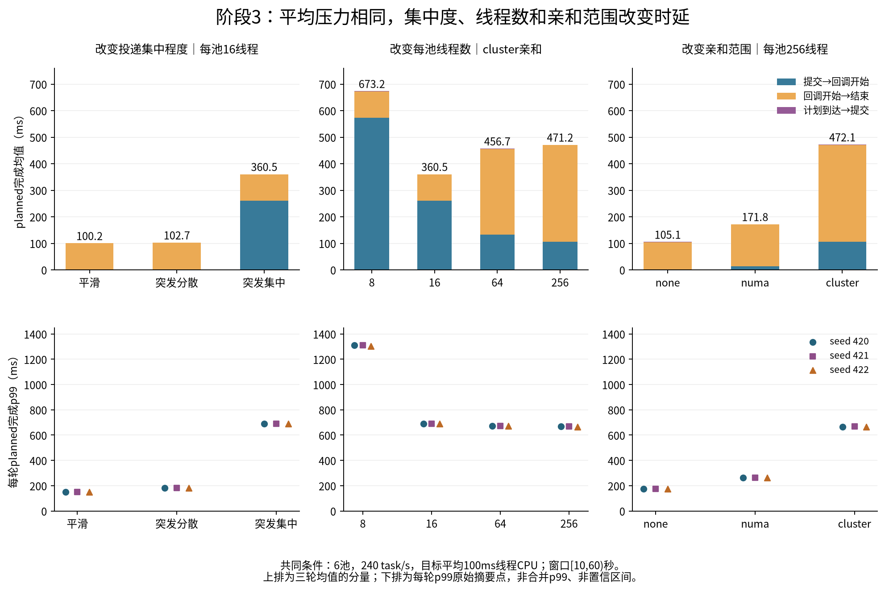
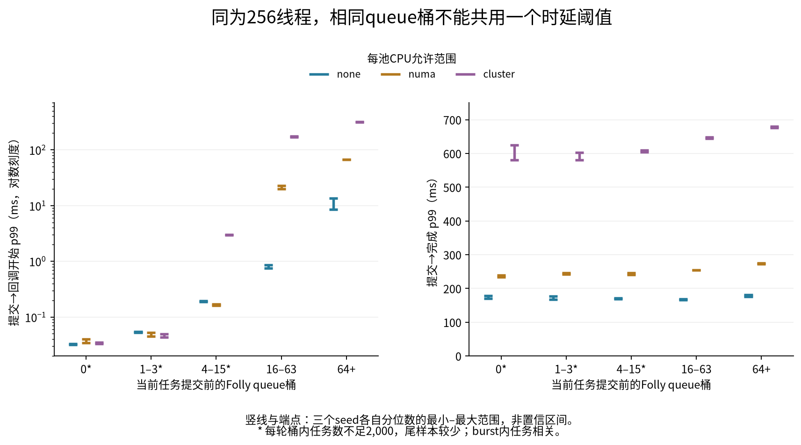

# 阶段 1～3 回顾：从业务模型到独立任务的定量证据

**阶段 1～2 的机制与观测分析已基本完备；阶段 3 已完成进入 DAG 所需的基础机制验证，可以进入下一阶段。** 这里的“完成”有明确范围：已经解释并实测任务集中程度、线程数量、CPU 亲和范围如何共同改变任务时延；尚未建立生产通用的负载阈值，也未验证请求级跨池均衡、回迁和数据局部性收益。

本次回顾固定于 demo 提交 `88e9f9f`、Folly 提交 `560e225e85229a3573061f66cab7e9207c98a9b0`。所有新增材料位于 `docs/reviews/stages-1-3/`，开发分支为 `review/stages-1-3-20261114`，使用独立工作树；不修改正在进行的 DAG、Folly 分组执行器或后续实验，也不重新运行共享工作区的性能负载。

## 阅读顺序与交付件

|材料|回答的问题|图示与证据|
|---|---|---|
|[01 真实业务回顾](01-business.md)|业务是否理解完整；哪些原始数字仍需确认；为何平均 CPU 不高仍可能有局部瓶颈|业务场景、异步 RPC 时序、任务/线程状态、实际资源拓扑；需求和关键路径模型|
|[02 Folly 回顾](02-folly.md)|何时入队、通知、取任务；精准通知是否传闭包；queue、busy 与内核 runqueue 怎样区分|源码调用关系、默认/经典信号量时序、竞争路径、负载时间轴、ARM 指标成本原值|
|[03 独立任务实验回顾](03-experiments.md)|工程如何产生负载、选池和计时；实际做了哪些实验；结果支持什么结论|执行场景与时序；41轮 ARM 原始摘要逐轮表；条件分位数、预测检验、完备性审计|
|[原始证据说明](evidence/README.md)|原始记录在哪里，是否收到逐任务数据|用户回传终端日志、拓扑、SHA256清单、截取边界|
|[逐轮结构化表](data/arm_runs.csv)|如何从每个汇总数追到日志|41轮，含来源文件/行号、配置、工作量、时延和完整性字段|
|[提取脚本](extract_stage3.py)、[绘图脚本](make_figures.py)|如何独立复算本回顾的表和图|只读取归档证据，不连接测试机、不执行性能实验|

旧的 [阶段3开发机结果](../../../stages/03-independent/RESULTS.md)只记录当时的开发机验证，其中“ARM 尚未执行”属于历史状态。本回顾合并后续 `0001`～`0005` 的阶段3证据，不把历史报告的旧状态当作当前结论。开发机短测与目标 ARM 实验分别列示，不混合统计。

## 一条贯穿三个阶段的解释链


睡眠唤醒并非每次提交必经；已运行的 worker 可以直接取得下一任务。内核调度等待既可发生在取任务前，也可发生在回调期间。**Folly 队列中的对象是闭包；内核 runqueue 管理的是可运行线程。** “提交到开始”包含多个环节，不应全部称为纯队列驻留；“回调墙钟”也不是纯 CPU 执行时间。

## 阶段 3 的设计与实际覆盖

实验固定六个独立 Folly CPU 池。每池以 `(N,N)` 固定最小和最大线程数，避免动态扩缩池。发生器按预先生成的计划开放环投递，不因上一任务未完成而停止后续到达；每任务保存计划、提交、开始和结束时刻，按计划到达窗口选 cohort，包含窗口后才完成的任务。

|维度|本轮实际设置|
|---|---|
|共同 CPU 资源|`0-47,192-239`，48物理核/96逻辑CPU；不是整机384逻辑CPU|
|none|每个池可在这96个CPU上运行，六池共享资源|
|numa|池0～2允许`0-47`；池3～5允许`192-239`，各是对应NUMA的选定部分|
|cluster|六池分别允许`0-15;16-31;32-47;192-207;208-223;224-239`|
|主对照负载|240 task/s，平均100ms线程CPU预算，约24 CPU秒/秒；随机时长抖动±50%，不含700～800ms长尾|
|smooth|单个任务平滑到达，逐任务轮询六池|
|spread|每批100个独立任务，每秒2.4批；批内逐任务轮询六池|
|local|相同批大小和平均速率；整批投到同一池，各批轮询六池|
|调度与均衡|静态选池；没有负载触发选池、跨池窃取或执行后回迁；spread不是自适应均衡|
|计量|提交前读queue和选定的包装器指标；回调内只记内存数据，后处理计算时延分布|

同样的24 CPU秒/秒可以在六池上平滑展开，也可以在一个cluster内集中排队。该设计先隔离“集中度”这一因素。CPU预算循环则控制线程CPU记账量；它不等于完成相同数量的真实算法运算，因此不能单独验证cache/NUMA优化的有用工作收益。

|已执行 ARM 组|轮数|要隔离的变量|主要范围限制|
|---|---:|---|---|
|三亲和 smoke|3|构建、拓扑mask与统计流程是否可用|每轮3秒、1ms任务，只作功能检查|
|平滑校准|8|120/240/480/720 task/s，各2次|每轮30秒；720只是最高已测值，未找到容量拐点|
|集中度对照|9|smooth/spread/local，各3次；每池16线程|每轮60秒，主要统计[10,60)秒|
|线程数扫描|12|cluster/local下8/16/64/256线程，各3次|识别等待在开始前与回调内的变化|
|高线程亲和对照|9|256线程/local下none/numa/cluster，各3次|线程上限足够高，比较单池允许的CPU范围|
|合计|**41**|工作量、完成状态与资源集合均有回传记录|三次重复适合描述当前大效应，不支持微小收益认证|

另有日志中的离线条件分桶、按整轮留出的预测检验和16线程指标成本微基准；它们不是额外的41轮主实验。完整计划比已执行集合更大：尚未做完整因子交叉、容量过载边界、目标机固定有用工作下的完整插桩扰动对照。详见第三章的已做/未做矩阵。

## 已得到的核心数字

下表为三轮均值的平均，以及三轮各自p99的最小～最大值。均为毫秒，完成时延从**计划到达**算起；不是合并样本p99，不是置信区间。每轮原始摘要及配对差见[第三章](03-experiments.md)和[逐轮CSV](data/arm_runs.csv)。

|对照|完成均值|每轮完成p99范围|最直接的解释|
|---|---:|---:|---|
|16线程，smooth|100.177|148.564～149.029|平滑到达几乎不增加等待|
|16线程，spread|102.722|180.648～183.399|同批分散，短时排队较少|
|16线程，local|360.460|690.684～691.584|同工作量集中一个cluster，均值增加主要来自开始前等待|
|cluster/local，8线程|673.163|1305.256～1311.969|消费者数量不足以使用cluster全部逻辑CPU|
|cluster/local，16线程|360.456|690.779～691.533|本次四档中平均完成时延最低|
|cluster/local，64线程|456.684|671.457～673.550|开始前等待下降，回调墙钟显著增长|
|cluster/local，256线程|471.242|666.091～668.057|增加线程未增加cluster硬件容量；p99小降、均值反增|
|256线程/local，none|105.106|173.234～175.026|允许单池使用更广CPU范围|
|256线程/local，numa|171.797|263.828～264.807|单池允许范围介于两者之间|
|256线程/local，cluster|472.097|664.734～668.246|同样线程数，被限制在单cluster内竞争|

`local/16线程`、`cluster/local/16线程`分别来自不同实验组，保留各自测量值；`256线程/cluster`同理。不要将相近数据当作同一轮，也不要把它们合成新的重复数。



上排将完成均值分解为提交至开始、回调墙钟和发生器提交延迟；下排展示三个seed各自p99。[SVG矢量图](figures/latency-components.svg)。回调墙钟增长与CPU竞争解释一致，但当前ARM未录制线程级调度等待，不能把增长全部记为内核runqueue时间。

## 负载与 p 时延：已经得到什么定量关系

**已经得到固定配置、固定分布下的条件分位数关系，无需再等待DAG才开始这项分析。** 统计对象是 `Qp(提交至开始/提交至完成 | 提交前queue分桶，配置)`。它与“仅由队列长度决定时延”的通用函数不同。

例如，同为256线程、相同100ms预算与local突发，在`queue≥64`桶中，三轮各自的提交至开始p99范围分别为：none **8.596～13.572ms**、numa **67.400～67.546ms**、cluster **313.930～316.825ms**。因此容量范围必须参与解释。同一cluster配置在`queue=0`桶中，开始等待很短，但完成p99仍约581～625ms：当前快照没有描述该任务开始后继续到来的同批竞争。



竖线仅表示三个seed的分位数范围。星号桶每轮不足2000任务，尾样本较少，且同批内任务相关。[原始范围表](data/arm_conditional_ranges.csv)、[SVG矢量图](figures/conditional-affinity.svg)。图中完成从**实际提交**算起，区别于前一张总览的planned口径。

原图左侧是对数轴、右侧是线性轴，不宜直接比较视觉变化幅度。针对“等待增加而完成p99较平”的疑问，另补[同轴16/256线程对照与机制解释](queue-latency-interpretation.md)，包含完成p50，避免将尾分位数的现象泛化为所有任务。

原生queue热读在目标机微基准中约**1.94ns（idle）/3.22ns（busy）**；该结果支持优先使用已有queue信号。它不覆盖跨NUMA高频写竞争或完整监控扰动。若queue低而回调内竞争明显，再检查inflight/outstanding、容量和CPU差分；无需仅为读取负载先改写Folly。C++并发普通整数读写仍是数据竞争；容忍误差可使用relaxed atomic，不等于可以无同步读取可变数据。

## 是否可以进入 DAG

|阶段目标|结论|仍需带到后续的限制|
|---|---|---|
|1：业务模型与变量拆分|基本完备|生产100ms的计时口径、实际CPU范围、图宽度/总量联合分布、内存放置仍未核实|
|2：任务、通知、等待与负载接口|基本完备|真实生产构造及厂商内核需要核对；源码允许的路径不等于目标机已发生|
|3：独立任务机制及条件时延|已达到进入DAG的门槛|不是完整容量认证，也不是生产SLA/统一路由阈值|
|4及以后：请求级均衡与局部性取舍|由并行工作继续|须增加请求生命周期、依赖、异步续接、home/实际池、数据共享及策略干预|

不必把所有参数组合跑完才进入DAG。当前已经知道：应同时保留开始前等待与回调墙钟；queue阈值须联系CPU范围和线程配置；三亲和必须保持相同资源并集；突发集中与总工作量要分别控制。后续若要宣称小幅性能改进、选择上线阈值或解释生产CPU下降，再补长时重复、固定有用工作和生产数据访问实验。

## 在本地复核材料

从仓库根目录执行，只处理归档文件：

```bash
python3 docs/reviews/stages-1-3/extract_stage3.py
```

图文件已包含在交付中，无需安装绘图库才能阅读。重新绘图可使用独立虚拟环境：

```bash
python3 -m venv /tmp/stage123-review-plots
/tmp/stage123-review-plots/bin/pip install matplotlib
/tmp/stage123-review-plots/bin/python docs/reviews/stages-1-3/make_figures.py
```

绘图脚本优先使用系统Noto CJK字体；没有中文字体时应先安装或调整字体路径。图的输入CSV哈希、绘图库版本与统计口径记录在[provenance.json](figures/provenance.json)。日志归档与提取保留原输出精度；没有逐任务ARM CSV，就不能声称本次重新计算了其分位数、置信区间或任务级回归。

本次完成归档哈希、来源行、重复提取一致性、41轮守恒、分桶样本数、均值分解和相对链接核验，并目视检查三张结果图；详见[核验记录](validation.json)。没有重新启动ARM实验，也没有测试或改动另一工作树中正在开发的DAG代码。
