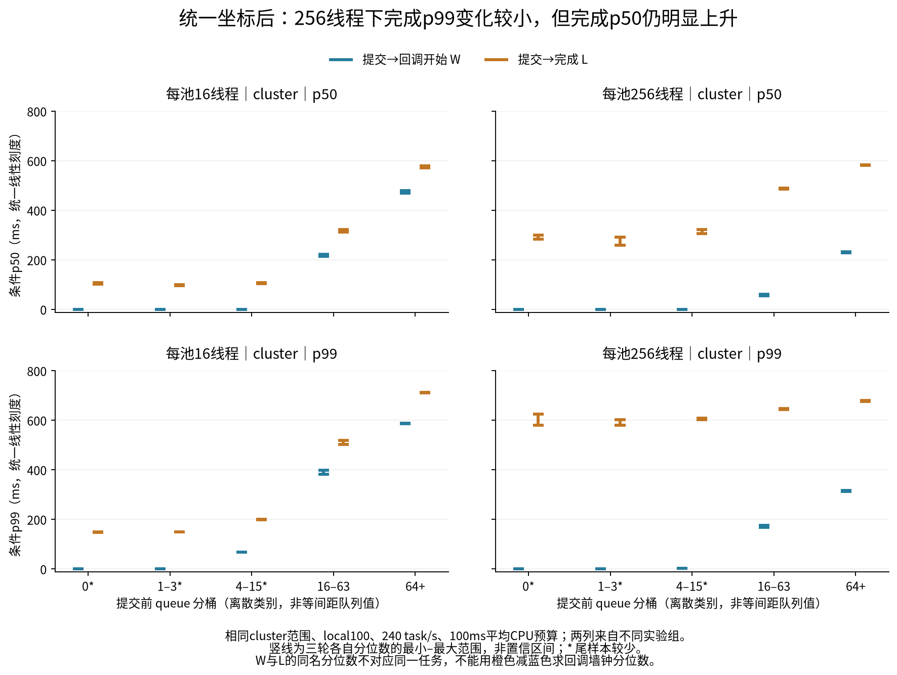

# 为什么 queue 越深，开始等待增长明显，完成 p99 却增长较小

**原图的坐标尺度确实放大了这种视觉差异，但256线程/cluster配置中，完成p99相对较平也是真实的统计现象。** 它不表示排队不影响完成，更不表示所有完成分位数都变化较小。

## 先区分三个时间

```text
t_submit ──────── t_start ─────────────── t_end
         W                   X
         └────────── L ────────────────┘

W = 提交 → 回调开始
X = 回调开始 → 回调结束（墙钟，包括期间失去CPU的时间）
L = 提交 → 回调结束 = W + X
```

原条件图右侧画的是L，不是X，也不是完整业务request的端到端时延。主实验汇总另有planned→end，含发生器迟到；不要把这两个完成口径混用。

对每个任务都有`L=W+X`；对同一批样本的均值也成立。但`p99(L)`一般不等于`p99(W)+p99(X)`。两条分位数曲线上的点通常不是同一个任务，不能用`p99(L)-p99(W)`推出回调墙钟的p99。

## 坐标问题与统一刻度复查

[原图](figures/conditional-affinity.png)左侧等待使用对数轴，右侧完成使用0～750ms线性轴。比如0.03→3ms跨两个数量级，视觉变化很大，却只有约3ms绝对增量；放在数百毫秒完成时延中并不明显。横轴还是离散queue分桶，不是等间距的queue数值，曲线斜率也不能当作ms/task。

下面所有子图统一线性时间轴，并加入16线程的对照以及p50：



[SVG矢量图](figures/queue-latency-same-scale.svg)。各竖线为三个seed各自分位数的最小～最大范围，不是置信区间；两列来自不同实验组，共同条件为cluster亲和、local100、240 task/s、平均100ms线程CPU预算。

下表直接摘自[原始条件分位数](data/arm_conditional_ranges.csv)，单位ms：

|每池线程|提交前queue|等待p99|提交完成p99|提交完成p50|
|---:|---|---:|---:|---:|
|16|0|0.030～0.032|146.702～148.967|101.477～109.008|
|16|64+|586.557～588.994|710.375～711.971|571.334～579.457|
|256|0|0.033～0.035|581.142～624.703|283.589～300.120|
|256|64+|313.930～316.825|676.422～679.841|582.240～583.437|

16线程下，开始前等待和完成p99都显著增长，符合较简单的排队直觉。256线程下，queue=0组完成p99的起点已经很高，之后增量相对较小；但是完成p50从约284～300ms升至582～583ms，接近翻倍。原图仅展示p99，不能据此说“端到端时延整体变化不明显”。

## 为什么高线程使低queue任务也有很高的完成尾延迟

queue是**当前任务投递前**的快照，不包含已经进入回调的任务，也看不到随后尚未提交的工作。本负载每批100个任务依次投递到同一个池。一个任务在queue=0时立即开始，之后同批其他任务仍可继续到来、进入回调并争用CPU。

cluster只有16个允许的逻辑CPU，而256个worker允许大量回调同时处于“已开始、未结束”状态。进入回调只是执行的一个边界，不是独占CPU直到完成。较早进入回调的任务可能在回调期间反复失去CPU；较晚进入回调的任务则有更多延迟体现在开始前。随着同批任务完成，竞争程度又会改变。因此，开始前等待变长，不要求完成尾延迟也增加同样的量。

一个仅用于理解的理想模型：100个等长任务，每个需100ms线程CPU，共约10 CPU秒；16个逻辑CPU即使全部持续用于这些任务，也需要约625ms处理总预算。若16个worker分波执行，早任务约100ms结束，后任务在开始前排队。若全部任务很早进入回调并理想公平分时，它们都可能到约625ms才结束；第一个任务即使开始前没有排队，也可能有很长的回调墙钟。**这不是对Linux实际时间片或实测每任务完成时刻的拟合。** 实测存在50～150ms预算分布、唤醒传播、投递迟到及其他开销。

整体均值提供了直接佐证：在同一线程数扫描中，16→256线程使开始前等待均值从260.264ms降到106.038ms，而回调墙钟从100.100ms升到364.119ms。更早进入回调并没有带来更早完成。该结果说明等待位置和并发竞争发生变化，但不能把所有墙钟增量都归为精确的内核runqueue时间。

## 现有证据能够与不能够确认的部分

- **已确认**：轴尺度不同；256线程低queue组有较高完成p99；其完成p50仍明显随桶变化；16线程对照中完成p99强烈增长。
- **与机制一致**：后续同批提交、执行中工作和有限CPU使低queue不等于低完成时延；线程数改变开始前与回调内延迟的分布。
- **尚未从现有终端摘要直接确认**：每个桶的回调墙钟分布、W与X的联合关系、每个任务的批内位置，以及精确runqueue等待。不能相减两个p99来补出这些数据。

queue=0每轮仅120个样本，数量与批次数相同，符合批首任务的解释，但未收到逐任务明细，不能将“每条都是批首”写成已经核实的事实。该桶p99靠近一两条极端样本，三个seed的范围不是精确置信区间。

若需要进一步验证机制，应在已有目标机tasks.csv上，按`配置/queue桶`同时输出W、X、L的均值与p50/p95/p99，并加入inflight和批内位置；均值可直接检查`E[L]=E[W]+E[X]`。要区分回调里的CPU运行与内核等待，再补同任务CPU时间及短窗口调度追踪。当前仅重画已有证据，不追加性能实验、不改动DAG工程。
