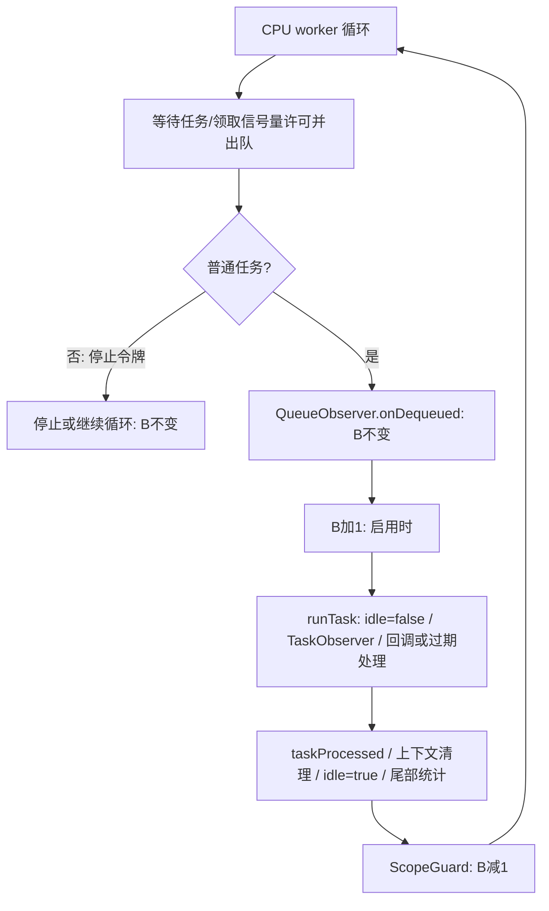
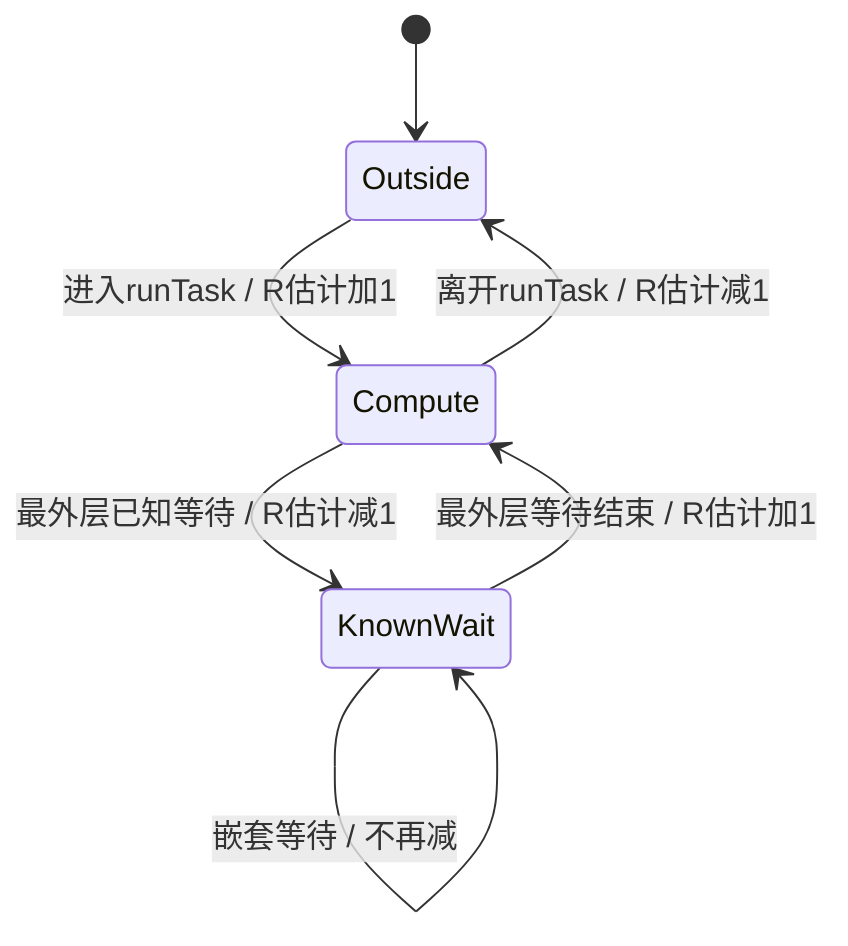

# 低成本 busy 与 running+runnable 近似的选择

## 1. 先确定统计对象

目标若是一个池的 OS running+runnable 线程数，统计单位就是**该池的 worker 线程**：正在 CPU 上运行，以及已具备运行条件、等待调度的线程。它不等于任务数，也不等于 CPU 利用率。只统计 executor 的 TID，不混入 IO、AIO、worker 构图池和采样线程。

Linux 线程的可运行状态由内核管理；`/proc/<pid>/task/<tid>/stat` 暴露每线程状态。线程在 futex、同步 IO、缺页等路径上的状态并不都由应用埋点覆盖。纯用户态库没有一个通用通知，能自动捕获所有这些变化。[Linux 状态定义](https://github.com/torvalds/linux/blob/master/include/linux/sched.h)、[proc 线程目录](https://man7.org/linux/man-pages/man5/proc_pid_task.5.html)、[stat 字段](https://man7.org/linux/man-pages/man5/proc_pid_stat.5.html)。

**选择建议：当前先用 B 作为 CPU 回调并发需求代理；确认有显著、可标记的同步等待后，才评估扣除这些等待的 R估计。** “更接近 OS”与“更能指导负载均衡”是两项不同验收：前者对比线程状态，后者对比请求完成时延、吞吐及排队。不能因一个指标便宜就宣称策略收益。

| 场景/目的 | 首选 | 原因和限制 |
|---|---|---|
| CPU 回调基本不阻塞，RPC 真正异步返回 | B | 计入运算期间被抢占、等待 CPU 的 worker；一次原子读 |
| 有明确的同步等待，且可在同线程作用域标记 | 先保留 B，再评估 R估计 | 扣除已标记等待可以减少部分高估，但标记区间也可能包括 runnable 时间 |
| 不透明第三方库、缺页/内核等待不可预测 | B 作代理，OS 数据作校准 | 不能仅凭应用状态保证“最相似” |
| 判断工作积压和是否接收新任务 | N 或 Q 与 B 联合观察 | B 在 worker 数达到上限后饱和；队列继续增长时 B 可能不变 |

不要用 `min(N, worker数)`、`Q+B` 或已激活 worker 数替代 OS runnable：它们都不能确定哪些线程真正具备运行条件。

## 2. B 的独立补丁

B 定义为处于 CPU worker 的 `runTask()` 外围计数作用域中的普通任务数。原生 CPU worker 循环一次只执行一个任务，所以这时也是处于该作用域的 worker 数。若现场自定义 worker 循环、嵌套执行或覆盖 `threadRun`，需要重新审计，不能自动继承该结论。



```cpp
// 构造：enabled 固定；B=0；必须在启动 worker 之前完成初始化。
// 原有 QueueObserver、队列、任务执行和停止流程保持顺序。
after_queue_observer(task);
if (!enabled) {
    runTask(thread, move(task));
} else {
    B.fetch_add(1, memory_order_relaxed);
    ScopeExit finish([&] { B.fetch_sub(1, memory_order_relaxed); });
    runTask(thread, move(task));
}
// 读取：启用时一次 relaxed load；未启用返回 unavailable。
```

计数在 Folly CPU 线程池内维护；不需要业务包装所有 `add`，也不需要每任务携带 N 的生命周期 ticket。B++ 发生在任务已经取出以后，因此 **B 不会在任务提交/唤醒时立即增加**。

| worker 所处情形 | B | OS running+runnable |
|---|---|---|
| 回调 CPU 运算 | 计入 | 计入 |
| 运算被抢占，在内核 runq 等 CPU | 计入 | 计入 |
| 回调在 mutex/futex/sleep/同步 RPC 内睡眠 | 计入 | 睡眠期间不计 |
| callback 已返回，异步 RPC 尚未完成 | 不因该 RPC 计入 | 取决于 worker 随后实际状态 |
| 已被唤醒，尚未到 B++ | 不计 | 可以已计入 |
| 队列仍有任务，但没有 worker 领取 | 任务不计 B | 任务本身不是线程 |
| worker 在空队列等待中 | 不计 | 实际睡眠时不计；自旋/检查阶段可能计入 |

语义分解可写为：

```text
R_OS = B
       − B作用域内实际不处于running/runnable的worker
       + B作用域外实际处于running/runnable的worker
```

这是同一瞬间、同一组 worker 的集合关系；实际独立采样还有时间差。B 一般既不是 R_OS 的上界，也不是下界。

**短峰场景尤其要注意唤醒遗漏**：真实峰只有约 5–20ms 时，唤醒到开始执行的间隙可能占比较大；不能以“计数代码只有几行”推断误差时间很短。被抢占时边界间隙也可能延长。当前没有测量该近似误差，因此不承诺 B 足够还原每个微突发峰。

## 3. 与 Folly 原生状态、N 的区别及成本

本节依据基线 `c8c7adb72c6d73e2fced5ff5cebc96aa3ff65b2c`，其他版本须按调用链核对。

| 指标 | 表达什么 | 采集成本/失真 |
|---|---|---|
| `numActiveThreads()` | 已激活 worker 管理数量，含空闲 worker | 低成本，但不是 busy，更不是 OS runnable |
| `getPoolStats().activeThreadCount` | `activeThreads − 扫描到的idle线程` | 扫描线程列表，O(T)，持列表共享锁；不是一致快照 |
| `getPoolStats().totalTaskCount` | `Q + 列表线程数 − 扫描到的idle线程` | 同上；停止、缩容和不同读取时刻有边界差异 |
| `getTaskQueueSize()` 得到的 Q | 队列实现报告的待取量 | 默认基线由信号量 `valueGuess()` 提供估计，不是遍历物理队列；自定义队列要审计 |
| 本补丁 B | runTask 作用域内占用 worker 数 | 读一次 relaxed load；开启时每任务2次 relaxed RMW，无每任务新字段/分配 |
| N | 已接纳/预留但尚未结束的工作总量，依实现确定边界 | 能覆盖排队、过渡和执行；不等于 runnable 线程数 |
| Q+B | 原生 totalTaskCount 的便宜近似 | 两次不同时间读取，可能有出队到B++的漏计；停止令牌可能进入Q；不能当同步屏障 |

本补丁 B++ 在原 `idle=false` 前，B-- 在原 `idle=true` 和尾部处理后。通常稳态意义相近，但不能要求 B 与原生 busy 扫描逐次相等。停止过程中 `activeThreads` 可以先归零，而回调仍在运行，因此 `B<=numActiveThreads()` 也不是全生命周期不变量。

启用后的两个共享原子更新会产生缓存行争用，成本取决于并发与 NUMA；不能未经测量填写纳秒数或称“零扰动”。关闭时无 B 维护写操作，但对象布局和代码分支仍变化。所有读取都不能使用非原子普通变量制造 C++ 数据竞争；容忍统计误差不等于可以容忍未定义行为。

`B/C` 是相对容量的并发需求代理。B=80、C=16 时为5，**不是CPU利用率500%**。C 是当前研究采用的容量标尺；16个逻辑CPU也不自动等价于16个独立物理核的算力。CPU利用率仍应由既有外部观测获取，不加入本补丁的调度决策。

## 4. 可选构造：扣除已知等待的 R估计

本节是供现场 AI 评估的设计，**没有包含在 `native-busy.patch` 中**。只有确认同步阻塞造成 B 明显失真时才值得实施。

定义 K 为“处于明确标记的同步等待作用域内的 busy worker 数”，不是等待调用次数。嵌套等待只能扣一次。理想同一状态下 `R估计=B−K`。为了避免分别读 B/K 的时序差、无符号下溢，可直接维护一个 R估计 原子计数：

```text
每个CPU worker的TLS状态：当前pool、当前runTask世代、busyScope、waitDepth
每个pool：atomic R_est = 0

进入runTask计数作用域：
    建立本线程pool/世代作用域；waitDepth=0
    R_est += 1
    RAII保证退出时waitDepth已回到0，再R_est -= 1，恢复TLS

进入已知同步等待：
    guard.armed = 是否处于匹配pool/世代的busy作用域
    若未armed，进入与析构都不修改任何状态
    若waitDepth从0变1：R_est -= 1
    嵌套层只增加waitDepth

等待返回/异常展开（RAII）：
    若guard未armed，直接返回
    waitDepth -= 1
    若从1变0：R_est += 1

OS抢占/等待CPU：
    无用户态通知，不更新R_est

读取：
    R_est.load(relaxed)
```



实现约束：

- guard 只用于同步、同一 OS 线程、词法嵌套的等待；不能跨 coroutine/fiber 挂起迁移、任务结束或异步返回。池与世代要校验，不把业务请求的“异步未完成”算作 worker 阻塞。
- 不把所有 `mutex.lock()` 调用都武断标为睡眠。能识别真实慢路径时只标该路径；不能识别时承认标记的是调用区间。不要为了计数改变锁获取语义。
- B、K、R估计 如需同时导出，它们的独立读取仍可能不满足等式。单独维护 R估计 只解决计算快照问题，不解决 OS 语义问题。
- 保留 B 的同时维护 R估计，每任务会再增加 R估计 的2次原子更新，每个最外层等待另加2次共享原子更新；TLS检查与RAII也有成本。小任务、高频锁争用下可能不划算。
- `R估计=0` 不代表池可接纳：所有 worker 都在同步等待时，CPU需求低，但没有线程能取新任务。接纳判断仍需结合 B、worker 数和 Q/N，避免将“CPU不忙”误当“线程可用”。

基线中的 `ExecutorBlockingGuard` 维护允许/禁止阻塞及 executor 的线程局部上下文，并没有检测线程当前是否睡眠；它不能直接提供 K。

**扣除并不保证更准确**：标记等待之前线程可能仍在运算，等待内部可能自旋或快速返回；内核已唤醒线程、线程正在 runq 排队、但等待函数尚未返回时，R估计 仍把它排除。没有标记的缺页和第三方同步调用仍会高估。因此“运算期间被抢占不扣”成立，“所有 runnable 时间都保留”不成立。

不建议本次改成 `存活worker−空闲等待worker−阻塞worker`：空闲 semaphore 的 wait 还可能包括快路径、自旋和唤醒后未返回。生产者 `post()` 可能只留下许可，不代表一个新线程变为 runnable；notify 数量也不能直接累加成 runnable 数。若未来确需覆盖唤醒阶段，应逐个 worker 建状态机，审计信号量、超时、停止和竞争，而不是在 post/wait 外各加减一次。

## 5. 最小验收与后续选择

本轮不增加性能测试矩阵：先验证 B 的定义、所有路径归零、已有执行行为未改变；本地结果见 VALIDATION。它只能证明计数实现正确，不能证明对应 OS 状态准确或 p99 有收益。

若要判定 B 对真实应用是否足够：在一个已选代表性负载上，同时留存 B/Q、请求完成时延、已有 CPU 曲线，并在限定时间对该池 worker TID 做 OS 状态参考。异步旁路采集不进入每次调度热路径。

- `/proc/<pid>/task/<tid>/stat` 的逐线程状态扫描适合较低频的粗校验；每轮 O(T) 文件读取，不是同时刻全池快照，不适合声称精确还原5ms峰。TID消失、读取失败记为未知，不能记空闲0；解析时线程名括号内可有空格。
- 如5–20ms唤醒窗口误差是关键，可在现场权限/开销允许时用既有 scheduler 跟踪工具短时核对。它需要内核事件支持，是另一种观测渠道，不是本补丁能在纯用户态自动完成的功能。不要默认添加持续高频跟踪工程。
- 若 B 高而很多线程实际上阻塞，优先审计同步等待，评估少量 K 埋点；若误差主要发生在唤醒到回调开始，K 无法修正该问题。
- 若目标是负载均衡收益，仍以**请求整体完成** mean/p99、吞吐及代价验收，不以 B 与某条曲线相关就定论。B 已饱和时必须保留 Q/N 以识别额外积压。

因此，当前最小可交付方案是 **B + 明确语义 + 必要时旁路校准**。R估计 扩展是有条件的后续选择，不预设它比 B 必然更接近 OS，也不直接改动现有调度阈值。
