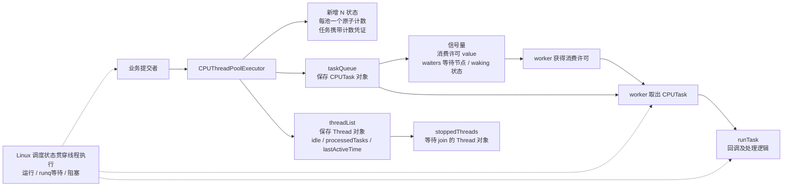
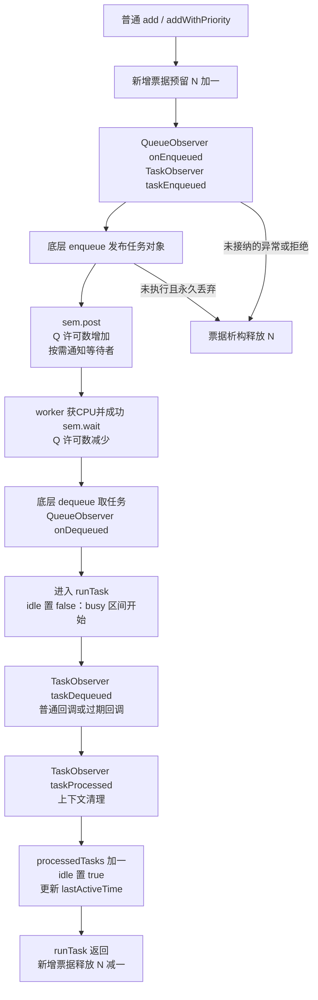

# 独立探索：新增 N 与 Folly 现有集合、队列和统计状态

本报告只做源码分析，不修改计数、调度或负载，不新增实验矩阵。

依据是本地 Folly `v2026.10.26.00` 基线及新增 N 后的提交
`54b6ebe1cd4622e92834087b5f0302654e8f6a55`。文末给出文件、函数、行号和固定版本链接。
其他版本需按函数职责核对，尤其是队列类型、信号量、PoolStats 和动态线程管理。

## 1. 先说明结论

**Folly 已有一个接近 N 的统计：`PoolStats.totalTaskCount`，它近似为“队列数 + 非 idle worker 数”。**
因此，不能把新增 N 的必要性解释为“Folly完全没有未完成任务指标”。

新增 N 的差异是：它在提交前预留，随普通任务所有权转移，直到处理结束或永久丢弃才释放；
读取只需一次原子 load。现有 `totalTaskCount` 则临时扫描线程状态、再读取队列数，
既有读取成本，也有状态转换窗口和非同一时刻采样的问题。

还必须区分三个同名或近似名称：

- `numActiveThreads()`：线程池管理上的已激活 worker 数，包括空闲 worker。
- `PoolStats.activeThreadCount`：从已激活数减去扫描到的 idle 数，正常稳定运行时近似正在处理任务的 worker 数。
- 新增 N：未终结普通任务数，包含提交、排队、领取后尚未进入回调、执行及结束清理阶段。

三个量都不是内核 runq 长度。后两者也不是“此刻真正占用 CPU 的线程数”。

## 2. 场景视图：这些集合分别存什么



`threadList` 不是任务集合，`waiters` 不是任务集合，`stoppedThreads` 也不是任务队列。
CPU 池没有通过这些集合维护一张可直接求大小的“所有未完成 CPUTask 集合”：
任务入队后会移到 worker 的局部对象，完成后销毁。新增 N 用票据记账，**也没有另建任务集合**。

内核调度状态是另一层：Folly 的 `idle=false` 不会在每次内核抢占时切回 true；
Folly 的等待节点也不会列出所有内核 runnable 线程。

## 3. 已有状态和 API 清单

以下 T 为线程集合中记录的 worker 数，K 为优先级数。复杂度描述实现结构，不是纳秒实测。

|状态 / API|怎样维护或读取|实际反映什么|与 N 的区别|
|---|---|---|---|
|`taskQueue_` 中的 CPUTask|提交移动入队，worker 移动取出|等待被领取的任务对象；也可能含停止标记|领取后不在队列中，仍可能长时间没有完成|
|`getTaskQueueSize()`|直接 `taskQueue_->size()`|具体队列实现给出的 size|本地默认实现读取信号量许可数，不是扫描任务对象|
|`getPendingTaskCount()` / `PoolStats.pendingTaskCount`|前者持线程集合共享锁；后者在统计共享锁内；最终也调用队列 size|与上述 Q 相同来源|不是另一套更完整的排队计数|
|`numThreads()` / `PoolStats.threadCount`|读取 `maxThreads_`|配置的线程上限|不是当前实际存在的线程数，更不是负载|
|`numActiveThreads()`|一次 relaxed load 读取 `activeThreads_`|已激活 worker 的管理数量，含 idle|空闲池也可很大，不能替代 N|
|`Thread::idle`|进入 `runTask` 置 false，尾部置 true|worker 是否处于该处理区间|忙标志保持期间也可能在 runq 等待或同步阻塞|
|`PoolStats.activeThreadCount`|扫描 idle，计算 `activeThreads_ - idleAlive`|稳定运行时近似 busy worker 数 B|不含排队和进入 runTask 前的任务|
|`PoolStats.idleThreadCount`|`maxThreads_ - activeThreadCount`|相对配置上限未被 busy 占用的数量|动态池中包含尚未创建的线程额度，不等于睡眠线程数|
|`PoolStats.totalTaskCount`|`queue.size() + threadList.size() - idleAlive`|近似“排队 + 正在处理”，最接近 N 的现有项|共享锁 + O(T)扫描；转换窗口缺失，组合读不一致；可包含队列停止标记|
|`PoolStatsLight`|同样共享锁 + O(T)扫描 idle，省去时钟和完整统计字段读取|thread/idle/active/pending 四项|不是单原子负载计数，没有 totalTaskCount 字段|
|每线程 `processedTasks` / 汇总 `processedTaskCount`|每次 runTask 尾部加一，线程退出时归入历史累计|已处理任务累计值，可差分看处理速率|包括异常和过期处理，不等于业务成功量；不反映当前积压|
|`lastActiveTime` / `maxIdleTime`|runTask 尾部记时间；完整统计扫描 idle worker|空闲状态持续时间的统计|不是任务年龄，也不是剩余执行时间|
|`getUsedCpuTime()`|共享锁，逐线程读取 CPU clock，加已退出线程累计|线程池累计实际 CPU 时间|O(T)系统接口查询，不是瞬时任务数或低成本逐次路由指标|
|`threadList_` / `stoppedThreads_`|线程创建登记、停止移出、之后 join 回收|线程对象寿命及回收状态|集合元素是线程；一个线程会先后执行很多任务|
|`ThreadIdWorkerProvider::osThreadIds_`|worker进入/退出时更新受锁TID集合；采集时复制ID并持退出保护|关联线程和诊断采样|既不是busy集合，也不是runq；采集保护长期持有还会延迟线程退出|
|`threadsToStop_` / `threadsToJoin_`|缩容、超时退出、stop/join 中更新|待停止/待回收线程数量|生命周期控制量，不是待执行任务数量|
|`TaskObserver` / `QueueObserver`|提交、领取、处理节点触发回调|插入观测逻辑的钩子|并非现成完整计数；失败/丢弃路径不保证 enqueued/processed 配对|
|全局线程池注册表 / observer 链表|登记 executor / 观察器实例|枚举池、线程或观测回调|元素数不表达任务负载|

线程ID集合的具体维护见[S8]。动态池例子：`maxThreads=256`，已激活10个，其中7个 idle，稳定时
`numActiveThreads=10`、`activeThreadCount=3`、`idleThreadCount=253`。
**253 不表示已有253个线程在睡眠。** 缩容和stop期间管理计数可先调整、线程稍后退出，
不要把上述组合字段当作强一致的线程状态快照。[S2][S3]

## 4. 默认队列的 Q：实际上读到了什么

本地 `makeDefaultQueue()` 默认选择
`UnboundedBlockingQueue<CPUTask, ThrottledLifoSem>`。优先级版本为
`PriorityUnboundedBlockingQueue<CPUTask, ThrottledLifoSem>`，不同优先级共用消费信号量。
默认工厂传入的 `wakeUpInterval={}` 是0，不能仅凭名字推断默认有某个固定微秒节流间隔。[S1]

实际代码可概括为：

```cpp
BlockingQueue::add(task):
    underlying_queue.enqueue(move(task));
    return sem.post();

BlockingQueue::take():
    sem.wait();
    return underlying_queue.dequeue();

BlockingQueue::size():
    return sem.valueGuess(); // 不是 underlying_queue.size()
```

所以这里将 Q 精确命名为**队列接口报告的未消费许可数**更合适。它通常可以作为队列积压代理，
但不严格等于此刻容器内对象个数，更不等于所有未完成任务数。[S4]

|信号量状态|维护方式|能说明什么 / 不能说明什么|
|---|---|---|
|ThrottledLifoSem `value`|post 增加，成功 wait 消费时减少|已发布未消费的许可；执行完成不更新它|
|`state_` 中 `numWaiters`|快速获取失败后登记，成功/超时退出时撤销|包含自旋、尚未睡眠和 waking 线程；不是纯睡眠数|
|`waiters_`|锁保护的 LIFO 等待节点链表|组织需要通知的等待者，不是全部 idle/runnable worker|
|`kWakingBit`、`lastWakeup_`|控制 waking 链交接和间隔|唤醒协议状态，不表示 task 数或占用 CPU 数|
|`excessValueGuess()`|`value - numWaiters`，可为负|剩余许可相对等待者的差额；不包含执行中的负载|
|`reusedThread`|TLS post 返回 `newValue <= numWaiters`|给动态扩线程提供是否可复用 worker 的提示；不是“任务已经开始”|
|LifoSem 的 head / handoff|head 表示许可值或等待者链表头；已有 waiter 时交付许可|与 TLS 的唤醒窗口不同，见下文|
|waiter 的 SaturatingSemaphore|维护通知是否已发生、是否需要阻塞/唤醒|一条等待通知的状态，不是负载计数|

TLS 的 `valueGuess()` 是一次状态原子读取；当前源码使用默认 seq_cst load。
LifoSem 的对应实现使用 acquire load，并只承诺 guess 的接口语义。
不能以“允许采样误差”为由，改成非原子的并发读写。[S5][S6]

底层 UMPMCQueue 另有生产票、消费票、segment、head/tail 和槽位发布状态。
其 `size()` 取两次票号读取的差值并截断为非负，但生产票在元素写好前增加，
消费票在取出完成前增加；源码只保证无并发变更时 size 准确。
**默认 BlockingQueue 的 size 并不调用这个 size。** 即便改读底层票号，也仍然只覆盖领取之前，
不能获得执行中数量。优先级底层集合的 size 还要遍历 K 个子队列。[S7]

### 两种唤醒路径的区别

```text
ThrottledLifoSem.post():
    value += 1
    必要时启动 waking 链，通知一个等待者
    // 通知本身不消费 value

ThrottledLifoSem.wait():
    先尝试 CAS 消费 value
    失败后登记 waiter，有限自旋，再进入等待路径
    被通知后仍需成功消费 value；其他 worker 可能先消费
    消费成功后，若已登记则撤销等待登记
    只有持有 waking bit 的慢路径线程才交接 waking 链

LifoSem.post():
    若有 waiter: 弹出一个 waiter，handoff 一个消费许可
                // 不增加共享 value
    否则: value += 1

LifoSem.wait():
    消费共享 value，或者等待自己的 handoff 许可
```

精准通知线程时，**任务仍然先入共享任务队列**。交付的是消费许可，不是把该任务对象
直接传给被唤醒线程。许可与特定任务身份没有绑定，拥有许可的 worker 仍从共享队列领取对象。
TLS 中被通知者可能被其他 worker 抢先消费许可；LifoSem 已经 handoff 的许可不会重新成为共享
value 被抢，但任务对象仍由共享队列分配。

两者都可能有自旋/重试阶段，不表示全部 worker 永久轮询任务队列。唤醒只使线程有机会继续执行，
什么时候被内核真正调度是另一件事。TLS 中尚未消费许可时 Q 仍可反映这些工作；
LifoSem 直接 handoff 后 Q 可已为0。因此，不能笼统地说“线程被唤醒但未获CPU时 Q 必然漏计”。

## 5. 同一任务经过哪些状态：N、Q、busy 分别怎样变化

下图以默认 TLS 路径表示，省略线程创建、超时重试和优先级选择。



从 B 到 L，N 保持。任意步骤之间都可能发生提交者或 worker 抢占，相关窗口不能只按源码行数
判断时间长短。任务被抢占、同步阻塞时没有自动 N--；异步回调返回时，本次任务正常终结，
等待下游响应期间不再占本次 N。

用一个无并发干扰、无poison的任务说明默认TLS状态；Q这一列只展示该示例的许可数：

|观察点|N|Q|worker idle|该任务是否终结|
|---|---:|---:|---|---|
|预留后、post前|1|0|true|否|
|post后、尚未消费许可|1|1|true|否|
|成功wait后、尚未进入runTask|1|0|true|否|
|runTask内执行、被抢占或同步阻塞|1|0|false|否|
|runTask尾部idle已置true，票据尚未释放|1|0|true|尚未到新增N的释放边界|
|票据已释放|0|0|true|是|

其中第三行最直观：**Q=0、busy=0，但N=1**。如果线程此时被抢占，该窗口可包含真正的调度等待。
没有一次读取`Q+busy`能够凭空补上这个尚未被busy标志覆盖的区间。[S1][S2]

新增N的核心伪代码：

```cpp
addImpl(task):
    validate_nonempty(task);
    task.ticket = reserve(state); // enabled时N++；先于观察器和发布
    original_observers_and_enqueue(move(task));
    // 拒绝时让实际拥有票据的对象析构；不无条件catch后N--

worker():
    task = queue.take();
    if (ordinary_task(task)):
        scope_exit { task.ticket.release(); } // 恰好一次N--
        queue_observer_on_dequeued(task);
        runTask(task);

destroy_unexecuted_task():
    ticket.destructor_releases_if_still_owned();

getN():
    if disabled: return none;
    return state.N.load(relaxed);
```

新增N不跟随回调是否成功计数，也不把发出取消信号当作完成。`stop()`保留的任务对象仍持有票据；
永久丢弃后才释放。内部poison直接进入队列，不经过普通任务预留，因此不计入N。
Q却可能包含poison，**不能在关闭阶段或不同时间的快照之间断言Q≤N**。

## 6. totalTaskCount 为什么接近 N，但不完全等价

本版本现有统计实际可概括为：

```cpp
getPoolStatsImpl(light):
    if !light: now = steady_clock.now();
    shared_lock(threadListLock);
    idleAlive = 0;
    for thread in threadList:
        idleAlive += thread.idle.load(relaxed);
        if !light:
            读取lastActiveTime，累加processedTasks;

    Q = queue.size();
    if !light:
        totalTaskCount = Q + threadList.size() - idleAlive;

    threadCount = maxThreads;
    activeThreadCount = activeThreads - idleAlive;
    idleThreadCount = threadCount - activeThreadCount;
    pendingTaskCount = Q;
```

共享锁保护线程集合寿命和结构，**不冻结每个worker的idle变化，也不冻结队列提交和领取**。
因此扫描得出的busy与之后读取的Q不是同一时刻的联合快照。转换期间可以低估，也可能因为
先读到旧busy、后读到新队列项而相对当前状态高估。

在正常稳定运行、一个worker每次处理一个回调、忽略过渡窗口且没有控制项时：

```text
PoolStats.totalTaskCount ≈ Q + busy ≈ N
```

而不是：

```text
N == numActiveThreads()                 // 错：包含空闲线程且不包含排队
N == PoolStats.activeThreadCount        // 错：只有busy，不含排队
N == Q + numActiveThreads()             // 错：把空闲worker也当任务
N == 任意时刻读取的totalTaskCount       // 无这样的严格保证
```

这意味着：**如果只需要低频近似负载观测，现有 totalTaskCount 是合理候选，不一定要修改Folly。**
如果每次投递都需要读取多个池、每池数百线程，新增N可以避免每次遍历这些线程；
同时将计数范围固定到任务生命周期。收益是读取路径和语义上的，不等于已经证明请求p99更好。

新增N的代价也要单列：普通任务额外两次N原子读改写、共享状态引用计数、任务对象尺寸变化，
多生产者可能争用计数缓存行。既有统计主要复用原有idle/queue状态；读取较重并不意味着维护较重。
不能只比较 getter 而忽略整个维护路径。

## 7. 三类具体场景

以下都是解释语义的假设，不是新增实验数据。设固定256个worker、16个逻辑CPU，停止流程未发生。

|场景|numActiveThreads|busy|Q|N|解读|
|---|---:|---:|---:|---:|---|
|池完全空闲|256|0|0|0|active worker数量不代表繁忙|
|80项已全部进入runTask且未结束|256|80|0|80|最多16个线程此刻获CPU；其他可在runq或阻塞。Q漏掉执行区间，busy/total/N能反映|
|16项执行、另64项仍对应未消费许可|256|16|64|80|totalTaskCount与N很接近，此时Q也能发现积压|
|只有1项已获许可，runTask前被抢占|256|0|0|1|N覆盖Q和busy之间的空档|
|发起异步RPC的CPU回调已返回，没有其他工作|256|0|0|0|请求可能还在等待下游；N=0不代表整个请求完成|

第二行同时说明：N相对Q的优势，并不是只有新增N才有。**现有busy或totalTaskCount也能看见
已进入runTask但没有完成的工作**，应该一并作为候选理解。

N仍然不知道每项需要1ms还是100ms，也不知道未来会释放多少任务、哪些节点在关键路径上。
N/C不是CPU利用率，不能用这次源码分析推导N与请求完成p99的普适线性关系。

## 8. 已有时延和CPU统计能解释哪些现象

`Task.enqueueTime_` 在构造Task时记录，早于实际入队。
`waitTime = runTask开始时间 - enqueueTime`，因此包括提交前后、队列等待、
`QueueObserver::onDequeued`及进入runTask前的领取/调度间隙；它不是纯粹的队列驻留时长，
也不是单独的内核runq等待。[S2]

`runTime` 对非过期任务记录从runTask开始到回调处理后的墙钟时间，包含
`TaskObserver::taskDequeued`、执行、
被抢占和同步阻塞；不包含后面的taskProcessed观察器及最终上下文清理。
过期路径不填写runTime，即使expireCallback有耗时也可能看到runTime=0。
不能把它当作实际CPU消耗，或据此得出过期处理没有成本。

`processedTaskCount`包括正常、抛异常和过期处理，可差分观察处理速率；未执行即丢弃不算处理。
简单用`taskEnqueued++ / taskProcessed--`维护N会漏掉提交拒绝与未执行丢弃的配对处理。

CPU诊断可以低频差分 `getUsedCpuTime()`：

```text
pool_cpu_equivalents = Δ累计线程CPU时间 / Δ墙钟时间
pool_cpu_ratio      = pool_cpu_equivalents / 固定分配的逻辑CPU数
```

这是该池线程消耗相对分配的逻辑CPU容量的比例，不能直接替代整个cluster的总CPU占用；
多个池共享CPU时，各池比例也要按其分母解释。如果分母换成吞吐标定的有效容量C，结果只能称为
按容量归一化的CPU时间需求，不能直接当作真实CPU利用率；SMT逻辑CPU时间与标定吞吐容量不等价。
逐线程时钟查询会有读取跨度和成本，不适合在
每次提交中使用，也不能未经测量就认为它能提供无扰动的1ms微突发曲线。[S3]

## 9. 对当前指标选择的指导

|目标|可优先考虑|限制|
|---|---|---|
|低成本查看尚未消费的积压|`getTaskQueueSize()`|只覆盖许可阶段，注意队列/信号量版本|
|不改库、低频查看排队与处理中工作|`getPoolStats().totalTaskCount`|O(T)扫描及共享锁，属于近似组合快照|
|只需现有线程占用和pending信息|`getPoolStatsLight()`|仍扫描线程；稳定运行时可用pending+active近似，但不承诺与完整total在管理过渡期间相等|
|高频选池需读取未终结任务数|新增N，或统一业务包装N|增加维护成本，覆盖范围必须完整；并发选池不是原子接纳事务|
|解释CPU短峰、阻塞或抢占|CPU曲线、调度轨迹、已有时延观测|诊断工具，不混入本次计数定义或自动改变均衡策略|

本次结论不要求继续增加测试场景。若后续要判断是否值得保留新增N，可以在已有固定负载下
**低频旁路记录**Q、busy、totalTaskCount与N，观察偏差及统计调用成本；不要为了比较这些指标
在每次提交中反复扫描数百线程，也不要把一次快照不相等直接判为计数bug。

## 10. 源码索引

以下链接固定到同一已提交版本；离线现场可按文件和符号阅读，不依赖访问链接。

|索引|文件与位置|本报告依据|
|---|---|---|
|S1|[CPUThreadPoolExecutor.cpp](https://github.com/bitianyuan123/folly/blob/54b6ebe1cd4622e92834087b5f0302654e8f6a55/folly/executors/CPUThreadPoolExecutor.cpp#L84)：84、259、304、351、410；[头文件](https://github.com/bitianyuan123/folly/blob/54b6ebe1cd4622e92834087b5f0302654e8f6a55/folly/executors/CPUThreadPoolExecutor.h#L279)：79、97、143、279|默认队列、提交、N票据、worker、poison、pending来源|
|S2|[ThreadPoolExecutor.cpp](https://github.com/bitianyuan123/folly/blob/54b6ebe1cd4622e92834087b5f0302654e8f6a55/folly/executors/ThreadPoolExecutor.cpp#L84)：84、113、126、204、386、421、477、488、620、662|时钟、观察器、idle/processed更新、统计公式、CPU时间、线程管理|
|S3|[ThreadPoolExecutor.h](https://github.com/bitianyuan123/folly/blob/54b6ebe1cd4622e92834087b5f0302654e8f6a55/folly/executors/ThreadPoolExecutor.h#L126)：126、156、199、251、376、417、433|统计结构、线程字段、线程集合、退出集合|
|S4|[UnboundedBlockingQueue.h](https://github.com/bitianyuan123/folly/blob/54b6ebe1cd4622e92834087b5f0302654e8f6a55/folly/executors/task_queue/UnboundedBlockingQueue.h#L32)：32、37、49；[PriorityUnboundedBlockingQueue.h](https://github.com/bitianyuan123/folly/blob/54b6ebe1cd4622e92834087b5f0302654e8f6a55/folly/executors/task_queue/PriorityUnboundedBlockingQueue.h#L52)：52、57、76|先enqueue/post、wait/dequeue、size取许可数|
|S5|[ThrottledLifoSem.h](https://github.com/bitianyuan123/folly/blob/54b6ebe1cd4622e92834087b5f0302654e8f6a55/folly/synchronization/ThrottledLifoSem.h#L113)：113、138、167、199、226、317、354、365|value、waiters、waking链及post返回值|
|S6|[LifoSem.h](https://github.com/bitianyuan123/folly/blob/54b6ebe1cd4622e92834087b5f0302654e8f6a55/folly/synchronization/LifoSem.h#L384)：384、556、679、717|直接handoff、valueGuess、许可与等待链|
|S7|[UnboundedQueue.h](https://github.com/bitianyuan123/folly/blob/54b6ebe1cd4622e92834087b5f0302654e8f6a55/folly/concurrency/UnboundedQueue.h#L105)：105、354、385、419、702；[PriorityUnboundedQueueSet.h](https://github.com/bitianyuan123/folly/blob/54b6ebe1cd4622e92834087b5f0302654e8f6a55/folly/concurrency/PriorityUnboundedQueueSet.h#L118)：118|底层票号、size并发语义和优先级集合|
|S8|[QueueObserver.cpp](https://github.com/bitianyuan123/folly/blob/54b6ebe1cd4622e92834087b5f0302654e8f6a55/folly/executors/QueueObserver.cpp#L41)：41、49、53；[头文件](https://github.com/bitianyuan123/folly/blob/54b6ebe1cd4622e92834087b5f0302654e8f6a55/folly/executors/QueueObserver.h#L78)：78、87|线程ID集合、复制快照和退出保护|

源码分析已由线程状态和队列/信号量两个独立审阅分别核对。本次没有宣称新的性能测量结果。
