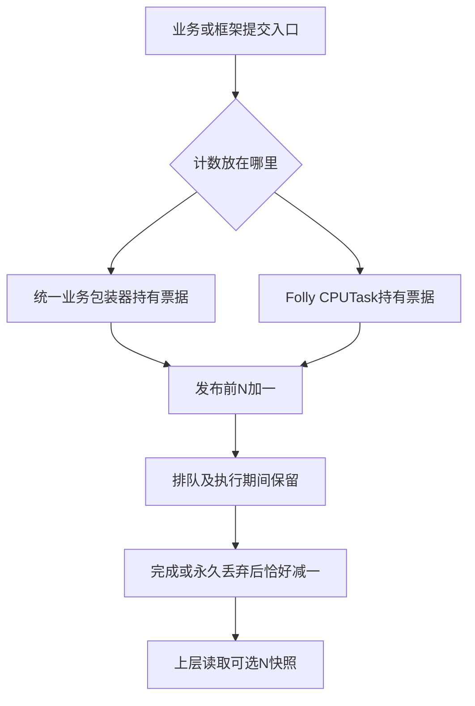

# N负载计数：业务包装与Folly原生两套交付

本包只改造**每池任务生命周期计数N**，不改路由、阈值、亲和性、线程数或工作负载。两套方案任选其一作为调度的权威计数源；同时做校验可以，但不能把两个N相加。接收环境不需要联网，也不需要知道此前会话。

|交付|用途|
|---|---|
|[business/](business/README.md)|无需修改Folly的业务统一提交包装器、示例、真实线程池测试|
|[folly/](folly/README.md)|原生Folly补丁的独立使用示例与定向测试构建入口|
|[FOLLY_PORTING.md](FOLLY_PORTING.md)|基于本地源码的改造点、生命周期与跨版本迁移说明|
|[PROMPT_ONLY.md](PROMPT_ONLY.md)|两个可独立复制的完整prompt；不能传文件时只需复制对应prompt|
|[VALIDATION.md](VALIDATION.md)|开发机实际验证记录及真实环境最小验收要求|
|`folly/native-outstanding.patch`|对明确基线生成的真实代码补丁；不同版本不能盲贴|
|`reference_manifest.json`|基线、修改提交、文件指纹和验证范围|

## 先固定语义

`N[p] = 已向池p预留、尚未处理结束或永久丢弃的普通executor任务数`。增加发生在任务发布给worker之前，领取/唤醒/回调开始不减；正常、异常、过期处理结束、确定未执行即丢弃时恰好释放一次。异步RPC片段返回后结束此次计数，响应就绪重新提交才增加新计数；同步阻塞仍计入N，不能把N当纯CPU需求。

不计入尚未ready的DAG节点、尚未投递的定时任务、整个请求的生存期和Folly停止标记。若用于提交前选池，应在本次任务预留前读取；本包不实现选池。计数值是合法的并发快照，不保证跨池同一时刻，也不把“读分数、选池、加一”变成原子事务。严格接纳上限是另一个接口设计，本包不实现。

`getOutstandingTaskCount()` 返回 `folly::Optional<size_t>`：禁用为 `none`，启用且空闲为 `0`。调用者不能用 `value_or(0)` 将禁用误判为空闲。计数开关在构造时确定，不能对已有积压任务中途打开后声称计数完整。

两套实现的任务边界略有不同：业务层包围用户回调/过期回调，库内方案还包围Folly的`runTask()`及task observer处理。二者都包括排队与执行，不能要求任意并发时刻逐位一致，也不能把清理边界差异误判为泄漏。

## 选择方案

- 能集中所有相关提交入口、暂不维护Folly分支：使用业务包装器。直接绕过包装器调用原池的任务不会被它计入；需要审计Future continuation、优先级入口、RPC恢复等路径。
- 多个框架直接提交同一CPU池、希望统一计数：使用Folly原生接口。被改造的实际CPU池能覆盖这些入口；其他executor、直接操作自定义队列或覆写提交逻辑的派生类仍须审计。
- 无法把文件交给现场agent：只复制[PROMPT_ONLY.md](PROMPT_ONLY.md)中对应路线的完整prompt，每次指定一个阶段，并携带上次完整文字交接卡。prompt不要求访问本包、外部链接或联网下载。

初次验收以生命周期正确性为主。生产侧如需衡量扰动，只做相同输入下观测关闭/开启的一组对照；不混入均衡策略收益，不增加阈值扫描。本地功能通过不等于真实环境已上线或性能已验收。

## 本地Folly基线与兼容性

原生改造基于 `v2026.10.26.00`，commit `c8c7adb72c6d73e2fced5ff5cebc96aa3ff65b2c`。本地已有分组执行器分支 `4d7cc97d0` 的CPU线程池相关文件与该基线一致；本次独立开发不携带、不改动其分组调度实现。

原生实现提交为`54b6ebe1cd4622e92834087b5f0302654e8f6a55`，分支
`experiment/native-outstanding-20261117`。本交接包位于demo仓库的
`experiment/stage3-load-balance-20261115`分支。完整源码指纹与补丁校验记录见manifest。

原生补丁改变`Options`、`CPUThreadPoolExecutor`及公开`CPUTask`的布局。即使默认关闭计数，也要重新编译Folly及依赖这些头文件的消费者；不能只替换头文件或把新对象混链接旧库。默认关闭减少计数路径开销，不代表对象布局、分支和移动成本完全为零。

## 与此前实验的关系

短峰ARM实验的初始80项全部完成p99为13.642→4.784ms，但完整请求p99仅568.466→567.877ms，基本不变。N计数本身不改善时延，这些策略实验也没有证明N优于Q、0.8最优。这个包只让现场获得定义清楚、生命周期完整的N；是否进一步用于调度是后续独立决定。
