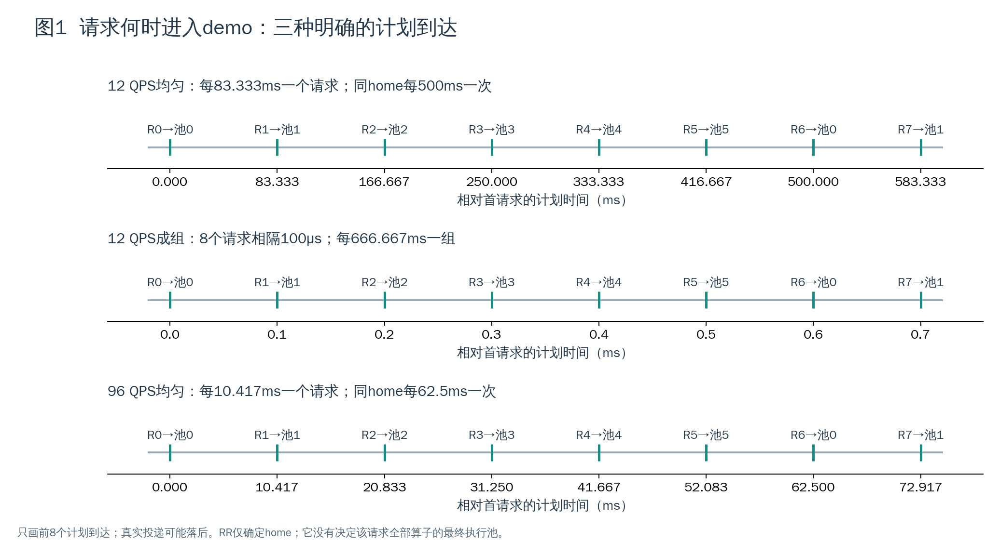
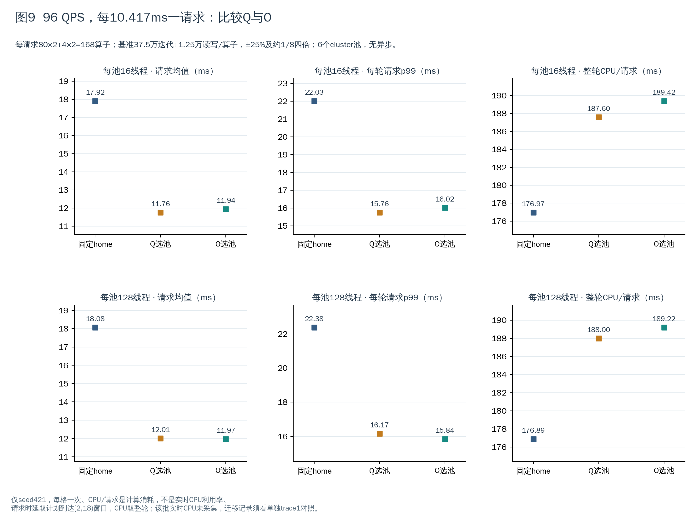
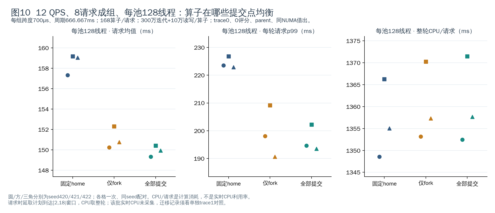
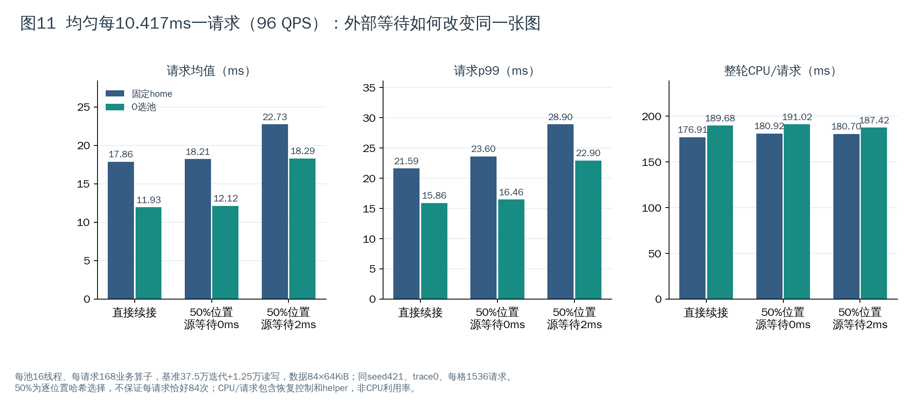
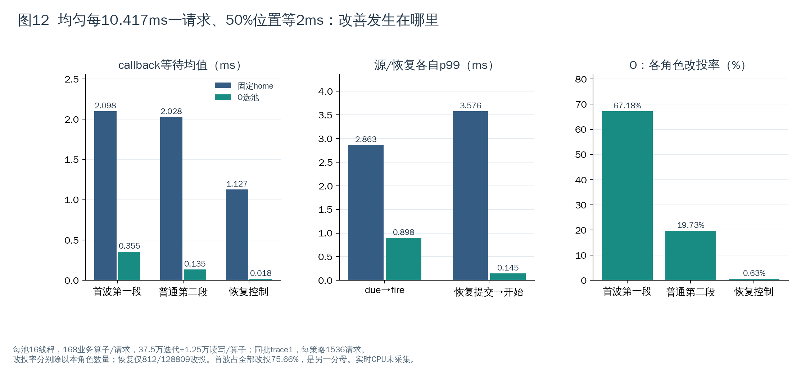
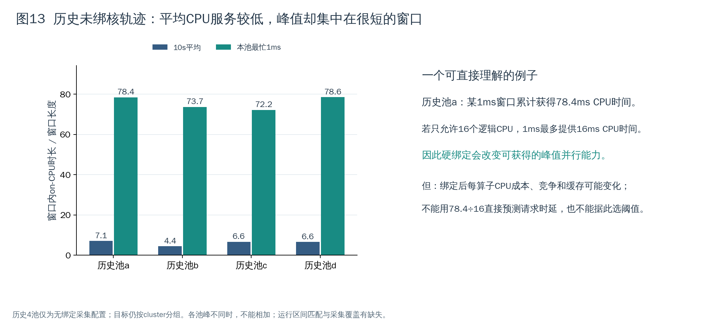

# 一条请求如何跨 cluster 执行：负载、计数、选池与实测结果

本报告从一条请求的执行过程开始，不要求读者先了解历史日志编号。目标架构始终是**每个已核实的硬件 cluster 一个子池，业务只使用一个总池**。历史真实应用的四个未绑核子池仅提供调度现象，既不是目标池数，也不是当前模拟部署。

当前工程已实现两层选择：请求入口确定固定的 home；**同一请求每个新 ready 算子再次通过总池选池**。首波 80 个算子可以分散到同 NUMA 的其他 cluster，后继也可以继续均衡。实测支持这种方式在若干明确负载下减少请求等待，同时增加一定 CPU 消耗；尚未选出跨场景统一最优的负载信号。

报告先展开执行时序和六个量化场景，再在第7节用新增六轮实验，把均匀12 QPS、首波80算子的请求时延、算子改投与逐cluster CPU时间窗放在同一轮比较。结果显示：全资源平均CPU仍约17%，每100 ms窗最忙cluster利用率的p95由约86%降到Q的47%–48%、O的43%–44%，请求均值由约121 ms降到74/73 ms。此前运行未采集的CPU仍保留为缺失；新增曲线不回填到旧批次。

**代表性边界：这些结果验证给定负载下的调度机制，尚未证明复现了真实请求的CPU服务形状。** 尤其300万迭代档约1.37 CPU秒/请求，在16逻辑CPU上天然需要数十毫秒服务。第7.6节解释请求期间1 ms诊断，第7.7节复核首波CPU证据并撤回未经校准的新图必做建议。现有图未充分覆盖复杂依赖和新旧请求阶段竞争；应先补历史时间形状约束，再确定新模型。不能把约38%–39%的模拟均值收益当作生产预测。

**4023更新见第7.8节：** 3份请求CPU曲线恢复成功，另有36轮工作量/图结构假设对照。新增结果支持收益依赖模型，尚未证明生产相似性；它们与前述97条历史整理及4021六轮分别保存。

## 1. 先看一条请求：到达、首次扇出、后继、完成

### 1.1 生产链路与本 demo 的边界

真实链路为 IO 接收 → worker 解析/构图 → executor 执行 ready 算子 → 可选 AIO/RPC → executor 恢复后继。本 demo 用一个按计划发请求的主线程替代前两段，重点覆盖 executor 的算子提交、依赖推进、数据复用及可选异步恢复。没有模拟收包、真实 RPC 网络、构图和压缩开销。

当前测试使用如下六个 cluster；工程池数由配置与拓扑决定，并不固定为六。

| 子池 | 获准逻辑 CPU | NUMA 标签 | worker 比较档 | 名义容量 C |
|---|---|---|---|---|
| 0 / 1 / 2 | 0–15 / 16–31 / 32–47 | 0 | 各16或128 | 各16 |
| 3 / 4 / 5 | 192–207 / 208–223 / 224–239 | 2 | 各16或128 | 各16 |

每个 cluster 是 8 物理核、16 逻辑 CPU。C 是计数归一化尺度，不等于已测得的 SMT 吞吐容量。各 worker 启动时绑定到所属 cluster 的 CPU 集合，并非固定到单一 CPU；driver 与异步 helper 使用这 96 个逻辑 CPU 的并集，与 executor 共享资源。分支payload页由 home 上的初始化 callback 首次触碰，没有强制页面绑定。

请求 home 按 RR 一次确定：R0→池0，R1→池1，…，R5→池5，R6→池0。之后该请求的 home 不变；某个算子实际到池1执行，不会把整张图的 home 改成池1。

| IPO | 本demo的具体对象 |
|---|---|
| 输入 | 每请求planned时间、168算子依赖图、固定循环/访问、84份64KiB数据、可选完成位置与due |
| 处理 | 一次确定home；每个新ready callback经总池选子池；worker执行并释放后继；外部pending另管 |
| 输出 | 请求planned→finish、callback submit→start/CPU/wall、改投角色、CPU/请求、失败与排空结果 |

### 1.2 请求究竟什么时候到达



第 i 个请求从0编号，origin 为本轮时间零点：

```text
均匀到达：planned(i) = origin + floor(i × 1秒 / QPS)
成组到达：planned(i) = origin
                       + floor(floor(i/8) × 8秒 / 12)
                       + (i mod 8) × 100微秒
```

12 QPS 均匀到达是每 83.333 ms 一个请求；96 QPS 是每 10.417 ms 一个。平均12 QPS的成组模式则每666.667 ms投一批8请求，批内0、0.1、…、0.7 ms。100 µs是**请求之间**的计划间隔，不是80个算子之间的间隔。

主线程等待 planned 时刻后记录 attempt，检查在途请求上限16，构造状态、确定 home，再提交初始化 callback。达到上限则拒绝，不是等到有槽位再补投。计划时刻、attempt、初始化开始、80个算子各自 ready/submit 是不同时间；报告中的请求完成时延以 planned 为起点，包含投递迟到。

### 1.3 一条请求的完整图与实际数据


以 R0 为例，主线程最初仅往池0放一个 `init`。它在 home 的 worker 上初始化84份分支数据，然后一次 `addBatch` 提交80个第一段算子。`chunk=1` 时这80项逐个选池、逐个交给底层 Folly，消费与提交可交错。

无异步时，每个第一段完成其计算后，立即 `add` 本分支第二段，**不等其他79个第一段**。两段共享同一个64 KiB可读写 buffer，第二段读到第一段修改后的数据。80条两段链全部完成后，最后完成者提交 join；join 再放出4条新的两段链；它们完成后最终 join 标记请求完成。

因此每请求有 `80×2+4×2=168` 个业务算子，以及1个初始化、2个 join，共171个基础 callback。80表示首波 ready 分支数，不表示同时有80个线程 on CPU，也不表示整张图168个算子一次全部入队。

数据共 `84×64 KiB=5.25 MiB/request`，各分支独立可写。**第二波4条链使用另外4份 buffer**：它与第一波有控制依赖，但没有第一波 payload 向第二波传递。初始化 first-touch、同链前后两段复用体现了局部性机制；当前负载没有覆盖跨分支共享张量、跨波大块数据传递或真实页面驻留分布。

### 1.4 一个算子做多少工作：使用次数，不把循环数写成固定毫秒

每个业务算子先执行整数 xorshift 循环，再执行分支 buffer 读写。一次访问选择一个8字节字，读、计算、写回；访问次数不是 cache miss 次数，也不是不同地址数量。

所有主对照固定 task 级扰动：

```text
r = mix(seed XOR mix(request_id) XOR mix(task_tag))
p = 75 + r % 51                 # 整数75..125
f = 4 if r % 8 == 0 else 1
循环次数 = floor(base_iterations × p / 100) × f
访问次数 = floor(base_accesses   × p / 100) × f
```

同算子的两种工作量使用同一 p/f；约1/8被选为四倍，但不是每轮精确12.5%，倍率与扰动也不是两个独立随机抽样。固定 seed、request、tag 后工作不随调度策略改变。

| 基准循环 / 访问 | f=1 实际循环范围 | f=4 实际循环范围 | f=1 / f=4 实际访问范围 |
|---|---|---|---|
| 3,000,000 / 100,000 | 2,250,000–3,750,000 | 9,000,000–15,000,000 | 75,000–125,000 / 300,000–500,000 |
| 375,000 / 12,500 | 281,250–468,750 | 1,125,000–1,875,000 | 9,375–15,625 / 37,500–62,500 |

例如 seed421、request0、第一分支第一段在375000档实际执行315000次循环、10500次访问；其第二段为420000次循环、14000次访问。不同阶段工作不必相同。

在相应诊断轮中，300万基准档业务算子平均 CPU 约8.14 ms，37.5万基准档约1.05 ms；这是**实测均值**，包含 kernel 与后继提交/异步注册等回调内成本，不是固定执行时间。它们没有复现生产描述中平均100 ms、个别700–800 ms的算子分布；旧 trace 也不能提供这种算子级标定。

### 1.5 异步等待放在哪里

三种模式保持上述168个业务算子的循环、访问、数据和依赖不变：

| 模式 | 每个业务位置计算完成后 | 额外 callback | worker 是否被等待占住 |
|---|---|---|---|
| 无异步 D0 | 直接 advance，提交后继或 join | 无；171/request | 否 |
| 50%位置、0 ms A0 | 确定性哈希选约50%位置；登记 due=issue，helper触发恢复 | 每次选中多一个 resume | 注册返回后释放 |
| 50%位置、2 ms A1 | 同一选择集；due=issue+2 ms；不做对齐聚合 | 同上 | 注册返回后释放 |

2 ms是每个选中位置的最早到期时间，不是每请求只加2 ms。不同分支等待可以重叠，同一链等待可以累积。零延迟仍有 helper 调度和恢复入池成本；helper 甚至可以在注册者返回前触发。

恢复 token 保存 request home、实际父池 source、路径迁移次数和 Folly RequestContext。helper恢复这些信息再提交，不把自己的CPU当成父池。外部 pending 只维持排空生命周期；原 callback 返回后，它不占子池 I/O。恢复 callback 新入池，再由它提交后继。

4020每轮1920请求，确定性选中161076次恢复，合计489396个callback；正式窗口1536请求中有128809次恢复、391465个callback。不是每请求恰有84次恢复。

## 2. Q / I / O / R：每个数在执行链哪一步产生

### 2.1 从提交者到 worker 的读写顺序


下面是与实现顺序一致的简化伪代码。左右两条路径可以并发，worker可能在底层 add 返回前开始甚至结束。

```text
提交线程（driver / 算子worker / helper）：
    j = choose(read Q[], I[], O[], R[])  # 先读状态、评分选池
    R[j] += 本chunk数量                  # 已选定，尚待交接
    诊断开启时：再读目标j的Q/I/O，记t_submit
    O[j] += 1                          # 底层add前预占
    Folly.add(包装callback)             # 闭包入队，然后post
    R[j] -= 1                          # 底层add返回后交接完毕
    # 失败/异常回滚O及尚未交接的R

Folly worker：
    获得信号量许可，取出队列中的闭包      # 原生Q在领取过程中变化
    I[j] += 1                          # 开始执行包装callback
    安装request/source上下文，记t_start
    执行kernel，再add后继或登记外部完成
    记t_finish；诊断记录；回调返回
    I[j] -= 1
    O[j] -= 1                          # 包装器收尾，异常也释放
```

| 信号 | 读取与维护位置 | 它覆盖什么 | 它漏掉或不能表达什么 |
|---|---|---|---|
| Q | Folly `getTaskQueueSize()`；本队列由信号量 `valueGuess()`提供近似量 | 尚未被worker领取的工作代理 | 已领取、已开始但没CPU、同步阻塞；不是内核runq |
| I | BusinessExecutor wrapper开始加1、退出减1；读 relaxed 原子 | 已进入callback但尚未返回的数量 | 不含领取到wrapper开始的间隙；包含抢占/阻塞，不能等同on-CPU |
| O | 底层add之前预占，callback退出释放；失败回滚 | 提交预占及已接收未完成的callback，覆盖Q/I之间的交接阶段 | 不表示剩余CPU时间，不含未ready图节点或外部异步pending |
| R | 高层choose后按chunk预留，每项交接结束释放 | 已路由而尚未完全交给底层的工作 | 非原子事务；与O可短时双计，不能保证多提交者绝不选同一池 |

O不是“并发请求数”；一请求首波可使 O 增加80。I不是“唤醒线程数”；一个worker被唤醒后可能连续跑多个callback。父callback投递子callback后尚未返回时，两者可同时计入I/O，尽管同一分支的两个计算 kernel 并未并行。

逐任务 trace 中的 `Q/I/O_before` 是**选定目标池**在enqueue时的再读取，不是最初home的压力，也不是choose时全部候选的快照；R未写进该行。不能用这些字段精确重放路由，也不能把“选中池Q=0”比例称为“home没压力”比例。

### 2.2 80个算子、16个逻辑CPU，为什么Q会漏看压力

以下为理想状态说明，忽略init，假设80个业务callback已提交而未完成：

| worker配置 | 可能看到的Q / I / O | CPU层面的含义 |
|---|---|---|
| 16 worker | 约64 / 16 / 80 | 16个callback占worker，其余尚待领取 |
| 128 worker | 可接近0 / 80 / 80 | 80个callback已开始；CPU计算时最多16个逻辑线程同时运行，其余可能等内核调度 |
| 128 worker且部分同步阻塞 | 可接近0 / 80 / 80 | 相同计数，但实际runnable/on-CPU更少 |
| 算子登记异步后返回 | 对应原callback退出I/O；外部pending增加 | 请求未完成，并不意味着它仍消耗executor CPU |

因此Q能低成本反映未领取的积压，但“Q=0”不保证请求完成快。I/O补足callback生命周期，仍不是CPU时间测量。允许误差不允许C++ data race：共享读写应使用原子或明确同步，不能为省成本直接并发读写普通整数。

### 2.3 唤醒的是worker，任务仍在公共队列里

底层路径为 `CPUThreadPoolExecutor::add → addImpl → taskQueue.add → enqueue(payload) → semaphore.post`；worker 的 `threadRun → take/try_take_for → wait/try_wait → dequeue → runTask`消费任务。正常提交先入队，再发布可用许可；所谓精准唤醒不是把闭包直接交到某个线程的私有参数槽中。

默认队列使用的 ThrottledLifoSem 有共享许可与唤醒链；经典 LifoSem 的等待者许可交接细节不同，不能混用两者行为。活跃worker完成callback后会继续尝试取下一项，没任务才走等待路径，并非每项都必须先睡眠再唤醒；已经活跃的worker与刚唤醒的worker可能竞争公共任务。被唤醒也只表示有机会运行，还需Linux调度器安排CPU。

所以必须区分：**Folly待领取队列、已进入callback的生命周期、Linux每CPU runq**。当前快速计数没有直接读取第三者。

### 2.4 读取成本、记录成本、评分算法分开考虑

| 方式 | 路由热路径操作 | 维护/记录成本 | 适用边界 |
|---|---|---|---|
| 原生Q | Q-only provider调用队列size近似接口 | 不需要逐任务日志；但本工程仍维护I/O等公共计数 | 简单低成本基线，CPU阶段迁出队列后有盲区 |
| Q+I | 读Q及生命周期计数 | 每callback起止I原子更新；共享cache line可能竞争 | 适配stock Folly可用TaskObserver；同步阻塞会抬高I |
| O | 读未完成与预留计数 | add前CAS预占、退出释放、拒绝回滚；本实现readLoad还读Q等其他字段 | 覆盖交接间隙更完整，仍等权计数轻重callback |
| 加权未完成工作 | 读维护中的工作估计 | 需要可靠算子工作估计及更新 | 接口可替换；当前无生产先验，不能用demo已知循环数冒充可部署估计 |
| 后台CPU样本 | 读缓存样本、检查年龄 | 逐TID扫描/proc成本随worker数增大；不能每次add扫描 | 当前CPU-hybrid候选，未证明优于计数 |
| 诊断trace=1 | 时间戳、线程CPU计时、逐callback行等 | 额外记录与缓存压力，需单独估计扰动 | 用于解释机制；不是生产默认开关 |

`LoadProvider`与评分策略分离，Q、Q+I、O保留为实现类；stock Folly适配器通过 `TaskObserver`维护I，不伪造O。该observer的边界与本demo wrapper并非同一条指令，接入真实应用要先对齐定义。

本工程三种计数均以R补路由预留：`Q评分=(Q+R)/C`，`active评分=(Q+I+R)/C`，`O评分=(O+R)/C`。**active不是I单指标**。不同字段不是同一原子快照；当前O读取不是一个孤立的atomic load。现有对照没有隔离“彻底删除I/O维护后的纯Q成本”，不报告未经测量的ns级优劣。

已测读成本仅有开发机x86、空闲worker、热缓存的批平均探针：原生Q约6.330–6.453 ns/操作，active读取加评分约11.290–11.513 ns；逐TID扫描/proc在4线程约33.6 µs/轮、128线程约982 µs/轮。这些数字未扣循环基线，不是单次p99，更不是ARM高并发写计数的成本；它们只说明“热路径读缓存”和“后台收集样本”是两笔不同成本。[原始验证记录](../../results/review/TRACE_LOAD_VALIDATION.md)

实际目标上的记录开关也有成本：12 QPS、37.5万/1.25万、home下，trace1相对trace0的CPU/请求增量为T16约1.83%、T128约2.28%；96 QPS、50%/2ms模式的4020中，home约+0.84%、O约+0.38%。它们每格一次，只用于检查敏感性；trace0仍维护基础I/O/R等计数，开关差不是整个观测系统的净成本。

CPU后台采样默认每次扫描结束后等待50 ms，实际采样窗口还包含扫描与调度耗时；demo允许最大年龄150 ms，通用类默认100 ms，不能混为同一配置。主要目标运行明确关闭了CPU采样。本文新增的独立cluster CPU采集器只用于补齐评估证据，不接入路由、不改变计数算法。

## 3. 二层均衡如何处理同一请求的80个首波算子

### 3.1 request确定home；每次算子提交确定实际池

高层总池提供 `beginRequest`、`add`、`addBatch`和异步续接。底层多个Folly池只执行高层指定的目标，避免再次做一套冲突选择。业务不直接创建、选择六个Folly池。

以当前O、parent、all、chunk1为例：

```text
beginRequest(id): home = RR_once()
submit(init, pinHome=true)

init在home运行：
    for branch in 0..79:                # addBatch内部按chunk逐项处理
        preferred = 本次父callback实际池  # 这里都是init的home
        if score(preferred) <= high:
            target = preferred
        else:
            target = 本NUMA内足够更轻的候选，否则仍preferred
            # 仅打开跨NUMA且本地无合格候选时再找远端
        reserve(target, 1)
        enqueue(target, branch.stage0)
        release_reservation(target, 1)

stage0结束计算：
    add(stage1, source=stage0实际池, home=不变)
    # all再次判断；fork模式普通后继直接沿source
```


图4仅为解释算法的冻结状态演算：同NUMA三个池、C均16、high=1、gain=0；home0已有init，所以O=[1,0,0]；没有其他请求，暂不消费新任务。前16个首波算子留home，第17个才开始借出，因为触发条件是提交前 `O/C>1`，不是`>=1`。80项全部交接后分配26/27/27，加上home的init，三池O均27。

真实执行边投边消费、父子交错、多请求同时提交，分配不固定为26/27/27。该图不是性能模拟，更不是负载均衡结果的实测曲线。它说明一个请求可以跨池，以及chunk1为何不能简化成“给整请求选一次池”。

### 3.2 首选池、均衡时机、迁移后继承是三个独立设置

| 设置 | 初始80项 | 普通链后继 / join / resume | 请求home |
|---|---|---|---|
| policy=home基线 | 全投home | 全投home | 固定 |
| O+parent+fork | addBatch中按压力选池；第二波4项也一样 | 直接沿实际父池，不再查负载 | 固定 |
| O+parent+all | 每项按压力选池 | 每次新ready再按压力选池 | 固定 |
| continuation=home | 按策略处理 | 只有home低于return-low等条件满足才优先回home；fork普通后继不走这条分支 | 固定 |


parent表示“优先前驱实际执行池”，不表示永远留在那里；pool1忙时后继仍可去pool2，home变轻时也可能由普通选轻逻辑回到home。join由最后完成分支提交，因此parent起点是该分支实际池。

当前本地选择需要首选池score严格高于high，并存在满足 `preferred_score-candidate_score>min_gain` 的更轻候选。候选不必绝对idle，也可能高于high。平手保留当前首选；候选之间平手保留扫描先遇到者。没有更轻池时留在原池，不为追求迁移率强制搬走。

跨NUMA打开后也先找本地；只在本NUMA没有合格候选时再查远端，并计远端惩罚。当前主要结果关闭跨NUMA，因此没有证明远端借出的得失。

`chunk=8`表示8项共用一次目标和预留，仍逐项入Folly；当前chunk1是80次选择。`hop=4`是每条依赖路径累计改投次数上限，不是一个request全图只能迁4项。当前没有偷取已入队任务，也不搬正在运行的算子；“迁移”仅指新callback的 `source != chosen`。

### 3.3 为什么现阶段采用总池封装

请求染色、home、实际父池、NUMA候选域属于业务执行语义。放在一个通用封装中既能隐藏多个Folly池，也能保持底层队列与线程管理不变。阶段五仍有意义：它负责通用接口、拒绝回滚、异常、续接、上下文、生命周期和排空验证；不必以修改Folly核心为完成标准。

只有后续明确需要原生队列内窃取、特殊唤醒或stock接口无法获得关键状态时，才有理由修改Folly。当前证据支持先使用可回退的高层封装；没有“业内普遍最优”算法可直接替代对本业务的观测与对照。

## 4. 结果阅读规则：先固定负载，再比较策略

以下图表均以本报告第1节的168算子、84×64 KiB数据和±25%/约1/8四倍工作为基础。它们不是“长/短”两个模糊类别，而是下表六个明确输入。

| 场景 | 计划请求到达 | 每算子基准循环/访问 | 外部完成 | worker/池 | 主要批次 |
|---|---|---|---|---|---|
| A | 平均12 QPS；8请求/700µs；批周期666.667ms | 300万 / 10万 | 无 | 16、128 | 4011–4013 |
| B | 12 QPS；每83.333ms一请求 | 300万 / 10万 | 无 | 16 | 4014 |
| C | 12 QPS；每83.333ms一请求 | 37.5万 / 1.25万 | 无 | 16、128 | 4015 |
| D | 96 QPS；每10.417ms一请求 | 37.5万 / 1.25万 | 无 | 16、128 | 4016；4018 D0 |
| E | 96 QPS；每10.417ms一请求 | 37.5万 / 1.25万 | 约50%位置，0ms到期 | 16 | 4018 A0 |
| F | 96 QPS；每10.417ms一请求 | 37.5万 / 1.25万 | 同一约50%位置，2ms到期 | 16 | 4018 A1；4020 |

所有主结果固定每cluster一池、RR home、同NUMA、parent、chunk1、hop4。除明确比较fork/all的场景A外，都使用all。Q/Q+I/O共同使用high1、gain0；这不是对各信号分别充分调参之后的竞赛。共同阈值也不表示同一触发条件：忽略R时，Q要待领取项数>16才搜索，O则未完成项数>16便搜索。

请求统计按计划到达 `[2,18)` 秒选cohort，保留晚完成者。12 QPS每轮240个请求、窗口192个；96 QPS每轮1920个、窗口1536个。CPU/请求用run阶段进程CPU除整轮完成数，包含请求构造、payload初始化、预热、排空、driver/helper和内存中trace记录；不含此前线程池启动、trace数组预分配和最后文件导出。它**不与请求窗口同口径**，也不是CPU利用率。

`trace=0`用于主要性能对照；`trace=1`提供callback机制记录。两者分别成对，不能把trace0时延与trace1迁移率拼成同一行。同一seed保持工作样本一致；不同seed改变实际工作量，不是同一工作独立重复三次。每格一次，192请求的nearest-rank p99是第二大值；不能精细断言1%左右的尾部差异。

### 4.1 场景A：12 QPS成组、300万循环/10万访问——三种计数有没有稳定赢家

输入是8请求在700 µs内到达；每请求再释放80个首波算子。每轮峰值在途8，拒绝/失败0。4012比较home、Q、Q+I、O与16/128 worker，三个工作seed，每格一次，全部trace0。


下面显示seed421的绝对值；图中保留三个seed各点，完整79条逐场景记录见附录数据。CPU时间序列与改投率在本性能轮**未采集**。

| seed / 每池worker / trace | 策略 | 请求mean ms | 请求p99 ms | CPU ms/完成请求 |
|---|---|---|---|---|
| 421 / 16 / 0 | home | 157.432 | 225.164 | 1364.706 |
| 421 / 16 / 0 | Q | 146.114 | 195.303 | 1368.840 |
| 421 / 16 / 0 | Q+I | 145.580 | 190.968 | 1368.679 |
| 421 / 16 / 0 | O | 145.527 | 190.521 | 1368.503 |
| 421 / 128 / 0 | home | 159.332 | 231.121 | 1368.040 |
| 421 / 128 / 0 | Q | 150.519 | 195.385 | 1370.470 |
| 421 / 128 / 0 | Q+I | 150.266 | 197.571 | 1370.263 |
| 421 / 128 / 0 | O | 151.459 | 198.984 | 1370.631 |

固定16 worker时，三个计数相对home的请求mean降低7.189%–7.562%，p99降低13.262%–15.630%，CPU/请求增加0.278%–0.385%；128 worker时mean降低4.756%–5.690%，CPU增加0.162%–0.376%。每个范围都是各自同seed、同线程、同批配对结果。

三种信号之间同格mean最大差不足最低mean的0.8%，排序不稳定，不能选出通用赢家。128→16 worker在三种均衡策略下mean再降低约2.93%–4.03%，但p99并非全部下降。当前证据使线程预算成为独立优化轴，并未证明16始终最优。

### 4.2 同一场景A的诊断轮：Q看不见的等待去了哪里，改投多少

4013保持成组到达、300万/10万、seed421，单独打开trace1；比较16/128 worker、home/Q/O。它回答机制，不补充为4012的独立性能重复。


| seed / 每池worker / trace | 策略 | 请求mean ms | 请求p99 ms | CPU ms/完成请求 | 改投/回调（率） |
|---|---|---|---|---|---|
| 421 / 16 / 1 | home | 157.530 | 227.492 | 1368.312 | 0/32832（0.00%） |
| 421 / 16 / 1 | Q | 146.024 | 197.570 | 1371.251 | 15248/32832（46.44%） |
| 421 / 16 / 1 | O | 145.379 | 190.936 | 1370.425 | 15760/32832（48.00%） |
| 421 / 128 / 1 | home | 160.173 | 226.132 | 1375.172 | 0/32832（0.00%） |
| 421 / 128 / 1 | Q | 151.277 | 198.169 | 1377.729 | 14813/32832（45.12%） |
| 421 / 128 / 1 | O | 151.492 | 205.922 | 1378.132 | 15099/32832（45.99%） |

home下，16 worker的业务operator平均CPU/wall为8.135/8.155 ms；128 worker为8.171/15.007 ms。CPU工作量接近，callback开始后的墙钟显著增加。增加worker让更多callback开始，不等于这些callback持续获得CPU；wall-CPU还可能含锁、提交和其他等待，不能全部标成内核runq。

O在16 worker时改投15760/32832=48.00%，Q为15248/32832=46.44%；128 worker时O为15099/32832=45.99%，Q为14813/32832=45.12%。这是同cohort的callback改投率，不是请求离开home的比例，更不是内核线程迁移率。

当前没有该轮逐cluster CPU曲线，不能据此画出“峰值被削平”。已能观察到的是：更多算子被分配到其他池、提交至开始等待下降，以及执行期间墙钟和线程预算的关系。

### 4.3 场景B：12 QPS均匀、300万循环/10万访问——改变请求重叠后再比较

图结构与工作量保持场景A，改为每83.333 ms一个请求，T=16、无异步；同home每500 ms接一次请求。4014有三个工作seed，home/Q/O分别配对，active未运行。


| seed / 每池worker / trace | 策略 | 请求mean ms | 请求p99 ms | CPU ms/完成请求 |
|---|---|---|---|---|
| 421 / 16 / 0 | home | 120.613 | 148.814 | 1363.827 |
| 421 / 16 / 0 | Q | 74.247 | 108.796 | 1370.904 |
| 421 / 16 / 0 | O | 73.418 | 106.183 | 1371.995 |

三个seed中Q相对home的mean降低37.89%–38.51%、p99降低26.89%–28.31%，CPU/请求增加0.42%–0.57%；O的mean降低38.31%–39.13%、p99降低约28.3%–29.8%，CPU增加0.54%–0.76%。本批改投率和实时CPU均未采集。

同样平均12 QPS，均匀到达的相对收益明显大于8请求成组。合理解释是独立请求的首波有更多空间借用其他池，而成组请求彼此争抢候选；但两批并非同一随机交错实验，**收益幅度差不能单独归因于到达方式**，池级CPU时间序列也尚未验证这个解释。不能只报QPS而忽略请求之间的时间结构。

### 4.4 场景C：12 QPS均匀、37.5万循环/1.25万访问——仅做工作尺度校准

把每算子基准工作缩至场景B的1/8，仍每83.333 ms一请求。4015只跑home，比较16/128 worker及trace开关，seed421。峰值在途1；这批没有Q/O策略比较。

| seed / 每池worker / trace | 策略 | 请求mean ms | 请求p99 ms | CPU ms/完成请求 | 改投/回调（率） |
|---|---|---|---|---|---|
| 421 / 16 / 0 | home | 17.952 | 21.458 | 178.817 | 未采集 |
| 421 / 16 / 1 | home | 18.245 | 23.420 | 182.090 | 0/32832（0.00%） |
| 421 / 128 / 0 | home | 17.973 | 21.083 | 178.363 | 未采集 |
| 421 / 128 / 1 | home | 18.376 | 23.410 | 182.432 | 0/32832（0.00%） |

关闭trace时两档请求mean均约17.96 ms，CPU/请求约178 ms；128 worker没有显示出明确收益。打开trace后CPU和p99有所增加，说明约1 ms CPU级算子的观测扰动应独立核算。这一批只能确认工作尺度与记录成本，不能得出“此负载不需要均衡”。实时CPU未采集。

### 4.5 场景D：96 QPS均匀、37.5万循环/1.25万访问——提高请求重叠

保持场景C的每请求图、数据、循环/访问，将到达变为每10.417 ms一个请求，同home每62.5 ms一个。4016固定seed421、无异步，比较home/Q/O和T16/128，每格一次、trace0；峰值在途3。



| seed / 每池worker / trace | 策略 | 请求mean ms | 请求p99 ms | CPU ms/完成请求 |
|---|---|---|---|---|
| 421 / 16 / 0 | home | 17.923 | 22.028 | 176.967 |
| 421 / 16 / 0 | Q | 11.757 | 15.760 | 187.598 |
| 421 / 16 / 0 | O | 11.943 | 16.023 | 189.416 |
| 421 / 128 / 0 | home | 18.077 | 22.377 | 176.889 |
| 421 / 128 / 0 | Q | 12.009 | 16.166 | 188.000 |
| 421 / 128 / 0 | O | 11.970 | 15.844 | 189.220 |

两档中Q/O均降低mean约33%–34%、p99约27%–29%，同时CPU/请求增加约6%–7%。与300万基准档中不足1%的CPU增量不同，这里时延收益伴随更明显的计算成本。没有cache计数或真实CPU曲线，不能把增量全部归因缓存失效，也不能将增量简单命名为路由函数开销。

T16下Q略优于O，T128下两者排名并不完全一致；单格一次不足以选择赢家。active、改投率和实时CPU均未在此批采集。此结果支持保留Q/O候选，不能支持只留O。

### 4.6 回到场景A：只均衡分叉，还是每个后继都再判断

4011使用成组12 QPS、300万/10万、T128、O评分；对home、fork-parent、all-parent做三seed比较。先看trace0性能，再在独立的trace1组内同时看时延和改投率。



trace0各seed中all相对fork的mean变化为-0.893、-1.900、-0.836 ms；p99变化为-3.444、-6.908、+2.848 ms。后继也均衡有小幅mean收益，但不是每个seed的p99都更好。

下表为**同trace1**的seed420，时延、CPU和迁移来自同一运行：

| seed / 每池worker / trace | 策略 | 请求mean ms | 请求p99 ms | CPU ms/完成请求 | 改投/回调（率） |
|---|---|---|---|---|---|
| 420 / 128 / 1 | home | 158.781 | 224.678 | 1357.480 | 0/32832（0.00%） |
| 420 / 128 / 1 | fork-parent | 150.573 | 197.389 | 1358.413 | 9224/32832（28.09%） |
| 420 / 128 / 1 | all-parent | 149.278 | 190.822 | 1357.098 | 15531/32832（47.30%） |

三个seed中all改投率47.02%–47.39%，fork为27.97%–28.09%。seed420按角色分解如下，分母是该角色callback数：

| 角色 | 数量 | fork改投 | all改投 | fork / all提交→开始均值 ms |
|---|---|---|---|---|
| 首波80项 | 15360 | 9212（59.97%） | 9589（62.43%） | 20.574 / 20.335 |
| 普通后继 | 16128 | 0 | 5941（36.84%） | 37.340 / 37.255 |
| 第二波4项 | 768 | 12（1.56%） | 0 | 0.037 / 0.026 |
| join | 384 | 0 | 1（0.26%） | 0.006 / 0.007 |

因此fork已经均衡**同请求内的首波算子**，并非只均衡请求。all增加约19个百分点callback改投，却没有稳定p99优势；是否值得扩大后继均衡，应该由具体负载、CPU预算与可重复收益决定。不同分支等待不能相加解释request p99。实时CPU仍未采集。

### 4.7 场景D/E/F：把异步等待与CPU ready压力拆开

4018固定96 QPS、37.5万/1.25万、T16、seed421，对无异步、50%位置0 ms、同50%位置2 ms分别比较home/O，均trace0。每种模式保持原有168个业务算子及工作量一致。



**无异步：**

| seed / 每池worker / trace | 策略 | 请求mean ms | 请求p99 ms | CPU ms/完成请求 |
|---|---|---|---|---|
| 421 / 16 / 0 | home | 17.862 | 21.595 | 176.908 |
| 421 / 16 / 0 | O | 11.934 | 15.857 | 189.680 |

**50%位置、0 ms到期：**

| seed / 每池worker / trace | 策略 | 请求mean ms | 请求p99 ms | CPU ms/完成请求 |
|---|---|---|---|---|
| 421 / 16 / 0 | home | 18.208 | 23.600 | 180.918 |
| 421 / 16 / 0 | O | 12.115 | 16.457 | 191.021 |

**50%位置、2 ms到期：**

| seed / 每池worker / trace | 策略 | 请求mean ms | 请求p99 ms | CPU ms/完成请求 |
|---|---|---|---|---|
| 421 / 16 / 0 | home | 22.729 | 28.898 | 180.696 |
| 421 / 16 / 0 | O | 18.286 | 22.901 | 187.419 |

2 ms到期模式使请求完成更晚，但CPU ready工作会在等待期间退出池计数。它并不等于worker sleep 2 ms。诊断的home恢复等待均值在0 ms模式约2.065 ms，2 ms模式约1.135 ms：请求更慢与池内某段排队更短可以同时发生，不能用请求存活数代替CPU压力。

本组trace0没有改投率或有效CPU序列。整轮进程CPU包含helper，不能额外重复加一次helper CPU。字段中虽有进程CPU总量和wall+drain，但两者起点并不一致；本报告不将其商包装成精确平均利用率。

### 4.8 场景F的补充诊断：收益主要发生在首波、普通后继，还是resume

4020重复同一50%/2 ms合同，补home/O各自的trace0/trace1四格，每格一次。无失败、拒绝、超时；工作签名、到达hash、checksum及迭代/访问总数保持一致。

| seed / 每池worker / trace | 策略 | 请求mean ms | 请求p99 ms | CPU ms/完成请求 | 改投/回调（率） |
|---|---|---|---|---|---|
| 421 / 16 / 0 | home | 22.808 | 29.175 | 180.640 | 未采集 |
| 421 / 16 / 0 | O | 18.277 | 22.947 | 187.401 | 未采集 |
| 421 / 16 / 1 | home | 22.752 | 27.972 | 182.159 | 0/391465（0.00%） |
| 421 / 16 / 1 | O | 18.273 | 23.039 | 188.117 | 109109/391465（27.87%） |

trace0的O相对home，mean降低19.87%，p99降低21.35%，CPU/请求增加3.74%。这是当前合同内的描述性结果，不是生产保证。



两个trace1运行的同cohort角色记录：

| 角色 | 数量 | home等待均值 ms | O等待均值 ms | O改投数及率 |
|---|---|---|---|---|
| init | 1536 | 0.016 | 0.014 | 0 |
| 首波第一段 | 122880 | 2.098 | 0.355 | 82553；67.18% |
| 第二波第一段 | 6144 | 0.008 | 0.027 | 252；4.10% |
| 普通后继 | 129024 | 2.028 | 0.135 | 25461；19.73% |
| join | 3072 | 0.005 | 0.022 | 31；1.01% |
| resume | 128809 | 1.127 | 0.018 | 812；0.63% |

O总计改投109109/391465=27.87%，其中75.66%的改投发生在首波。普通后继19.73%的改投率直接证明后继也参与二层均衡；恢复自身仅0.63%换池，却仍大幅减少恢复排队。这与“先分散业务工作，让后续ready工作受益”相容，不能解释成“主要靠迁移RPC恢复”。第二波和join等待略增，不能写成每类都获益。

异步路径还需分别看：issue→due固定2 ms；due→fire p99由2.863降至0.898 ms；resume submit→start p99由3.576降至0.145 ms。helper与executor共享CPU，完成源也会受资源竞争影响。各分段p99不能相加得到request p99，总收益也不能全归给Folly队列。

trace1下业务operator平均CPU由1.054升至1.082 ms；恢复callback约0.002→0.004 ms。计数O对它们各算1，是已知局限，但本批尚不足以证明必须采用加权工作。这里仍没有实时CPU曲线；callback occupancy峰值或均值不能替代它。

### 4.9 这些实验已得到什么“负载与时延关系”

已经得到两类结果：一是固定部署/工作/到达下，提交前Q对应的**条件等待分布**；二是固定负载下，改变信号与路由后**整请求mean/p99和CPU成本的干预对照**。没有一个跨线程数、图结构和外部等待都通用的 `Q或I或O → request p99` 公式。

早期独立任务实验没有DAG：平均240任务/秒，每416.667 ms产生100个无依赖任务，同批全部入一个池，批次RR选六池；任务CPU预算基准100 ms、±50%抖动并做整轮精确均值归一化，无额外长尾。每池256 worker、cluster绑定，运行60秒，统计计划到达[10,60)的12000项。它按线程CPU预算忙算，而非当前固定迭代/数据模型。Q分桶如下；三seed范围不是置信区间：

| 提交前Q | submit→start p99 ms | submit→finish p99 ms | 每轮桶内样本 |
|---|---|---|---|
| 0 | 0.033–0.035 | 581.142–624.703 | 120；尾部样本不足 |
| 4–15 | 2.940–3.018 | 603.284–609.160 | 1556–1619；尾部样本不足 |
| 16–63 | 167.625–176.667 | 643.763–647.688 | 6124–6346 |
| ≥64 | 313.930–316.825 | 676.422–679.841 | 3549–3831 |

Q越大，待开始分布明显变差；但Q=0仍可能完成很慢，后续同批提交、执行工作与开始后的竞争都在影响完成。该旧任务合同与当前168算子图不同，不能用表中阈值设当前路由参数。完整旧合同与部署比较在附录链接，主报告不把它混入当前策略排名。

## 5. 真实调度轨迹：哪些事实能指导每cluster一池

历史trace是用户提供的约10秒真实应用采集，16 QPS、四个未绑定CPU的池、每池约128线程。已整理到404个池内TID，轨迹可见CPU0–383。池归属由线程名推断，采集CPU范围、丢失事件与区间匹配存在局限，以下数值是已审阅历史摘要。它有sched切换/唤醒/迁移事件，**没有request ID、算子边界、Folly出入队和RPC标记**。下面每条都明确“观察到什么→对目标的意义”。

### 5.1 单池平均不高，却曾短时获得远超一个cluster的CPU服务



四池平均CPU时间当量为7.093、4.364、6.620、6.569；各自最大1 ms桶为78.437、73.656、72.167、78.559。78.437表示在这个1 ms窗口，池内所有已匹配运行区间合计78.437 ms CPU时间，不是某个瞬间精确有78个线程同时运行；各池最大值也不必同时发生。

一旦把该池硬限制到16逻辑CPU，在1 ms内最多提供约16 ms CPU时间。原先从全机取得的短时并行必须转为等待、执行效率变化或上层算子外借。因此“整机平均CPU约50%”不能排除绑定后单cluster瓶颈。不能直接把原请求时延乘78/16，因为缓存、SMT、线程竞争也会改变。

**对应模拟与工程动作：** 单请求首波80项与每池16CPU直接制造这一矛盾；比较home和算子外借，再单独比较16/128 worker。真实改造不能仅把历史128 worker原样绑进一个cluster而不检查峰值并行。目标池数按真实cluster生成，不沿用四池。

### 5.2 池间压力不总是一起高，但旧trace不能证明同NUMA一定空闲

以各池自身平均CPU的两倍为各自阈值，4280个“至少一池高”的1 ms桶中，3550个只有一池高，占82.94%。最繁忙10%的桶承担各池45.5%–54.8%的CPU服务，说明平均值掩盖了集中段。

这些阈值不是统一的16CPU；“只有一个池高”不等于其他池idle。旧池未绑NUMA，不能据此说82.94%过载能在本NUMA消化。

**对应模拟与工程动作：** 同时测试均匀12 QPS与8请求成组12 QPS，因为候选池是否也忙会改变收益。保留“首选忙且同NUMA存在更轻池才改投”，没有更好目标就不迁移。同NUMA优先是减少未知远端内存代价的初始策略，跨NUMA需独立实验，不是历史trace已证明的最优规则。

### 5.3 与CPU强相关的“活跃线程”不是工程I

旧分析的1 ms桶内“上过CPU的不同TID数”与CPU时间相关系数0.926–0.933；waking次数与CPU的相关系数仅0.501–0.546，10 ms桶约0.690–0.740。不同TID计数把先后运行的线程都算进来，运行1 µs与900 µs都记1。它与CPU时间来自同一组运行区间，而I是callback开始至返回的瞬时占用数。

因此不能用旧“单池平均20、峰值80”的未确认口径直接设I阈值，更不能将I/C称为CPU利用率。128 worker时I可能80而on-CPU最多16；同步阻塞又会使二者偏离。

**对应模拟与工程动作：** 保留Q低成本基线、Q+I与O候选，用同负载对照请求p99与CPU成本；真实CPU通过独立同窗计账验证。现有三种计数未分出稳定赢家，选择信号不能只看与CPU的相关系数。

### 5.4 旧trace不足以指定“等3ms再迁移”

按前述“CPU超过自身均值两倍”的连续高桶段，p50约2 ms，p95约15–20 ms，最大25–55 ms。短段与持续段并存；但这是CPU时间桶的段长，不是同请求的算子排队时长。

原先0.85 ms的统计口径仍未确认。后续脚本得到相近的约0.868 ms，定义为线程wake到首次非runnable切出候选周期；相近数值不能反证原口径。这样的一个周期可能执行多个callback，一个callback也可能跨多个周期。不能据此推导20个算子在16CPU上约1.2 ms排空。1266个过载事件及所提0.9C/0.75C/2C门槛没有完成同定义复核，外部解析器的跨桶状态处理也曾发现问题。

此外，当前总池只在提交新ready工作时选池。早期目标CSV摘要中80项首波提交跨度均值约0.070–0.120 ms；如果统一等3 ms才准借出，首波通常已经全入原池，当前实现不会重新搬动已入队工作。

**对应模拟与工程动作：** 先保留已经验证的即时计数选择。只有测到大量无益改投、且门控期间仍有可路由的新工作时，再把持续门控作为独立算法比较。不能直接把平滑后的下降尾巴当真实持续压力；也不能把return-low误称成parent策略的快释放线。

## 6. 给真实环境的候选起点：明确单位、适用条件和后续梯度

以下是受控对照起点，不是无需验证的生产默认值。接入前先核实cluster/SMT、进程允许CPU/quota、每次后继是否都走总池、同步阻塞与异步释放worker边界；无需重采旧trace才能完成这些代码核查。

| 项目 | 已测起点 | 为什么这样起步 | 有证据需要时才展开的候选 |
|---|---|---|---|
| 分组 | 每核实cluster一池 | 保留明确CPU/cache域 | none/NUMA作为独立部署基线，别与策略同时改 |
| L1 | 现有request RR home | 控制请求归属不变，隔离L2收益 | 入口负载感知需另测，不与L2混淆 |
| worker | CPU主导时纳入T=C档；保留既有T | 已测16/128显示线程过配会改变等待位置 | 有同步阻塞再试更高档；不一刀切16 |
| 信号 | Q与O对照，必要时Q+I | Q便宜但漏已领取；O完整但轻重等权 | 只有可靠成本先验才加权；CPU样本可作独立候选 |
| high | 1.0，无量纲 | 复现已有点；触发严格score>1 | 同信号试0.75/1/1.25/1.5，不能跨信号当同一计数阈值 |
| gain | 0，归一化score差 | 存在严格更轻才借出 | 若频繁微小差值改投，试0.125/0.25；C16要求计数差严格大于2/4项 |
| continuation | parent | 优先前驱实际池，保留同链复用机会 | 与有条件home回迁独立比较，不强制每次回home |
| balance-at | fork与all均保留 | fork已处理80首波；all额外处理后继 | 按mean/p99、CPU与迁移率选择，不只比迁移多寡 |
| chunk | 1 | 每项读状态，解释性强 | 若路由成本显著再试4/8，预留覆盖整chunk |
| hop | 每条依赖路径4次 | 限制反复改投；非全request额度 | 检查触顶比例后试2/4/8 |
| NUMA | cross-numa=0 | 先控制跨页域代价 | 本NUMA持续拥堵且远端有余量时再开，并单独定惩罚 |
| return-low | 0.5，仅有条件home模式使用 | 评分≤0.5才优先回home | parent/fork普通后继不靠它“快释放” |

“初值+梯度”应交给当地agent作为有预算的候选集，不是让它自动跑全笛卡尔积。先固定负载/资源/观测，比较home与一个候选；通过正确性、排空、失败率和业务预先确定的CPU/p99门槛后，再只展开有问题的一轴。保留同工作配对和未参与选参的工作seed，增加独立交错整轮重复，避免拿少数最小p99挑参数。

现有纯prompt交接已拆成只读探索 → 本地设计 → 可回退实现 → 功能验收 → 有预算性能对照。其作用是让当地agent核实事实，不让它照搬此处循环次数、96 QPS或2 ms。真实业务无网络直通、无法传文件不妨碍使用这些阶段提示；目前结论不要求新的生产trace作为前置条件。

## 7. 同一轮的CPU时间分布、请求时延与算子改投

### 7.1 已完成的六轮负载与有效性

新增六轮依次为home → Q → O → O → Q → home，组成前后两个比较块；第二块用最后一轮home作基线。本节只比较这六轮，不把旧批次的trace0时延与新CPU拼成同一轮。

| 维度 | 六轮共同合同 |
|---|---|
| 资源 | CPU 0–47、192–239；6个cluster各1池、各16 worker；每池C=16；前三池NUMA 0、后三池NUMA 2 |
| 请求到达 | 均匀12 QPS，每83.333 ms一请求，home按RR；每轮240请求，计划到达[2,18)秒内192请求用于时延统计 |
| 一次请求展开 | init首次触碰84份64 KiB数据 → 80条两段链 → join → 4条两段链 → join；168业务算子、171 callback；同分支两段复用可写数据 |
| 每算子工作 | 基准300万迭代+10万访问；task级±25%扰动，约1/8四倍；seed421。实际全程平均每请求700,110,000次迭代、23,337,000次访问 |
| 算子调度 | parent/all、chunk=1、high=1、gain=0、hop=4、禁止跨NUMA；每个新ready算子均经总池，home策略不借出 |
| 观测与等待 | 六轮均trace=1，独立100 ms CPU采集；无异步、无同步阻塞，CPU后台评分与页面采样关闭 |

**请求均匀到达仍有请求内部微突发**：初始化结束时80个第一段依次提交，第二段随各自前驱完成提交。命令中遗留的burst-size=8和spacing=100µs在regular模式不生效，不能把本轮误认为8请求成组。

六轮全程各240/240成功、cohort各192/192、零拒绝/失败、峰值在途请求数2。逐请求checksum、算子实际工作、计划到达和CPU资源的目标侧审计全部通过。每轮32832个cohort callback，角色数之和与之相等；跨NUMA改投均为0。

每轮得到159个六cluster完整窗口，即954行，六轮合计5724行；正式16秒范围覆盖99.363%–99.375%，没有无效窗口。少量边界没有完整读取括号，依规则排除。单轮报告中的“无唯一配对”只是它只输入一个目录；最后前后三格均形成有效home比较。旧matrix元数据未登记也不否定本次显式命令和同工作审计。

### 7.2 先看同轮请求结果和CPU成本

| 比较块 / 轮次 | 请求mean ms | p95 ms | p99 ms | callback等待p99 ms | 进程CPU/请求 ms | 改投/全部callback |
|---|---:|---:|---:|---:|---:|---:|
| 1 / 01-home | 120.549 | 139.148 | 146.012 | 39.433 | 1368.269 | 0/32832，0% |
| 1 / 02-Q | 74.097 | 93.801 | 111.234 | 10.314 | 1373.819 | 9745/32832，29.68% |
| 1 / 03-O | 73.243 | 93.503 | 106.573 | 7.595 | 1372.960 | 18287/32832，55.70% |
| 2 / 06-home | 120.756 | 139.941 | 147.571 | 39.273 | 1369.249 | 0/32832，0% |
| 2 / 05-Q | 74.283 | 92.671 | 121.098 | 10.338 | 1373.002 | 9664/32832，29.43% |
| 2 / 04-O | 73.441 | 93.827 | 105.859 | 7.614 | 1373.757 | 18159/32832，55.31% |

Q相对本块home，请求均值降低38.49%–38.53%，p99降低17.94%–23.82%；O分别降低39.18%–39.24%和27.01%–28.27%。进程CPU/请求增加仅约0.27%–0.41%。算子CPU均值约8.14–8.17 ms、墙钟均值约8.15–8.19 ms，主要差异在开始前等待。这里的等待是选池后submit→callback开始，包含Folly交接和可能的内核等待，不能称为精确Linux runq时间。

每个p99只有192请求中的第二大值；两轮均列出，不平均、不伪造置信区间。4014相同seed的工作签名与本轮一致，均值改善方向也一致，但4014为trace0且没有本轮采集器，不能跨批求采集开销或合并成更多同条件重复。

### 7.3 CPU消耗在时间与cluster之间怎样变化


固定home时，请求轮流进入六个cluster，因此**长期平均已经接近均匀**，各cluster全段平均约16%–18%。但一个请求的80个首波算子及后继集中在一个cluster；图中出现局部深色窗口。Q/O把新ready算子借到同NUMA另两个cluster后，同一NUMA内几个cluster更同步地工作，局部深色窗口变淡，请求更早结束。该解释同时得到角色改投和等待数据支持；图本身没有给每条CPU活动标记request身份。

定义每窗口六cluster利用率为U0…U5。本节“最忙cluster的p95”先逐窗取max(U0…U5)，再在159个结果上取nearest-rank p95；**不是六个cluster各自p95再取最大值**。同NUMA极差先算`[(max(U0,U1,U2)-min(U0,U1,U2)) + (max(U3,U4,U5)-min(U3,U4,U5))]/2`，再按实际窗长加权平均，单位为百分点，包含当窗闲置的NUMA域。

| 比较块 / 轮次 | 96逻辑CPU平均利用率 | 窗内最忙cluster的p95 | 同NUMA利用率极差均值 | 全资源窗口利用率p95 |
|---|---:|---:|---:|---:|
| 1 / 01-home | 17.37% | 86.26% | 40.52个百分点 | 18.74% |
| 1 / 02-Q | 17.31% | 47.40% | 5.59个百分点 | 21.48% |
| 1 / 03-O | 17.35% | 44.22% | 4.16个百分点 | 21.88% |
| 2 / 06-home | 17.31% | 86.24% | 39.83个百分点 | 18.96% |
| 2 / 05-Q | 17.54% | 48.12% | 5.67个百分点 | 21.47% |
| 2 / 04-O | 17.46% | 43.23% | 4.13个百分点 | 22.20% |

**改善发生在局部负载和等待，平均CPU并未下降。** 全资源某些100 ms窗口的并行度反而更高：窗口利用率p95从约19%升到约22%。因此不能说“负载均衡降低所有CPU峰值”，也不能由17%的整体均值推断单cluster不会排队。


### 7.4 Q与O究竟在哪些算子上做出不同选择

| 轮次 | 首波第一段改投率 / 平均等待ms | 普通第二段改投率 / 平均等待ms |
|---|---:|---:|
| 01-home | 0% / 15.166 | 0% / 30.685 |
| 02-Q | 63.36% / 2.551 | 0.081% / 4.213 |
| 03-O | 67.47% / 2.480 | 49.09% / 4.039 |
| 06-home | 0% / 15.168 | 0% / 30.708 |
| 05-Q | 62.86% / 2.526 | 0.056% / 4.223 |
| 04-O | 67.45% / 2.483 | 48.34% / 4.057 |

首波分母是192×80=15360；普通第二段是192×84=16128；全部改投率的分母32832还包含init/join等控制callback。这里是新callback相对保存的source池改变投递目标，既不是线程迁核，也不是把已经排队的算子偷走。

两策略都配置all，**Q在本负载的实际行为接近只均衡首波**：普通后继仅9或13次改投；O则为7796或7918次。O的普通后继中有2741或2781次回到原home，这是parent优先下的普通选池结果，不能写成开启了ReturnHome模式。

O比Q请求均值只再快0.842–0.854 ms，但总改投率多约26个百分点。p99本轮也更低，仍受样本数限制。不能据此认定O的全部额外后继改投都有必要，因为两者的首波落点也不同；若业务需要减少亲和性破坏，应在相同负载下比较O/fork与O/all或有限提高gain，而不是仅凭当前结果删去后继均衡。

同一个high=1也不意味着相同压力门槛。忽略短时R时，Q评分要等Q>16才进入借出判断；O评分在I约16且Q刚开始出现时就可能达到O>16。O包含已领取且未结束的任务，Q主要反映未领取数量。此次比较证明两套配置的行为和效果不同，**没有单独证明Q观测不准，或O在等压阈值下必然更优**。

### 7.5 计量边界与当前行动

CPU来自`/proc/stat`的`Δ(user+nice+system+irq+softirq)/HZ/实际窗长`，再除以该cluster的16个逻辑CPU；不重复加guest。cluster值包括executor、driver/helper、采集器及其他活动；进程CPU另读，不能按总数反推每池CPU。进程与cluster读取边界不同，不把两者逐窗相减解释为精确外部干扰。

实际窗口为92.779–107.219 ms，最大采样迟到5.052 ms；100 ms窗口无法验证1 ms微突发或30 ms过载持续时间。100 ms采样还与同home每500 ms的RR周期存在相位关系，单个cluster分位数差异不能直接解释为硬件差异。正式CPU时间窗与请求计划窗口对齐，但窗口中可有较早请求的尾段或缺少cohort晚完成部分，故窗口CPU不等于恰好那192请求的CPU总量。

采集器每轮自身约0.543–0.567 CPU秒，被测进程约328–330 CPU秒；前者约为后者的0.17%，已包含在cluster计量中，不应再加。没有采集开/关配对，不能承诺p99零扰动。CPU/请求来自被测进程整轮，覆盖240请求，包含helper与记录开销。

**本轮已补齐此合同下的CPU时间分布、请求时延、算子改投证据，不需要为相同目的再跑六轮。** 维持当前固定工作负载、计数器实现和候选参数；既不恢复历史四池架构，也不据此增加EWMA或3 ms持续门槛。真实环境下一步仍是逐阶段prompt核查：每cluster一池、统一后继入口、计数生命周期、阻塞边界与容量，然后按当地SLO比较一个有限候选。若后续必须决策“减少后继改投”或“识别1 ms自愈尖峰”，分别触发同合同fork/all消融或更细粒度计账；它们不是当前报告交付的前置测试。

CPU采集命令保留于[复现指南](CPU_CAPTURE_GUIDE.md)，本轮完整审阅与边界见[4021审阅](../../docs/TARGET_V2_4021_REVIEW.md)。历史其他负载、128线程、异步与跨NUMA不因本轮而获得CPU时间序列；相应结论仍使用它们自己的证据范围。

### 7.6 80条两段链是否把现场短脉冲模拟成了持续压力

**低长期均值与短时高并行，只约束了部分现象，不能唯一决定DAG和请求内部服务形状。** 当前图的160个首波业务算子占168个算子的95.24%；seed421实际第一波迭代/访问工作占cohort约95.21%。第二波仅8个算子，且没有异步间隙，确实是以首波持续计算为主的模型，不是已经验证过的现场请求回放。

以4021第一轮为例，首波第一段算子平均约8.25 CPU毫秒，每请求80个第一段合计约660 CPU毫秒。仅这些第一段在16个逻辑CPU上就需要至少约41.25 ms供给，后面还有第二段和其他控制工作。按同cohort角色CPU均值加权，整个请求约1.369 CPU秒，数值经过原始表格舍入。

| 假定可同时提供的逻辑CPU | 约1.37 CPU秒工作的理想供给下限 |
|---|---:|
| 16：一个cluster | 约85.6 ms |
| 48：同NUMA三个cluster | 约28.5 ms |
| 80：仅用来解释历史未绑核时可能的高并行 | 约17.1 ms |

这些是`CPU工作量/并行供给`的解释性界，暂时假定工作CPU成本不随部署变化，不是预测时延。图依赖、实际可用核、SMT、缓存和其他请求会改变实测结果。历史池未绑CPU，因此**相同CPU面积在未绑定时形成较短高并行脉冲、绑定16CPU后拉成长平台并不矛盾**；也不能据此证明历史就是这张80×2的图。

另一方面，12QPS按六池RR使每个home每500 ms才收到一次请求。`1.37 CPU秒/0.5秒≈2.74 CPU`，相对于16逻辑CPU只有约17%。所以当前模型能同时产生低长期平均和数十毫秒的请求内压力。100 ms热图把这个请求内过程进一步平均掉，不能用于验收微突发形状。

历史trace没有request/operator标记。其高服务段p50约2 ms、p95约15–20 ms，采用的是“超过该历史池自身均值2倍”的门槛；它们不是请求持续时间，也不是N>16的过载段。约0.868 ms的线程wake周期也不能换成算子CPU时长。当前数据仍能验证总池逐算子借出的机制、Q/O配置的区别及工作守恒，不能确认真实业务收益比例、数据局部性代价或生产阈值。

**新增的目标是请求内部的服务形状；4021已经完成的100 ms比较无需推翻或重复。** 工程现在提供两个互补入口：

| 输入与工具 | 实际产物 | 可以回答什么 |
|---|---|---|
| 已有trace1的tasks/requests/summary；`request_cpu_shape.py` | 每请求CPU面积、首波占比、服务累积50/90/99%时间上下界；1 ms各池CPU服务上下界 | 不重跑即可检查工作是否集中于首波、压力可能持续多久；上下界不是实测CPU曲线 |
| 新短轮perf sched_switch + callback worker TID；`request_sched_profile.py` | 每1/5 ms当前请求CPU调度驻留、同窗cluster全部非idle驻留、已提交未开始和callback占用 | 分开观察需求积压、已开始未返回和实际调度服务，核对请求内平台/脉冲/尾段 |

第一种工具利用单callback已测CPU量C及wall区间W：对某窗口的交集长度l，服务下界`max(0,C-(W-l))`、上界`min(C,l)`，从不按wall比例均摊CPU。第二种工具以TID和统一CLOCK_MONOTONIC把实际调度驻留区间与callback相交，1 ms是离线积分窗口，不是轮询周期。调度驻留包含非idle任务被IRQ打断的时间、没有计算idle中的IRQ；须与线程CPU时钟累计交叉检查，不能称为精确扣除中断后的CPU计账。缺失、丢失和时钟不一致不补成空闲。

采集在demo前后分别执行逐CPU的边界动作，使持续idle的CPU也有可检查的首尾切换。动作在请求区间外，单独记录，不计入请求面积；它会唤醒CPU，采集及启动状态扰动不能忽略。这些短轮用于形状诊断，不替代未开启调度事件记录时的净性能比较。

已有采集方案比较300万/10万和37.5万/1.25万两个迭代/访问尺度，保持12QPS、每cluster16线程，并含375k的O诊断对照。每次24请求只用于观察服务面积、t50/t90/t99、局部平台与未开始callback积压，不做p99排名；改变工作量也改变平均压力。4022已回传采集执行记录，当前失败发生在离线解析。**现在只恢复这些已保存文件，不重复压测或重采。** 采集命令保留作复现说明，当前恢复命令见[4022修订指南](../../docs/TARGET_V2_4022_REVIEW.md)。

在4022恢复解析前尚无目标机细粒度结果；4023已恢复的曲线见第7.8节，但仍不能按想象修改DAG以“拟合”历史四池。若最终仍没有现场request边界，只能覆盖可解释的负载家族与策略敏感性，不能保证单个合成模型代表真实业务。真实环境可访问时的最低补证是request边界、ready算子数、每算子CPU/wall和外部等待，而非必须重采整段历史trace。

### 7.7 负载代表性复核：不能由偏重直接指定替代图

4022回传了旧4021两轮CSV的请求级重分析，证明了现有工作分布，但没有确定替代负载。全240请求中，首波全部深度占业务算子CPU的逐请求份额均值为home **95.732%**、O **95.744%**。因此原模型的主要计算一直留在80路宽波内；只将所有算子缩短八倍，仍没有改变这一结构性偏重。

显式选择的request6提供如下服务时间界。这是同一请求ID在两次独立运行中的记录，不是代表样本；50/90/99%指累计CPU工作比例，不是请求完成时延分位数。

| request6指标 | home | O |
|---|---:|---:|
| 请求过程至最后callback结束ms | 127.341 | 74.004 |
| timed callback CPU ms | 1374.030 | 1358.920 |
| 交付50% CPU时间界ms | 45.568–45.591 | 16.945–16.966 |
| 交付90% CPU时间界ms | 80.508–80.534 | 34.613–34.646 |
| 交付99% CPU时间界ms | 113.562–113.587 | 60.393–60.411 |

这些界限已否定“当前3M工作只在开头1–2ms完成服务”的解释，但不证明连续满载。O保持接近的面积并更早交付，解释了给定模型的收益；生产代表性仍未建立。全240请求统计不替代前面192请求cohort。原文、源行号和计量范围见[4022证据](../../results/review/4022_summary.json)。

此前据此指定80×1+4×22及三档矩阵为下一步必做实验，缺少依据，现撤回该建议。工具仍可表达这个受控假设，但它不是trace标定的业务图，也没有目标机代表性验收。

| 图 | 首波与后波 | 业务算子/分支数据/总callback | 首波固定工作计数份额 |
|---|---|---|---:|
| 原机制基线front80 | 80条深度2链，再4条深度2链 | 168 / 84×64KiB / 171 | 95.24% |
| 未校准提案tail4 | 80条深度1链，再4条深度22链 | 相同 | 47.62% |

两图都只有独立分支链和整波barrier，没有任意多父依赖、局部再扇出或阶段流水。后波使用另一组buffer，join读取结果摘要；22段链还改变同分支复用和hop预算作用。因此等工作计数既不是等CPU成本，也不能证明已经减少头部压力或模拟复杂数据亲和。

regular 12QPS全局间隔83.333ms，六池RR同home间隔500ms；加深链不能自动保证旧请求后期与新扇出在同池或同NUMA竞争。既有在途重叠和角色聚合也没有这项联合归因。后续需要以request阶段、ready/开始/结束及实际池，验证两类工作同时间争用资源，并分别统计新旧请求时延。不能用总在途或合并p99替代。

历史trace还可提供有用的时间形状约束：最忙10%毫秒桶承载45.532%–54.827%服务，其余90%承载45.173%–54.468%。这说明峰外服务不能忽略，但不是逐请求尾部占比。峰前/峰后背景、相邻高段间距、再次突发与其他池同期服务尚未给出；应优先利用既有可信S1序列补这些条件统计。已有高段p50约2ms、p95约15–20ms，采用各池自身均值两倍阈值，不能当成统一N>16过载或业务阶段。

旧trace无业务标记，不能唯一恢复DAG、算子成本或新旧request归属；“长期执行”也可能包括CPU段和外部等待。下一版应明确已知约束与假设，保留复杂依赖及请求相撞的敏感性场景，不预先指定新宽度/深度。历史四个未绑CPU池仅是采集条件，主线始终为每个核实的硬件cluster一池。

4022纠偏时提出[历史trace有界定向分析](../../docs/TRACE_TEMPORAL_SHAPE_PROMPT.md)与[已有demo采集离线恢复](../../docs/TARGET_V2_4022_REVIEW.md)，无需访问生产、重采或运行新图矩阵。当时尚未回传新的调度驻留曲线，该次修订没有新性能结果或算法/阈值修改；后续4023结果见下节。

### 7.8 4023：已观测服务形状与模型敏感性

本轮新增三份显式request6的1ms profile，合计1127行窗口；以及三档工作量、两图、三策略、两个seed的36轮完整执行。375k有192请求cohort和角色报告，其余两档目前只有240请求全轮摘要。本地复核终端数据，没有重读目标原trace/CSV。详细图表、口径与源行号见[4023审阅](../../docs/TARGET_V2_4023_REVIEW.md)及[复算产物](../4023/README.md)。

| 显式request6 | 3M home | 375k home | 375k O |
|---|---:|---:|---:|
| attempt至完成ms | 128.594 | 18.601 | 12.410 |
| callback调度驻留CPU·ms | 1362.722 | 182.941 | 195.613 |
| 1ms窗口最大CPU当量 | 16.000 | 15.986 | 47.088 |
| >8CPU连续桶时长ms | 82 | 11 | 6 |
| 累计90%服务所在窗末ms | 83 | 13 | 7 |

原3M请求在home上的服务持续数十毫秒，375k也不能直接称为1ms自愈；O将该请求分散到同NUMA三个cluster并更早交付。profile与callback计时面积差约0.16%–0.37%。这些是实际调度驻留，包含不同于线程CPU计账的中断边界；不是需求、runq或请求p99，也不是代表样本。另有范围外非idle服务不自动等同于旧请求后期竞争。

形状矩阵关闭工作扰动，profile保留原task扰动并开启perf，因此不得拿这些曲线代替矩阵的实时CPU。新矩阵仍为六cluster各16线程、regular12QPS、parent/all、同NUMA，两个图均168算子，分别80×2+4×2与80×1+4×22。375k统一分析cohort的绝对均值为：

| 图 | home mean ms，seed421/422 | Q mean ms | O mean ms |
|---|---:|---:|---:|
| front80 | 12.980 / 13.014 | 8.097 / 8.246 | 8.243 / 8.116 |
| tail4 | 24.500 / 24.439 | 21.719 / 21.764 | 21.455 / 21.328 |

这支持图结构会改变收益，但没有认证tail4接近真实业务。46875档的全轮CPU代价增幅可达约28%，front80的p99改善跨seed反号；3M档front80的全轮均值改善约48%，tail4约7%–8%。两档尚待补齐同口径cohort和工作指纹，以上仅作初步描述。两个seed范围不是置信区间，进程CPU/请求不是CPU利用率。

375k/front80中，Q普通后继改投0.50%/0.56%，O为44.77%/46.42%，请求均值却无一致赢家；tail4后继改投均0。T16和无阻塞条件下的Q/O结果不可外推至超配128worker，同high=1也并非等压力阈值。

46875全部12轮、375k的11/12轮在途峰值为1；3M tail4虽均为3，仍未证明旧请求后期与新请求首波争用相同CPU。两种图也仍只有分支链和整波barrier。当前保留机制结论和未校准场景，继续历史trace峰间背景/复发分析，并对已完成目录补离线报告；不新增压测矩阵，不修改算法或阈值。历史生产trace的这项定向补证没有包含在4023中。

### 7.9 4024：同一36轮的统一窗口与新旧请求相遇线索

4024仅补打既有46875和3M两档各12份report/flow，未新增执行。与375k既有报告合并后，36轮都有192/192完成的计划到达[2,18)秒cohort；整轮仍为240/240。进程CPU总量、在途峰值与4023逐项一致，新增同图配对的工作指纹、checksum及角色守恒通过。完整绝对值、逐seed图表与源行号见[4024审阅](../../docs/TARGET_V2_4024_REVIEW.md)和[交付目录](../4024/README.md)。请求时延统一使用192样本，CPU成本仍使用全240请求。

| 每算子迭代 / 图 | Q均值下降，两个seed范围 | O均值下降，两个seed范围 |
|---|---:|---:|
| 46875 / 80×2+4×2 | 6.78%–15.35% | 3.14%–11.84% |
| 46875 / 80×1+4×22 | 5.01%–6.37% | 0.32%–4.09% |
| 375000 / 80×2+4×2 | 36.64%–37.62% | 36.49%–37.64% |
| 375000 / 80×1+4×22 | 10.95%–11.35% | 12.43%–12.73% |
| 3000000 / 80×2+4×2 | 48.08%–48.18% | 47.95%–48.04% |
| 3000000 / 80×1+4×22 | 7.60%–8.06% | 7.51%–7.55% |

最小46875档，Q在两种图的p99改善均随seed反号：front80为恶化19.41%/改善19.93%，tail4为恶化8.12%/改善7.83%。此前tail4全240请求摘要的轻微改善不能替代此192请求结论。每轮p99主要依赖顶部约两个请求，不能宣布稳定尾部收益。该档init仍有约2.3–2.8ms callback CPU，包含数据初始化及首波提交；缩小业务工作而固定数据量也改变了请求成本组成，不能把最小档当成纯调度成本或已匹配生产微突发的实验。

3M front80中，Q普通后继改投约0.8%，O约40%–41%；请求mean Q略低，两个seed的p99则O较低（42.420/41.773ms，对Q的46.066/42.365ms）。更多后继改投没有均值优势，但不能笼统说没有尾部收益；首波落点不同，也未隔离出后继规则的因果贡献。

3M tail4的首波平均等待从home的12.598/12.601ms降到Q的2.712/2.703ms、O的2.722/2.727ms。普通后继等待却从0.003/0.003ms升到Q的0.153/0.153ms、O的0.123/0.124ms，后继改投仅每16128个3–9次。这是下一步需要解释的阶段差异；角色平均数不能相加为关键路径，也不能仅凭在途峰3就归因于旧请求与新请求争用相同cluster。

[只读阶段重叠分析](../../docs/REQUEST_PHASE_OVERLAP_GUIDE.md)使用已有CSV核对不同请求的后波与首波是否同时落在同一实际池/NUMA，并反向统计后波等待与新首波执行的交集。它不要求新采集、修改负载或访问生产，结果仍是callback时间边界，不能冒充on-CPU或等待因果。两图继续保留为未校准结构假设。

### 7.10 4025：历史服务形状与多层门控候选

4025补回了既有10秒、1ms桶的服务分析，未重扫trace。四池均值4.364–7.093 CPU当量；非高桶均值1.939–3.865，承载各池38.679%–48.533%的已观测服务。这里high定义为S>2×本池10秒均值，S为匹配on-CPU面积/桶宽，不是Q/O/N或在线过载。线程名推断和coverage未知仍未消除。

| 高服务段持续时间 | 段数 / 占比 | 高段CPU服务面积占比 |
|---|---:|---:|
| ≤2ms | 620 / 55.61% | 9.67% |
| >2–5ms | 213 / 19.10% | 15.63% |
| >5–20ms | 250 / 22.42% | 59.74% |
| >20ms | 32 / 2.87% | 14.96% |

短段次数占多数，但>5ms段承载74.70%的高段服务。段间非高间隔p50为11–15ms，起点间隔p50为16–20ms；这些不是请求到达间隔。至少一池high的4280个桶中，82.94%只有一池high，但其他池同期服务合计p50仍为11.809–14.713 CPU当量，不能说目标池闲置。背景/复发/错峰因此应作为覆盖维度，不能从历史四池恢复生产DAG或按比例映射为六池。

综合4024小工作量迁移成本与大扇出收益，建议进一步设计可选PressureGate：中等压力持续确认、严重积压允许旁路、低谷快速使旧资格失效；然后仍检查目标当前负载、同NUMA合格余量、收益和预留。持续计时可先以裸O/C为候选，选池得分仍含R，但两者都不是完整CPU需求。采样空洞、并发低谷后的旧ARMED复用、O/R交接重复及已入队任务无法被门控搬走，均需明确处理。

候选实验起点M=1、L=0.75、D=0/1ms，再独立比较H关闭/2C与D=0.5/3ms；它们不是现有CLI参数或生产默认。先保留当前即时组、只采样组及匹配信号/目标规则的D=0组，逐项消融；parent、跨NUMA和EWMA不同时改。具体状态、并发代际、开销、目标前瞻和验收指标见[4025分析与设计](../../docs/TARGET_V2_4025_REVIEW.md)，图表及可复算数据见[4025目录](../4025/README.md)。本轮没有实现PressureGate或宣称新策略性能；默认负载与调度参数不变。

## 附录：证据、实现与可复现产物

### A. 从结论到源数据

- [逐场景数据](data/scenario_results.json)：六个量化场景、79条运行，字段带源文件与指针；本报告主结果使用它们组织比较。
- [完整整理数据](data/comparisons.json)、[运行CSV](data/runs.csv)、[同批配对CSV](data/paired_comparisons.csv)：97条选定运行、108个配对、68条机制记录。
- [新增同轮CPU数据](../../results/review/4021_summary.json)、[5724行CPU窗口CSV](../../results/review/4021_cpu_windows.csv)：六轮显式合同、源日志行号、角色和计量审计；与上面旧97条运行分别保存。
- [历史trace整理](data/trace_evidence.json)、[独立任务条件分布](data/independent_evidence.json)、[早期部署对照](data/affinity_baseline_evidence.json)。这些是终端审阅摘要，不是原始CSV/trace；4019与4018重复，未作为新一轮独立执行。
- [4011 fork/all审阅](../../docs/TARGET_V2_4010_4011_REVIEW.md)、[4012信号和线程对照](../../docs/TARGET_V2_4012_REVIEW.md)、[4013诊断](../../docs/TARGET_V2_4013_REVIEW.md)、[4014均匀12QPS](../../docs/TARGET_V2_4014_REVIEW.md)、[4020异步机制](../../docs/TARGET_V2_4020_REVIEW.md)。
- [独立任务及旧DAG基线](../../docs/TARGET_PILOT_05_DAG_BASELINE_REVIEW.md)：旧图是60算子、20 ms CPU预算，不与当前168算子固定迭代模型混排。

性能结论均限于相同合同、同批、同seed、同trace成对比较。没有把不同负载的p99合并，没有从舍入摘要补造原样本，没有把未采集项填零。图4为带明确假设的教学状态演算，图1/2/3/5为源码流程示意；其余统计图由已版本化审阅数据生成。

### B. 代码位置与指南

| 目的 | 工程入口 |
|---|---|
| 发生器、图、工作扰动、异步位置 | [affinity/main.cpp](../../experiments/affinity/main.cpp) |
| 总池、home/parent、逐项路由、预留、续接 | [RequestExecutor.h](../../experiments/affinity/include/executor_demo/RequestExecutor.h) |
| O/I生命周期、底层Folly组、线程亲和 | [BusinessExecutor.h](../../experiments/dag/include/executor_demo/BusinessExecutor.h) |
| 64KiB分支数据及实际计算/访问 | [LocalityWorkload.h](../../experiments/affinity/include/executor_demo/LocalityWorkload.h) |
| 观测与评分接口 | [LoadPolicy.h](../../experiments/affinity/include/executor_demo/LoadPolicy.h) |
| 请求内CPU形态 | [上下界分析](../../experiments/affinity/request_cpu_shape.py) / [调度事件归因](../../experiments/affinity/request_sched_profile.py) / [单轮采集](../../scripts/run_request_cpu_capture.py) |
| 通用CPU补采 | [cluster_cpu_capture.py](../../experiments/affinity/cluster_cpu_capture.py) |
| 当地分步实施 | [生产agent手册](../../docs/PRODUCTION_AGENT_PLAYBOOK.md) / [纯prompt备选](../../docs/PRODUCTION_AGENT_PROMPTS_ONLY.md) |
| 报告复现与验证 | [本目录README](README.md) / [validation.json](validation.json) |

4023–4025更新整理回传证据和候选设计，并增加只读阶段重叠分析器，没有修改C++调度、负载默认或阈值。此前trace1增加的worker TID及导出时钟对齐现已用于三份目标机请求profile；trace0热路径不增加TID获取。六轮100ms结果保留在图14/15，4023细粒度和形状结果另有专门图表，不回填其他历史缺失项。HTML内嵌所有图、PDF内嵌中文字体；单文件离线阅读正文不依赖网络，进一步核查源码需要完整仓库。
