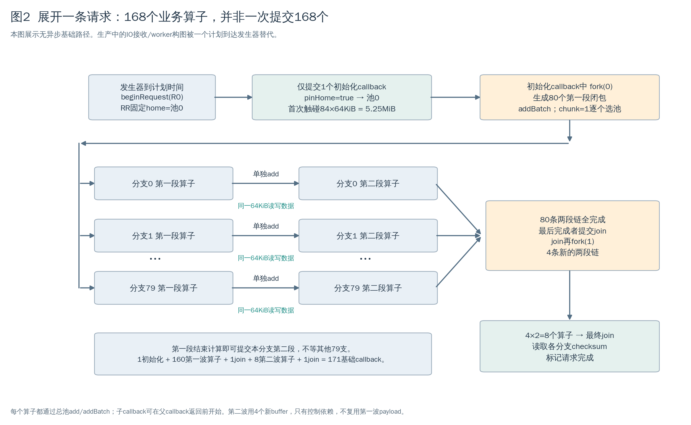
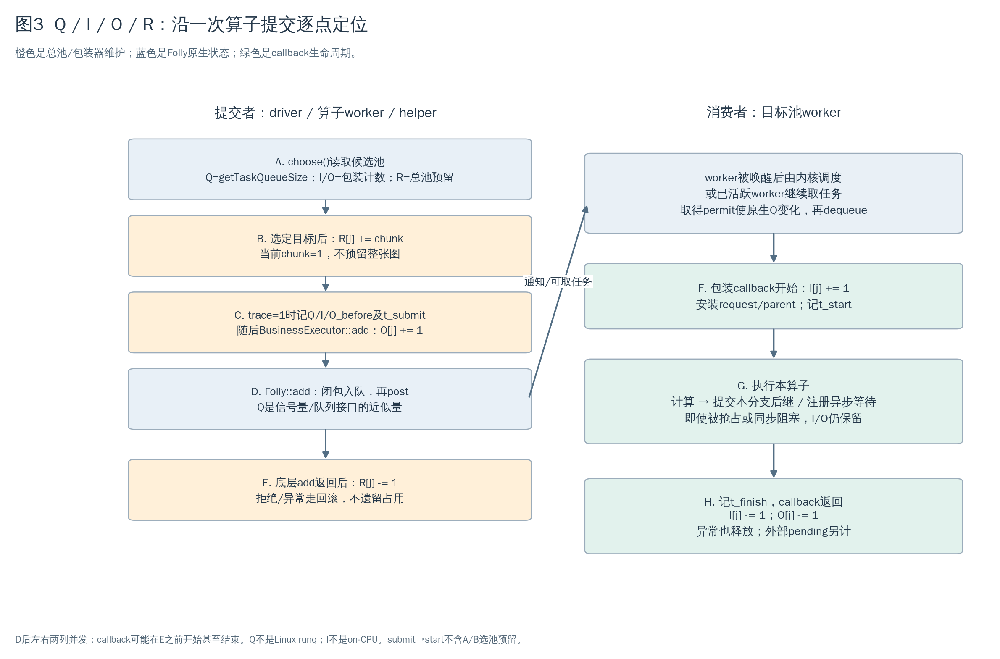
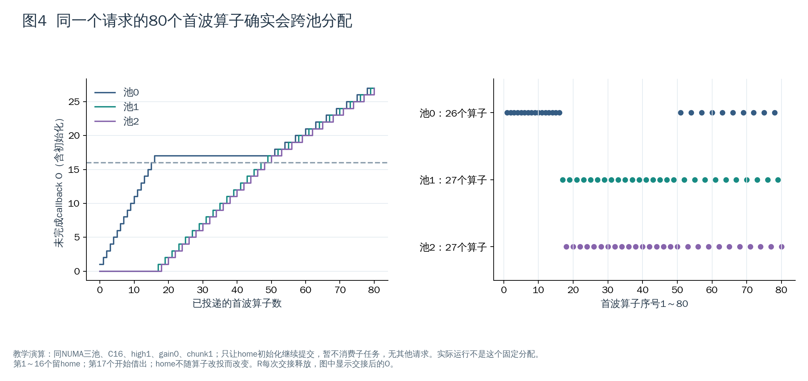
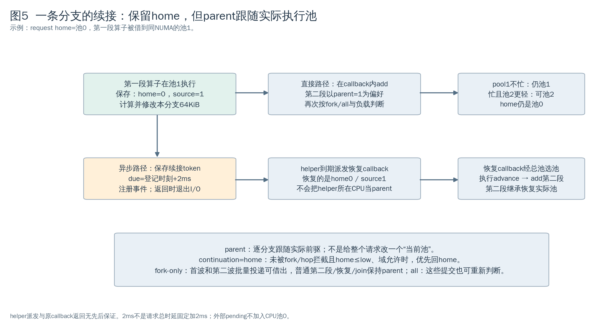
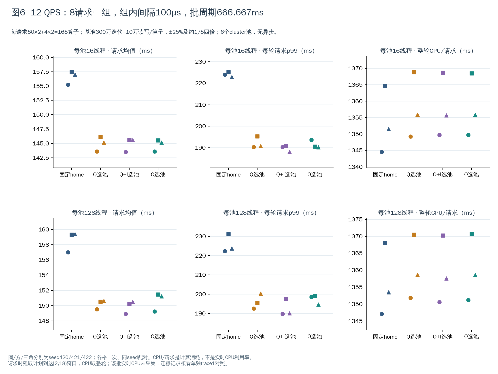
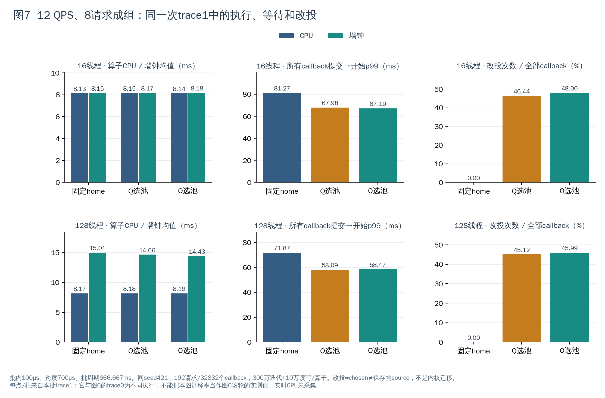
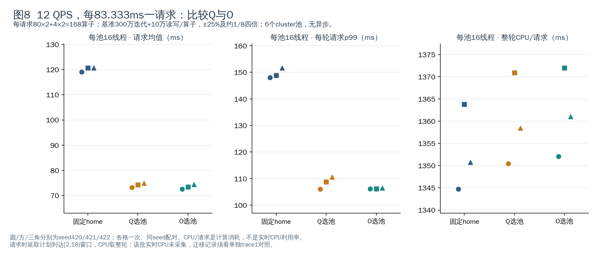

# 一条请求如何跨 cluster 执行：负载、计数、选池与实测结果

本报告从一条请求的执行过程开始，不要求读者先了解历史日志编号。目标架构始终是**每个已核实的硬件 cluster 一个子池，业务只使用一个总池**。历史真实应用的四个未绑核子池仅提供调度现象，既不是目标池数，也不是当前模拟部署。

当前工程已实现两层选择：请求入口确定固定的 home；**同一请求每个新 ready 算子再次通过总池选池**。首波 80 个算子可以分散到同 NUMA 的其他 cluster，后继也可以继续均衡。实测支持这种方式在若干明确负载下减少请求等待，同时增加一定 CPU 消耗；尚未选出跨场景统一最优的负载信号。

本次重写补全执行时序和逐场景比较。一个实质缺口也必须明确：已回传的主要运行没有采集有效的逐 cluster CPU 时间序列，因而**不能给出那些运行的实时 CPU 曲线**。下面将已有时延、CPU/请求、改投率逐项列清，另提供仅针对这个缺口的补采工具和有限对照指南。

## 1. 先看一条请求：到达、首次扇出、后继、完成

### 1.1 生产链路与本 demo 的边界

真实链路为 IO 接收 → worker 解析/构图 → executor 执行 ready 算子 → 可选 AIO/RPC → executor 恢复后继。本 demo 用一个按计划发请求的主线程替代前两段，重点覆盖 executor 的算子提交、依赖推进、数据复用及可选异步恢复。没有模拟收包、真实 RPC 网络、构图和压缩开销。

当前测试使用如下六个 cluster；工程池数由配置与拓扑决定，并不固定为六。

| 子池 | 获准逻辑 CPU | NUMA 标签 | worker 比较档 | 名义容量 C |
|---|---|---|---|---|
| 0 / 1 / 2 | 0–15 / 16–31 / 32–47 | 0 | 各16或128 | 各16 |
| 3 / 4 / 5 | 192–207 / 208–223 / 224–239 | 2 | 各16或128 | 各16 |

每个 cluster 是 8 物理核、16 逻辑 CPU。C 是计数归一化尺度，不等于已测得的 SMT 吞吐容量。各 worker 启动时绑定到所属 cluster 的 CPU 集合，并非固定到单一 CPU；driver 与异步 helper 使用这 96 个逻辑 CPU 的并集，与 executor 共享资源。分支payload页由 home 上的初始化 callback 首次触碰，没有强制页面绑定。

请求 home 按 RR 一次确定：R0→池0，R1→池1，…，R5→池5，R6→池0。之后该请求的 home 不变；某个算子实际到池1执行，不会把整张图的 home 改成池1。

| IPO | 本demo的具体对象 |
|---|---|
| 输入 | 每请求planned时间、168算子依赖图、固定循环/访问、84份64KiB数据、可选完成位置与due |
| 处理 | 一次确定home；每个新ready callback经总池选子池；worker执行并释放后继；外部pending另管 |
| 输出 | 请求planned→finish、callback submit→start/CPU/wall、改投角色、CPU/请求、失败与排空结果 |

### 1.2 请求究竟什么时候到达


第 i 个请求从0编号，origin 为本轮时间零点：

```text
均匀到达：planned(i) = origin + floor(i × 1秒 / QPS)
成组到达：planned(i) = origin
                       + floor(floor(i/8) × 8秒 / 12)
                       + (i mod 8) × 100微秒
```

12 QPS 均匀到达是每 83.333 ms 一个请求；96 QPS 是每 10.417 ms 一个。平均12 QPS的成组模式则每666.667 ms投一批8请求，批内0、0.1、…、0.7 ms。100 µs是**请求之间**的计划间隔，不是80个算子之间的间隔。

主线程等待 planned 时刻后记录 attempt，检查在途请求上限16，构造状态、确定 home，再提交初始化 callback。达到上限则拒绝，不是等到有槽位再补投。计划时刻、attempt、初始化开始、80个算子各自 ready/submit 是不同时间；报告中的请求完成时延以 planned 为起点，包含投递迟到。

### 1.3 一条请求的完整图与实际数据



以 R0 为例，主线程最初仅往池0放一个 `init`。它在 home 的 worker 上初始化84份分支数据，然后一次 `addBatch` 提交80个第一段算子。`chunk=1` 时这80项逐个选池、逐个交给底层 Folly，消费与提交可交错。

无异步时，每个第一段完成其计算后，立即 `add` 本分支第二段，**不等其他79个第一段**。两段共享同一个64 KiB可读写 buffer，第二段读到第一段修改后的数据。80条两段链全部完成后，最后完成者提交 join；join 再放出4条新的两段链；它们完成后最终 join 标记请求完成。

因此每请求有 `80×2+4×2=168` 个业务算子，以及1个初始化、2个 join，共171个基础 callback。80表示首波 ready 分支数，不表示同时有80个线程 on CPU，也不表示整张图168个算子一次全部入队。

数据共 `84×64 KiB=5.25 MiB/request`，各分支独立可写。**第二波4条链使用另外4份 buffer**：它与第一波有控制依赖，但没有第一波 payload 向第二波传递。初始化 first-touch、同链前后两段复用体现了局部性机制；当前负载没有覆盖跨分支共享张量、跨波大块数据传递或真实页面驻留分布。

### 1.4 一个算子做多少工作：使用次数，不把循环数写成固定毫秒

每个业务算子先执行整数 xorshift 循环，再执行分支 buffer 读写。一次访问选择一个8字节字，读、计算、写回；访问次数不是 cache miss 次数，也不是不同地址数量。

所有主对照固定 task 级扰动：

```text
r = mix(seed XOR mix(request_id) XOR mix(task_tag))
p = 75 + r % 51                 # 整数75..125
f = 4 if r % 8 == 0 else 1
循环次数 = floor(base_iterations × p / 100) × f
访问次数 = floor(base_accesses   × p / 100) × f
```

同算子的两种工作量使用同一 p/f；约1/8被选为四倍，但不是每轮精确12.5%，倍率与扰动也不是两个独立随机抽样。固定 seed、request、tag 后工作不随调度策略改变。

| 基准循环 / 访问 | f=1 实际循环范围 | f=4 实际循环范围 | f=1 / f=4 实际访问范围 |
|---|---|---|---|
| 3,000,000 / 100,000 | 2,250,000–3,750,000 | 9,000,000–15,000,000 | 75,000–125,000 / 300,000–500,000 |
| 375,000 / 12,500 | 281,250–468,750 | 1,125,000–1,875,000 | 9,375–15,625 / 37,500–62,500 |

例如 seed421、request0、第一分支第一段在375000档实际执行315000次循环、10500次访问；其第二段为420000次循环、14000次访问。不同阶段工作不必相同。

在相应诊断轮中，300万基准档业务算子平均 CPU 约8.14 ms，37.5万基准档约1.05 ms；这是**实测均值**，包含 kernel 与后继提交/异步注册等回调内成本，不是固定执行时间。它们没有复现生产描述中平均100 ms、个别700–800 ms的算子分布；旧 trace 也不能提供这种算子级标定。

### 1.5 异步等待放在哪里

三种模式保持上述168个业务算子的循环、访问、数据和依赖不变：

| 模式 | 每个业务位置计算完成后 | 额外 callback | worker 是否被等待占住 |
|---|---|---|---|
| 无异步 D0 | 直接 advance，提交后继或 join | 无；171/request | 否 |
| 50%位置、0 ms A0 | 确定性哈希选约50%位置；登记 due=issue，helper触发恢复 | 每次选中多一个 resume | 注册返回后释放 |
| 50%位置、2 ms A1 | 同一选择集；due=issue+2 ms；不做对齐聚合 | 同上 | 注册返回后释放 |

2 ms是每个选中位置的最早到期时间，不是每请求只加2 ms。不同分支等待可以重叠，同一链等待可以累积。零延迟仍有 helper 调度和恢复入池成本；helper 甚至可以在注册者返回前触发。

恢复 token 保存 request home、实际父池 source、路径迁移次数和 Folly RequestContext。helper恢复这些信息再提交，不把自己的CPU当成父池。外部 pending 只维持排空生命周期；原 callback 返回后，它不占子池 I/O。恢复 callback 新入池，再由它提交后继。

4020每轮1920请求，确定性选中161076次恢复，合计489396个callback；正式窗口1536请求中有128809次恢复、391465个callback。不是每请求恰有84次恢复。

## 2. Q / I / O / R：每个数在执行链哪一步产生

### 2.1 从提交者到 worker 的读写顺序



下面是与实现顺序一致的简化伪代码。左右两条路径可以并发，worker可能在底层 add 返回前开始甚至结束。

```text
提交线程（driver / 算子worker / helper）：
    j = choose(read Q[], I[], O[], R[])  # 先读状态、评分选池
    R[j] += 本chunk数量                  # 已选定，尚待交接
    诊断开启时：再读目标j的Q/I/O，记t_submit
    O[j] += 1                          # 底层add前预占
    Folly.add(包装callback)             # 闭包入队，然后post
    R[j] -= 1                          # 底层add返回后交接完毕
    # 失败/异常回滚O及尚未交接的R

Folly worker：
    获得信号量许可，取出队列中的闭包      # 原生Q在领取过程中变化
    I[j] += 1                          # 开始执行包装callback
    安装request/source上下文，记t_start
    执行kernel，再add后继或登记外部完成
    记t_finish；诊断记录；回调返回
    I[j] -= 1
    O[j] -= 1                          # 包装器收尾，异常也释放
```

| 信号 | 读取与维护位置 | 它覆盖什么 | 它漏掉或不能表达什么 |
|---|---|---|---|
| Q | Folly `getTaskQueueSize()`；本队列由信号量 `valueGuess()`提供近似量 | 尚未被worker领取的工作代理 | 已领取、已开始但没CPU、同步阻塞；不是内核runq |
| I | BusinessExecutor wrapper开始加1、退出减1；读 relaxed 原子 | 已进入callback但尚未返回的数量 | 不含领取到wrapper开始的间隙；包含抢占/阻塞，不能等同on-CPU |
| O | 底层add之前预占，callback退出释放；失败回滚 | 提交预占及已接收未完成的callback，覆盖Q/I之间的交接阶段 | 不表示剩余CPU时间，不含未ready图节点或外部异步pending |
| R | 高层choose后按chunk预留，每项交接结束释放 | 已路由而尚未完全交给底层的工作 | 非原子事务；与O可短时双计，不能保证多提交者绝不选同一池 |

O不是“并发请求数”；一请求首波可使 O 增加80。I不是“唤醒线程数”；一个worker被唤醒后可能连续跑多个callback。父callback投递子callback后尚未返回时，两者可同时计入I/O，尽管同一分支的两个计算 kernel 并未并行。

逐任务 trace 中的 `Q/I/O_before` 是**选定目标池**在enqueue时的再读取，不是最初home的压力，也不是choose时全部候选的快照；R未写进该行。不能用这些字段精确重放路由，也不能把“选中池Q=0”比例称为“home没压力”比例。

### 2.2 80个算子、16个逻辑CPU，为什么Q会漏看压力

以下为理想状态说明，忽略init，假设80个业务callback已提交而未完成：

| worker配置 | 可能看到的Q / I / O | CPU层面的含义 |
|---|---|---|
| 16 worker | 约64 / 16 / 80 | 16个callback占worker，其余尚待领取 |
| 128 worker | 可接近0 / 80 / 80 | 80个callback已开始；CPU计算时最多16个逻辑线程同时运行，其余可能等内核调度 |
| 128 worker且部分同步阻塞 | 可接近0 / 80 / 80 | 相同计数，但实际runnable/on-CPU更少 |
| 算子登记异步后返回 | 对应原callback退出I/O；外部pending增加 | 请求未完成，并不意味着它仍消耗executor CPU |

因此Q能低成本反映未领取的积压，但“Q=0”不保证请求完成快。I/O补足callback生命周期，仍不是CPU时间测量。允许误差不允许C++ data race：共享读写应使用原子或明确同步，不能为省成本直接并发读写普通整数。

### 2.3 唤醒的是worker，任务仍在公共队列里

底层路径为 `CPUThreadPoolExecutor::add → addImpl → taskQueue.add → enqueue(payload) → semaphore.post`；worker 的 `threadRun → take/try_take_for → wait/try_wait → dequeue → runTask`消费任务。正常提交先入队，再发布可用许可；所谓精准唤醒不是把闭包直接交到某个线程的私有参数槽中。

默认队列使用的 ThrottledLifoSem 有共享许可与唤醒链；经典 LifoSem 的等待者许可交接细节不同，不能混用两者行为。活跃worker完成callback后会继续尝试取下一项，没任务才走等待路径，并非每项都必须先睡眠再唤醒；已经活跃的worker与刚唤醒的worker可能竞争公共任务。被唤醒也只表示有机会运行，还需Linux调度器安排CPU。

所以必须区分：**Folly待领取队列、已进入callback的生命周期、Linux每CPU runq**。当前快速计数没有直接读取第三者。

### 2.4 读取成本、记录成本、评分算法分开考虑

| 方式 | 路由热路径操作 | 维护/记录成本 | 适用边界 |
|---|---|---|---|
| 原生Q | Q-only provider调用队列size近似接口 | 不需要逐任务日志；但本工程仍维护I/O等公共计数 | 简单低成本基线，CPU阶段迁出队列后有盲区 |
| Q+I | 读Q及生命周期计数 | 每callback起止I原子更新；共享cache line可能竞争 | 适配stock Folly可用TaskObserver；同步阻塞会抬高I |
| O | 读未完成与预留计数 | add前CAS预占、退出释放、拒绝回滚；本实现readLoad还读Q等其他字段 | 覆盖交接间隙更完整，仍等权计数轻重callback |
| 加权未完成工作 | 读维护中的工作估计 | 需要可靠算子工作估计及更新 | 接口可替换；当前无生产先验，不能用demo已知循环数冒充可部署估计 |
| 后台CPU样本 | 读缓存样本、检查年龄 | 逐TID扫描/proc成本随worker数增大；不能每次add扫描 | 当前CPU-hybrid候选，未证明优于计数 |
| 诊断trace=1 | 时间戳、线程CPU计时、逐callback行等 | 额外记录与缓存压力，需单独估计扰动 | 用于解释机制；不是生产默认开关 |

`LoadProvider`与评分策略分离，Q、Q+I、O保留为实现类；stock Folly适配器通过 `TaskObserver`维护I，不伪造O。该observer的边界与本demo wrapper并非同一条指令，接入真实应用要先对齐定义。

本工程三种计数均以R补路由预留：`Q评分=(Q+R)/C`，`active评分=(Q+I+R)/C`，`O评分=(O+R)/C`。**active不是I单指标**。不同字段不是同一原子快照；当前O读取不是一个孤立的atomic load。现有对照没有隔离“彻底删除I/O维护后的纯Q成本”，不报告未经测量的ns级优劣。

已测读成本仅有开发机x86、空闲worker、热缓存的批平均探针：原生Q约6.330–6.453 ns/操作，active读取加评分约11.290–11.513 ns；逐TID扫描/proc在4线程约33.6 µs/轮、128线程约982 µs/轮。这些数字未扣循环基线，不是单次p99，更不是ARM高并发写计数的成本；它们只说明“热路径读缓存”和“后台收集样本”是两笔不同成本。[原始验证记录](../../results/review/TRACE_LOAD_VALIDATION.md)

实际目标上的记录开关也有成本：12 QPS、37.5万/1.25万、home下，trace1相对trace0的CPU/请求增量为T16约1.83%、T128约2.28%；96 QPS、50%/2ms模式的4020中，home约+0.84%、O约+0.38%。它们每格一次，只用于检查敏感性；trace0仍维护基础I/O/R等计数，开关差不是整个观测系统的净成本。

CPU后台采样默认每次扫描结束后等待50 ms，实际采样窗口还包含扫描与调度耗时；demo允许最大年龄150 ms，通用类默认100 ms，不能混为同一配置。主要目标运行明确关闭了CPU采样。本文新增的独立cluster CPU采集器只用于补齐评估证据，不接入路由、不改变计数算法。

## 3. 二层均衡如何处理同一请求的80个首波算子

### 3.1 request确定home；每次算子提交确定实际池

高层总池提供 `beginRequest`、`add`、`addBatch`和异步续接。底层多个Folly池只执行高层指定的目标，避免再次做一套冲突选择。业务不直接创建、选择六个Folly池。

以当前O、parent、all、chunk1为例：

```text
beginRequest(id): home = RR_once()
submit(init, pinHome=true)

init在home运行：
    for branch in 0..79:                # addBatch内部按chunk逐项处理
        preferred = 本次父callback实际池  # 这里都是init的home
        if score(preferred) <= high:
            target = preferred
        else:
            target = 本NUMA内足够更轻的候选，否则仍preferred
            # 仅打开跨NUMA且本地无合格候选时再找远端
        reserve(target, 1)
        enqueue(target, branch.stage0)
        release_reservation(target, 1)

stage0结束计算：
    add(stage1, source=stage0实际池, home=不变)
    # all再次判断；fork模式普通后继直接沿source
```



图4仅为解释算法的冻结状态演算：同NUMA三个池、C均16、high=1、gain=0；home0已有init，所以O=[1,0,0]；没有其他请求，暂不消费新任务。前16个首波算子留home，第17个才开始借出，因为触发条件是提交前 `O/C>1`，不是`>=1`。80项全部交接后分配26/27/27，加上home的init，三池O均27。

真实执行边投边消费、父子交错、多请求同时提交，分配不固定为26/27/27。该图不是性能模拟，更不是负载均衡结果的实测曲线。它说明一个请求可以跨池，以及chunk1为何不能简化成“给整请求选一次池”。

### 3.2 首选池、均衡时机、迁移后继承是三个独立设置

| 设置 | 初始80项 | 普通链后继 / join / resume | 请求home |
|---|---|---|---|
| policy=home基线 | 全投home | 全投home | 固定 |
| O+parent+fork | addBatch中按压力选池；第二波4项也一样 | 直接沿实际父池，不再查负载 | 固定 |
| O+parent+all | 每项按压力选池 | 每次新ready再按压力选池 | 固定 |
| continuation=home | 按策略处理 | 只有home低于return-low等条件满足才优先回home；fork普通后继不走这条分支 | 固定 |



parent表示“优先前驱实际执行池”，不表示永远留在那里；pool1忙时后继仍可去pool2，home变轻时也可能由普通选轻逻辑回到home。join由最后完成分支提交，因此parent起点是该分支实际池。

当前本地选择需要首选池score严格高于high，并存在满足 `preferred_score-candidate_score>min_gain` 的更轻候选。候选不必绝对idle，也可能高于high。平手保留当前首选；候选之间平手保留扫描先遇到者。没有更轻池时留在原池，不为追求迁移率强制搬走。

跨NUMA打开后也先找本地；只在本NUMA没有合格候选时再查远端，并计远端惩罚。当前主要结果关闭跨NUMA，因此没有证明远端借出的得失。

`chunk=8`表示8项共用一次目标和预留，仍逐项入Folly；当前chunk1是80次选择。`hop=4`是每条依赖路径累计改投次数上限，不是一个request全图只能迁4项。当前没有偷取已入队任务，也不搬正在运行的算子；“迁移”仅指新callback的 `source != chosen`。

### 3.3 为什么现阶段采用总池封装

请求染色、home、实际父池、NUMA候选域属于业务执行语义。放在一个通用封装中既能隐藏多个Folly池，也能保持底层队列与线程管理不变。阶段五仍有意义：它负责通用接口、拒绝回滚、异常、续接、上下文、生命周期和排空验证；不必以修改Folly核心为完成标准。

只有后续明确需要原生队列内窃取、特殊唤醒或stock接口无法获得关键状态时，才有理由修改Folly。当前证据支持先使用可回退的高层封装；没有“业内普遍最优”算法可直接替代对本业务的观测与对照。

## 4. 结果阅读规则：先固定负载，再比较策略

以下图表均以本报告第1节的168算子、84×64 KiB数据和±25%/约1/8四倍工作为基础。它们不是“长/短”两个模糊类别，而是下表六个明确输入。

| 场景 | 计划请求到达 | 每算子基准循环/访问 | 外部完成 | worker/池 | 主要批次 |
|---|---|---|---|---|---|
| A | 平均12 QPS；8请求/700µs；批周期666.667ms | 300万 / 10万 | 无 | 16、128 | 4011–4013 |
| B | 12 QPS；每83.333ms一请求 | 300万 / 10万 | 无 | 16 | 4014 |
| C | 12 QPS；每83.333ms一请求 | 37.5万 / 1.25万 | 无 | 16、128 | 4015 |
| D | 96 QPS；每10.417ms一请求 | 37.5万 / 1.25万 | 无 | 16、128 | 4016；4018 D0 |
| E | 96 QPS；每10.417ms一请求 | 37.5万 / 1.25万 | 约50%位置，0ms到期 | 16 | 4018 A0 |
| F | 96 QPS；每10.417ms一请求 | 37.5万 / 1.25万 | 同一约50%位置，2ms到期 | 16 | 4018 A1；4020 |

所有主结果固定每cluster一池、RR home、同NUMA、parent、chunk1、hop4。除明确比较fork/all的场景A外，都使用all。Q/Q+I/O共同使用high1、gain0；这不是对各信号分别充分调参之后的竞赛。共同阈值也不表示同一触发条件：忽略R时，Q要待领取项数>16才搜索，O则未完成项数>16便搜索。

请求统计按计划到达 `[2,18)` 秒选cohort，保留晚完成者。12 QPS每轮240个请求、窗口192个；96 QPS每轮1920个、窗口1536个。CPU/请求用run阶段进程CPU除整轮完成数，包含请求构造、payload初始化、预热、排空、driver/helper和内存中trace记录；不含此前线程池启动、trace数组预分配和最后文件导出。它**不与请求窗口同口径**，也不是CPU利用率。

`trace=0`用于主要性能对照；`trace=1`提供callback机制记录。两者分别成对，不能把trace0时延与trace1迁移率拼成同一行。同一seed保持工作样本一致；不同seed改变实际工作量，不是同一工作独立重复三次。每格一次，192请求的nearest-rank p99是第二大值；不能精细断言1%左右的尾部差异。

### 4.1 场景A：12 QPS成组、300万循环/10万访问——三种计数有没有稳定赢家

输入是8请求在700 µs内到达；每请求再释放80个首波算子。每轮峰值在途8，拒绝/失败0。4012比较home、Q、Q+I、O与16/128 worker，三个工作seed，每格一次，全部trace0。



下面显示seed421的绝对值；图中保留三个seed各点，完整79条逐场景记录见附录数据。CPU时间序列与改投率在本性能轮**未采集**。

| seed / 每池worker / trace | 策略 | 请求mean ms | 请求p99 ms | CPU ms/完成请求 |
|---|---|---|---|---|
| 421 / 16 / 0 | home | 157.432 | 225.164 | 1364.706 |
| 421 / 16 / 0 | Q | 146.114 | 195.303 | 1368.840 |
| 421 / 16 / 0 | Q+I | 145.580 | 190.968 | 1368.679 |
| 421 / 16 / 0 | O | 145.527 | 190.521 | 1368.503 |
| 421 / 128 / 0 | home | 159.332 | 231.121 | 1368.040 |
| 421 / 128 / 0 | Q | 150.519 | 195.385 | 1370.470 |
| 421 / 128 / 0 | Q+I | 150.266 | 197.571 | 1370.263 |
| 421 / 128 / 0 | O | 151.459 | 198.984 | 1370.631 |

固定16 worker时，三个计数相对home的请求mean降低7.189%–7.562%，p99降低13.262%–15.630%，CPU/请求增加0.278%–0.385%；128 worker时mean降低4.756%–5.690%，CPU增加0.162%–0.376%。每个范围都是各自同seed、同线程、同批配对结果。

三种信号之间同格mean最大差不足最低mean的0.8%，排序不稳定，不能选出通用赢家。128→16 worker在三种均衡策略下mean再降低约2.93%–4.03%，但p99并非全部下降。当前证据使线程预算成为独立优化轴，并未证明16始终最优。

### 4.2 同一场景A的诊断轮：Q看不见的等待去了哪里，改投多少

4013保持成组到达、300万/10万、seed421，单独打开trace1；比较16/128 worker、home/Q/O。它回答机制，不补充为4012的独立性能重复。



| seed / 每池worker / trace | 策略 | 请求mean ms | 请求p99 ms | CPU ms/完成请求 | 改投/回调（率） |
|---|---|---|---|---|---|
| 421 / 16 / 1 | home | 157.530 | 227.492 | 1368.312 | 0/32832（0.00%） |
| 421 / 16 / 1 | Q | 146.024 | 197.570 | 1371.251 | 15248/32832（46.44%） |
| 421 / 16 / 1 | O | 145.379 | 190.936 | 1370.425 | 15760/32832（48.00%） |
| 421 / 128 / 1 | home | 160.173 | 226.132 | 1375.172 | 0/32832（0.00%） |
| 421 / 128 / 1 | Q | 151.277 | 198.169 | 1377.729 | 14813/32832（45.12%） |
| 421 / 128 / 1 | O | 151.492 | 205.922 | 1378.132 | 15099/32832（45.99%） |

home下，16 worker的业务operator平均CPU/wall为8.135/8.155 ms；128 worker为8.171/15.007 ms。CPU工作量接近，callback开始后的墙钟显著增加。增加worker让更多callback开始，不等于这些callback持续获得CPU；wall−CPU还可能含锁、提交和其他等待，不能全部标成内核runq。

O在16 worker时改投15760/32832=48.00%，Q为15248/32832=46.44%；128 worker时O为15099/32832=45.99%，Q为14813/32832=45.12%。这是同cohort的callback改投率，不是请求离开home的比例，更不是内核线程迁移率。

当前没有该轮逐cluster CPU曲线，不能据此画出“峰值被削平”。已能观察到的是：更多算子被分配到其他池、提交至开始等待下降，以及执行期间墙钟和线程预算的关系。

### 4.3 场景B：12 QPS均匀、300万循环/10万访问——改变请求重叠后再比较

图结构与工作量保持场景A，改为每83.333 ms一个请求，T=16、无异步；同home每500 ms接一次请求。4014有三个工作seed，home/Q/O分别配对，active未运行。



| seed / 每池worker / trace | 策略 | 请求mean ms | 请求p99 ms | CPU ms/完成请求 |
|---|---|---|---|---|
| 421 / 16 / 0 | home | 120.613 | 148.814 | 1363.827 |
| 421 / 16 / 0 | Q | 74.247 | 108.796 | 1370.904 |
| 421 / 16 / 0 | O | 73.418 | 106.183 | 1371.995 |

三个seed中Q相对home的mean降低37.89%–38.51%、p99降低26.89%–28.31%，CPU/请求增加0.42%–0.57%；O的mean降低38.31%–39.13%、p99降低约28.3%–29.8%，CPU增加0.54%–0.76%。本批改投率和实时CPU均未采集。

同样平均12 QPS，均匀到达的相对收益明显大于8请求成组。合理解释是独立请求的首波有更多空间借用其他池，而成组请求彼此争抢候选；但两批并非同一随机交错实验，**收益幅度差不能单独归因于到达方式**，池级CPU时间序列也尚未验证这个解释。不能只报QPS而忽略请求之间的时间结构。

### 4.4 场景C：12 QPS均匀、37.5万循环/1.25万访问——仅做工作尺度校准

把每算子基准工作缩至场景B的1/8，仍每83.333 ms一请求。4015只跑home，比较16/128 worker及trace开关，seed421。峰值在途1；这批没有Q/O策略比较。

| seed / 每池worker / trace | 策略 | 请求mean ms | 请求p99 ms | CPU ms/完成请求 | 改投/回调（率） |
|---|---|---|---|---|---|
| 421 / 16 / 0 | home | 17.952 | 21.458 | 178.817 | 未采集 |
| 421 / 16 / 1 | home | 18.245 | 23.420 | 182.090 | 0/32832（0.00%） |
| 421 / 128 / 0 | home | 17.973 | 21.083 | 178.363 | 未采集 |
| 421 / 128 / 1 | home | 18.376 | 23.410 | 182.432 | 0/32832（0.00%） |

关闭trace时两档请求mean均约17.96 ms，CPU/请求约178 ms；128 worker没有显示出明确收益。打开trace后CPU和p99有所增加，说明约1 ms CPU级算子的观测扰动应独立核算。这一批只能确认工作尺度与记录成本，不能得出“此负载不需要均衡”。实时CPU未采集。

### 4.5 场景D：96 QPS均匀、37.5万循环/1.25万访问——提高请求重叠

保持场景C的每请求图、数据、循环/访问，将到达变为每10.417 ms一个请求，同home每62.5 ms一个。4016固定seed421、无异步，比较home/Q/O和T16/128，每格一次、trace0；峰值在途3。


| seed / 每池worker / trace | 策略 | 请求mean ms | 请求p99 ms | CPU ms/完成请求 |
|---|---|---|---|---|
| 421 / 16 / 0 | home | 17.923 | 22.028 | 176.967 |
| 421 / 16 / 0 | Q | 11.757 | 15.760 | 187.598 |
| 421 / 16 / 0 | O | 11.943 | 16.023 | 189.416 |
| 421 / 128 / 0 | home | 18.077 | 22.377 | 176.889 |
| 421 / 128 / 0 | Q | 12.009 | 16.166 | 188.000 |
| 421 / 128 / 0 | O | 11.970 | 15.844 | 189.220 |

两档中Q/O均降低mean约33%–34%、p99约27%–29%，同时CPU/请求增加约6%–7%。与300万基准档中不足1%的CPU增量不同，这里时延收益伴随更明显的计算成本。没有cache计数或真实CPU曲线，不能把增量全部归因缓存失效，也不能将增量简单命名为路由函数开销。

T16下Q略优于O，T128下两者排名并不完全一致；单格一次不足以选择赢家。active、改投率和实时CPU均未在此批采集。此结果支持保留Q/O候选，不能支持只留O。

### 4.6 回到场景A：只均衡分叉，还是每个后继都再判断

4011使用成组12 QPS、300万/10万、T128、O评分；对home、fork-parent、all-parent做三seed比较。先看trace0性能，再在独立的trace1组内同时看时延和改投率。


trace0各seed中all相对fork的mean变化为−0.893、−1.900、−0.836 ms；p99变化为−3.444、−6.908、+2.848 ms。后继也均衡有小幅mean收益，但不是每个seed的p99都更好。

下表为**同trace1**的seed420，时延、CPU和迁移来自同一运行：

| seed / 每池worker / trace | 策略 | 请求mean ms | 请求p99 ms | CPU ms/完成请求 | 改投/回调（率） |
|---|---|---|---|---|---|
| 420 / 128 / 1 | home | 158.781 | 224.678 | 1357.480 | 0/32832（0.00%） |
| 420 / 128 / 1 | fork-parent | 150.573 | 197.389 | 1358.413 | 9224/32832（28.09%） |
| 420 / 128 / 1 | all-parent | 149.278 | 190.822 | 1357.098 | 15531/32832（47.30%） |

三个seed中all改投率47.02%–47.39%，fork为27.97%–28.09%。seed420按角色分解如下，分母是该角色callback数：

| 角色 | 数量 | fork改投 | all改投 | fork / all提交→开始均值 ms |
|---|---|---|---|---|
| 首波80项 | 15360 | 9212（59.97%） | 9589（62.43%） | 20.574 / 20.335 |
| 普通后继 | 16128 | 0 | 5941（36.84%） | 37.340 / 37.255 |
| 第二波4项 | 768 | 12（1.56%） | 0 | 0.037 / 0.026 |
| join | 384 | 0 | 1（0.26%） | 0.006 / 0.007 |

因此fork已经均衡**同请求内的首波算子**，并非只均衡请求。all增加约19个百分点callback改投，却没有稳定p99优势；是否值得扩大后继均衡，应该由具体负载、CPU预算与可重复收益决定。不同分支等待不能相加解释request p99。实时CPU仍未采集。

### 4.7 场景D/E/F：把异步等待与CPU ready压力拆开

4018固定96 QPS、37.5万/1.25万、T16、seed421，对无异步、50%位置0 ms、同50%位置2 ms分别比较home/O，均trace0。每种模式保持原有168个业务算子及工作量一致。


**无异步：**

| seed / 每池worker / trace | 策略 | 请求mean ms | 请求p99 ms | CPU ms/完成请求 |
|---|---|---|---|---|
| 421 / 16 / 0 | home | 17.862 | 21.595 | 176.908 |
| 421 / 16 / 0 | O | 11.934 | 15.857 | 189.680 |

**50%位置、0 ms到期：**

| seed / 每池worker / trace | 策略 | 请求mean ms | 请求p99 ms | CPU ms/完成请求 |
|---|---|---|---|---|
| 421 / 16 / 0 | home | 18.208 | 23.600 | 180.918 |
| 421 / 16 / 0 | O | 12.115 | 16.457 | 191.021 |

**50%位置、2 ms到期：**

| seed / 每池worker / trace | 策略 | 请求mean ms | 请求p99 ms | CPU ms/完成请求 |
|---|---|---|---|---|
| 421 / 16 / 0 | home | 22.729 | 28.898 | 180.696 |
| 421 / 16 / 0 | O | 18.286 | 22.901 | 187.419 |

2 ms到期模式使请求完成更晚，但CPU ready工作会在等待期间退出池计数。它并不等于worker sleep 2 ms。诊断的home恢复等待均值在0 ms模式约2.065 ms，2 ms模式约1.135 ms：请求更慢与池内某段排队更短可以同时发生，不能用请求存活数代替CPU压力。

本组trace0没有改投率或有效CPU序列。整轮进程CPU包含helper，不能额外重复加一次helper CPU。字段中虽有进程CPU总量和wall+drain，但两者起点并不一致；本报告不将其商包装成精确平均利用率。

### 4.8 场景F的补充诊断：收益主要发生在首波、普通后继，还是resume

4020重复同一50%/2 ms合同，补home/O各自的trace0/trace1四格，每格一次。无失败、拒绝、超时；工作签名、到达hash、checksum及迭代/访问总数保持一致。

| seed / 每池worker / trace | 策略 | 请求mean ms | 请求p99 ms | CPU ms/完成请求 | 改投/回调（率） |
|---|---|---|---|---|---|
| 421 / 16 / 0 | home | 22.808 | 29.175 | 180.640 | 未采集 |
| 421 / 16 / 0 | O | 18.277 | 22.947 | 187.401 | 未采集 |
| 421 / 16 / 1 | home | 22.752 | 27.972 | 182.159 | 0/391465（0.00%） |
| 421 / 16 / 1 | O | 18.273 | 23.039 | 188.117 | 109109/391465（27.87%） |

trace0的O相对home，mean降低19.87%，p99降低21.35%，CPU/请求增加3.74%。这是当前合同内的描述性结果，不是生产保证。


两个trace1运行的同cohort角色记录：

| 角色 | 数量 | home等待均值 ms | O等待均值 ms | O改投数及率 |
|---|---|---|---|---|
| init | 1536 | 0.016 | 0.014 | 0 |
| 首波第一段 | 122880 | 2.098 | 0.355 | 82553；67.18% |
| 第二波第一段 | 6144 | 0.008 | 0.027 | 252；4.10% |
| 普通后继 | 129024 | 2.028 | 0.135 | 25461；19.73% |
| join | 3072 | 0.005 | 0.022 | 31；1.01% |
| resume | 128809 | 1.127 | 0.018 | 812；0.63% |

O总计改投109109/391465=27.87%，其中75.66%的改投发生在首波。普通后继19.73%的改投率直接证明后继也参与二层均衡；恢复自身仅0.63%换池，却仍大幅减少恢复排队。这与“先分散业务工作，让后续ready工作受益”相容，不能解释成“主要靠迁移RPC恢复”。第二波和join等待略增，不能写成每类都获益。

异步路径还需分别看：issue→due固定2 ms；due→fire p99由2.863降至0.898 ms；resume submit→start p99由3.576降至0.145 ms。helper与executor共享CPU，完成源也会受资源竞争影响。各分段p99不能相加得到request p99，总收益也不能全归给Folly队列。

trace1下业务operator平均CPU由1.054升至1.082 ms；恢复callback约0.002→0.004 ms。计数O对它们各算1，是已知局限，但本批尚不足以证明必须采用加权工作。这里仍没有实时CPU曲线；callback occupancy峰值或均值不能替代它。

### 4.9 这些实验已得到什么“负载与时延关系”

已经得到两类结果：一是固定部署/工作/到达下，提交前Q对应的**条件等待分布**；二是固定负载下，改变信号与路由后**整请求mean/p99和CPU成本的干预对照**。没有一个跨线程数、图结构和外部等待都通用的 `Q或I或O → request p99` 公式。

早期独立任务实验没有DAG：平均240任务/秒，每416.667 ms产生100个无依赖任务，同批全部入一个池，批次RR选六池；任务CPU预算基准100 ms、±50%抖动并做整轮精确均值归一化，无额外长尾。每池256 worker、cluster绑定，运行60秒，统计计划到达[10,60)的12000项。它按线程CPU预算忙算，而非当前固定迭代/数据模型。Q分桶如下；三seed范围不是置信区间：

| 提交前Q | submit→start p99 ms | submit→finish p99 ms | 每轮桶内样本 |
|---|---|---|---|
| 0 | 0.033–0.035 | 581.142–624.703 | 120；尾部样本不足 |
| 4–15 | 2.940–3.018 | 603.284–609.160 | 1556–1619；尾部样本不足 |
| 16–63 | 167.625–176.667 | 643.763–647.688 | 6124–6346 |
| ≥64 | 313.930–316.825 | 676.422–679.841 | 3549–3831 |

Q越大，待开始分布明显变差；但Q=0仍可能完成很慢，后续同批提交、执行工作与开始后的竞争都在影响完成。该旧任务合同与当前168算子图不同，不能用表中阈值设当前路由参数。完整旧合同与部署比较在附录链接，主报告不把它混入当前策略排名。

## 5. 真实调度轨迹：哪些事实能指导每cluster一池

历史trace是用户提供的约10秒真实应用采集，16 QPS、四个未绑定CPU的池、每池约128线程。已整理到404个池内TID，轨迹可见CPU0–383。池归属由线程名推断，采集CPU范围、丢失事件与区间匹配存在局限，以下数值是已审阅历史摘要。它有sched切换/唤醒/迁移事件，**没有request ID、算子边界、Folly出入队和RPC标记**。下面每条都明确“观察到什么→对目标的意义”。

### 5.1 单池平均不高，却曾短时获得远超一个cluster的CPU服务


四池平均CPU时间当量为7.093、4.364、6.620、6.569；各自最大1 ms桶为78.437、73.656、72.167、78.559。78.437表示在这个1 ms窗口，池内所有已匹配运行区间合计78.437 ms CPU时间，不是某个瞬间精确有78个线程同时运行；各池最大值也不必同时发生。

一旦把该池硬限制到16逻辑CPU，在1 ms内最多提供约16 ms CPU时间。原先从全机取得的短时并行必须转为等待、执行效率变化或上层算子外借。因此“整机平均CPU约50%”不能排除绑定后单cluster瓶颈。不能直接把原请求时延乘78/16，因为缓存、SMT、线程竞争也会改变。

**对应模拟与工程动作：** 单请求首波80项与每池16CPU直接制造这一矛盾；比较home和算子外借，再单独比较16/128 worker。真实改造不能仅把历史128 worker原样绑进一个cluster而不检查峰值并行。目标池数按真实cluster生成，不沿用四池。

### 5.2 池间压力不总是一起高，但旧trace不能证明同NUMA一定空闲

以各池自身平均CPU的两倍为各自阈值，4280个“至少一池高”的1 ms桶中，3550个只有一池高，占82.94%。最繁忙10%的桶承担各池45.5%–54.8%的CPU服务，说明平均值掩盖了集中段。

这些阈值不是统一的16CPU；“只有一个池高”不等于其他池idle。旧池未绑NUMA，不能据此说82.94%过载能在本NUMA消化。

**对应模拟与工程动作：** 同时测试均匀12 QPS与8请求成组12 QPS，因为候选池是否也忙会改变收益。保留“首选忙且同NUMA存在更轻池才改投”，没有更好目标就不迁移。同NUMA优先是减少未知远端内存代价的初始策略，跨NUMA需独立实验，不是历史trace已证明的最优规则。

### 5.3 与CPU强相关的“活跃线程”不是工程I

旧分析的1 ms桶内“上过CPU的不同TID数”与CPU时间相关系数0.926–0.933；waking次数与CPU的相关系数仅0.501–0.546，10 ms桶约0.690–0.740。不同TID计数把先后运行的线程都算进来，运行1 µs与900 µs都记1。它与CPU时间来自同一组运行区间，而I是callback开始至返回的瞬时占用数。

因此不能用旧“单池平均20、峰值80”的未确认口径直接设I阈值，更不能将I/C称为CPU利用率。128 worker时I可能80而on-CPU最多16；同步阻塞又会使二者偏离。

**对应模拟与工程动作：** 保留Q低成本基线、Q+I与O候选，用同负载对照请求p99与CPU成本；真实CPU通过独立同窗计账验证。现有三种计数未分出稳定赢家，选择信号不能只看与CPU的相关系数。

### 5.4 旧trace不足以指定“等3ms再迁移”

按前述“CPU超过自身均值两倍”的连续高桶段，p50约2 ms，p95约15–20 ms，最大25–55 ms。短段与持续段并存；但这是CPU时间桶的段长，不是同请求的算子排队时长。

原先0.85 ms的统计口径仍未确认。后续脚本得到相近的约0.868 ms，定义为线程wake到首次非runnable切出候选周期；相近数值不能反证原口径。这样的一个周期可能执行多个callback，一个callback也可能跨多个周期。不能据此推导20个算子在16CPU上约1.2 ms排空。1266个过载事件及所提0.9C/0.75C/2C门槛没有完成同定义复核，外部解析器的跨桶状态处理也曾发现问题。

此外，当前总池只在提交新ready工作时选池。早期目标CSV摘要中80项首波提交跨度均值约0.070–0.120 ms；如果统一等3 ms才准借出，首波通常已经全入原池，当前实现不会重新搬动已入队工作。

**对应模拟与工程动作：** 先保留已经验证的即时计数选择。只有测到大量无益改投、且门控期间仍有可路由的新工作时，再把持续门控作为独立算法比较。不能直接把平滑后的下降尾巴当真实持续压力；也不能把return-low误称成parent策略的快释放线。

## 6. 给真实环境的候选起点：明确单位、适用条件和后续梯度

以下是受控对照起点，不是无需验证的生产默认值。接入前先核实cluster/SMT、进程允许CPU/quota、每次后继是否都走总池、同步阻塞与异步释放worker边界；无需重采旧trace才能完成这些代码核查。

| 项目 | 已测起点 | 为什么这样起步 | 有证据需要时才展开的候选 |
|---|---|---|---|
| 分组 | 每核实cluster一池 | 保留明确CPU/cache域 | none/NUMA作为独立部署基线，别与策略同时改 |
| L1 | 现有request RR home | 控制请求归属不变，隔离L2收益 | 入口负载感知需另测，不与L2混淆 |
| worker | CPU主导时纳入T=C档；保留既有T | 已测16/128显示线程过配会改变等待位置 | 有同步阻塞再试更高档；不一刀切16 |
| 信号 | Q与O对照，必要时Q+I | Q便宜但漏已领取；O完整但轻重等权 | 只有可靠成本先验才加权；CPU样本可作独立候选 |
| high | 1.0，无量纲 | 复现已有点；触发严格score>1 | 同信号试0.75/1/1.25/1.5，不能跨信号当同一计数阈值 |
| gain | 0，归一化score差 | 存在严格更轻才借出 | 若频繁微小差值改投，试0.125/0.25；C16要求计数差严格大于2/4项 |
| continuation | parent | 优先前驱实际池，保留同链复用机会 | 与有条件home回迁独立比较，不强制每次回home |
| balance-at | fork与all均保留 | fork已处理80首波；all额外处理后继 | 按mean/p99、CPU与迁移率选择，不只比迁移多寡 |
| chunk | 1 | 每项读状态，解释性强 | 若路由成本显著再试4/8，预留覆盖整chunk |
| hop | 每条依赖路径4次 | 限制反复改投；非全request额度 | 检查触顶比例后试2/4/8 |
| NUMA | cross-numa=0 | 先控制跨页域代价 | 本NUMA持续拥堵且远端有余量时再开，并单独定惩罚 |
| return-low | 0.5，仅有条件home模式使用 | 评分≤0.5才优先回home | parent/fork普通后继不靠它“快释放” |

“初值+梯度”应交给当地agent作为有预算的候选集，不是让它自动跑全笛卡尔积。先固定负载/资源/观测，比较home与一个候选；通过正确性、排空、失败率和业务预先确定的CPU/p99门槛后，再只展开有问题的一轴。保留同工作配对和未参与选参的工作seed，增加独立交错整轮重复，避免拿少数最小p99挑参数。

现有纯prompt交接已拆成只读探索 → 本地设计 → 可回退实现 → 功能验收 → 有预算性能对照。其作用是让当地agent核实事实，不让它照搬此处循环次数、96 QPS或2 ms。真实业务无网络直通、无法传文件不妨碍使用这些阶段提示；目前结论不要求新的生产trace作为前置条件。

## 7. 实时CPU比较尚缺什么，如何只补这一项

本报告已能对比请求完成时延、整轮CPU/请求，以及诊断轮的算子等待和改投率。**不能从已有摘要补出每个cluster随时间的CPU利用率，也不能用I占用或callback wall−CPU冒充。** 原始tasks.csv若还保留，可重建callback占用/迁移时间序列，但无法确定callback每段何时真正on-CPU。

为完成用户要求的“实时CPU变化、时延、迁移”同场景视图，新增独立 `cluster_cpu_capture.py`。它每100 ms读取一份/proc/stat，按选定CPU求实际CPU时间增量；另读被测进程stat计所有线程CPU，不逐worker扫描。它不改负载、计数器、路由或Folly，无需重新编译。

```text
cluster_busy = Δ(user+nice+system+irq+softirq) / HZ / 实际窗口秒数
cluster_util% = 100 × cluster_busy / cluster逻辑CPU数
```

这是100 ms窗平均利用率，不足以观察1 ms峰或确认30 ms持续时间。选定CPU上的driver/helper、采集器和外部干扰都计入cluster busy；进程CPU另列，不能拆成池CPU。guest不重复加，idle/iowait/steal另报；无效计数不补零，读取迟到、采集器自身CPU成本一并保存。

若要补这个证据，建议先只做**场景B**：均匀12 QPS、300万/10万、80/4×2图、T16，固定seed421，在统一trace1和统一100 ms采集下比较home/Q/O。第一组顺序home→Q→O，第二组反序O→Q→home，共6轮，每轮20秒、超时120秒，完整排空。它用于建立同合同时间序列与可重复方向，仍不是正式p99认证；不自动扩展线程、NUMA、异步、阈值矩阵。

选择这一组是因为已有较大的请求时延差，适合先核对外借后CPU时间在cluster间如何重新分布。它不能补回历史4014的曲线。必须作为新的采样批次单独比较，并记录trace1与采集器成本；如果目标仅是交接机制，现有结论可冻结，不必执行。

看结果时先核对所有策略工作签名、到达、成功数一致，再对齐正式窗口：画六个cluster的100 ms利用率与请求完成曲线，标每池改投数量；按同一时间窗比较最大cluster压力、池间离散程度和持续段。CPU曲线不一定更低：外借可能让多个cluster更早一起工作、更早完成，同时总CPU成本略增。CPU全局平均不足以解释request p99。

完整单格命令、只打印终端的输出格式、采集边界和失效判据在 [CPU补采指南](CPU_CAPTURE_GUIDE.md)。当前只在开发机验证短进程功能，没有新目标机CPU结果；未来若要分辨1 ms微突发，再为明确问题使用完整调度计账或合适的内核计数，不能把/proc采样间隔简单改为1 ms。

## 附录：证据、实现与可复现产物

### A. 从结论到源数据

- [逐场景数据](data/scenario_results.json)：六个量化场景、79条运行，字段带源文件与指针；本报告主结果使用它们组织比较。
- [完整整理数据](data/comparisons.json)、[运行CSV](data/runs.csv)、[同批配对CSV](data/paired_comparisons.csv)：97条选定运行、108个配对、68条机制记录。
- [历史trace整理](data/trace_evidence.json)、[独立任务条件分布](data/independent_evidence.json)、[早期部署对照](data/affinity_baseline_evidence.json)。这些是终端审阅摘要，不是原始CSV/trace；4019与4018重复，未作为新一轮独立执行。
- [4011 fork/all审阅](../../docs/TARGET_V2_4010_4011_REVIEW.md)、[4012信号和线程对照](../../docs/TARGET_V2_4012_REVIEW.md)、[4013诊断](../../docs/TARGET_V2_4013_REVIEW.md)、[4014均匀12QPS](../../docs/TARGET_V2_4014_REVIEW.md)、[4020异步机制](../../docs/TARGET_V2_4020_REVIEW.md)。
- [独立任务及旧DAG基线](../../docs/TARGET_PILOT_05_DAG_BASELINE_REVIEW.md)：旧图是60算子、20 ms CPU预算，不与当前168算子固定迭代模型混排。

性能结论均限于相同合同、同批、同seed、同trace成对比较。没有把不同负载的p99合并，没有从舍入摘要补造原样本，没有把未采集项填零。图4为带明确假设的教学状态演算，图1/2/3/5为源码流程示意；其余统计图由已版本化审阅数据生成。

### B. 代码位置与指南

| 目的 | 工程入口 |
|---|---|
| 发生器、图、工作扰动、异步位置 | [affinity/main.cpp](../../experiments/affinity/main.cpp) |
| 总池、home/parent、逐项路由、预留、续接 | [RequestExecutor.h](../../experiments/affinity/include/executor_demo/RequestExecutor.h) |
| O/I生命周期、底层Folly组、线程亲和 | [BusinessExecutor.h](../../experiments/dag/include/executor_demo/BusinessExecutor.h) |
| 64KiB分支数据及实际计算/访问 | [LocalityWorkload.h](../../experiments/affinity/include/executor_demo/LocalityWorkload.h) |
| 观测与评分接口 | [LoadPolicy.h](../../experiments/affinity/include/executor_demo/LoadPolicy.h) |
| 通用CPU补采 | [cluster_cpu_capture.py](../../experiments/affinity/cluster_cpu_capture.py) |
| 当地分步实施 | [生产agent手册](../../docs/PRODUCTION_AGENT_PLAYBOOK.md) / [纯prompt备选](../../docs/PRODUCTION_AGENT_PROMPTS_ONLY.md) |
| 报告复现与验证 | [本目录README](README.md) / [validation.json](validation.json) |

本次重写未改变C++调度、负载合同或阈值。新增采集器是可选观测工具，真实目标机结果须由后续运行提供。HTML内嵌所有图、PDF内嵌中文字体；单文件离线阅读正文不依赖网络，进一步核查源码需要完整仓库。
