# Folly executor：亲和性、负载观测与两层调度阶段报告

**报告日期：2026-11-17 · 证据截至目标机 4020.log 回传 · 主线：每个硬件 cluster 一个子池**

本报告从业务场景和指标定义开始，随后比较受控实验，最后将结果与历史真实调度轨迹对应。读者不需要先读前序日志。图表使用已经审阅的终端汇总；原始目标机 CSV 和生产 trace 没有在本地重新分析。数据保留原输出精度，缺失项不补零。

本阶段的结论是：**局部宽扇出可以通过同 NUMA 的新 ready 工作借出缓解，但收益随负载变化，且可能增加 CPU 消耗。Q、Q+I、O 没有稳定的通用赢家；O 是覆盖生命周期较完整的集成候选，Q 仍是低成本基线。** 已完成机制研究与可复用工程，尚未完成生产代表性及正式尾部性能验收。

阅读顺序：第 1～4 节解释设计；第 5～7 节解释对比方法和测试结果；第 8～10 节讨论真实业务对应、候选初值和后续决策。附录提供证据与工程定位。

## 1. 场景视图：要解决哪一种拥塞

### 1.1 业务链路与主要矛盾

真实业务由 IO 线程接收请求，worker 线程分析和构图，executor 执行依赖图；部分算子通过 AIO/RPC 访问下游。一个请求开始时会释放大量并行工作，后续工作在依赖满足后继续释放。用户描述的规模为约 20～400 个子任务，存在首波短时占满一个 cluster 的现象。

把同一请求的计算保持在同一 cluster，可能复用缓存和本地数据；同时，它把瞬时服务能力限制在该 cluster。全机平均 CPU 不高，与某个 cluster 在几毫秒内排队并不矛盾。线程数超过 CPU 数量，也不会增加物理服务能力：等待可能从 Folly 队列转移到内核调度阶段，或进入已经开始的 callback 墙钟时间。

目标架构是一个业务可见的总池，内部按核实过的硬件 cluster 建立子池。第一层为请求确定固定亲和池，第二层为新具备执行条件的工作决定是否借用其他池。历史轨迹使用四个未绑定 CPU 的临时池，只是采集条件；架构不固定为四池。本次目标测试选了六个 cluster，所以使用六池。

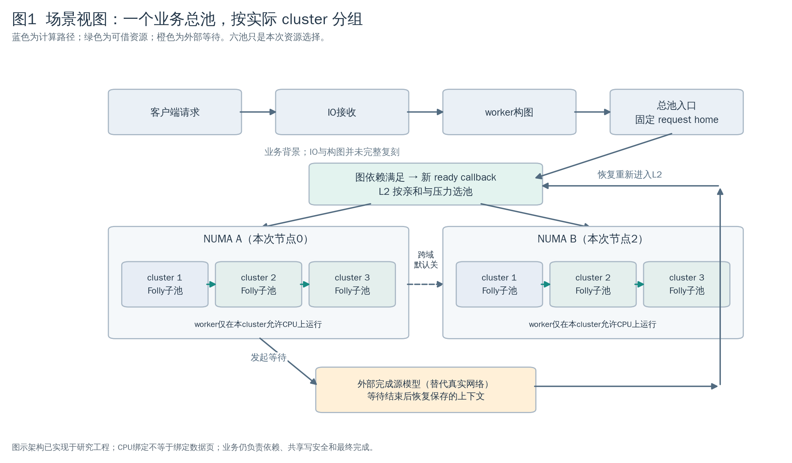

本次六个 mask 为 `0-15`、`16-31`、`32-47`、`192-207`、`208-223`、`224-239`，并集为 `0-47,192-239`，分属 NUMA 0/2。每 cluster 报告 8 个物理核、16 个逻辑 CPU。CPU 绑定只约束线程可运行位置，不保证数据页驻留本 NUMA，也不能把 SMT 的两个逻辑 CPU 当作两倍物理吞吐。

### 1.2 四种对象与三种队列/等待

| 对象 | 本文含义 | 不能混同的对象 |
|---|---|---|
| request / 请求 | 一张图从计划到达到最终完成的生命周期 | 一个算子或一个 Folly 任务 |
| operator / 业务算子 | 具有业务计算和数据依赖的一段工作 | 全部 callback；恢复、join 等 callback 可以很轻 |
| callback / 回调任务 | 提交给总池及 Folly 的一个可调用闭包 | 一个 OS 线程；同线程可连续消费很多 callback |
| worker / 工作线程 | Folly 创建的系统线程 | 一次唤醒或一个请求 |
| home / 请求亲和池 | 请求创建时确定且保持不变的归属池 | 后续实际执行所在池 |
| parent / 父池 | 当前分支的前驱实际执行池 | 整个 request 共用的可变“当前池” |

三种状态必须分开：**尚未满足依赖的图节点**没有进入 Folly；**Folly 任务队列**管理闭包；**Linux runqueue**管理可运行线程。RPC 等待还可能在三者之外：请求仍存活，但没有任何 executor 工作处于 ready 状态。

### 1.3 IPO：系统输入、处理和输出

| 层级 | 输入 Input | 处理 Process | 输出 Output |
|---|---|---|---|
| 请求发生器 | QPS、到达形态、seed、在途预算 | 按计划尝试准入、生成请求 | 计划/实际到达、home、失败和完成 |
| 图执行器 | 波宽、深度、固定工作、分支数据 | fork、依赖续接、join、下一波 | 业务 checksum、各角色 callback、请求时延 |
| 总池 | request/parent 上下文、ready 闭包、拓扑、负载 | L1 固定 home；L2 评分、选池、预留、提交 | 目标池、借出原因、接纳或拒绝 |
| Folly 与内核 | 闭包、worker 及有效 CPU mask | 队列/信号量；线程唤醒、运行或等待 | callback 开始/结束、CPU 服务、调度等待 |
| 外部完成源 | due 时刻、一次性 continuation | 保存等待、到期派发、恢复上下文 | source lag、恢复排队、生命周期守恒 |
| 分析器 | 时间戳、计数、整轮 CPU、运行合同 | 同合同配对、分角色/负载统计 | 时延与 CPU 代价、机制证据、无效对照提示 |

## 2. 负载设计：分别控制到达、依赖和外部等待

### 2.1 请求到达不等于内部扇出

`regular` 按固定间隔安排请求；`burst8` 保持平均 12 QPS，但每批 8 个请求，计划间隔 100µs。批周期约 666.7ms，计划首尾跨度 700µs。实际投递会受发生器调度、创建请求等影响，必须另外报告 arrival lag 和实际批内跨度。发生器的 attempt 时间早于根任务构造，不能把它称为全部算子已经 ready 的时刻。

一个请求即使独自进入，也能产生内部微突发。当前主体图第一波 80 个分支、每支深度 2；join 后第二波 4 个分支、深度 2，共 168 个业务算子。初始化和两个 join 使直接版本共有 171 个基础 callback。后继按实际完成释放，不预先把整张图塞进任务队列。

### 2.2 固定业务工作与真实数据依赖

策略间固定迭代数、访问数、到达计划和 seed，以防“执行得更快所以少做了工作”。分支读写模型为每支分配 64KiB，后继读取前驱更新的缓冲区和标量，各分支不互相写入。home 上初始化提供 first-touch 条件，但没有强制页绑定；它只能构造局部性机会，不能预设真实 cache miss 的收益。

异质工作支持 request 和 task 两种作用范围。主要后续结果使用 task 级 ±25% 扰动，并让哈希选择的约 1/8 任务承担四倍工作。长工作位于不同分支，会改变关键路径。不同 seed 因而是不同工作实例，不是同一工作重复三次。

| 工作族 | 每业务算子基础迭代 / 访问 | 到达 | 主要用途 |
|---|---|---|---|
| L：长工作 | 3,000,000 / 100,000 | regular 12 QPS 或 burst8 平均 12 QPS | 局部集中、线程预算、信号与后继策略 |
| S：短工作低密度 | 375,000 / 12,500 | regular 12 QPS | 缩短工作后的观测扰动与低重叠校准 |
| SD：短工作高密度 | 同 S | regular 96 QPS | 增加请求重叠，验证短工作下的策略代价 |
| D0 / A0 / A1 | 同 SD 的业务工作 | regular 96 QPS | 分开直接续接、异步结构、外部等待 |

实测业务 callback CPU 均值约为 L 的 8ms 和短族的 1ms；这是受控尺度，不是生产算子耗时标定。原始业务口述的平均 100ms、个别 700～800ms 尚未明确 CPU 时间、墙钟时间和算子边界，不能与这里直接对齐，也不能用历史线程周期约 0.85ms 替换它。

### 2.3 D0、A0、A1 的区别

| 合同 | 做什么 | 能分离的问题 |
|---|---|---|
| D0 | 业务完成后直接推进依赖 | 基础计算与图调度 |
| A0 | 确定性选择约 50% 的位置，经完成源、配置等待 0ms | 异步登记、helper、恢复 callback 等结构成本 |
| A1 | 与 A0 相同位置，但 due 设置为登记后 2ms | 在同业务工作上增加外部等待 |

异步路径完成当前业务算子，捕获续接上下文、注册 due 后返回。原 callback 返回后退出 CPU 池的占用计数；完成源在到期后提交轻量 `rpc_resume`，恢复 request、实际 parent 和 Folly RequestContext，再推进图。

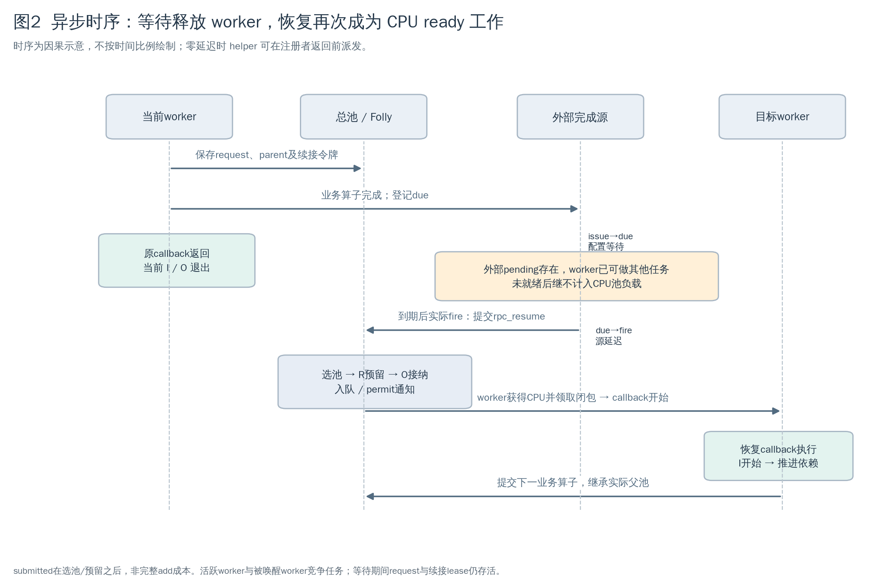

2ms 是选中位置的最早到期等待，不是每个请求固定增加 2ms；串行、并行和实际派发共同决定请求代价。A0 允许 helper 在注册者返回前派发，图示不承诺它必然先返回。完成源是与 executor 共享获准 CPU 的有界单线程模型，未模拟真实网络协议、下游排队、重试或超时相关性。

最新合同为 `align=0`、源容量 4096、最大请求在途 16。最新四次运行峰值在途仅约 4，源 pending 峰值最多 87；这些结果验证了该合同正常完成，不能据此宣称持续过载或容量边界已经验收。

## 3. 观测点设计：先说明计量对象，再讨论成本

### 3.1 入队与唤醒的实际关系

本工程锁定的 Folly 基线为 `v2026.10.26.00`。常规路径为 `add → 保存闭包/上下文 → enqueue → post → worker 取得 permit → dequeue → 执行 callback`。通知某个等待线程不等于把闭包直接交给它；普通任务仍经过队列。已工作的线程执行完当前 callback 后会继续取工作，因此可能先于刚被唤醒的线程取得任务。唤醒只让线程有机会运行，内核仍决定何时给它 CPU。

默认 `ThrottledLifoSem` 先增加共享值，再推进唤醒链，通知本身不保留某个线程独占的 permit；额外唤醒间隔默认是 0。经典 `LifoSem` 可把 permit 交给某个 waiter，公共值可能已经为 0 而闭包尚未领取。两种实现的队列 size 语义不能混讲。即使默认路径，也有 enqueue/post、permit/dequeue、dequeue/callback 开始之间的窗口。

### 3.2 快速信号的定义与覆盖范围

| 信号 | 定义 | 主要盲区 | 维护与读取 |
|---|---|---|---|
| Q | 当前 Folly 队列接口报告的未领取工作代理 | 已领取、开始后被抢占或阻塞；具体 size 依实现 | 原生合法原子读及解码；无新增统计更新 |
| I | 包装 callback 已开始、尚未返回的数量 | 不含开始前窗口；含抢占和同步阻塞 | 开始/结束更新，读取常数级 |
| O | 底层包装已预留/接纳、尚未完成的 callback | 未 ready 图节点、已脱离 worker 的外部等待 | 预留/完成原子更新，提交失败回滚 |
| R | 总池已选定目标、尚未逐项交接的批内预留 | 只是选择侧近似预留 | 批量预留与交接维护；可能与 O 短暂重复 |
| request 在途 / source pending | 请求或外部等待的生命周期数量 | 不能识别有多少 CPU ready 工作 | 用于准入和下游诊断，独立记录 |

这里 I 是 callback 占用，不是窗口内上过 CPU 的不同线程数，也不是内核 runnable。O 已覆盖进行中的 callback，不能再加 I。Q、I、O、R 是不同时间读出的近似快照，不要求满足精确等式。

对计数容忍误差，不意味着可以用普通共享整数跨线程读写：那会产生 C++ data race。relaxed 原子读与竞争性原子 RMW 的成本不同；优化应针对实际竞争和缓存行，而不是统称“原子操作很慢”。

### 3.3 可替换的观测与评分接口

`LoadProvider` 提供已发布的合法快照，热路径不读 `/proc`、不遍历线程、不打印；`LoadScorer` 把快照转为单位明确的分数，候选池搜索与之分离。

| 评分器 | 当前分数 | 适用解释 |
|---|---|---|
| queue | `(Q + R) / C` | 最便宜的未领取工作基线 |
| active | `(Q + I + R) / C` | 增加已开始占用；仍有交接窗口 |
| outstanding | `(O + R) / C` | 更完整的接纳至完成压力；不把异步存活算作 CPU 工作 |
| work | `(估计未完成 CPU 微秒 + 预留 CPU 微秒) / C` | 必须有可靠成本估计；阈值不能沿用 count/C |
| cpu-hybrid | `max(Q+R, 窗口CPU+可运行等待需求, 有效的瞬时runnable) / C` | 慢反馈；无效、过期或 worker 全占用时回退 O |

C 是配置的名义容量，cluster 模式当前为 `min(worker 数, 获准逻辑 CPU 数 × scale)`。C=16 不是经过标定的物理吞吐，score=1 也不是 CPU 利用率 100%。

原版池可通过 TaskObserver 适配 Q/I：须在任务接纳前安装，并保证 observer 生命周期；缺少完整提交失败生命周期时不伪造 O。更完整的 O 由总池包装器维护，具备成功、拒绝、异常及取消收尾，不依赖 demo 的图形状。取消不表示能从 Folly 删除已入队闭包：已入队工作仍需消费收尾，外部 token 的取消则结束对应续接生命周期。

### 3.4 成本证据及不能省略的限制

开发机空闲 worker 的批量平均探针中，原生 Q 读取约 6.3～6.5ns，active 读取加评分约 11.3～11.5ns；逐 TID 扫描 `/proc`，4 个线程约 33.6µs，128 个线程约 982µs/轮。它们只是 x86、热缓存、空闲线程的读路径例子，**不是 ARM 高并发维护成本，也不是单次调用 p99**。

当前 O 路径通过 `BusinessExecutor::readLoad()` 读取多个计数及 Q，尚未专化为一次 O 原子读。所有策略以及 trace0 都维护基础生命周期、O/I/work；Q/O 策略比较不能推导“删掉全部计数”的收益。stock observer 每 callback 额外两次 relaxed RMW，其高并发争用需要单独测量。

CPU 后端按 TID 后台扫描，每轮完成后默认等待 50ms，样本最大年龄默认 100ms；实际窗口包含扫描影响。缓存读取便宜不代表采集免费，也不能据此捕捉 1～3ms 的全部尖峰。目标早期 CPU 策略曾全部回退 O，故没有 CPU 评分胜出的目标证据。应同时报告样本年龄、有效率、回退率和采样 CPU。

日常建议记录成功/失败/拒绝、请求时延、CPU/完成请求、低频 Q/I/O 分布和借出计数；需要解释机制时，短时开启细粒度时间戳、角色和路由原因。周期采样可能漏峰，全量记录则可能改变短任务行为。第 7 节给出实际开关对照。

## 4. 负载均衡设计：新 ready 工作的放置

### 4.1 两层路由与迁移后的亲和

L1 保留已有 RR 或染色 hash，为请求固定 home。L2 由同一个总池处理后续提交：普通 add、标记 fork 的批量提交、外部 continuation 都复用选池路径；业务无需知道池编号，但仍需表达依赖、fork 语义及异步所有权。

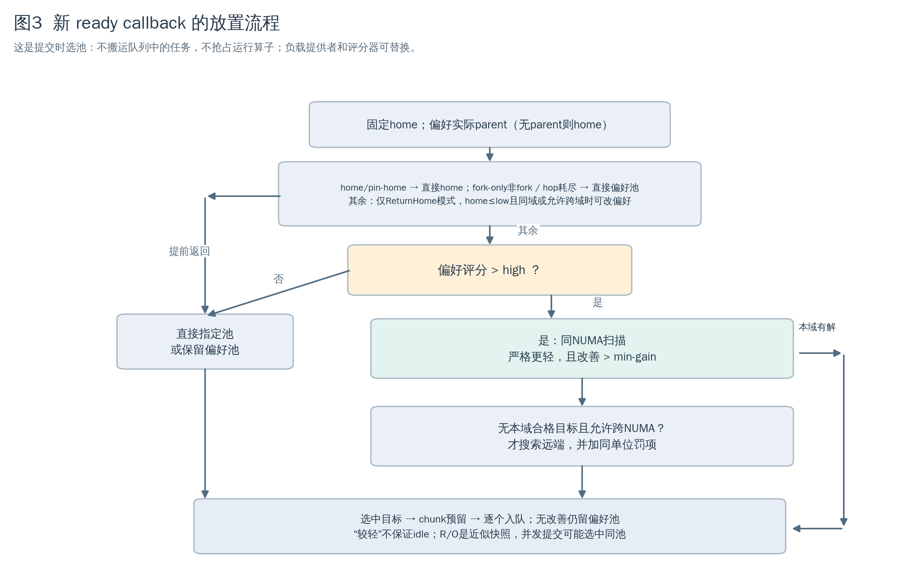

默认偏好实际 parent，没有 parent 时使用 home。偏好池评分**严格大于** high 才尝试借出；候选必须严格更轻，且改善**严格大于** min-gain。平手保留原池。“较轻”不要求低于 high，所以目标不一定 idle。

先在偏好池所在 NUMA 搜索；仅本域没有合格改善且开关允许时，才考虑远端并加罚项。该流程不是不分拓扑的全机 argmin。远端罚项与评分同单位，不能把毫秒直接加到 count/C。

| 开关 | 语义 | 本阶段证据边界 |
|---|---|---|
| parent | 各分支继续优先实际来源池 | 保留迁移后的局部性机会；普通选择仍可能回 home |
| ReturnHome | 未被 fork/hop 提前拦截，home 分数≤low 且同域或允许跨域时，可优先回 home | 是独立规则；parent 模式下 low 不触发主动回迁 |
| fork / all | 仅各次标记 fork，或所有允许路由的提交 | fork 不仅首波；all 的额外收益依场景变化 |
| chunk | 一组任务共用一次选池和预留 | 成员仍逐个入队；不是把任务合并执行 |
| max-hops | 沿依赖上下文累计改池次数预算 | 不是全 request 的迁移总数，也不是驻留时间 |
| cross-numa | 是否可在本域无改善时借到远端 | 最新对照关闭；跨域收益尚未验收 |

并发选择与预留不是一个全局事务，仍可能同时选中同一目标。当前没有搬运已经入队的闭包、工作窃取、运行中抢占、LALB 或持续压力状态机；它也不接管内核 runqueue。没有可靠反例前，不因历史短峰叙述直接加入 3ms 门控。

### 4.2 工程边界与阶段五的作用

总池封装固定 home、分支上下文、拓扑、负载接口、选择和生命周期。业务负责 DAG 依赖、共享写安全、完成判定及异常语义。batch 返回已接纳前缀，未接纳后缀必须显式收尾；外部 token 必须恢复、取消或销毁。关闭时停止新根请求，允许已接纳链路及 continuation 完成，再 drain 子池。

这一层可先使用 stock Folly 公共接口，不需要立即修改 Folly 核心。阶段五仍有价值：确认公共 API、Future/KeepAlive 接入、失败及关闭契约是否值得下沉为通用组件。已有可选库扩展并不证明所有生产接法等价，也不构成必须维护 Folly 分叉的依据。

## 5. 如何阅读测试图表

### 5.1 哪些比较是可比的

每个策略对照保持业务工作、seed、到达合同、线程预算和 CPU 资源一致，并核对完成数、失败数、固定工作及 checksum。改变线程数、工作族、异步合同或到达形态是有意干预，必须单独标明。历史开发机功能通过只证明实现可运行；目标 ARM 汇总才用于本报告的性能观察。

DAG 主要请求时延使用计划到达落在 `[2,18)` 秒的 cohort，晚完成仍保留；12 QPS 每轮 192 个请求，96 QPS 每轮 1536 个。指标为**计划到达至请求完成**，包含发生器落后；另有 attempt→finish 供诊断。独立任务实验使用自己的 `[10,60)` 秒窗口，图 4 不能与 DAG 数值混池。

三 seed 对照会保留三个点。单轮 192 个请求的 p99 接近最慢的少数请求；burst 请求还存在相关性。三个 seed 不等于三次同工作重复，增加同轮样本也不能代替独立交错整轮。因此本文展示描述性差值，不把各轮 p99 平均成总体 p99，不画未计算的置信区间。

### 5.2 CPU 指标为何没有直接写成“利用率”

当前可追溯汇总较完整地记录了**整轮进程 CPU / 完成请求**。CPU 计量包含运行期的发生器、worker、helper 等及 warmup/drain，不包含池/缓冲区构造和结果导出；请求时延通常只取上述 cohort。两种范围分别标明，不将它们拼成一个精确同窗效率指标。

真正的同窗归一化 CPU 利用率应为：

`U = 同一窗口内进程CPU秒 / (窗口墙钟秒 × 获准逻辑CPU数)`。

还需说明 CPU 并集、quota、外部竞争和是否归一到逻辑 CPU。当前所选回传摘要没有统一的同窗利用率数据，故图表使用 CPU ms/完成请求，不凭 QPS、口述“50%”或排空时间补造利用率。该指标仍能回答：在同批同工作条件下，时延改善是否消耗了更多 CPU。

百分比统一为 `100 × (候选 / 同批基线 - 1)`；时延负值表示下降，CPU 正值表示成本增加。下面每张图的点、线和样本范围均有独立定义。

## 6. 多轮结果：按问题组织，而不是按日志顺序

### 6.1 Q 能给出条件时延关系，但不是通用预测公式

独立任务先排除 DAG 和迁移，以提交前 Q 分桶。图 4 是 cluster 绑定、每池 256 线程、localburst100 条件下三个 seed 的分位数范围；每轮统计 12,000 个任务，线段是三轮范围，不是置信区间。

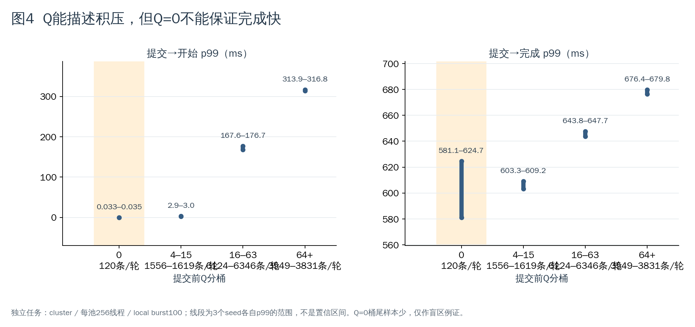

Q 从 4～15、16～63 增至 64+ 时，提交→开始 p99 从约 3ms、168～177ms 增至 314～317ms，显示明确的条件积压关系。另一方面，Q=0 的提交→开始 p99 仅约 0.033～0.035ms，提交→完成 p99 仍约 581～625ms。该桶每轮仅 120 条，尾部估计很弱；它多对应 burst 中首个任务，后续同批工作可在读取 Q 后到达。任务开始后也可能执行很久或被调度延后，因此这不是单独隔离 I 盲区的实验，但足以提示 Q=0 不保证完成快。

相同 Q≥64，none（不设置子池 CPU 绑定）时的提交→开始 p99 约 8.6～13.6ms，与 cluster 下约 314～317ms 相差很大。**已经得到的是按部署、线程数、工作和到达形态分层的条件关系；没有得到跨配置通用 Q 阈值，更没有 Q→整张 DAG 请求 p99 的公式。**

### 6.2 早期部署基线：只绑 cluster 会限制峰值并行

在引入当前固定迭代/分支数据模型之前，曾用同一 96 逻辑 CPU 并集、每池 256 线程做 none/numa/cluster 九次 home 基线。该旧模型为规则 12 QPS、同质 20ms CPU 预算算子、无 RPC 和数据局部性，每请求 60 个业务算子及两个 join。它用于隔离允许 CPU 范围的影响，不能与当前约 1ms/8ms 工作族合并比较。

| 部署 | 每个子池允许范围 | 请求均值，ms（三轮均值的等权平均） | 请求 p99，ms（各轮范围） |
|---|---|---:|---:|
| none | 整个获准 CPU 并集 | 60.713 | 60.818～60.967 |
| numa | 所属 NUMA 的获准 CPU | 60.731 | 60.830～61.312 |
| cluster | 所属 cluster 的获准 CPU | 98.951 | 103.892～113.252 |

每轮主窗口 600 个请求，工作 CPU 预算一致；cluster 相对 none 的请求均值增加约 63%。第一波 40 个算子超出本 cluster 的 16 逻辑 CPU 范围，而低重叠 none/numa 接近无资源等待路径预算。这支持“硬绑定必须同时考虑峰值并行”，不证明取消亲和是生产最优；该模型没有缓存收益，且未记录完整进程 CPU，不能比较总 CPU 效率。numa 与 none 的微小差异也不足以判定优劣或严格等效。

### 6.3 负载改变时，借出收益与 CPU 代价一起改变

图 5 每个点都是同批、同 seed、同线程的策略相对 home。Q、Q+I、O 使用第 3 节的归一化定义。多个点保留工作 seed 差异；短密集及 A1 各格为单次目标运行。

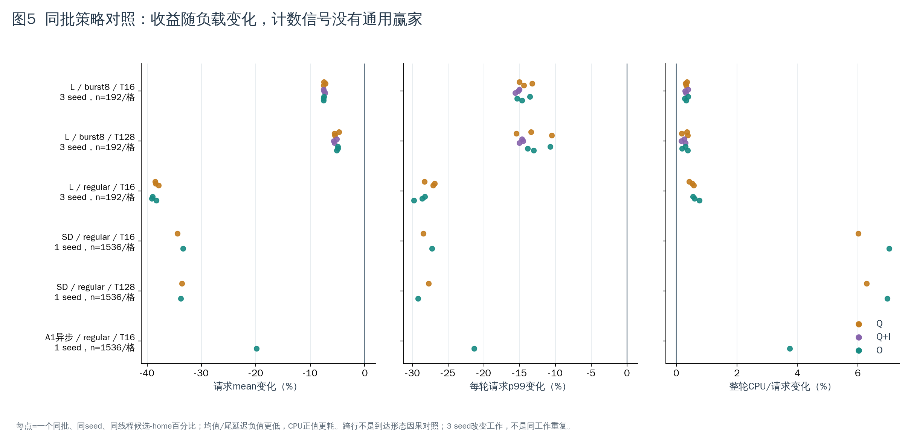

| 场景及证据范围 | 请求均值变化 | 请求 p99 变化 | CPU/请求变化 | 可以得出的结论 |
|---|---|---|---|---|
| L、burst8、16线程，Q/active/O，3 seed | 约 -7.2%～-7.6% | 各轮有差异，见图 | 约 +0.2%～+0.4% | 有限收益；信号间差距很小 |
| L、regular、16线程，Q，3 seed | -38.51%～-37.89% | -28.31%～-26.89% | +0.42%～+0.57% | regular 下收益较大；跨批仅描述性参照 |
| L、regular、16线程，O，3 seed | -39.13%～-38.31% | -29.77%～-28.25% | +0.54%～+0.76% | 与 Q 接近，未证明通用优势 |
| SD、regular、16/128线程，Q/O，单 seed | 约 -33%～-34% | 约 -27%～-29% | 约 +6%～+7% | 短工作高密度下，时延收益伴随更明显 CPU 代价 |
| A1、regular、16线程，O，最新 trace0 | -19.87% | -21.35% | +3.74% | 真正释放 worker 的异步场景仍可受益 |

regular 长工作与 burst 长工作的差异，与多个 home 同期承压、可借资源变化相容；不能只凭总体均值把全部差异归为某一种硬件原因。测试支持借出的机制价值，不支持“CPU 一定下降”或“只要 Q 不足就换 O”。SD 中 Q/O 排名随线程档变化，更不支持唯一信号赢家。

### 6.4 worker 多不等于更快：等待会换位置

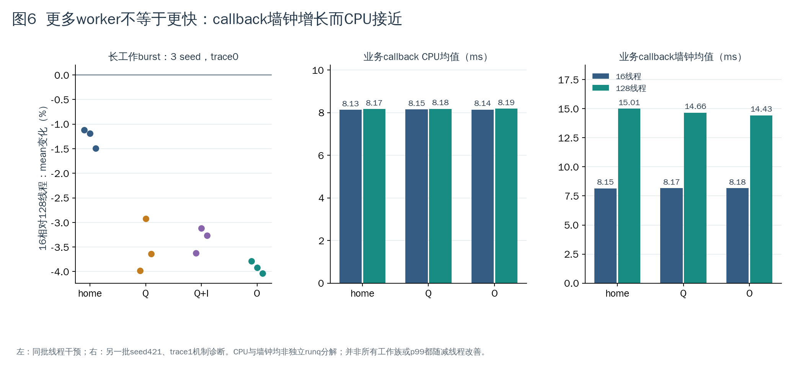

长工作 burst 的三 seed 中，借出策略从每池 128 降至 16 线程，请求均值改善约 2.93%～4.03%；p99 并非每个对照都改善。另一次机制诊断中，业务 callback CPU 均值都约 8.1～8.2ms，而墙钟均值从 16 线程的约 8.2ms 上升到 128 线程的约 14.4～15.0ms。

这说明在该 CPU 工作族里，更多 worker 没有创造额外业务工作效率，并使开始后的历时增大。墙钟减 CPU 仍可能包含抢占、阻塞及其他等待，不能全部命名为 runqueue 时间。该证据不确定生产最优线程数；如果真实算子同步阻塞很多，必须重新核实预算。

### 6.5 首波借出之后，后继还要不要均衡

fork 只在标记的扇出点允许借出，all 继续对后继提交判断。图 7 比较同 seed 的 all-parent 与 fork-parent，分别保留 trace0/trace1。

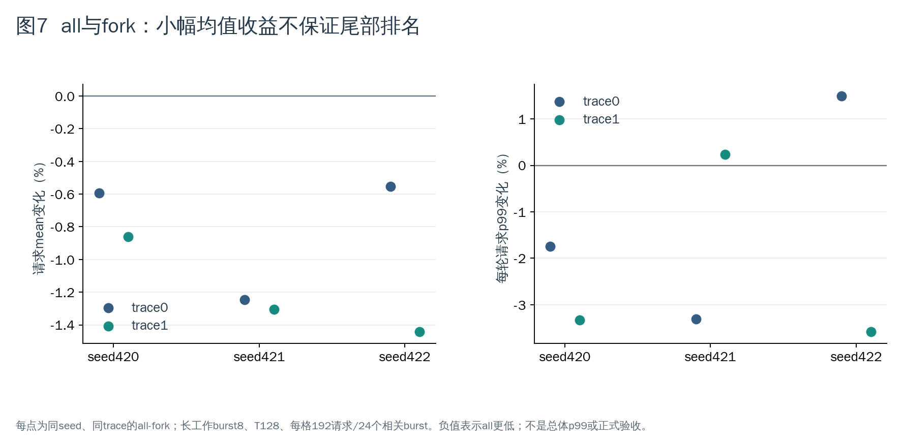

长工作 burst 中，关闭详细记录时 all 的请求均值比 fork 低约 0.84～1.90ms，幅度很小；p99 在一个 seed 反向增加约 2.85ms。打开记录后，也有一个 seed 的 p99 反向。更早 regular 对照的 all 均值近似不变、p99 更高；另一批 burst 的 all 则均值和 p99 都下降。这些跨批差异是敏感性线索，不能混作一次因果对照。

因此 all 可以是当前集成候选，但没有证据强制所有后继都必须重新均衡；fork 是必要的成本与局部性对照。现有主要性能运行使用 parent，尚未独立证明它比 ReturnHome 更好。

### 6.6 异步等待不是 CPU ready 压力

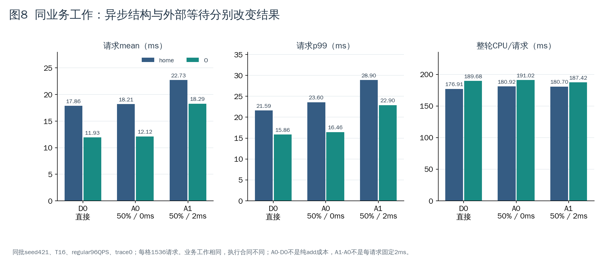

D0、A0、A1 保持业务算子工作相同，但执行结构不同。A0 增加完成源和恢复 callback；A1 再加入配置等待。home 下 D0→A0→A1 请求均值约 17.862→18.208→22.729ms，p99 约 21.595→23.600→28.898ms。这里不是把 2ms 加到整个请求上的简单模型。

前一批（4018）的 home trace1 对照中，从 A0 到 A1 请求均值增加，恢复 callback 等待均值却从 2.065 降至 1.135ms。更多时间在外部等待，可以减少同时 ready 的工作；所以 request 在途或 source pending 不能直接当成 O，也不能单凭请求更慢判定 CPU 池更忙。

最新 A1 关闭详细记录的结果如下。两策略各 1920 个请求全部完成，cohort 各 1536 个；业务工作与选中的异步位置一致。

| 指标 | home | O 借出 | 相对变化 |
|---|---:|---:|---:|
| 请求均值，ms | 22.808 | 18.277 | -19.87% |
| 请求 p95，ms | 26.612 | 21.333 | -19.84% |
| 请求 p99，ms | 29.175 | 22.947 | -21.35% |
| 整轮 CPU/完成请求，ms | 180.640 | 187.401 | +3.74% |

这组观测支持“该异步合同下 O 借出仍有价值”；每格一次运行，不构成生产 p99 承诺。

### 6.7 异步收益发生在哪里：不能只看恢复任务迁移

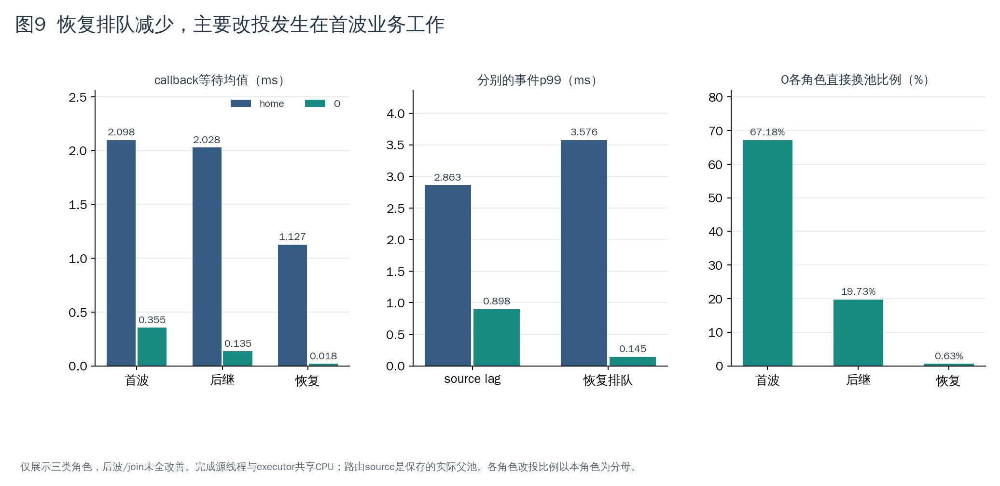

最新 trace1 机制对照中，首波业务、普通后继、恢复 callback 的等待均值分别从 2.098→0.355ms、2.028→0.135ms、1.127→0.018ms。恢复的等待确实大幅下降，但它自身直接改池仅占 0.63%；首波占全部迁移的 75.66%。结果与“首波分散，后续继承实际父池并受益”相容，不能说收益来自大量恢复 callback 迁移，也未单独隔离 parent 的因果作用。

完成源 due→fire 的 p99 从 2.863→0.898ms，恢复提交→开始的 p99 从 3.576→0.145ms。helper 与 executor 共享 CPU，所以完成源也会受到调度反馈；运行波动仍不能排除。总收益不全属于 Folly 队列，几个阶段的 p99 也不能相加成 request p99。后一波和 join 的等待并非全部下降。

## 7. 观测扰动：短工作需要单独核算

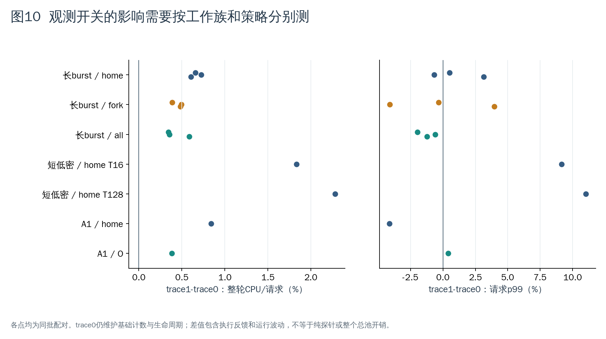

详细 trace 开关的 CPU/请求增量，在长工作 burst 中约 0.34%～0.73%，在短低密度 home 中约 1.83% / 2.28%（16 / 128线程）。最新 A1 中 home 约 +0.84%、O 约 +0.38%；O 的请求均值变化约 -0.02%，p99 约 +0.40%。没有观察到改变该轮 O 收益方向的大扰动，但不能称为零开销。

图中的 p99 负变化也不代表观测能加速系统：记录改变调度，并叠加单轮波动。**记录成本随工作粒度、策略和并发变化，不应拿 home 的比例直接套到 O。** trace0 仍保留总池基础计数和生命周期，开关差不是全部观测系统成本。工程已能区分读路径、后台采集、记录开关；高并发基础计数维护的净成本仍未被这一组对照隔离。

## 8. 历史真实轨迹：支持哪些相似性，不能提供什么

### 8.1 可采用的历史事实

历史采集包含 `sched_switch`、`sched_wakeup`、`sched_waking`、`sched_migrate_task`、`sched_wakeup_new`。用户报告当时 16 QPS，四个临时 executor 池、未做 CPU 绑定；QPS 不是从调度事件中测得。采用同一 10 秒窗口、最终 exact TID 集合和匹配区间摘要，四池共映射 404 个 TID，归属由线程名称推断。

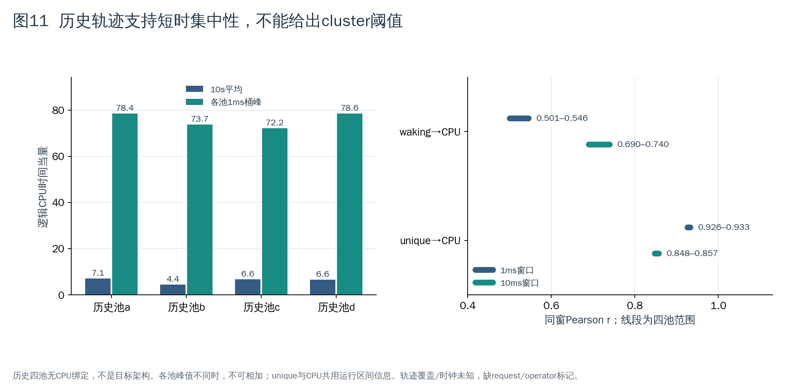

四池平均 on-CPU 逻辑 CPU 时间当量约 7.093、4.364、6.620、6.569，而各自 1ms 桶峰值约 72～79。当量是运行时长之和除以窗口长度；它不是物理吞吐，也不是当前 96 个测试 CPU 的利用率。四池同期求和后再取峰为 83.291，不能把各池不同时间的峰相加。

最忙 10% 的 1ms 桶承载各池约 45.5%～54.8% 的 CPU 服务。以“超过各自均值两倍”定义描述性高服务，连续段 p50 为 2ms、p95 为 15～20ms；至少一池高服务的桶中，约 82.94% 仅一池达到这个定义。这支持研究短时集中与不同池错峰，但不证明其余池 idle，更不证明它们位于可借的同 NUMA。

窗口内不同上 CPU 线程数 unique-onCPU 与 on-CPU 当量的 1ms 相关系数约 0.926～0.933；两者共享运行区间信息。waking 与 on-CPU 的 1ms 相关系数约 0.501～0.546，扩大到 10ms 后约 0.690～0.740。它们支持窗口服务集中性，不证明业务 callback I 能作为相同精度的低成本 CPU 代理。

### 8.2 不能据此标定 3ms 或生产算子时长

历史闭合 wake→run p99 约 0.312～0.340ms，只覆盖约 89.6%～89.9% 的 wakeup；summary_exact 中 runnable 切出→再运行 p99 约 1.483～1.617ms；另一次独立审计的对应事件匹配率约 72%～75%，两者删失处理和分母不同，不组合成一套精确覆盖率。这不是全部调度等待，更不是请求尾部。缺少 clock、mask/filter、overrun 的完整元数据，未出现显式 LOST 也不证明采集完整。

“平均活跃 20、峰值 80”的统计对象尚未核实；外部分析中的约 0.85ms 更接近候选线程周期，不能解释为单算子 CPU 服务。关于 1266 个过载事件、92% 两毫秒自愈及 3ms / 0.9C / 0.75C / 2C 门槛的说法没有通过可用产物复核，部分外部解析还有跨桶状态和 unknown 初态问题。因此这些数字不进入推荐阈值。

旧 trace 不含 request/operator 身份、DAG 边、Folly 入队/出队、RPC 或缓存/页位置。继续扫描也无法补出未采集的业务语义。非 runnable 切出不自动等于 RPC，一段 on-CPU 也不自动等于一个算子。

### 8.3 真实机制与模拟覆盖的对应关系

| 真实机制或线索 | 模拟覆盖 | 相似性及仍缺失的事实 |
|---|---|---|
| 初始大扇出、短时服务集中 | 首波 80 分支、多波 join、regular/burst | 机制较强；真实 ready 跨度和宽度分布未标定 |
| 算子长短、依赖关键路径 | task/request 异质性、L/S/SD | 覆盖敏感性；真实 CPU/墙钟边界和长任务位置未知 |
| 线程数超过 cluster CPU | 16/128 worker、Q/active/O | 覆盖过配机制；真实同步阻塞、quota 未知 |
| 后继数据亲和 | 分支 64KiB 读写、home first-touch、parent | 存在真实依赖；未测硬件 cache 因果、页归属及多父融合 |
| AIO/RPC 期间释放 worker | D0/A0/A1、一次性 continuation | 生命周期较强；真实网络、重试及集中回流分布未复现 |
| 短峰与较长集中段并存 | 长短尺度、入口 burst、多波释放 | 有敏感性覆盖；没有可靠 N(t) 连续过载标定 |
| 多池同时忙、阻塞或外部竞争 | 相对评分、CPU 回退、准入接口 | 目标性能覆盖不足；未验收持续饱和、公平及强竞争 |

模拟的意义是隔离可重复机制、比较同工作策略，不能声称复刻生产分布。当前最接近业务主矛盾的是“每 cluster 一池 + 有依赖的数据分支 + 首波集中 + 新 ready 借出”；异步合同补齐了等待释放 worker 的重要边界。绝对 QPS、算子时间、缓存收益和生产阈值仍不能直接外推。

## 9. 场景化建议与候选初值

### 9.1 按场景选择观测与策略

| 当地确认的场景 | 观测起点 | 调度候选 | 同时验收 |
|---|---|---|---|
| 以 CPU 计算为主，worker 接近容量 | Q 基线，O 候选，active 对照 | 固定 home，同 NUMA 借出 | 请求 mean/p99、CPU/请求、失败、池间分布 |
| Q 已很低，但很多 callback 已领取/占用 | O 或 Q+I，保留 Q | 同上；先核实 worker 预算 | callback CPU/墙钟，抢占或阻塞来源 |
| 真正异步等待，恢复 callback 较轻 | O 与 source pending 分列 | parent 起点；恢复复用总池 | source lag、恢复排队、业务角色、总请求时延 |
| 大量同步阻塞或强外部 CPU 竞争 | Q/I/O 加 CPU/等待慢反馈 | 先识别预算和准入，不靠无限借出 | 采样有效率、阻塞、失败、服务能力 |
| 数据亲和强，同 NUMA 有可借资源 | Q/O 可替换 | parent，保留 fork/all 对照 | CPU 代价、迁移、分支角色；不先归因 cache |
| 各池同时持续高需求 | 相对计数加准入/在途 | 较轻池不等于闲池；需要容量方案 | 持续进展、公平、拒绝与排空 |
| 准备跨 NUMA | 原信号附拓扑和数据页信息 | 本域优先，远端独立开关 | 同工作跨域成本，实际 mask/页位置 |
| 怀疑瞬时峰引发无效迁移 | 先证实重复反例与持续性 | 之后才考虑慢进入/快释放等状态机 | 采样空洞、下降复位、确认时是否仍有新 ready |

### 9.2 已测起点不是生产最优值

以下为最新可复现候选；demo 默认 policy 仍为 home，O 需显式启用。梯度只在当地证据提出具体问题时使用，不建议一次展开全参数乘积。

| 参数 | 已测候选起点 | 可配置方向与限制 |
|---|---|---|
| 子池数 / CPU | 每个核实且获准的 cluster 一池 | 动态发现，不固定四或六；核对每 worker 有效 mask |
| request home | RR；也可使用已有染色 | 生命周期内固定，不改业务归属语义 |
| worker 数 | 本次每池 16 | CPU/真正异步确认后，以本池逻辑 CPU 数为试验起点；阻塞不明时不盲降 |
| C / scale | 本次 C=16、scale=1 | 名义容量；线程减少可能同时改变 C，须记录 |
| 信号 / high | O，high=1 | 保留 home/Q/active；必要时少量选 0.75/1/1.25/1.5；严格超过才借 |
| min-gain | 0 | 必须严格正改善；无效小迁移存在时再试 0.125/0.25/0.5 |
| continuation | parent | ReturnHome 单独对照；并不保证永远不回 home |
| return-low | 0.5 | parent 下不主动生效；仅 continuation=home（ReturnHome）再考虑 0.25/0.5/0.75，且≤high |
| balance-at | all | 保留 fork；主要收益已在首波时，后继额外选择未必值得 |
| chunk / max-hops | 1 / 4 | 有选择开销证据再试 chunk 2/4/8；hop 1/2/4；0禁借出 |
| cross-numa | 0 | 先关闭；远端罚项本批未使用，不给未经标定的通用值 |
| 详细 trace / CPU 后台采样 | 性能轮关闭，机制轮按需开启 | 同时保留关闭对照；报告有效率和扰动 |
| 持续压力 gate | 未实现、未启用 | 不下发 3ms、0.9C、0.75C、2C 为实测阈值 |

C=16 时 min-gain=0.125 相当于两个任务当量分差，但由于严格比较，恰差两个仍不借出。return-low 是回 home 规则，不是时间门控释放线。96 QPS、异步 50%/2ms、在途 16 和源容量 4096 都属于实验负载/准入合同，不应复制为生产调度参数。

## 10. 当前交付状态与后续边界

本轮已足以收束机制研究：独立任务给出分层的 Q→时延条件关系；复杂图验证局部借出、线程预算、后继范围和异步释放的影响；观测接口及总池具备可复用实现和功能测试。没有新的部署决定时，无需追加无边界的合成矩阵，也无需继续解析旧 trace 来“补齐”不存在的业务标记。本次报告重组没有重新运行目标性能实验或修改运行策略。

尚未完成的是生产代表性、正式独立多轮 p99 验收、跨 NUMA、真实网络/集中回流、同步阻塞、持续饱和与公平、硬件缓存因果以及基础计数维护净开销。它们是不同问题，不应一起解释为当前实验失败，也不能被当前成功运行代替。

当地接入按三步推进：先只读核实实际 Folly、拓扑、CPU 预算、提交与异步生命周期；再设计可回退的总池集成和功能验收；最后在明确 SLO、CPU/请求与失败门槛下，做少量交错整轮比较。若要正式声明尾部改善，需要冻结合同、独立重复和留出工作 seed，并增加适配当前异步格式的跨轮配对统计；现有逐轮报告和旧版比较工具不能冒充已经完成这一步。

生产、测试、开发无法互通，不妨碍使用本报告的机制与参数原则。仓库已有分阶段当地 agent 手册及纯 prompt 备选，先探索实现、再设计、再修改验收；无法交接文件时可复制提示词。当地事实未知时记录未知，不要求凭空补出先验，不把 3ms 或 16 线程硬编码为正确答案。

## 附录 A：证据、复现与工程定位

### A.1 本报告数据的来源

报告绘图选取 97 条运行汇总、108 个配对对照及 68 条机制记录；它们是既有证据的重组，不是 97 次新测试。来源保留路径、原回传哈希或审阅文件哈希、JSON 字段指针及打印精度。配对表为核算便利，也包含不同问题的比较，不能全部合并为一个总体效应。

| 图 / 主题 | 原证据 | 使用方式 |
|---|---|---|
| 图1～3 设计 | 总池、观测、业务包装与异步源源码 | 流程示意，不是测量时间线 |
| 图4 独立任务 | 阶段3三 seed 汇总 | 按提交前 Q 分桶的范围 |
| 图5 信号/负载 | 4012、4014、4016、4020 | 各自同批相对 home |
| 图6 线程 | 4012 性能；4013 机制 | 两组分面展示，不能直接相减归因 |
| 图7 后继范围 | 4011 | 同 seed/trace 的 all 对 fork |
| 图8 异步合同 | 4018 | 同业务工作 D0/A0/A1 |
| 图9 异步机制 | 4020 trace1 | 角色、源/恢复时间及迁移 |
| 图10 记录开关 | 4011、4015、4020 | 同合同 trace1 对 trace0 |
| 图11 历史轨迹 | 4005、4007 摘要及 4010 审计 | 服务集中与相关性，保留删失限制 |

更早的 4001～4009 用于校准、合同修正和后继敏感性；4017 用于到达核查；4019 是 4018 的重复附件，不增加独立证据。它们仍保留在审阅档案，但不与后来改变工作合同的批次合并排名。

数据与导出文件：[运行表](data/runs.csv)、[配对表](data/paired_comparisons.csv)、[汇总及字段来源](data/comparisons.json)、[独立任务证据](data/independent_evidence.json)、[早期部署基线](data/affinity_baseline_evidence.json)、[历史轨迹证据](data/trace_evidence.json)、[图表来源清单](figures/manifest.json)。离线 HTML 内嵌全部图片；PDF 可单独阅读。重建命令与验证范围见[本报告使用说明](README.md)。

### A.2 独立工程入口

| 职责 | 工程或文档 |
|---|---|
| 业务分析与五阶段边界 | [业务分析](../../stages/01-business/README.md)、[阶段验收](../../stages/README.md) |
| Folly 队列/唤醒源码 | [Folly 分析](../../stages/02-folly/README.md) |
| 简单任务实验 | [独立任务设计](../../stages/03-independent/README.md)、`experiments/independent` |
| 透明总池和固定工作图 | [affinity 工程指南](../../experiments/affinity/README.md) |
| 负载接口与评分 | [LoadPolicy.h](../../experiments/affinity/include/executor_demo/LoadPolicy.h) |
| 两层选择与上下文 | [RequestExecutor.h](../../experiments/affinity/include/executor_demo/RequestExecutor.h) |
| 计数及 Folly 包装 | [BusinessExecutor.h](../../experiments/dag/include/executor_demo/BusinessExecutor.h) |
| 外部完成源与数据依赖 | [AsyncCompletionSource.h](../../experiments/affinity/include/executor_demo/AsyncCompletionSource.h)、[LocalityWorkload.h](../../experiments/affinity/include/executor_demo/LocalityWorkload.h) |
| 当地探索、改造、验收 | [分阶段手册](../../docs/PRODUCTION_AGENT_PLAYBOOK.md)、[纯 prompt 交接](../../docs/PRODUCTION_AGENT_PROMPTS_ONLY.md) |
| 历史逐轮审阅 | [结果档案](../../results/review/README.md)、[截至4020简明结论](../../docs/CURRENT_CONCLUSIONS_AND_STARTING_CONFIG.md) |

源码锁定和原始实验指南继续保留；本报告是理解设计、比较证据与选取候选策略的总入口。图中没有把历史四池重新变成目标架构，也没有把描述性关联升级为生产最优阈值。
