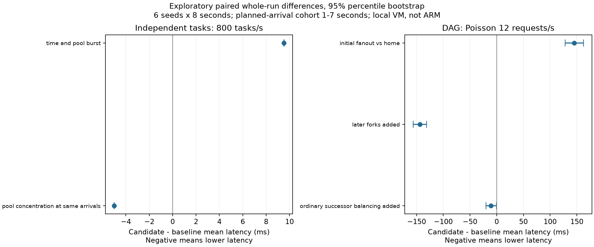

# 再次复核：实验设计修订与实际补测

这轮不将先前数据重命名为新证据。代码以 demo `ff9d7c4` 为修订起点，Folly 原版基线仍为 `v2026.10.26.00`；可选扩展新增候选域，提交为 `560e225e85229a3573061f66cab7e9207c98a9b0`。原始数据、合同和本轮结果均位于本目录。

## 1. 结论与修正范围

原设计有有价值的基础，但单靠“相同QPS、改变fanout、运行几秒”不足以定量分离原因。本轮修正了以下实际缺口：

|缺口|设计/工程修正|本轮验证|
|---|---|---|
|长尾同时增加平均工作量|阶段3可精确匹配整轮总CPU；阶段4生产参数使100ms均值包含700～800ms尾部|预算守恒测试、同均值分布补测；窗口预算差另报|
|时间突发与单池集中混在一起|同任务率改变burst；同到达/任务序列改变local/spread|独立任务5种配置及低压力独立seed确认|
|以机器逻辑CPU数量直接推压力|容量扫描要求显式任务率或实测容量，业务端点压力单列|生成器代数与边界测试；没有伪造本机可持续容量|
|初始均衡被当作所有后继均衡|初始fork、所有fork、全部后继逐项配对，增加随机RPC计划及Poisson到达|深链3波DAG对照、RPC计划/依赖功能检查|
|无法严格比较域内与全机借用|Folly/业务版新增preferred-numa候选域，DAG验证实际CPU节点|两套22项执行器测试及前端、后端一致性验证|
|短样本容易输出过度精确结论|预声明允许变量/工作量合同、planned cohort、整轮配对区间、小样本p99门槛|14项统计边界测试与所有补测数据审计|
|队列短被误认为整体等待少|保持原生queue基线，另分解回调前等待/回调墙钟|独立seed的每池2/16线程诊断，出现明确等待位置变化|

完整协议见[总复核](../../stages/EXPERIMENT_REVIEW.md)、[阶段3设计修订](../../stages/03-independent/DESIGN_REVIEW.md)、[阶段4设计修订](../../stages/04-dag/EXPERIMENT_REVIEW.md)和[配对分析指南](../../stages/COMPARISON_GUIDE.md)。

## 2. 本机实际执行了什么

环境为4逻辑CPU、单NUMA的x86 KVM，guest报告2 core × SMT2、共享LLC。`0,1;2,3`是人工CPU分区，不能称为两个ARM cluster。完整[环境记录](environment.json)包含CPU拓扑和quota。所有性能轮次串行执行；编译、sanitizer、其他性能负载均未与正式补测轮次并行。

每轮8秒，使用计划到达1～7秒的cohort，窗口后完成的慢任务仍保留。每配置6个seed，按seed分块、块内随机顺序。独立任务与DAG分别计量：

|批次|设置|运行数|整轮完成|测量窗口完成|
|---|---|---:|---:|---:|
|独立任务主批次|2池×1线程，1600 task/s，1ms总体名义均值；smooth、local burst、spread burst、固定与长尾分布|30|384,000 task|288,000 task|
|独立任务低压力复验|独立seed，800 task/s；smooth/local/spread三个配置|18|115,200 task|86,400 task|
|DAG主批次|2池×16线程，Poisson期望12QPS；3波，每波5条4节点链；每算子4ms，每join100μs；4策略|24|2,308 request|1,748 request|
|DAG线程诊断|独立seed，home策略；相同图和到达，2/16线程对照|12|1,128 request|828 request|

合计 **84轮、499,200个独立task、3,436个DAG request**，全部完成，无拒绝/取消/失败。两轮pilot单独归档，不进入上述配对推断。低压力复验与线程诊断是在主批次暴露波动/路径问题后增加的诊断，使用独立seed、单独合同，原批次没有删除任何轮次；它们不是先前就预注册的生产确认实验。

所有对照的允许变量、CPU资源并集、二进制、seed、到达、工作预算、图与RPC签名检查通过。整轮和cohort预算严格匹配的burst/策略/线程对照差值为0；分布对照整轮严格匹配，cohort预算差为−1.147%～+0.626%（相对各自baseline），未超过预声明3%门槛。不能将这个子窗口称为严格等CPU量。

## 3. 可以得出的定量判断

全部逐次差值、告警和探索性95%区间见[配对汇总](analysis/summary.md)。差值均为candidate−baseline的planned→finish均值差，bootstrap单位为完整seed配对。

1. **相同平均需求并不能消除集中突发等待。** 800 task/s复验中，K=20集中入单池相对K=1平滑提交增加 **9.531ms**，区间[9.513,9.549]ms；同样K=20和计划到达，将同批任务分散到两个池降低 **5.009ms**，区间[−5.020,−4.999]ms。逐任务预算和窗口ID完全一致。这里没有图迁移或缓存局部性机制。
2. **同均值异质性对照已经成立，但这批数据不足以确认其效应方向。** 1600 task/s批次波动较大，固定/均匀与均匀/长尾两项均值差区间都跨0。保留结果而不宣称“长尾改善了时延”。主批次6轮发生器/投递p99>1ms、7轮后半时延增长；新增较低需求复验未出现这些告警，但所有轮次仍短，不能认证稳态容量。
3. **初始分散不是通用收益。** 多波深链DAG中，仅初始fork均衡相对home增加 **144.783ms**，区间[128.341,162.320]ms；允许后续fork再次均衡后，消除了约143.903ms的退化。all-forks整体均值262.885ms与home262.005ms接近，不能把“修复initial策略退化”写成“相对home节省144ms”。Sticky相对all-forks的配对均值差约−10.551ms，但有单轮反向，且存在短窗口/滞后告警，不据此推荐生产策略。
4. **用户态等待变少不等于请求更快。** 独立线程诊断中，2→16线程使完成路径submit→start均值从 **184.718降至29.608ms**，而路径执行墙钟从 **48.807升至210.087ms**；请求均值从233.671升至240.451ms，配对差+6.781ms，区间[4.653,8.847]ms。queue=0回调比例从5.2%升至65.3%。因此原生queue依然是低成本有用信号，但在过量线程场景不能单独代表全部CPU竞争。没有新内核追踪，执行墙钟增量不能全部命名为Linux runq时间。

上述DAG分量来自**同一个测量cohort**，逐请求路径相加守恒。[路径与路由表](analysis/dag-mechanism.md)还显示initial策略的较大池工作占比约56%，其他策略约51%；这与局部集中相容，但不足以单凭汇总确认具体内核原因。并发request峰值达到17，确实观察到了请求重叠。完整依赖审计检查240,520条CPU阶段依赖边，全部通过。



**DAG p99只描述，不给改善区间。** 本轮每配置每seed的request样本不足，分析器主动输出null。独立task样本达到启发式尾部门槛仍不保证生产尾延迟精度。6个短轮次的区间不能证明0.5%～1%的业务收益。

## 4. 构建与功能验证

- 原版Folly基线未重编；阶段3、阶段4业务版继续只依赖其公共接口。
- 独立任务工程构建成功，3组CTest通过；业务DAG独立构建成功，5组CTest通过。
- 根Release聚合构建成功，**13组CTest通过**；含新增14项配对分析边界检查、9项DAG设计/功能检查、两套各22项执行器测试。
- 业务/Folly扩展接入检查覆盖5策略及受限候选域的Poisson/随机RPC，共12轮；工作量、到达、RPC计划和生命周期契约一致。
- 新增代码ASan+UBSan构建成功，**10组CTest通过**。原版Folly依赖库未重新插桩，不是完整依赖栈覆盖；未执行TSan。延续宿主兼容设置`ASAN_OPTIONS=verify_asan_link_order=0`，没有关闭内存/UB检查。
- 原始[Release日志](logs/release-tests.log)、[sanitizer日志](logs/sanitizer-tests.log)、[独立DAG日志](logs/standalone-dag-tests.log)保留在仓库。

## 5. 复现和重新分析

先按根README构建原版Folly及各工程，再使用本目录配置。CPU列表仅适合本次开发机；目标机应使用阶段生成器及真实六cluster拓扑。

```bash
# 在仓库根目录。输出目录必须是新的，避免覆盖原始证据。
python3 experiments/independent/scripts/run_matrix.py \
  --config results/review/configs/independent.json --output results/local/review-independent
python3 experiments/independent/scripts/run_matrix.py \
  --config results/review/configs/independent-lower.json --output results/local/review-lower

python3 scripts/run_matrix.py --binary build/executor_demo \
  --cases-json results/review/configs/dag.json --output results/local/review-dag \
  --repeats 6 --duration 8 --qps 12 --cpu-us 4000 --seed 20264000 --proc-interval 0
python3 scripts/run_matrix.py --binary build/executor_demo \
  --cases-json results/review/configs/dag-threads.json --output results/local/review-threads \
  --repeats 6 --duration 8 --qps 12 --cpu-us 4000 --seed 20265000 --proc-interval 0

# 本次原始数据含上述84轮和两轮pilot，路径相对仓库根目录。
sha256sum -c results/review/artifact-checksums.sha256
tar -xzf results/review/raw-observations.tar.gz

# 不重新运行负载，按预声明合同重新计算；替换name可处理另外三个批次。
python3 scripts/compare_runs.py --manifest results/review/runs/independent/manifest.json \
  --spec results/review/configs/independent-contrasts.json \
  --output results/review/analysis/independent-paired
python3 stages/04-dag/analyze_graph.py results/review/runs/dag/r* \
  --output results/review/analysis/dag-paths
python3 stages/04-dag/analyze_graph.py results/review/runs/dag-threads/r* \
  --output results/review/analysis/dag-threads-paths
python3 scripts/report_review.py
# 可选：在已安装matplotlib的Python环境使用 --plot 重绘。
```

完整命令、退出码、二进制SHA256保存在各manifest；[源码/二进制清单](source-hashes.json)和[产物校验和](artifact-checksums.sha256)防止源码、数据、结果混淆。大批CSV压缩归档，未把全部原始行直接加入代码审查diff。

## 6. 测试环境还需验证的内容

工程与设计现在覆盖九个独立任务实验族，以及部署、压力、图形、决策时点、真实参数端点和候选域对照；**覆盖计划、代码支持、本机已运行、生产已验证是四种不同状态**。

ARM的六池×三亲和×线程数应按阶段指南先筛选，再扩大压力/图形变量。100ms含长尾、20～400节点范围的真实概率、有效CPU容量、共享数据所有权、内存first-touch和页驻留仍需现场数据；不能从“约50%整体CPU”直接推某cluster是否空闲。任意DAG、真实下游拥塞与可写中间结果不在当前合成模型内。

preferred-numa硬约束已经有可运行工程和功能证据，但本机单NUMA无法验证其跨域性能差异。正式业务p99需要显著更长测量和独立批次；12QPS收集10,000请求约需833秒有效投递，且该数量仍不保证尾部精度。所有现场复核问题均在[总协议](../../stages/EXPERIMENT_REVIEW.md)对应步骤列明，不以本地短测代替。
