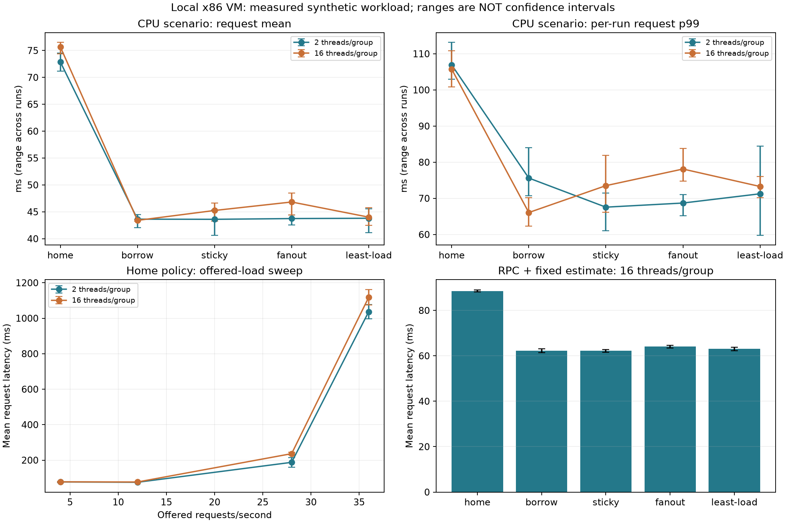

# 本地验证与测量结果（2026-11-14，Asia/Shanghai）

交付使用真实 Folly 库，固定基线为 `v2026.10.26.00 / c8c7adb72c6d73e2fced5ff5cebc96aa3ff65b2c`。完整工程和编译入口见 [README](../README.md)，源码与内核解释见 [Folly 唤醒分析](../docs/folly-wakeup.md)。本页描述实际执行过的验证，不把建议的 ARM 实验写成已完成。

## 环境和验证范围

本机为 Debian 13、GCC 14.2、x86_64 KVM，报告 4 个逻辑 CPU、2 个物理核、1 个 NUMA；实际可见 RAM 约 7.5 GiB。测试将 CPU `0,1` 与 `2,3` 划为两个 CPU 分区，**并非两个真实 ARM cluster**。另有六池共享四个 CPU 的无绑定对照。完整证据见 [environment.json](environment.json)。编译 `-j2`，4GB 机器建议 `-j1`。

已完成：

- Folly Release 完整编译、安装；demo 链接实际 Folly 静态库。
- 3 个 CTest 测试组全部通过：8 个 demo 黑盒测试方法（多种参数组合）、5 个分析统计测试、17 个分组执行器 GoogleTest。
- Folly 实验目录的独立 CMake / GoogleTest 构建通过。
- demo 与新执行器头文件的 AddressSanitizer + UndefinedBehaviorSanitizer 构建及上述 3 个测试组通过。原版 Folly 库未重编译为 sanitizer 版本，因此不是完整依赖栈的 sanitizer 覆盖。
- 76 轮正式合成对照，共 3,360 个请求，全部完成，0 拒绝、0 删失、0 失败；拒绝和取消路径另外由功能测试覆盖。另有固定迭代校准和独立 perf 诊断。

本机 `/etc/ld.so.preload` 包含 `libonion.so`。首次 sanitizer 启动因 ASan 不处于加载列表首位而拒绝运行；未修改系统配置，使用进程级 `ASAN_OPTIONS=verify_asan_link_order=0` 后全部测试通过。没有关闭内存检查或未定义行为检查；该宿主预加载环境及未插桩依赖仍是覆盖边界。原始失败原因与通过日志均保存在 [logs](logs)。

```bash
ctest --test-dir build --output-on-failure
cmake -S . -B build-sanitize -G Ninja \
  -DCMAKE_PREFIX_PATH=/path/to/folly/_install -DFOLLY_SOURCE_DIR=/path/to/folly \
  -DCMAKE_BUILD_TYPE=RelWithDebInfo \
  '-DCMAKE_CXX_FLAGS=-fsanitize=address,undefined -fno-omit-frame-pointer' \
  '-DCMAKE_CXX_FLAGS_RELWITHDEBINFO=-O1 -g -DNDEBUG'
cmake --build build-sanitize -j1
# 仅本机存在预加载顺序冲突时需要这个兼容设置。
ASAN_OPTIONS=verify_asan_link_order=0 ctest --test-dir build-sanitize --output-on-failure
```

## 主要机制：集中扇出与允许借用 CPU

主矩阵：QPS=10，4秒开放到达，fanout=20、每分支2段、末尾1段join；每段名义CPU预算3000μs，抖动±50%，长任务概率2%、倍数8；seed=420/421/422。每配置3轮、每轮40请求，案例顺序随机，案例之间顺序运行。每个重复轮次的任务计划在全部策略中逐项相同。该实验主要检验 request 自身的 burst，而非持续历史积压。

| 配置 | 120 请求合并平均 ms | 120 请求合并 p99 ms |
|---|---:|---:|
| 两分区，每池2线程，home | 72.850 | 105.503 |
| 两分区，每池16线程，home | 75.653 | 105.504 |
| 两分区，每池16线程，borrow/work | 43.410 | 69.633 |
| 两分区，每池16线程，sticky/work | 45.250 | 72.438 |
| 两分区，每池16线程，fanout/work | 46.828 | 82.916 |
| 两分区，每池16线程，borrow/queue | 48.423 | 77.190 |
| 六池无绑定，每池8线程，home | 44.270 | 70.680 |

这里的 p99 是合并原始请求后重新求 nearest-rank，**不是各秒/各轮 p99 的平均值**。图上的点则是各轮指标平均，误差条是最小到最大范围，不是置信区间。每点120请求和3次重复不足以推断生产0.5%变化，也不能据此认定某种策略在所有图上最优。



固定 home 时，增线程 2→16 把平均提交至开始等待从约 **22.83ms 降至10.91ms**，但平均算子墙钟从约 **3.449ms 增至15.586ms**，请求平均从72.850ms升至75.653ms。这符合“等待移入已开始的回调，线程数没有增加 CPU 容量”的解释。原主矩阵未启用 schedstats，不能仅用 wall-cpu 把全部差值归因于内核 runqueue。

## 队列深度有用，但不是完整负载

主矩阵每轮的原生 queue 与任务 submit→start 的 Pearson 为 **0.778–0.945**，说明该合成负载下队列深度是有信息的信号。

但 t16/borrow/queue 的4,920段中，**1,051段**提交时同时满足原生队列为0、inflight大于配置容量2；其中204段仍等待超过1ms，最大7.763ms。此处证明的是“Q=0不保证轻载或立即执行”，不是证明这1,051段都正在内核 runqueue 排队。共享计数也不是事务快照。

主矩阵请求到达时多为空池，入口队列无方差，其与请求时延的相关系数是不可计算的 `null`，不能把段级相关性冒充入口负载与整请求的相关性。为此另做16轮到达率扫描：

| QPS | 每池2线程各轮平均 ms | 每池16线程各轮平均 ms | 解释 |
|---:|---:|---:|---|
| 4 | 74–80 | 76–80 | 入口近空，主要为自身扇出 |
| 12 | 约75 | 约77 | 入口负载仍无明显方差 |
| 28 | 160–215 | 229–244 | 开始出现明显跨请求积压 |
| 36 | 997–1076 | 1074–1162 | 短时间过载，停止到达后排空 |

QPS36四轮入口queue与请求时延的Pearson为 **0.711–0.844**，work为 **0.760–0.866**。这是3秒开放到达、积压增长再排空的非稳态实验，时间趋势本身也会贡献相关性，不能据此宣称稳态容量或精确排队公式。QPS28的相关性在不同轮次有明显波动，work并非每轮都显著优于queue。

## RPC、后续亲和与固定工作量对照

RPC场景另12轮，每池16线程，35%算子经过20ms异步定时等待，使用固定3000μs估计（不是提前知道每段真实预算）。两轮平均请求时延：home约 **88.56ms**，borrow **62.20ms**，sticky **62.18ms**，fanout **64.04ms**。这是不同图阶段与估计误差共存的场景；只能在场景内比较策略，不能把它与主矩阵的全部差异单独归因于RPC。

CPU时间预算模式下，部分均衡轮次实际kernel CPU总量比名义预算高约2–7%，个别段过冲约8ms；原因未确认，保留为本VM计量/执行环境的复核项。因此不能声称各策略执行了完全相同的实际 CPU 时间或迭代数。

进一步执行12轮固定迭代对照，按单独校准的512 iterations/名义μs执行完全相同的迭代预算。两轮平均：t2-home **73.46ms**、borrow **45.04ms**、fanout **45.72ms**；t16-home **76.71ms**、borrow **47.35ms**、fanout **46.19ms**。主要现象仍存在。未配置真实NUMA内存放置，本结果仍不能衡量业务远程缓存/内存成本。

## 原始数据、复现与尚未证明的结论

另执行两轮独立 `perf sched` 诊断（home，每池2/16线程，各30请求），确实观察到更多线程带来的内核调度等待。worker调度等待总和/请求约为 **0.936ms / 569.716ms**；这是多个线程并行等待的累计值，**不能加到请求时延上**。两轮累计worker运行时间约4.40s/4.38s。默认追踪记录了数百万事件，并有少量乱序提示；CPU预算模式也会把追踪开销算进预算，不能据此声称追踪无扰动。原始filtered timehist、解析方法与限制见 [独立内核诊断](../docs/perf-diagnostic.md)。主76轮无这些追踪开销。

- [所有配置的独立重复范围](experiment-summary.md)、[结构化汇总](experiment-summary.json)。
- [每轮分析与完整命令](analysis)、[源码/二进制SHA256](source-hashes.json)。
- `raw-observations.tar.gz` 保留原始任务、请求、逐秒、线程组、外部采样、元数据和运行清单。它按仓库相对路径展开为 `results/runs/`，该目录被Git忽略，压缩归档本身被提交。
- [实验指南](../docs/experiments.md) 给出了ARM部署、负载控制、拓扑核对、迁移代价、低扰动采样与统计流程。

```bash
tar -xzf results/raw-observations.tar.gz
python3 scripts/analyze.py results/runs/local-main/r0-split-t16-home \
  --output results/local/reanalysis
# 绘图另需 matplotlib；分析CSV本身只依赖Python标准库。
python3 scripts/report_results.py --main results/runs/local-main \
  --rpc results/runs/local-rpc --load results/runs/local-load \
  --iterations results/runs/local-iterations --output results/local/overview --plot
```

尚未验证：ARM双NUMA/六cluster的缓存和内存成本、真实图依赖/算子类型、业务几百线程的最佳数量、生产估计器、长期公平性及迁移阈值。当前证据支持继续验证“限制过量线程 + 有边界的跨组借用”，不支持直接上线某组默认参数。
