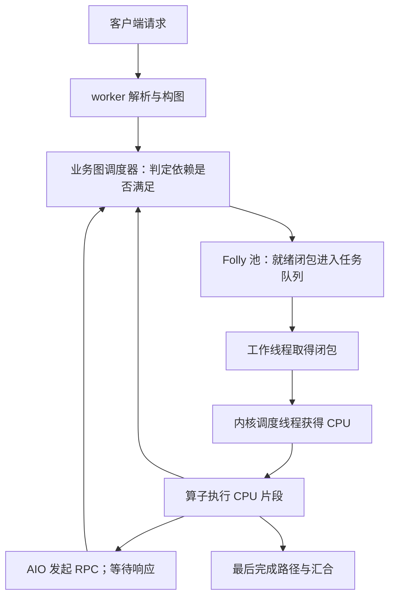

# 阶段 1：真实业务分析报告

本阶段只建立真实业务的资源、等待和时延模型，输出后续实验需要验证的命题。这里不把合成 demo 的结果当作生产结论，也不先引入跨池路由策略。工程全貌见 [分阶段入口](../../README.md)；下一步是 [阶段 2：Folly 机制与负载信息](../02-folly/README.md)。

## 1. 已知信息、待确认口径与当前结论

以下事实来自需求描述，而非对生产系统的独立采样。

| 项目 | 已知信息 | 尚不能据此认定的事项 |
|---|---|---|
| 工作流 | IO 接入 → worker 解析/构图 → executor 图计算；部分算子经 AIO 调用下游 | executor 是否完全没有同步阻塞、IO/worker/AIO 是否共享 CPU |
| 执行器 | 6 个 Folly CPU 线程池，每池几百线程；requestID 按 round-robin 选择 home 池，后续任务留在该池 | 实际 Folly 版本、队列类型、min/max 线程数和动态伸缩参数 |
| 请求压力 | 整体约 12 QPS | 是入口 offered QPS、成功完成 QPS，还是稳定窗口平均值；到达突发程度 |
| 图规模 | 描述同时包含“起始扇出 20–400”与“每请求分发 20–400 次子任务” | 20–400 究竟是初始宽度、总节点数，还是两者各自的范围；不可将它们自动视为同一变量 |
| 算子时长 | 平均约 100 ms，少量 700–800 ms，不含显式记录的调度/等待 | 100 ms 是否由线程 CPU 时钟测量；是否还含抢占、锁等待、缺页或同步下游 |
| 拓扑 | ARM64；2 NUMA，每 NUMA 3 cluster，每 cluster 8 物理核；报告 SMT2 | 实际在线/允许 CPU、SMT 是否启用、cluster 与缓存共享关系、quota |
| 利用率 | 整体 CPU 约 50% | 统计分母、窗口、进程范围及各 cluster 的短时利用率 |
| 绑定观察 | cluster 绑定：CPU 下降约 4%、均值时延上升约 1%；NUMA 绑定：约 2%、0.5%；有约 30 ms cluster 满载窗口 | 百分比还是百分点、噪声范围、流量是否配对；不能直接拆出局部性收益和并行能力损失 |

当前最有依据的判断是：**全机平均利用率不足以排除某个 home 池的短时容量瓶颈；大量线程也不能消除这个瓶颈。原生 Folly 队列长度值得首先测量，但还须区分“未被取出的任务”和“已经占用线程、仍未完成的任务”。** 哪个因素主导生产 p99，需要后续阶段的测量，而不是从现有几个平均值推定。

## 2. 从业务到内核的三层调度边界



这张图表达逻辑边界；线程取任务本身也需要先获得 CPU。更精确的唤醒时序见阶段 2。

1. **业务图调度器管理依赖与闭包放置。** 未满足依赖的节点不应提交到 CPU 池占线程等待。它知道 requestID、图结构、初始宽度、关键路径和数据归属。
2. **Folly 管理闭包队列和消费者等待。** 它不自动理解两个闭包属于同一个请求，也不把一个池的队列任务交给另一个独立池。
3. **内核管理线程。** 内核 runqueue 的元素是可运行线程，不是 Folly 闭包或 DAG 节点。它能在 affinity 允许的 CPU 间选择/迁移线程，但不会重新分配业务图的任务队列。

因此必须分开统计：在途请求数、图中未就绪节点数、已提交未开始任务数、已开始未结束回调数、存活线程数、可运行线程数、正在 CPU 上执行的线程数。异步 RPC 等待是一种业务状态；只要回调已经返回 executor，它不再占用该 executor 工作线程。

## 3. 负载模型必须同时保留“总量”和“宽度”

定义每请求的以下量：

| 符号 | 定义 | 影响 |
|---|---|---|
| `N` | 总 CPU 回调/执行片段数 | 总提交成本与 CPU 工作量 |
| `B0` | 初始同时就绪宽度 | 请求开始时的突发压力 |
| `B(t)` | 请求在时刻 t 的就绪/执行并行宽度 | 中途 fork、RPC 回流与重叠突发 |
| `S_cpu(v)` | 算子执行片段 v 的线程 CPU 时间 | 实际消耗的 CPU 时间 |
| `S_wall(v)` | 进入执行片段到返回的单调墙钟时间 | 包含 CPU、抢占和片段内阻塞 |
| `W = Σ S_cpu(v)` | 每请求总 CPU 工作量 | 容量和长期吞吐需求 |
| `CP` | 沿依赖路径的必要执行与外部等待 | 单请求可缩短时延的边界 |

`B0 ≤ N`，但 `N=400` 并不代表初始有 400 个就绪节点。一个 400 节点长链和 400 个独立节点的 CPU 总量可以相同，局部 burst、可用并行性和时延却完全不同。一个异步算子若分为发起前和响应后两个 CPU 片段，应把算子数和 executor 提交次数分别记录，避免重复或遗漏工作量。

若每请求总调用次数确实为 20–400，且平均每次是 **100 ms 线程 CPU 时间**，则两个端点场景分别为：

| 场景 | 每请求工作量 | 12 QPS 的 CPU 时间需求 |
|---|---:|---:|
| 每请求 20 次 | 2 CPU 秒/请求 | 24 CPU 秒/秒 |
| 每请求 400 次 | 40 CPU 秒/请求 | 480 CPU 秒/秒 |

这不是实际平均需求的区间估计。正确平均量是 `12 × E[Σ S_cpu(v)]`；在节点数和服务时间相关时，不应擅自替换为 `12 × E[N] × E[S_cpu]`。

所述拓扑对应 48 物理核；如果实际启用 SMT2，则有 96 个逻辑 CPU。CPU 时间记账上限约为每秒 96 CPU 秒，而不是任意算子的吞吐都翻倍。因此“全部请求都接近 400 次、每次真消耗 100 ms CPU、长期完成 12 QPS”这三项不能同时成立。应优先检查时长口径、节点分布、RPC 等待、测量窗口和积压，而不是靠增加线程解释这一矛盾。

对同一线程内的一段回调，可以分别取单调墙钟和 `CLOCK_THREAD_CPUTIME_ID` 的前后差。跨 AIO 或线程切换后的 continuation，必须在每段执行内分别测量后求和，不能拿不同 TID 的线程时钟相减。

## 4. 六个逻辑池不一定拥有六份独立容量

| 部署 | 每池允许 CPU | 池间容量关系 | 主要待验证机制 |
|---|---|---|---|
| 不设置额外 affinity | 继承进程/cpuset 的有效允许集合 | 6 池竞争共享总容量；不能将每池允许 CPU 数相加 | 内核有较大放置空间；是否产生更多跨域访问/迁移 |
| 绑定 NUMA | 每 3 池共享同一 NUMA 的允许 CPU | 3 池共享该 NUMA 的容量，不各拥有整个 NUMA 的独占容量 | 能否在同 NUMA 内吸收一个池的突发，同时减少远端访问 |
| 绑定 cluster | 每池一个互不重叠的 cluster 集合 | 在 mask 正确且无外部竞争时，分区较独立 | 局部性可能改善；其他 cluster 的空闲 CPU 无法为该池提供算力 |

线程数是消费者数量，允许 CPU 集是调度边界，有效容量还取决于 SMT、频率、其他线程、cgroup quota、内存带宽和具体算子。把“200 线程”“16 逻辑 CPU”“16 个独占物理核”视为等价会导致错误结论。

Linux 的 cluster/topology 属性由架构支持情况决定，cluster 不自动等同于 LLC；应读取真实 CPU siblings 与 cache shared CPU 集合。CPU 编号也不保证按 cluster 连续。[内核 CPU 拓扑说明](https://docs.kernel.org/admin-guide/cputopology.html)

CPU 绑定不自动把现有页面迁到对应 NUMA。构图由 worker 完成，如果大量图数据先在另一个 NUMA 被触页，后续把 executor 固定在 home NUMA 仍可能远端访问。要记录 first-touch、内存策略与自动 NUMA 平衡状态。[内核 NUMA 内存策略](https://docs.kernel.org/admin-guide/mm/numa_memory_policy.html)

还应核对 `cpuset.cpus.effective`、所有相关层级的 `cpu.max` 和 `cpu.stat`，避免看到 96 CPU 却实际受较小配额限制。[cgroup v2 CPU/cpuset 文档](https://docs.kernel.org/admin-guide/cgroup-v2.html)

## 5. 为什么 50% 平均 CPU 与 cluster 饱和可以同时出现

Round-robin 均匀的是请求个数，不是 CPU 工作量，也不是瞬时就绪宽度。请求差异、到达相位、长任务及 RPC 回流都可以让一个池突然很忙，其他池仍空闲。统计窗口越长，越容易抹平这种 burst。

若 `B` 个独立任务同时就绪，每个消耗 `s` CPU 秒，总工作量为 `B·s`。在容量 `C` CPU 秒/秒且没有其他竞争的理想模型里，整批完成至少需 `B·s/C`，还不能低于最长单任务必须经历的时间。以理想 16 逻辑 CPU 时间容量举例，20×100 ms 需要至少 125 ms，400×100 ms 需要至少 2.5 s。该量纲检查不包含真实 SMT 效率，也不保证每任务以孤立时相同速度推进。

“扇出时 cluster 被占满 30 ms”仅证明观察到一个饱和片段。它不能单独证明整个请求仅受限 30 ms，更不能区分唤醒链、可运行线程竞争、算子本身 CPU 消耗和采样分辨率。

每池几百线程可能让闭包很快离开 Folly 队列；随后许多回调在不同 TID 上已开始、轮流争取有限 CPU。此时 Folly 队列短，内核调度等待却可能较长。这是应验证的机制，并不意味着队列指标不准确：它准确描述的对象本来就是另一阶段。

## 6. 请求时延的拆解与不可相加项

对一个执行片段，至少保存三个时间点：提交前、回调开始、回调结束。

```text
提交至完成 = 提交至开始 + 回调开始至结束
回调墙钟 ≈ 回调线程 CPU + runnable 等待 + 阻塞等待 + 计量边界差异
```

“提交至开始”也不是纯 Folly 排队时间：它可能包括提交路径、队列停留、waiter 获得 CPU、取出后的抢占及回调前包装开销。精确分离物理 enqueue/dequeue 与内核 wake/switch 需要更细粒度的插桩。

请求完成时间沿依赖关系递推；多个分支并行时，join 等待最迟完成的分支。**不能把所有算子的排队时间相加称为请求调度时延，也不能把所有线程的 runqueue 等待相加称为请求的关键路径等待。** 多个线程在同一 10 ms 内各等待 10 ms，累计线程等待可以远大于请求实际经过的墙钟时间。

算子长尾会使计数型负载的预测力变弱：队列里 1 个 800 ms 任务和 8 个 10 ms 任务不是相同工作量。反过来，工作量预测若偏差很大，也不必优于简单队列深度；阶段 3 需比较测量结果后再选择。

## 7. 将现有亲和性观察转成可检验假设

| 假设 | 若成立可能观察到什么 | 哪些证据不能单独证明它 |
|---|---|---|
| H1：cluster 绑定改善局部性 | 相同工作量下 CPU/请求或固定工作完成时间下降；相应硬件事件改变 | 整机 CPU 百分比下降，尤其完成吞吐未对齐时 |
| H2：cluster 绑定限制 burst 并行容量 | 高初始宽度时该 cluster 饱和、其他域有空闲，submit-to-start 或回调内调度等待增大 | 单段 30 ms 满载，或只看平均时延 |
| H3：几百线程将等待转移到内核 | 线程数下降后 native queue 变长，但 callback wall、runqueue 等待或尾延迟下降 | native queue 变长本身 |
| H4：NUMA 绑定是较好折中 | 同工作集下，域内可借容量足够，远端数据开销没有抵消收益 | NUMA 模式比 cluster 模式均值好 0.5% 的一次运行 |
| H5：round-robin 个数均衡不能均衡工作 | 每池请求数近似一致，短窗口 CPU 工作、积压和时延明显不同 | 每池总线程数不同或实验流量不一致时的差异 |
| H6：RPC/锁造成非 CPU 等待 | 回调 wall 或请求时延高，但对应 CPU 和 runnable 等待不高 | 单独的 wall−CPU 差值；它无法区分具体阻塞原因 |

现有 4%、2%、1%、0.5% 数据是提出假设的依据，尚不构成定量归因。新实验必须保留完成吞吐、拒绝/未完成请求和 CPU/请求，明确百分比与百分点，使用同工作集合、交错顺序、多次重复。

## 8. 生产信息采集表：先补口径，不先改变策略

| 优先级 | 采集项 | 建议边界 |
|---|---|---|
| 必需 | Folly commit、实际构造函数/队列类型、线程 min/max、wake interval、优先级 | 启动配置快照；阶段 2 的调用链必须与此一致 |
| 必需 | CPU 型号、online/allowed CPU、NUMA、SMT siblings、cache 共享、quota | 一次拓扑快照；记录 IO/worker/AIO/executor 各自 mask |
| 必需 | 每请求总节点数、executor 提交次数、初始宽度、最大宽度、长尾算子类别 | 业务已有字段优先；抽样记录图摘要 |
| 必需 | 计划/实际到达、开始图计算、请求完成；成功/失败/超时/取消 | 保留未完成和拒绝，避免只统计快速完成样本 |
| 必需 | native queue、抽样 submit-to-start、回调 CPU/wall | 每池时间序列与同一任务提交点采样区分开 |
| 建议 | 各池 CPU 时间、各 cluster 利用率、TID 和池映射 | 低频外部采样，不在每次提交中扫描所有线程 |
| 诊断 | runnable 等待、阻塞栈、CPU 迁移、硬件事件、NUMA 页面位置 | 独立短窗口；记录采集开销和权限/支持状态 |

长时间 CPU 采样不能解释单次 30 ms burst；全量调度追踪也不宜作为默认压测配置。常态低扰动指标和短窗口诊断分开运行。若采样字段不可用，应标为 unknown，不能填 0 后解释为“没有等待”。

## 9. 本阶段如何与后续实验衔接

1. **阶段 2**核对一个任务从提交到执行的实际流程，明确各负载指标测到了什么及其成本。
2. **阶段 3**使用独立、无 DAG 的随机时长任务；固定投递规则，单独改变线程数、负载和 affinity，验证队列与任务时延的关系。此时不引入复杂路由收益。
3. **阶段 4**再加入 12 QPS 请求、初始 burst、依赖、RPC、数据访问和迁移策略；分别改变总工作量和初始宽度，避免把二者混为一个参数。
4. **阶段 5**在策略收益与测量成本有证据后，决定业务调度层和 Folly 通用机制的边界。库内实现不是阶段 1–3 的运行前提。

本阶段的验收物是本报告、可检验假设和上述采集表。阶段 3 的合成实验可以先进行；生产未确认的口径保留为待复核项，不用未经证实的参数填充为“真实业务结论”。
