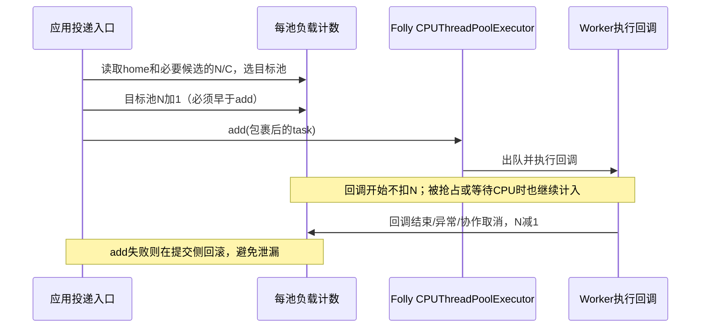
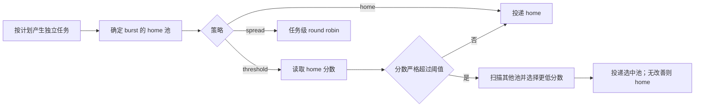

# 3001.log：ARM 阶段 3 主线收敛审查

2026-11-16。证据入口：[原始终端日志](../../results/stage3-arm-3001/3001.log)、[可复算汇总与脚本](../../results/stage3-arm-3001/README.md)、[后续主机名确认](../../results/stage3-arm-3001/subsequent_hostname_confirmation.txt)。

后续状态：用户的3002日志已确认56轮别名重算成功，6组各7个有效配对；限定minimal子集也已9/9完成。正式配对区间、实际负载说明和下一步判断见[3002报告](ARM_3002_NEXT_STEPS.md)。下文3001摘要表仍保留其原始证据身份。

**已有 122 轮 ARM 主线足够支持当前简单 demo 的机制结论，可以停止扩大矩阵。剩余 70 轮 minimal 不是进入 DAG 阶段的门槛。** 日志没有显示实验超时、任务持续积压导致无法结束或结果持续漂移；主要问题是测试范围不断扩展，以及同一物理主机改名使严格配对被拆分。先用显式主机别名重算现有数据，保留尚未完成的成本测量为独立问题。

本审查只收到终端汇总，未收到 ARM `tasks.csv`、`metadata.json` 和完整 manifest。所有表格由终端打印值生成；不根据这些四舍五入的数值生成正式置信区间，也不冒充对原始任务数据的重新分析。

## 1. 已完成什么

|阶段|完成/计划轮数|数据状态|3001.log 行号|
|---|---:|---|---|
|构建和功能验证|7/7 CTest，另 10 个矩阵脚本单测|全部通过；最初 Folly 路径问题随后已修正|21–78|
|dev preset 预检|6/6|全部有效，仅功能预检|108–130|
|ARM observe|18/18|全部有效|174–223|
|ARM tune|48/48|全部有效|661–849|
|ARM evaluate|56/56|全部有效，但配对被主机名拆分|979–1125|
|ARM minimal|日志仅确认 1/70|附件在第 1 轮完成后结束，不能推断其后状态|1252–1268|
|固定工作量 cost|未见实际结果|日志中粘贴了命令，不等于命令已经完成|约 721–731|

ARM observe、tune、evaluate 合计 **122 轮**，发压时长合计约 **122 分钟**，不计启动、排空和离线分析。每轮分析摘要均为 12000/12000 完成。minimal 新计划又增加 70 分钟发压时间，因此用户感受到的是矩阵规模和收尾边界问题。

终端的逐轮表与 Markdown 报告重复出现。解析器以 `(case, split, seed)` 去重，得到 128 个独立运行摘要（ARM 122、dev 6），保留每条记录的全部原始行号，避免重复计数。

## 2. 本轮实验条件与适用范围

主场景为 6 个 Folly CPUThreadPoolExecutor，每池分别固定 16 或 256 个工作线程。每池绑定一个 16 逻辑 CPU 的 cluster，CPU 集合为 `0-47,192-239`；6 个池的容量归一化系数均为 `C=16`。这里的 16 是允许的逻辑 CPU 数，不是测得的有效物理吞吐率。

主场景以 2.4 bursts/s 到达，每个 burst 100 个独立任务，home 池按 burst 轮转选择；同一 burst 初始集中在同一个 home 池。任务平均消耗 100ms 线程 CPU 时间，均匀扰动 ±50%，有限样本均值精确归一化；没有图依赖、RPC 等待和真实缓存/内存亲和收益。整机输入工作量约 24 CPU-s/s。每轮发压 60 秒，打印摘要对应 12000 个任务的分析窗口。

### Q、N、C 和阈值 H 的含义

下标 i 表示第 i 个线程池。当前是6个池，每池16或256个worker；每池cluster允许16个逻辑CPU（8个物理核的SMT线程）。不要将池数量、worker数量和CPU数量混为一谈。

|符号|含义|如何获得|不能解释成什么|
|---|---|---|---|
|Q_i|Folly公开的任务队列积压估计|提交新task前调用该池 `getTaskQueueSize()`|不是Linux runq，不覆盖所有已领取/正在执行的task，也不是可靠的“已提交未开始”完整计数|
|N_i|应用已为该池接纳/预留、尚未终态释放的task数，命令中叫 `outstanding`|应用为每池维护一个原子计数，投递前加1，task退出时减1，投递失败回滚|不是请求数、活跃线程数、正在CPU上运行的线程数或runq长度|
|C_i|对负载评分的容量归一化尺度|本demo默认 `min(固定worker数,该池allowed逻辑CPU数)`，启动时确定|不是测得的CPU吞吐，也不是CPU利用率；SMT不代表计算吞吐翻倍|
|H|触发考虑跨池投递的阈值|配置 `--load-threshold`|不是硬并发上限，也不是毫秒时延目标|

本轮cluster组无论每池16还是256个worker，都是 `C=16`。`N/C=2` 表示平均每个容量单位对应两个未结束task，不表示CPU利用率200%，也不表示等待2ms。使用none/numa亲和时池之间共享CPU资源，C不能按池相加为独占总容量，当前阈值结论不能直接平移。

### 在 Folly 和应用的哪个位置采集

本版本默认队列的Q读取路径是 `CPUThreadPoolExecutor::getTaskQueueSize()` → `UnboundedBlockingQueue::size()` → `ThrottledLifoSem::valueGuess()`。最后读的是同步协议的计数快照；取走任务、分配唤醒与真正获得CPU并不是同一事件。故Q很低甚至为0时，仍可有许多未结束task在竞争CPU。具体队列/gflags变更时应重新确认路径，详见阶段2分析。

N由应用的executor投递封装维护，现有实现无需修改Folly，不读取 `/proc`。每次算子/独立task调用 `pool.add()` 都经过同一封装，计数归属**实际选中池**，不是固定归属request的home池。



实现位置见 [main.cpp](../../experiments/independent/src/main.cpp)：容量计算第403行；读取Q/N并归一化第489–498行；选择目标第510行；投递前预留N第532行；回调scope guard释放第548行；add失败回滚第569行。路由判定在 [LoadRouting.h](../../experiments/independent/src/LoadRouting.h) 第32–45行。

这样，被唤醒但还在内核runq排队、已出队尚未开始回调、已开始但被抢占的task，都仍计入N。N对整个在途生命周期计数，不能据此反推出这些状态各占多少。路由实时读提交前快照；`pools.csv`的100ms周期样本只是离线诊断，不能用这个采样间隔作为分流控制的刷新间隔。

在 `instrumentation=none, load-observation=minimal, load-metric=outstanding` 下，每成功接纳的task额外维护N两次relaxed原子RMW，加一次、减一次；路由未触发时读1个池，触发扫描时最多读6个池，每池一次relaxed load。启动时缓存C。原有全局准入计数、任务记录和其他必要开销另计，不能把上述操作次数直接换算为已经测得的纳秒成本。Q利用Folly已有计数，其默认ThrottledLifoSem读取是O(1)原子load（默认seq_cst）；N增加维护成本，但统计范围更完整。允许快照误差并不允许普通变量并发读写。

接入业务时还需保证：所有投递路径都覆盖；异常、取消、过期或队列丢弃都恰好释放一次；计数存活到全部任务释放之后。本demo采用join排空和协作取消，不能直接假设生产环境被丢弃的闭包也会执行回调里的scope guard。异步RPC发出后若CPU回调返回，应结束本次CPU执行片段的计数，RPC返回后新就绪的CPU片段重新接纳；不要把整个request等待网络的时间都计为CPU池负载。同步阻塞RPC则仍占worker、仍在N中，因此这时N也不是纯CPU需求。

observe 还包括 smooth 和初始 spread 两种对照。tune/evaluate 的主收益表使用相同 local 工作负载，只改变投递策略：



策略不迁移已经入队或开始执行的任务。`Q` 是 Folly 队列深度；`N` 是已接纳、尚未结束的任务数。两者都不是 Linux runq。所有收益比较当前使用同一 progress/full 观测配置；它证明该观测条件下的行为，尚不能代替 minimal 模式的成本测量。

## 3. 七个新种子的验证结果

下表为 evaluate 的 7 个种子 31000–31006，数据来自日志 1052–1107 行。均值列是各轮完成时延均值的等权平均；p99 列是各轮 p99 的等权平均，**不是合并全部任务的 p99**。时间均从计划到达至任务结束。

|线程/池|策略|均值 ms|各轮 p99 均值 ms|平均 spill|
|---|---|---:|---:|---:|
|16|home|360.052|691.291|0%|
|16|N/C > 2|117.649|266.869|67.0%|
|16|Q/C > 2|149.636|368.522|51.2%|
|16|任务级 spread|102.730|180.548|83.0%|
|256|home|468.943|669.753|0%|
|256|N/C > 2|123.562|247.982|67.0%|
|256|Q/C > 2|170.230|348.067|51.2%|
|256|任务级 spread|102.788|166.453|83.0%|

256 线程时，N 阈值方案相对 home 的描述性下降幅度约为：均值 **73.65%**，各轮 p99 均值 **62.97%**。这些幅度远大于本轮间的波动；目前没有必要为证明“分散集中 burst 能显著降低延迟”继续扩展大量策略。

机制也可以从时延分解看出：256 线程 home 的平均 `W=start-submit` 为 106.921ms，平均 `X=end-start` 为 361.048ms；N 阈值方案分别为 1.915ms、121.448ms。大量线程已经进入回调以后仍会争用同一 cluster 的 CPU，等待不再全部体现在 Folly 队列中。投递到其他 cluster 同时减少开始前等待与回调执行期间的 CPU 争用。

这一解释与本 CPU 任务模型和观测一致，但 X 是回调墙钟时间，不能将 X 超过目标 CPU 预算的部分全部精确归为 Linux runq 等待；本日志没有内核调度轨迹来进一步量化抢占、迁移或其他停顿的占比。

**不能把 N 方案相对 Q 方案的全部收益归因为“预测精度更高”。** N/C > 2 分流了 67% 的任务，Q/C > 2 仅约 51.2%；同样的数字阈值不代表同样的迁移强度。静态 spread 的时延更低，同时 spill 达到 83%。当前 synthetic 工作不模拟迁移后的缓存代价，因此它不能决定真实业务应接受多少跨池迁移。

## 4. 指标预测质量：改善有边界

observe 采用 3 个完整 seed 的留出验证。后续用户输出确认了配置映射：`79fbbec9139e` 为 `main-t16-local`，`c383f86cfb2e` 为 `main-t256-local`。原始映射确认单独保存，未写入或修改原日志。

|线程/池|指标|开始前等待预测 MAE ms|计划至结束预测 MAE ms|计划至结束 p99 pinball ms|
|---|---|---:|---:|---:|
|16|Q|23.0334|34.0282|1.0044|
|16|N/C|21.2013|32.5202|0.9204|
|16|剩余估计 CPU 工作量/C|21.2013|32.5202|0.9204|
|256|Q|14.1407|94.8940|1.9702|
|256|N/C|11.8295|94.6190|1.9623|
|256|剩余估计 CPU 工作量/C|11.8295|94.6190|1.9623|

来源为日志 265–300 行及对应 Markdown 预测表；完整 288 个预测条目保存在 [quality.csv](../../results/stage3-arm-3001/quality.csv)。MAE 是任务时延均值预测器的平均绝对误差；pinball 是条件 p99 预测损失，**不是某组任务的实际 p99 时延**。

高线程场景中，N 相比 Q 将等待预测 MAE 降低约 16.3%，但完成时延预测 MAE 只降低约 0.29%。因此现有数据不能支持“已经找到普适、明显优于 queue 的单指标完成时延预测器”，更不能将相关性描述为稳定的线性定律。

固定预算估计使 full work 与 N 仅有常数缩放。在这个固定大小、快速提交、相隔较久的 burst 主场景中，remaining 的预测结果也与 N 相同。自身任务随机时长、同 burst 后续尚未提交的任务和线程获得 CPU 的过程都会影响完成时延；提交瞬间的池状态只覆盖其中一部分。继续扩大同一负载下的 remaining/work 网格，新增信息有限。

## 5. 调参结果与冻结边界

以下为 tune 的 3 个种子 21000–21002，来自日志 784–831 行；完整结果在 [cases.csv](../../results/stage3-arm-3001/cases.csv)。

|线程/池|策略|均值 ms|各轮 p99 均值 ms|spill|
|---|---|---:|---:|---:|
|16|N/C > 0.5|102.752|179.963|83%|
|16|N/C > 2|117.630|266.728|67%|
|256|N/C > 0.5|102.830|165.725|83%|
|256|N/C > 2|123.534|247.418|67%|
|256|remaining/C > 50ms|102.835|165.934|83%|
|256|remaining/C > 200ms|123.484|247.405|67%|
|256|任务级 spread|102.870|165.616|83%|

若目标仅是当前 demo 的时延，0.5 阈值明显优于 2，且与静态 spread 接近。阈值 2 可以被解释为保留更多 home 执行的选择，但需要写明该权衡，不能称其为时延最优阈值。日志 971–975 行中的冻结理由仍是占位文字。

**已经冻结并验证的是阈值 2。不得用 evaluate 的结果追溯修改 selection，再把同一批 evaluate 当作新阈值的独立验证。** 如需以 0.5 为独立新方案，应另立问题并预先定义验证；本阶段收尾不要求做这一步，也不要求为了得到“最优”二字继续搜索阈值。

### 当前可以怎样选指标和阈值

可以得到一个明确的下一阶段候选：**应用侧N计数，按N/C评分，H=2，最小改善量0**。它有本轮7个新seed的收益支持，后续3002已确认主机别名重算恢复全部配对。它是可复现的起点，不是已经证明的生产最优参数；当前收益来自统一full/progress观测，minimal净收益与硬件维护成本尚不能从本日志认定。

等价的策略参数为：

```text
--routing threshold --load-metric outstanding --load-threshold 2
--min-improvement 0 --capacities 16,16,16,16,16,16
```

选择逻辑（读数均在本task预留计数之前）：

```text
target = home
home_score = N[home] / C[home]
if home_score > H:
    扫描其他池，选择N[i]/C[i]最低且严格小于home_score的池
    没有更低分的池则继续使用home
对target预留N并提交task；终态恰好释放一次
```

`H=2,C=16` 时旧N为32仍保留home；加到33后，下一task才触发扫描。`H=0.5` 时旧N为8仍保留home；加到9后，下一task触发。目标池只需比home低，不要求一定低于H；相等不分流。因此H不是强制限流线，也不是“池永不超过32项”的保证。

本demo只有一个投递者，跨池读数不是原子快照。真实业务多个executor线程同时投递时，可能同时选中同一个低负载池；预留N能使后续投递看到压力，但不能保证并发选择不扎堆。这属于DAG/多生产者阶段的验证范围，不追加为本次简单矩阵的前置要求。

|当前目标|可采用的判断|证据强度与边界|
|---|---|---|
|保留更多home执行，同时显著改善局部拥塞|N/C > 2作为DAG阶段候选|7个新seed；约67%跨池，时延明显改善；真实亲和收益尚未测|
|当前无亲和代价的简单demo尽量低时延|静态task级spread是已验证的强基线；N阈值0.5接近它|spread有7个新seed；N阈值0.5仅3个tune seed，不宣称独立验证最优|
|找可跨任意业务使用的最佳阈值或p99公式|当前不能给出|任务成本、阻塞、共享CPU域和未来到达都会改变关系|

阈值较低意味着更早分散本批task。在忽略提交期间完成、各池起初空闲的直观模型中，H=2会先让home保留33项，再将更多后续项送往其他池，与实测约67%分流一致；H=0.5较早触发，最终6池接近均分100项，跨池比例接近83%。这解释了时延与亲和保留之间的选择，但不是所有负载都满足的性能公式。

N比Q更完整，不代表N对单task完成时延的预测必然精确。路由只需要发现“哪个池相对积压更多”，这比预测一个task的完成p99容易。本轮数据支持前者有用，对后者的改进很有限。当前没有证据值得为同样的入口信号引入work/remaining的额外维护复杂度。

## 6. 配对报告为何没有合成七对

原报告读取了 56 个有效运行，但将同一 case 分成两个配置组，3 个 seed31004 候选报告 `missing_or_ambiguous_matched_home`。相应 home 确实存在，见日志 1086、1091、1123–1125 行。这不代表少跑了实验。

用户随后打印配置差异并确认：**每个线程配置内唯一变化的是 hostname，从 `localhost.localdomain` 变为 `localhost`，其他被比较的配置字段相同**。映射如下：

|场景|旧主机名配置 ID|新主机名配置 ID|
|---|---|---|
|main-t16-local|79fbbec9139e|b4e75135d0d7|
|main-t256-local|c383f86cfb2e|590ac4e7825a|

正确处理是在分析命令中显式声明这两个 hostname 属于同一台主机，再使用原 ARM 原始文件重新配对。资源、负载、观测方式、二进制以及任务预算序列的校验仍保留。无需重跑 56 轮，也不应为了合并分组而无条件忽略所有 hostname。

本目录的描述性汇总没有读取 ARM 原始文件，没有执行该正式重算，故不生成 CI。后续测试机重算已在3002日志中确认，其区间由[3002报告](ARM_3002_NEXT_STEPS.md)单独记录，不把本审查表冒充正式配对输出。

## 7. 收尾边界与下一步

当前阶段可以回答：集中 burst 即使在整体资源有余量时也会形成局部瓶颈；线程严重超配使部分等待转移到回调内部，queue 不能代表全部在途压力；简单跨池分流在当前负载下能显著降低平均与尾部时延；N 是可用的低复杂度路由信号，但其完成时延预测优势有限，迁移比例必须共同报告。

因此先完成主机别名重算与结果归档，**不再把全部 minimal 70 轮、所有指标的成本矩阵、更多亲和性组合都设为 DAG 前置条件**。若 minimal 已经执行，复用其完成数据；是否需要补充少量固定策略的 minimal/home 对照，应服务于“观测开销是否改变收益”这个明确问题，而不是为了填满表格。

仍未回答的内容明确留给后续：真实图依赖和开头扇出、RPC 等待、迁移后的缓存/NUMA 访问成本、request 亲和与后续算子回迁，以及生产负载变化下阈值是否稳健。这些问题需要 DAG 或真实业务证据，继续重复简单独立任务矩阵无法替代。
