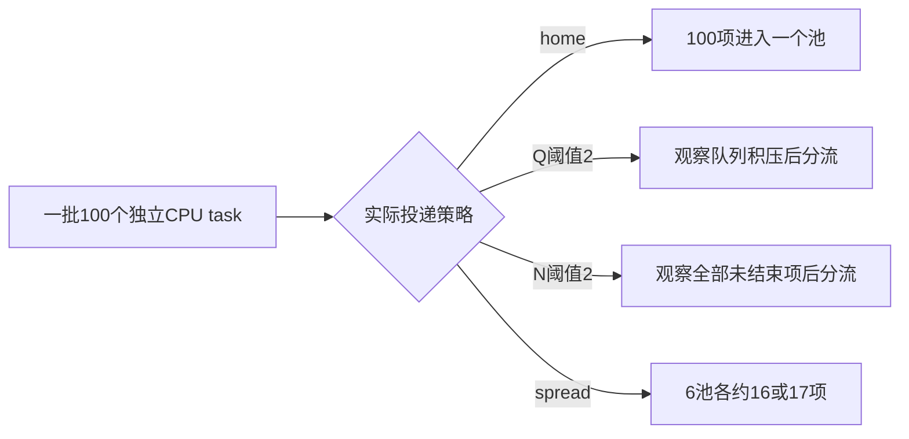

# ARM 3002：主线配对已恢复，下一步优先验证负载代表性

2026-11-16。原始证据为 [3002.log](../../results/stage3-arm-3002/3002.log)，[SHA256](../../results/stage3-arm-3002/source.sha256)保留附件校验。本报告承接[3001实验报告](ARM_3001_REVIEW.md)。本地收到的是测试机分析输出，没有收到ARM逐任务CSV，不将日志转述冒充本地重算。

## 1. 新增结果：本轮无需再追加运行

主机别名分析已成功：**56轮、0无效、0排除，6组比较各7个有效配对、0无效配对**。以下为测试机原始分析打印的数值，单位ms，差值均为“候选减home”：

|线程/池|策略|均值差|各轮p99差的均值|p99差的95% bootstrap区间|
|---|---|---:|---:|---|
|16|N/C > 2|-242.403|-424.422|[-425.799, -423.231]|
|16|Q/C > 2|-210.415|-322.769|[-323.957, -321.477]|
|16|静态spread|-257.322|-510.743|[-512.196, -509.168]|
|256|N/C > 2|-345.381|-421.771|[-423.340, -420.106]|
|256|Q/C > 2|-298.713|-321.686|[-322.960, -320.477]|
|256|静态spread|-366.155|-503.300|[-504.753, -501.522]|

这里以seed为重复单位，不把每条task视为独立实验。p99列不是合并全部任务后的p99，也不是“99%的任务都改善了这么多”。区间衡量当前固定配置的重复差异，不能表示换成真实业务后仍有同样收益。

minimal筛选也已经完成：选中9轮，复用6轮，只补3轮，最终 `selected successful=9/9`。`whole matrix successful=22/70; matrix_complete=false` 正确表示原完整计划保留但未全部执行，**无需再补48轮**。3002没有打印minimal的时延或有效性分析，故目前只能说执行结束，不能宣称minimal净收益已验证。

## 2. 当前对照究竟承受什么负载

以下为3001主线和3002 minimal选中组共用的主负载；观测方式另列：

|维度|实际设置|
|---|---|
|CPU与池|6个Folly池，各绑定一个cluster；每池16逻辑CPU，合计96逻辑CPU，48物理核的SMT线程|
|线程数量|主线每池16或256个固定worker；minimal选中组仅256，合计1536个worker，并不代表1536个CPU执行槽|
|到达方式|单个发生器，开放环regular到达，不等待前批完成；每秒2.4批|
|一批如何生成|一次到达后顺序快速调用add投递100个task；它们全部可独立执行，没有依赖门槛|
|原始home|第b批的home为b mod 6，同一批100项共享home；各批轮询home|
|每task工作|整数运算忙循环，以线程累计CPU时间达到预算为结束条件，不是sleep，也不是墙钟固定100ms|
|预算分布|先按100ms的±50%均匀扰动生成，再对整轮精确均值归一化；约50–150ms，整轮目标均值100ms|
|长尾与估计|long-prob=0，没有700–800ms特殊长尾；每项提前估计值统一100ms，没有任务类别预测|
|主线观测|full/progress，统一维护候选指标，避免不同策略观测配置不同|
|minimal观测|none/minimal，仅维护N作为新增负载指标；home、N阈值、spread三组同口径|
|运行和统计窗口|每轮投递60秒，144批、14400项；按planned到达[10,60)选12000项，保留窗口后才完成的慢任务|
|当前时延对象|独立task从计划到达到完成的时延；不是实际DAG request端到端时延|

不同策略、同一seed使用相同的预生成计划到达与CPU预算序列。跨seed任务预算序列不同；exact均值归一化控制整轮预算总量。CPU预算模式会调整实际循环次数，因此观测开销可能减少相同预算内的有用计算；它不能代替固定迭代成本实验。

时间与工作量关系：

```text
0ms       ：第0批，100项，原始home=池0
416.667ms ：第1批，100项，原始home=池1
833.333ms ：第2批，100项，原始home=池2
……
2500ms    ：第6批，100项，原始home再次=池0
```

每秒240项 × 0.1 CPU秒/项 = **24 CPU秒/秒**的名义工作预算，即所选96逻辑CPU预算的25%，另有运行开销。它不是实测CPU利用率，更不表示SMT的有用计算吞吐等于96个物理核；也没有复现原业务QPS12、整机CPU约50%。

每批总预算约10 CPU秒，集中在16逻辑CPU上，仅从CPU时间守恒看理想排空尺度约625ms，仍远小于同home的2.5秒到达间隔；实际排空受调度等影响。现有均值/p99与“以单批局部拥塞为主”的解释一致，但仅凭终端p99不能证明每次下一批到达前都完全排空。

原业务如果机械设为12批/秒、每批100项、每项100ms线程CPU预算，就会变成120 CPU秒/秒，超过所选96逻辑CPU的名义时间预算，改变为持续过载实验。业务对齐须先明确每request真实CPU片段数量及线程CPU时间，不能只把2.4改成12并将结果直接比较。

## 3. 四种策略怎样形成不同并发压力



home配16个worker时，最多16个回调在执行，其他项主要等待回调开始。home配256个worker时，这100项可以有更多已进入回调，但同一cluster仍只有16个逻辑CPU；已开始的回调可以在内核中等待CPU，所以Q不再覆盖全部压力。不能把256个worker称为256路同时进行的CPU计算。

N阈值2的规则是提交前 `N_home/16 > 2` 且其他池分数更低才分流。初始空闲、忽略投递期间完成时，home先保留33项，其余67项可分散至其他池，与实测约67%spill一致。Q阈值2只看Folly队列，领取/开始后的task不再完整体现在Q里，实测约51.2%spill，故它保留更多本地压力。两者数字阈值相同并非同等干预强度。

spread完全按task ID轮询，100项分到6池后各约16或17项，接近各池16个worker/逻辑CPU的单波规模，跨home比例约83%。这批任务没有缓存共享收益、依赖或网络等待，因此静态均分很自然地表现很好。

降低N阈值至0.5后更早分流，tune结果已接近spread。这里继续找更小的阈值，主要是在重现更积极的均分，而不是发现新的负载信息或亲和性最优权衡。

## 4. 优先级：先改变需要回答的问题，再选择是否优化指标或阈值

**当前不继续扫新指标，也不扩大阈值网格。先分析已经完成的9轮minimal，然后以固定的home、N/C>2、static spread作为复杂阶段的基线。**

当前N的采集覆盖更完整，且阈值路由明显有效；但完成时延预测MAE相对Q仅改善约0.29%。这并不矛盾：判断哪个池相对积压更多，比精确预测单task未来完成时间容易。后续尚未提交的同批task、自身随机成本及CPU调度会改变完成时间，单个入口快照无法包含全部信息。

当前full work估计恰好是100ms×N，信息只是单位变换；remaining在本批入口采样上也未显示额外预测价值。新指标不能仅因为理论上更复杂就进入新的全矩阵。

后续由现象决定方向：

|需要检验的真实条件|若观察到的问题|再选择的优化方向|
|批次更随机、重叠，池间存在不同历史积压|静态轮询仍向忙池送任务，N能识别差异|检验N相对静态spread的动态价值；先固定阈值|
|短任务与700–800ms长任务混合|相同N对应的CPU需求差很多，N反复选错池|按可获得的任务类别估计CPU成本，考虑加权N/剩余工作量；同时量化估计误差和维护成本|
|共享数据、NUMA访问或request亲和有实测收益|分散降低排队却增加计算/访存耗时|在已选指标下调整阈值/最小改善量，比较完成时延与实际迁移代价|
|同步阻塞RPC与异步续体混合|N高但CPU并不忙，CPU任务与阻塞任务相互影响|先区分CPU片段与阻塞/网络等待生命周期；不能把整个request当CPU在途任务|

这些是DAG阶段的方向与触发条件，不是一组新的必跑笛卡尔积。本会话不修改另一agent的DAG工程。下一阶段首先要检验的具体命题是：**存在历史负载差异或真实亲和代价时，N阈值策略相对静态spread是否仍有可衡量的价值。** 如果仍没有，采用静态分散也是有效结果，不要求动态策略必胜。

## 5. 现在仅需离线读取已完成的minimal数据

下面不启动负载，不改原始manifest，也不要求把70轮补齐。分析全部已记录结果，再只打印事先限定的9轮和6个配对；其他13个完成结果仍保留，不混入该小组。

```bash
python3 experiments/independent/scripts/analyze_balance.py \
  --manifest results/balance-arm/minimal/manifest.json \
  --hostname-alias localhost.localdomain=localhost \
  --hostname-alias-reason '3001/3002: same isolated ARM host; hostname labels only' \
  --output results/balance-arm/minimal-analysis \
  > results/balance-arm/minimal-analysis.stdout.log
python3 - <<'PY'
import json
r=json.load(open('results/balance-arm/minimal-analysis/report.json'))
cases={'main-t256-local-home','main-t256-local-outstanding-h2','main-t256-local-spread-policy'}
seeds={32000,32001,32002}
runs=[x for x in r['runs'] if x['case'] in cases and x['seed'] in seeds]
pairs=[x for x in r['pairs'] if x['case'] in cases and x['seed'] in seeds]
print('selected_runs',len(runs),'invalid_runs',sum(not x['valid'] for x in runs),
      'selected_pairs',len(pairs),'invalid_pairs',sum(not x['valid'] for x in pairs))
for x in sorted(runs,key=lambda x:(x['case'],x['seed'])):
    s=x['statistics']
    print(x['case'],x['seed'],'valid',x['valid'],
          'completed/planned',s['cohort_completed'],s['cohort_planned'],
          'mean_ms',s['planned_latency_ms_mean'],'p99_ms',s['planned_latency_ms_p99'],
          'spill',s['spill_fraction'],'reasons',x['invalid_reasons'])
for x in sorted(pairs,key=lambda x:(x['case'],x['seed'])):
    print('PAIR',x['case'],x['seed'],'valid',x['valid'],
          'mean_delta_ms',x['deltas'].get('planned_latency_ms_mean'),
          'p99_delta_ms',x['deltas'].get('planned_latency_ms_p99'),'reasons',x['reasons'])
for x in r['excluded_entries']:
    if x['case'] in cases:
        print('EXCLUDED',x['entry'],x['reason'])
PY
```

预期9个有效run、6个有效pair；若数目不同，先查原因，不自动补跑。每策略3个seed仅作为方向性复核，不生成7-seed bootstrap结论，不通过平均每秒p99制造新的总体p99。该小组即使复现收益，也仍不能代替固定指令工作量的观测成本测量。
