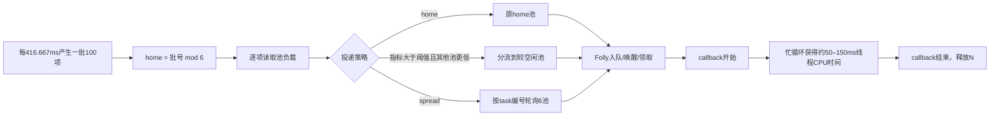
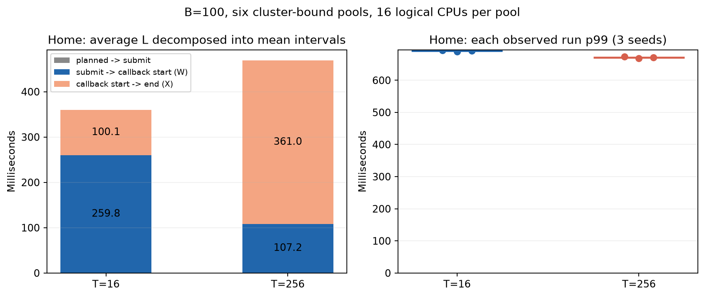
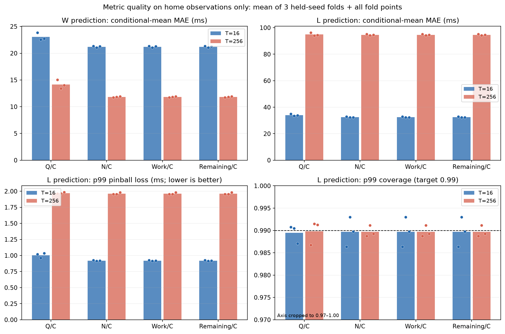
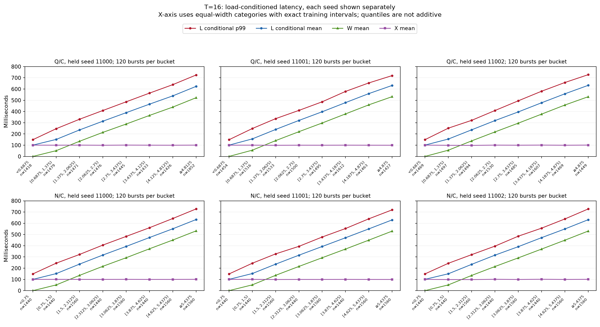
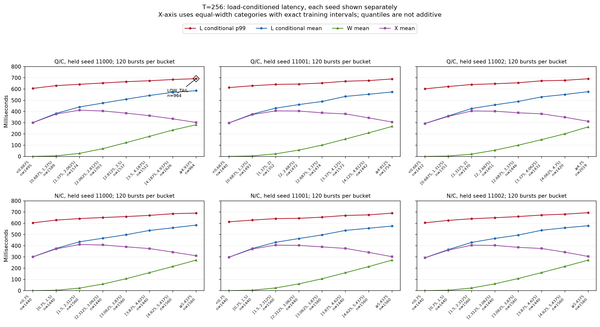
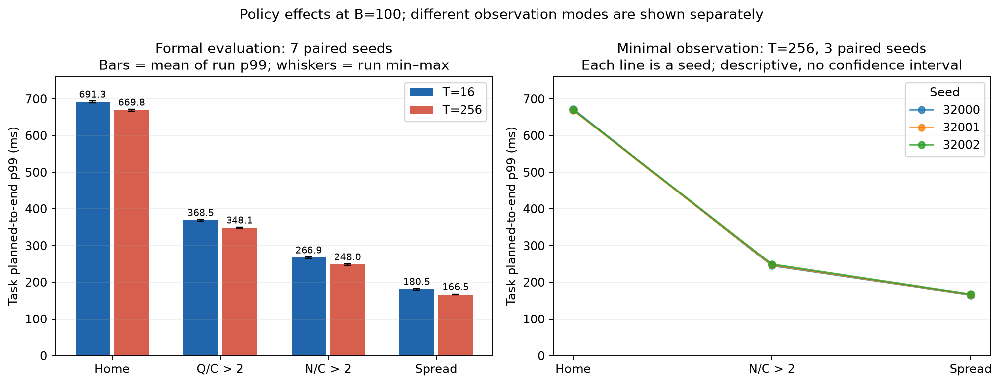

# ARM 3003：当前微突发负载下的指标有效性与策略有效性

2026-11-16。本报告只分析阶段3独立CPU任务；不修改DAG工程，不推断真实DAG请求的端到端收益。证据来自测试机打印的 [3003.log](../../results/stage3-arm-3003/3003.log)以及用户随后补充的[buckets终端文本](../../results/stage3-arm-3003/buckets-terminal.txt)，[SHA256与来源记录](../../results/stage3-arm-3003/evidence.json)分别校验两个来源。没有收到ARM逐任务CSV，因此本文继承测试机分析器的有效性判定，不把终端转录称为本地原始数据重算。

**现有证据支持：在每批100项、每池绑定16个逻辑CPU的负载下，N/C>2显著降低task p99；minimal九轮也复现了这一方向。N比Q更完整地覆盖未完成工作，但它对完成时延的预测优势远小于路由收益。静态spread仍然最好；尚不能证明动态N策略优于静态分散，也不能证明该结论已覆盖其他突发大小、64/128线程或none亲和。**

## 1. 证据完整性与可复核范围

|来源|本报告选中轮数|有效轮数|用途|
|---|---:|---:|---|
|observe|6|6|T=16/256各3个home种子，分析指标质量|
|tune|48|48|两种线程数、各8种策略、3个种子，描述阈值行为|
|evaluate|56|56|两种线程数、home/Q2/N2/spread、7个独立配对种子|
|minimal|9|9|T=256的home/N2/spread、3个预定配对种子|

3003完整打印了123行summary和108行quality；quality重复打印两次，内容完全一致，归档解析只保留一次。用户随后补齐buckets.txt的全部192条记录，按2种线程配置×3个held seed×4种指标×8桶组织。每组桶的样本量之和均为12000，边界连续且来自训练seed；以下条件曲线保留逐seed边界，没有跨桶平均p99。未收到collection.json，不影响已有打印字段的分析，但仍无法独立重算逐任务分位数。

唯一收集警告是原minimal大计划中，未被本报告选中的`main-t256-local-queue-h2-s32001`缺少summary.json。它不在预先限定的home/N2/spread九轮中；这九轮及六个配对均有效，不需要补跑该Q组合。

归档的[CSV文件与提取脚本](../../results/stage3-arm-3003/README.md)保留终端打印的全部数字。收集器大多数浮点字段使用12位有效数字，不能声称恢复了未打印的原始精度。统计表中的小数进一步按展示需要舍入。图中未跨桶平均p99、未跨轮合并任务；所有“平均p99”均明确指各轮p99的算术平均。

## 2. 当前负载和投递逻辑

|维度|实际配置与含义|
|---|---|
|线程池|6个原生Folly CPUThreadPoolExecutor，每池固定16或256个worker|
|CPU集合|`0-15;16-31;32-47;192-207;208-223;224-239`，每池绑定一个cluster，共96逻辑CPU、48物理核的SMT线程|
|容量C|每池配置C=16；不是线程数，也不是16个物理核，不能当成SMT计算吞吐的精确尺度|
|到达|单生产者开放环regular，每秒2.4批，每批100个独立CPU task；约416.667ms一批|
|home|第b批的home为b mod 6；同批100项共享home，同一home每2.5秒接收一批|
|同时与并发|一批到达时连续快速调用add，100项均无依赖；不等于100个生产线程在同一纳秒投递，也不等于100项同时获得CPU|
|task工作|整数运算忙循环，以线程CPU时间达预算为结束条件；约50–150ms，整轮精确归一化至平均100ms|
|长任务|long-prob=0；没有700–800ms特殊长尾|
|预估成本|每项统一估计100ms，估计值不使用该项真实随机预算|
|full观测|统一维护Q、N、估计工作量、剩余工作量；remaining进度发布间隔5000µs|
|minimal观测|`instrumentation=none, load-observation=minimal`，新增池负载仅维护N；仍有基本task记录与计时，不是零观测成本|
|窗口|每轮投递60秒；分析planned到达[10,60)的120批、12000项，窗口后完成的慢项仍计入|
|不存在的因素|DAG依赖、RPC等待、request共享数据、真实跨cluster缓存代价、NUMA内存代价模型|



名义预算为240 task/s × 0.1 CPU秒/task = **24 CPU秒/秒**，相当于所选96逻辑CPU时间预算的25%；这是工作量设定，不是实测利用率或物理核吞吐利用率。每批约10 CPU秒集中在16逻辑CPU上，理想排空尺度约625ms，小于同home批次间隔2.5秒。当前主要检验局部微突发拥塞；它没有复现原业务QPS12、CPU约50%、多级扇出和依赖。

CPU时间预算模式会把观测开销计入已消耗CPU预算，从而改变相同预算内的有效循环次数。它适合固定CPU需求下比较调度时延，不能直接测得固定业务工作量的观测开销。

## 3. 指标采集位置与时延口径

|指标|定义与位置|覆盖与限制|
|---|---|---|
|Q|路由前调用`CPUThreadPoolExecutor::getTaskQueueSize()`|Folly公开的任务队列估计；不是Linux runq，也不代表全部已开始但未结束的回调|
|N|选定目标池后、调用add前递增；callback退出的scope guard递减；add失败回滚|覆盖已保留/已接受但未结束的CPU task，含尚未开始及已开始后被抢占的工作；不是活跃CPU数量|
|Work|所有未结束task的预估总CPU预算，add前增加、完成后扣除|当前估计统一100ms，因此Work=100ms×N，无新增信息|
|Remaining|初始增加估计预算，回调按CPU进展扣减，退出清理余量|理论上比Work多进度信息；当前入口采样的相关性/预测结果未体现额外增益|
|C|配置的每池容量16|Q/C、N/C单位为项/容量；Work/C、Remaining/C单位为估计CPU毫秒/容量|

具体入口为[readLoad与add包装](../../experiments/independent/src/main.cpp)，决策在[LoadRouting.h](../../experiments/independent/src/LoadRouting.h)。N每项有两次relaxed原子读改写，另有路由读取；不可用普通并发读写替代原子而依赖“允许误差”，那会造成C++数据竞争。实际生产中还需保证取消、丢弃、超时未执行闭包的预留计数也恰好释放一次。

本实验是纯CPU回调；异步RPC场景应对CPU片段计数，等待网络期间不把整个request一直算作CPU需求。N也无法区分同步阻塞回调与CPU竞争，这是其适用边界。

```text
planned            submit                  callback start                 end
   |----发生器延迟----|---- W：开始前等待 ---------|---- X：回调墙钟时长 -------|
   |------------------------ L：计划到完成 --------------------------------|
```

W包含Folly队列、唤醒、内核调度等开始前等待，不能单独称为Folly队列停留时间。X含实际CPU运算以及回调开始后的被抢占/等CPU时间。逐项有`L=发生器延迟+W+X`，均值也可相加，**p99不能相加**。

observe的三轮均值如下，均为ms：

|线程/池|L均值|W均值|X均值|各轮L p99平均|
|---|---:|---:|---:|---:|
|16|360.108|259.840|100.150|691.908|
|256|469.146|107.214|361.007|670.937|

worker从16增到256，开始前等待减少，但回调开始后的墙钟时长显著增加，平均完成时延反而增加。任务“开始了”不等于持续获得CPU。p99略降和均值上升可以同时发生，不能只看其中一项；这也说明仅缩短W未必改善整体L。



## 4. 指标有效性：关联强度、预测误差与尾部证据分开看

只使用observe的home数据，避免负载均衡本身改变采样分布。每种线程配置有三个独立seed；以下相关系数为三个run统计的描述性平均，**不是“指标与p99的相关系数”**。

|线程/池|指标|与W的Pearson|与L的Pearson|与L的Spearman|
|---|---|---:|---:|---:|
|16|Q/C|0.9926|0.9797|0.9801|
|16|N/C|0.9948|0.9821|0.9823|
|256|Q/C|0.9692|0.5951|0.5803|
|256|N/C|0.9702|0.5968|0.5806|

当前数据不支持“线程远多于CPU时Q完全无用”：Q与开始前等待仍很强相关。但Q和N对完成时延的关联都明显减弱，N并没有把0.60提升到接近1。主要限制不只是坐标轴：入口快照无法得知后续同批投递给本池的全部工作、自身随机CPU成本及后续被抢占情况。N更完整地表示在途量，并不等价于准确预测每个task的未来完成时间。

预测采用三次整轮seed留出：其他两个seed的24000项训练分桶，完整留出一个seed的12000项/120批验证，桶边界只由训练集决定。以下为三个fold误差的平均：

|线程/池|指标|W均值预测MAE ms|L均值预测MAE ms|L条件p99 pinball ms|L p99覆盖率|
|---|---|---:|---:|---:|---:|
|16|Q/C|23.033|34.028|1.0044|98.944%|
|16|N/C|21.201|32.520|0.9204|98.969%|
|16|Work/C|21.201|32.520|0.9204|98.969%|
|16|Remaining/C|21.201|32.520|0.9204|98.969%|
|256|Q/C|14.141|94.894|1.9702|98.983%|
|256|N/C|11.830|94.619|1.9623|98.972%|
|256|Work/C|11.830|94.619|1.9623|98.972%|
|256|Remaining/C|11.830|94.619|1.9623|98.972%|

MAE是每项实际时延与训练所得条件均值预测的绝对差，并非“整轮平均时延预测误差”。pinball以0.99分位的非对称误差评价条件p99预测，越小越好，但不是p99本身，也不是p99相差了1.96ms；覆盖率应接近99%，不能越高越好。

T=256时，N相对Q的W MAE降低约16.3%；L MAE只降低约0.29%，L pinball降低约0.40%。当前不应把后两项微小差别描述成有充分统计把握的预测优势。三个fold不是充分的跨环境验证，尚无针对指标差异的独立置信区间。

无负载信息的global基线，T=16/256的L MAE分别为157.110/120.735ms，L pinball为3.4814/2.1530；加入N后分别变为32.520/94.619ms和0.9204/1.9623。因此指标确实有信息，但T=256的完成尾部预测增益有限。仅使用已知真实task CPU预算的oracle，T=256 L pinball为1.8648，已优于仅N；N加oracle降至1.5366。这个oracle不可作为生产可用指标，只说明自身成本信息值得区分。

N加oracle并非处处更好：T=16的均值MAE由32.520升至40.043ms。当前采用有限样本分桶模型，增加维度可能损害泛化；不能把这次模型结果当成额外信息理论上无价值。所有原始fold均保留在[prediction_folds.csv](../../results/stage3-arm-3003/prediction_folds.csv)。

Work与N的恒定倍数关系由分析器验证。Remaining与N在本次打印的关联和预测结果上完全一致，说明没有可识别的增益；**这不等于证明所有时刻Remaining都精确等于100ms×N**，也不应推广到异质长任务或批次重叠场景。当前按维护成本与实际增益选择，N是合理的最小候选，尚无理由改为更昂贵的Remaining。



本图展示误差与校准；下面另外展示`p99(L | a≤指标<b)`，它们回答的问题不同。

### 负载—条件p99的直接关系：并非仅仅坐标轴问题

以下选held seed 11000展示原始N桶结果，其他两个seed在下图分别呈现，未混合平均。每个桶均覆盖120个批次，样本量依次为1440、1440、1560、1440、1560、1440、1560、1560；单位ms：

|提交前N/C区间|T=16的L p99|T=256的L p99|T=256的L均值|T=256的W均值|T=256的X均值|
|---|---:|---:|---:|---:|---:|
|<0.75|149.421|604.354|301.572|0.063|300.550|
|[0.75,1.5)|244.847|628.201|376.504|3.565|371.959|
|[1.5,2.3125)|322.500|641.800|435.105|22.968|411.136|
|[2.3125,3.0625)|405.849|650.831|466.629|58.871|406.738|
|[3.0625,3.875)|482.941|659.670|497.913|106.516|390.356|
|[3.875,4.625)|560.271|670.089|536.092|160.438|374.596|
|[4.625,5.4375)|642.331|685.279|559.523|215.034|343.413|
|≥5.4375|727.584|690.181|583.668|272.125|310.449|

T=16时，X均值维持约100ms，N越大主要表现为W增长，L均值和条件p99随之显著增加。T=256时，低N桶的W接近0，但L p99已经约604ms；最高N桶约690ms，仅高约86ms。三个seed的最低桶p99为604.354/612.853/604.382ms，最高桶为690.181/690.182/693.915ms，方向一致。**因此“W增长很多而完成p99曲线较平”确实存在，换坐标轴可以放大视觉差异，却不会改变其原因。** 也需区分均值与尾部：T=256的L均值仍由约302增至584ms，并非整体时延完全不变。

入口快照是在本task投递前采集。低N样本往往是该批较早的task，后面还有同批task继续进入home。T=256允许更多task早早开始回调，后续投递增加CPU竞争，早开始的task随后也会被抢占；**低的“当前N”不能保证未来直到完成一直低负载**。高N样本开始更晚，之前一部分工作已经运行过，X均值在中间桶达到峰值后下降，部分抵消W的增加。图中这种形态与上述机制一致；没有内核调度轨迹，不能把每一段差异精确归因到runq等待或某种Folly唤醒机制。

这组观测是自然发生的负载条件分布，不是人为固定N的因果实验，也不能从`p99(L|N)`直接读出阈值H=2的策略收益。策略改变后，同批未来task的去向也改变；这正是N2路由收益显著、但home下N对L的预测优势很小仍可同时成立的原因。





图的横轴为等宽分类桶，标签保留原训练区间，不把开放尾桶伪造为某个数值中点，也不据连线拟合斜率。全部192桶均含120个独立批次；唯一LOW_TAIL是T=256、Q/C、seed 11000的最后桶，n=964，图中空心菱形标出。其p99仍可描述，但尾部任务数约10，不能包装成精确尾部规律；其余桶通过项目的描述性门槛也不等于置信区间充分。

N、Work、Remaining的48组对应桶（2线程×3seed×8桶）在样本数、均值、p99和W/X统计上均完全一致，Work/Remaining的横轴单位为N的100倍，因此不重复画同一组曲线。这与集中快速投递时入口采样主要看见尚未发布进展的工作相符；单靠聚合表不能证明每次提交都早于每次进度发布，不能将它推广为Remaining的一般恒等式。

## 5. 策略有效性：当前开启负载均衡确实降低p99

规则为提交前读取home负载：`score_home > H`才扫描其他池，只有存在更低分数才分流。当前H=2、C=16、单生产者；N等于32时不触发，第33项仍可留home，随后开始分流。目标池不要求低于H，所以这不是每池N≤32的硬上限。

空池开始且投递期间没有完成时，N2约保留33项、分出67项；实际spill为67%。Q2的spill约51.2%，spread约83%。**相同数值阈值不意味着相同分流强度**。因此“N2比Q2好”同时涉及指标含义和实际分流量，不能将全部收益归因于更准确预测L。

正式evaluate为7个配对seed、每策略每seed12000项；下表“均值/p99”分别为各轮均值/各轮p99的平均，单位ms：

|线程/池|策略|L均值|L p99|spill|p99相对home下降|
|---|---|---:|---:|---:|---:|
|16|home，关闭均衡|360.052|691.291|0%|—|
|16|Q/C>2|149.636|368.522|51.162%|46.69%|
|16|N/C>2|117.649|266.869|67%|61.40%|
|16|静态spread|102.730|180.548|83%|73.88%|
|256|home，关闭均衡|468.943|669.753|0%|—|
|256|Q/C>2|170.230|348.067|51.133%|48.03%|
|256|N/C>2|123.562|247.982|67%|62.97%|
|256|静态spread|102.788|166.453|83%|75.15%|

每seed先计算“候选p99−home p99”，再以seed为重复单位bootstrap。N2的差值为：T=16 **−424.422ms，95%区间[−425.799,−423.231]**；T=256 **−421.771ms，区间[−423.340,−420.106]**。区间排除0，支持固定负载下的收益；它不反映换负载/硬件/真实业务后的不确定性。全部六个比较的原始差值、区间和配对状态保留在[comparisons.csv](../../results/stage3-arm-3003/comparisons.csv)。



### 阈值为什么影响这么大

tune只有3个seed，是探索结果；下面不与正式evaluate混成同一组验证：

|线程/池|策略|H|L p99 ms|spill|
|---|---|---:|---:|---:|
|16|N/C|0.5|179.963|83%|
|16|N/C|2|266.729|67%|
|16|Q/C|0.5|221.862|75.167%|
|16|Q/C|2|368.618|51.167%|
|16|Remaining/C|50ms|179.982|83%|
|16|Remaining/C|200ms|266.704|67%|
|16|spread|—|180.522|83%|
|256|N/C|0.5|165.725|83%|
|256|N/C|2|247.418|67%|
|256|Q/C|0.5|200.556|75.161%|
|256|Q/C|2|346.358|51.197%|
|256|Remaining/C|50ms|165.934|83%|
|256|Remaining/C|200ms|247.405|67%|
|256|spread|—|165.616|83%|

更低阈值在该无真实亲和收益的场景中更早分散，N0.5接近spread。H=2是此前冻结验证点，不是已证明的最优值；不能据两个采样点拟合“最佳阈值”。静态spread无需指标却更好，是本实验重要的对照结论：当前场景可以证明消除集中投递有价值，但不能单凭它证明动态负载感知比静态分散更有价值。

## 6. minimal九轮：低维护模式下收益是否保留

三个策略都使用同一minimal观测模式，只维护N；均有效。以下是日志原始逐轮L结果，单位ms：

|seed|home均值|home p99|N2均值|N2 p99|spread均值|spread p99|
|---|---:|---:|---:|---:|---:|---:|
|32000|468.419669125|671.887600|123.316770287|245.268937|102.835995579|165.346584|
|32001|468.737141593|668.991374|123.548664398|246.629580|102.794570971|166.093434|
|32002|470.465186243|670.233594|123.629256940|249.118104|102.961188718|167.101597|

N2的三次配对p99差依次为−426.618663、−422.361794、−421.115490ms，平均−423.365ms，平均相对改善63.15%；spread平均差−504.190ms，相对改善75.21%。minimal的策略排序与full一致，支持“N无需同时维护其他负载指标也能复现效果”。

N2三轮记录的平均路由耗时为112.8–266.1ns、路由p99为420–780ns；这只是所包围的路由代码片段，并未独立测得两次计数维护、缓存行竞争或全部记录的总成本。三次结果是描述性复核，不给它包装七次验证的置信区间。full与minimal使用不同seed和配置，且工作按CPU预算停止，不能用两者时延或CPU差直接宣称“观测开销为零/低于某百分比”。

## 7. 本阶段已有结论与下一批独立任务验证的边界

|问题|现在可以回答的程度|
|---|---|
|Q是否能预测开始前等待|本负载T=16和256均可；关联强、预测误差显著优于global|
|N是否比Q更完整|生命周期定义更完整；本负载等待预测MAE更低，但完成时延预测优势很小|
|Work/Remaining是否值得替代N|当前无新增预测价值，Work本身与N等价；不能据此否定其他负载下的价值|
|N2开/关是否改善p99|七轮正式与minimal三轮方向一致，当前B=100、cluster配置下成立|
|N2是否优于spread|否，现有结果中spread更低；动态策略价值尚未由此证明|
|负载值到p99的定量曲线|已有逐seed条件曲线：T=16增长明显，T=256低桶尾时延已高、上升较缓；不作普适线性斜率或因果承诺|
|B=40/80/120/160、T=64/128是否仍成立|3003没有这些数据，需要新验证；池数仍应明确为6，64/128指每池worker数|
|none亲和是否更快、是否削弱均衡收益|3003全部为cluster，不能给出结论；需同CPU总资源的配对对照|

本阶段已有足够数据回答当前负载下的指标与策略有效性，不以新增大矩阵作为交付报告的前提。现有summary、quality和buckets三段证据已齐，不再要求重跑或补打印同一批结果。

后续仅规划[固定B80/T128的四种组合各一次、共4轮小对照](MINIMAL_FOLLOWUP_PLAN.md)，检查none亲和下均衡是否仍有收益。40/120/160突发与64线程暂不展开，不搜索新阈值，不新增指标，不进入DAG。若这组结果没有改变当前结论，阶段3即可结束；不要求找到任何环境都获胜的指标或策略。
