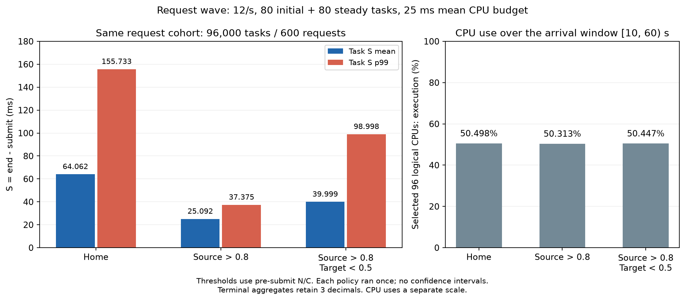
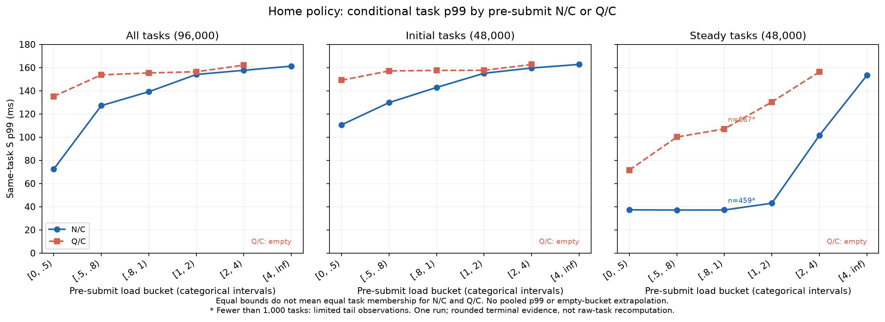

# ARM 3004：持续背景计算下的微突发分流与目标接纳

**本轮可以按阶段3的限定目标收口。** 在12请求/s、初始80项/20ms＋后续80项/400ms、6池×128线程、cluster亲和的合成负载中，源N/C>0.8后选择更轻目标池，任务完成p99相对home下降约76%；再增加目标N/C<0.5门槛，下降约36%。后者限制了分流机会，当前结果没有显示这个门槛带来保护收益。无需为本轮继续增加重复、阈值或亲和性矩阵。

这证明的是该输入下N驱动分流的观测收益，不是N普遍优于Q、生产最优阈值或真实DAG请求收益。下一阶段可把N和source_only作为候选信号/参考策略，具体依赖图与数据亲和仍由阶段4处理。

关于当前怎样选择指标、怎样选择策略及是否补其他负载场景，另见[选型报告](METRIC_POLICY_SELECTION_REPORT.md)，其中汇总CPU指标并限定可选补测范围。

## 1. 证据范围与有效性

来源为用户提供的[3004.log原件](../../results/stage3-arm-3004/3004.log)。[归档目录](../../results/stage3-arm-3004/README.md)保存SHA256、逐表提取和绘图脚本。

终端打印了4份报告：校准报告两次、正式三策略报告两次。重复打印不构成重复实验；实际为一次20秒home校准，加三种策略各一次60秒正式运行。正式比较的执行顺序是home、guarded、source_only。

- ARM编译成功，GCC 14.3.1，11组CTest全部通过。
- 校准home的`valid=True`。校准报告`comparison_valid=false / not_three_policy_runs`只表示它不是三策略比较，不是校准失败。
- 正式三轮均`valid=True`，`comparison_valid=true`，没有比较错误；每轮选择600个请求、96000项任务。
- 分析器按请求计划到达[10,60)选择完整请求，后续释放和窗口后完成的任务保留；并已在测试机检查输入轨迹、资源、产物哈希和计数完整性。

本地只收到终端汇总，没有ARM原始tasks.csv、CPU采样CSV或manifest。因此本文继承测试机有效性结论，只复核打印表的重复一致性和算术关系，不声称本地重算了原始分位数或独立核验了测试机二进制身份。大多数字段仅打印3位小数，不能恢复未打印精度；变化比例优先引用原分析器打印值。

## 2. 这次负载是否符合预期

|项目|实际配置或观察|
|---|---|
|资源|6个池，每池128线程；每池16逻辑CPU，C=16；共96逻辑CPU|
|CPU集合|0–47、192–239；NUMA标签0,0,0,2,2,2|
|请求输入|regular 12/s；home按6池轮询，同home约500ms一个请求|
|初始任务|80项计划在20ms内释放；不是80个线程同时调用add|
|后续任务|80项均匀安排于请求开始后[20,420ms)|
|任务CPU预算|平均25ms、均匀±50%，整轮精确归一化；无RPC、DAG或特殊长尾|
|名义CPU需求|12×160×.025=48 CPU秒/秒，即所选96逻辑CPU时间的50%|
|实际平均CPU利用率|三策略分别50.498%、50.447%、50.313%|
|CPU采样|约100ms，按所选CPU组及并集统计，不参与路由决策|

校准home的CPU平均50.491%，正式home为50.498%；因此本次合成预算与实际压力相符，没有通过给不同策略调整预算来获得收益。

初始实际投递跨度为同请求最后一项submit减第一项submit：

|策略|均值 ms|p99 ms|超过30ms的请求|
|---|---:|---:|---:|
|home|19.936|20.700|4/600，约0.67%|
|guarded|19.810|19.820|2/600，约0.33%|
|source_only|21.680|27.889|3/600，0.50%|

绝大多数请求满足30ms内投递，少数例外已保留在时延统计中，不能表述为全部满足。日志未打印这些例外的最大值，无法精确量化其影响，也不以此为由要求补跑整个矩阵。

这些检查支持“初始集中投递、后续平缓到达、整体CPU约50%”的简化负载。25ms纯CPU仍是合成预算，不能称为原业务100ms算子的复现。后续phase的名称`steady`仅指预定到达形状；其任务可能与初始积压竞争，不表示线程池N保持稳定或进入独立稳态。

## 3. 三种策略的直接结果

S为实际submit至end，L为该项planned至end，两者均不是整个DAG request从接收到完成的时延。

|策略|S均值 ms|S p99 ms|L p99 ms|S p99相对home|分流比例|平均CPU|
|---|---:|---:|---:|---:|---:|---:|
|home：关闭均衡|64.062|155.733|155.934|—|0|50.498%|
|source_only：源>0.8，选更轻池|25.092|37.375|37.597|−76.001%|44.0%|50.313%|
|guarded：源>0.8，目标<0.5|39.999|98.998|99.101|−36.431%|20.5%|50.447%|

source_only的S均值下降60.831%；guarded下降37.562%。加目标0.5门槛后，相对source_only，S均值上升59.406%、S p99上升164.879%。因此当前候选中source_only更好，不能继续把0.5门槛推荐为本场景的默认保护收益。

source_only仍读取其他池的指标并选更轻者；它没有忽略目标池负载，只是没有0.5这一绝对接纳上限。三策略输入一致，不是降低任务数量或减少CPU工作量的对照。

## 4. 为什么目标0.5门槛削弱收益

guarded中，53.9%的任务触发源阈值；20.5%的任务成功分流；33.4%的全部任务因没有满足接纳门槛的目标而留home，约占已触发任务的62.0%。这些是终端舍入后的比例，不据此伪造精确任务数。

C=16时，目标提交前N/C<0.5只允许N≤7的池接收下一项；本地任务或已分流任务使N达到8后，目标即不再符合条件。这个限制可以保留余量，但在本次实际输入中，保留余量的代价超过了观测到的收益。不能由此推断所有生产场景都应取消接纳门槛，也不能得出另一个未测试阈值是最优值。

开始前等待与回调墙钟均值如下，单位ms：

|策略|W：submit至start|X：start至end|S=W+X|
|---|---:|---:|---:|
|home|16.289|47.773|64.062|
|guarded|5.890|34.109|39.999|
|source_only|0.018|25.074|25.092|

source_only相对home的均值改善38.970ms，其中W减少16.271ms，X减少22.699ms。它与开始前等待、回调开始后的CPU竞争同时减轻一致。W不能单独称为Folly队列等待，X也不等于纯CPU执行时间；没有调度轨迹，不能精确拆出runq等待。

source_only的X均值25.074ms接近配置CPU预算均值25ms，完成p99约37.4ms也接近预算分布上沿约37.5ms，说明本轮调度造成的额外墙钟等待已很小。这是对已测结果的解释，不是严格计算出的生产性能下界。

后续任务同样受益：steady的S p99为home 138.953ms、guarded 66.986ms、source_only 37.350ms。因此本轮收益不限于初始80项，也包括减少初始突发对后续任务的干扰。

## 5. CPU观测说明收益来自哪里

三轮全程进程CPU时间分别为2881.833、2881.942、2882.172 CPU秒（home、guarded、source_only），都接近60秒输入的2880 CPU秒预算。该统计包含预热和排空，不与去预热的CPU采样窗口直接相除混用。source_only相对home进程CPU时间仅约增加0.012%，不能据此宣称节省计算工作量。

各池平均CPU均在约50%，但100ms采样的局部峰值差别明显：home六个池峰值都达到100%；guarded约97.1%–100%；source_only约62.8%–65.2%。这支持局部集中竞争被分散的解释。

**并非所有峰值都下降。** CPU并集采样峰值为home 54.381%、guarded 56.202%、source_only 59.457%。分流可能增加多个CPU组同时工作的程度，同时降低单组高峰。均值近似不变而任务时延下降，正是平均利用率不能充分描述局部拥塞的例子。

CPU有效覆盖约49.88–49.92秒，均标记ok。100ms样本无法恢复20ms级瞬时峰形或证明峰值持续时间，当前观察仅针对这一采样窗口。

## 6. N与Q：这次提供了什么新证据

N是应用按池维护的未完成任务数：选池并通过准入后、调用Folly `add`前加1，回调退出时减1，提交失败则回退。它包含尚未开始及已经开始但未结束的任务；即使线程被抢占，该任务仍计入N。Q是Folly `getTaskQueueSize()`返回的原生近似队列指标，不包括已取走执行的任务；两者均不是内核runq。C为本实验给每池配置的16逻辑CPU容量刻度，不是128个worker线程数，也不是实测物理核吞吐。N/C不等于CPU利用率。

只分析home，采样点是当前项提交前，N不含该项。以下为同任务S的条件p99，单位ms；Q/C≥4无样本，不能补成0或外推：

|入口区间|全部任务N/C桶p99|全部任务Q/C桶p99|steady的N/C桶p99|steady的Q/C桶p99|
|---|---:|---:|---:|---:|
|[0,0.5)|72.413|135.247|37.319|71.612|
|[0.5,0.8)|127.196|153.751|37.126|100.105|
|[0.8,1)|139.211|155.440|37.169*|107.121*|
|[1,2)|154.080|156.436|43.025|130.379|
|[2,4)|157.698|162.150|101.512|156.312|
|[4,+∞)|161.265|无样本|153.322|无样本|

星号桶分别只有459/667项，尾部名义样本很少，不据其微小起伏拟合阈值拐点。

N有可用信息：steady中N/C<0.5的S均值24.958ms、p99 37.319ms；N/C≥4时均值103.787ms、p99 153.322ms。它能区分后续到达任务中的较低与较高风险状态。

但**同一区间标签不代表同一批任务或相同覆盖率**。steady中N/C<0.5选出28877项，即60.2%；Q/C<0.5选出38913项，即81.1%。N筛选更严格，条件p99更低不能单独证明总体预测误差更小。当前没有同样本预测评估或等覆盖率比较，也没有本轮Q驱动策略对照，不宣称N普遍优于Q。

阶段混合也会影响曲线。初始阶段N/C<0.5的p99仍达110.641ms，后续阶段同区间为37.319ms；同一个低N状态，面对的未来同批任务不同。此前“入口低N仍可能遭遇后续竞争”的限制仍存在。与3003相比，新增较平缓到达让这种阶段差异得以观察，不能跨不同工作量直接比较绝对p99来宣布指标质量提升多少。

因此，本轮对指标的结论是：**N可作为这套分流策略的候选需求计数，尤其在后续平缓到达阶段包含风险信息；N的普遍预测优越性仍未证明。** 阈值策略收益由同输入开/关对照证明，不从条件p99曲线直接推导。

## 7. 当前阶段的结束条件

|目标|当前判断|
|---|---|
|输入包含短时80项扇出、后续持续工作及约50%平均CPU|已在合成模型中验证，保留少量投递跨度例外|
|其他池有持续工作时，N驱动分流是否仍有效|已观察到明显收益|
|目标<0.5是否比仅选更轻目标更好|本轮否；它明显削弱收益|
|N是否普遍比Q更优、0.8是否生产最优|尚未证明，且不是本轮继续扩矩阵的理由|
|真实DAG request时延、数据亲和/回迁收益|本阶段不回答|

本轮无需补跑或重新收集已经打印完整的表。保留source_only为当前参考策略、guarded为保守接纳对照，把结论和局限带入下一阶段即可；不修改其他agent负责的DAG/Folly工程。
