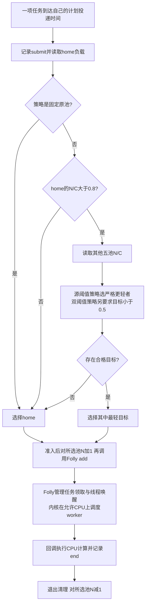

# 阶段3最终分析报告：微突发负载、指标选择与分流策略

> 场景适用性修订：用户随后指出真实CPU冲高粗略仅5–20ms，尚未确定阈值。本报告home约175–185ms的高占用代表长峰负载，数值仍有效，但不能据此认定真实短峰下收益或推荐阈值。下一步按[短峰负载修订](SHORT_PEAK_GUIDE.md)先验收home波形，再做两策略对照；旧结果不重写为新结果。

本报告解释一个限定问题：**六个Folly线程池各自绑定CPU、线程数远多于CPU数量时，如何用低成本的任务计数分流，减少初始微突发引起的任务完成时延。** 内容包括业务简化、实验负载、指标与策略定义、统计方法、原始结果及适用边界，可独立阅读。主要结果来自ARM测试机的3005日志，3004作为未开启高精度CPU跟踪时的同负载参考。

在本次合成负载下，按“原池未完成任务较多时，将新任务投到更轻的池”的策略，任务完成p99从155.828ms降至37.381ms，降低76.011%；整体CPU平均占用仍约50%。各池最长连续高占用由175–185ms缩短为20ms。进一步要求目标池的未完成任务数低于更严格门槛，反而限制了分流，任务完成p99为98.604ms。下文完整定义这些策略及统计量。

## 1. 业务背景与本阶段回答的问题

真实业务先由IO线程接收请求，再由worker线程构图，最后交给executor线程池执行图计算。一个请求包含多个算子，开始阶段集中扇出，后续执行受图依赖影响；部分算子还会通过RPC访问下游。当前executor分成六个池，同一请求的任务通常集中在一个池，每池数百线程。测试资源包含两个NUMA节点、每节点三个cluster，每cluster有16个逻辑CPU；业务整体约12请求/s、平均CPU利用率约50%。

本阶段聚焦“任务集中在单池”与“有可用CPU却仍等待”的关系，使用独立计算任务模拟开始阶段集中投递和后续平缓投递。以下区别决定结论能够推广到哪里：

|真实业务特征|本次demo如何处理|
|---|---|
|12请求/s；初始短时间扇出80项以上|固定12请求/s，每请求80项初始任务计划在20ms内投递|
|后续仍有计算，整体CPU约50%|另80项任务在后续400ms平缓投递，总CPU预算设为所选资源的50%|
|六个亲和池，每池线程远多于CPU|六个原生Folly CPUThreadPoolExecutor，每池128线程、16逻辑CPU|
|算子平均约100ms，存在700–800ms长任务|每项采用平均25ms的合成CPU预算；没有额外长尾，不能称为原算子的时间分布复现|
|真实DAG依赖、完成后唤醒下一算子、RPC|本轮不模拟；全部任务按预定时间投递，彼此没有依赖|
|共享数据、缓存及NUMA内存访问成本|本轮没有相应业务数据模型，不能测得保持数据亲和的实际收益|

本报告分别判断两件事：①提交时的负载读数能否区分任务完成时延风险；②使用该读数的分流策略是否改善实际时延。第二件事有收益，并不自动证明第一件事中的指标最准确。

## 2. 负载和资源究竟是什么

### 2.1 先区分请求、任务和线程

|术语|本报告中的含义|
|---|---|
|请求 request|发压器产生的一组任务，共160项。用于确定到达时间、原始亲和池和统计分组；不是一次网络RPC|
|任务 task|一次提交给Folly执行的纯CPU回调，是本报告平均时延与p99的基本统计对象|
|原始亲和池 home pool|请求创建时按轮询确定的池；该请求的160项任务共享此标记，分流不会改变标记|
|源池 source|当前任务原本要进入的home池，不是“执行上一项任务的池”|
|目标池 target|当前任务经过路由后实际提交的池；可能仍是home，也可能是其他池|
|worker线程|池内执行回调的操作系统线程；128线程不等于128项任务能同时获得CPU|
|cluster|本次绑定的一组16个逻辑CPU。池内线程可由内核在这组CPU之间调度，并非逐线程固定到单一CPU|
|NUMA节点|CPU与内存局部性的拓扑分组；本机两个节点的系统编号为0和2，编号不要求连续|
|initial / steady|任务的“初始集中投递阶段 / 后续平缓投递阶段”标签；`steady`不表示队列、CPU或时延已经进入稳态|

### 2.2 每个请求如何产生任务

发压器是**单生产者、开放环**：每隔约83.333ms产生一个请求，不等待上一个请求结束，也不根据CPU占用或时延降低投递速率。请求编号为b时，计划到达时间为`b/12`秒，home池为`b mod 6`。因此不同home的初始波次错开约83.333ms，同一home每500ms接收一个新请求。

以一个请求的计划到达时刻为0：

```text
时间         0           19.75 20                         415 420ms
初始80项     | 每0.25ms投递1项 |                            |
后续80项                       | 每5ms投递1项，最后在415ms |
执行         各项提交后即可竞争CPU；后续项不等待初始项结束
```

初始第j项（j=0…79）的计划时间为`j×0.25ms`，处于[0,20ms)；后续第k项（k=0…79）为`20ms+k×5ms`，处于[20,420ms)。全部请求的任务按计划时间统一排序投递，因此前一个请求的后续任务与后一个请求的初始任务会交错。这里的“80项扇出”是短时间内依次提交，不是80个生产线程同一时刻调用`add()`。

每项做整数运算忙循环，使用`CLOCK_THREAD_CPUTIME_ID`判断已经消耗的线程CPU时间，达到预算后结束。原始预算在25ms的±50%内随机生成，约12.5–37.5ms，再把**整轮全部任务**的平均预算精确归一为25ms。不是每个请求或每个阶段都恰好平均25ms；没有设置700–800ms的特殊长尾。

25ms表示任务累计获得的CPU时间，不是固定墙钟时延，也不是休眠25ms。排队或被抢占会延长墙钟完成时间，但不会替任务消耗CPU预算。相同预算也不保证完成相同数量的业务指令，因此本模型适合比较固定CPU需求下的调度效果，不能直接证明生产吞吐提升或节省了业务计算量。

名义需求为：`12请求/s × 160任务/请求 × 0.025 CPU秒/任务 = 48 CPU秒/秒`。相对96个逻辑CPU即50%；总任务到达率为1920项/s。这个50%是工作量设定，随后由CPU观测检验，**不是发压器通过反馈强行维持的利用率目标**。

25ms的选择用于控制这组简化任务的总体压力：如果仍按12请求/s、每请求160项，却把每项设为100ms纯CPU，名义需求将变成192 CPU秒/秒，达到所选96逻辑CPU时间容量的200%。因此本轮优先保留微突发形状和约50%的平均CPU压力，没有同时复现真实算子的100ms耗时。

### 2.3 线程池和亲和性

|池编号|NUMA编号|允许执行的逻辑CPU|固定worker数|容量刻度C|
|---|---:|---|---:|---:|
|0|0|0–15|128|16|
|1|0|16–31|128|16|
|2|0|32–47|128|16|
|3|2|192–207|128|16|
|4|2|208–223|128|16|
|5|2|224–239|128|16|

总计768个worker竞争96个逻辑CPU，每池线程数为逻辑CPU数的8倍。六组CPU不重叠，三策略均采用这组cluster亲和配置。分流候选覆盖其余五池，允许跨NUMA；本轮没有同NUMA优先、迁移成本罚分或NUMA内存绑定策略。CPU占用按逻辑CPU时间计算，不把SMT线程视为独立物理核吞吐。

## 3. 负载指标是什么，在哪里采集

|符号|定义、单位与采集位置|能覆盖什么，不能表示什么|
|---|---|---|
|Q|路由时读取Folly `getTaskQueueSize()`得到的近似任务队列深度，单位“项”|描述Folly任务队列；不包含已被取走执行的回调，也不是内核runq|
|N|应用按池维护的已预留或接纳、尚未退出的任务数，单位“项”|包括未开始及已开始但未结束的工作；线程被抢占时任务仍在N内。不是正在CPU上运行的线程数|
|C|配置的池容量刻度，本轮每池16|归一化分母，既不是128个worker，也不是实测物理核吞吐|
|Q/C、N/C|队列项数或未完成项数除以容量|单位是“任务项/容量”。例如N=16时N/C=1，不意味着CPU恰好100%|
|CPU占用率|独立观察器统计各CPU组实际忙闲时间|用来解释现象，本轮不作为任务选池输入|

内核runq管理等待CPU调度的可运行线程，Folly任务队列管理待领取的回调任务。worker取到任务后仍可能等待CPU或被抢占，此时Q已不包含该项，N仍包含。这解释了N为何值得作为候选，但不能单凭计数范围更广就断言它预测时延更准确。

N的生命周期是：**选池并通过全局准入后、调用该池`add()`前原子加1；回调结束清理时原子减1；`add()`失败则回退**。回调的结束时间戳先记录，随后清理释放N，因此两者存在很短的清理间隔。每项维护N主要增加两次relaxed原子读改写；路由时读取相关池的计数。不扫描全部worker，不读取`/proc`，但缓存行争用仍可能有成本，本轮没有测出可推广的每次操作纳秒数。

当前任务的N、Q在它自身预留之前读取，**不包含当前任务**。CSV中的home/selected读数保存的是本次路由用到的快照，没有在任务完成后重新回填；不同字段及不同池分别读取，不构成一致的全池快照。允许近似不能改为无同步普通变量并发读写。

Q与N均被观测，但本轮路由只用N/C。观测配置为`instrumentation=full, load-observation=basic`，还保留回调计时和其他诊断计数，并非只维护N的最低开销版本。实现对应[任务生成、readLoad和add包装](../../experiments/independent/src/main.cpp)与[选池函数](../../experiments/independent/src/LoadRouting.h)。

## 4. 三种调度策略如何工作

下文用中文名称配合程序中的策略标识，便于对照日志：

|中文名称与日志标识|源池触发条件|目标选择规则|没有合格目标时|
|---|---|---|---|
|固定原池 `home`|不进行阈值判断|所有项直接投到请求的home池|仍在home|
|源阈值分流 `source_only`|home的N/C严格大于0.8|读取其他五池，选择N/C最小且严格低于home的池；不设目标绝对上限|留在home|
|双阈值分流 `guarded`|home的N/C严格大于0.8|除更轻外，还要求目标N/C严格小于0.5，再选择最小者|留在home|

`source_only`的“only”指**只设置源池的绝对触发门槛**，不表示只读取源池或忽略目标负载。`guarded`增加了接纳限制，但名称不代表已经证明它对性能更安全。两个阈值都不是CPU百分比。

C=16时，源N至少为13才触发；双阈值策略只允许提交前N≤7的其他池接收当前项。当前项提交会使目标N增加，后续本地任务也可继续进入；0.5是本次快照判断条件，不是目标池长期负载上限。源池即使很忙，找不到目标仍回退到原池，不因这两个阈值直接拒绝任务。

例如home的N=20，其他池最小N=10：源阈值分流会选择N=10的池；双阈值分流认为所有目标N都至少为8，继续留home。若home的N=10，两种分流策略均不触发，即使其他池当前为空。



同分目标按从`task_id mod 6`开始的循环顺序保留先遇者，避免总偏向池0。每一项initial和steady任务都从该request的原home重新决策，不沿用上一项的分流目标；只为尚未提交的新任务选池，不搬运已排队或正在执行的任务。当前只有一个生产者，不能直接据此保证真实多生产者同时选池时不会集中争抢同一目标。

## 5. S、L、W、X和p99分别代表什么

所有墙钟时间戳来自单调时钟。设`R`为请求计划到达时间，`P`为这一项任务的计划投递时间；后续任务的P可以比R晚数百毫秒。

```text
R：请求计划到达       P：当前项计划投递
       └──任务释放偏移──┘
                      P ── D ── submit ───── W ───── start ───── X ───── end
                      └──────────────── L ─────────────────────────────┘
                                └────────────── S ────────────────────┘
                                读负载、选池、预留N、add     计算    随后清理N
```

|标识|公式|含义及限制|
|---|---|---|
|`submit`|时间戳|应用进入当前项提交路径，**早于读取负载、选池、预留N和Folly add**；不是精确入队时刻|
|`start`|时间戳|worker进入用户回调后、更新执行计数和开始CPU计算前记录|
|`end`|时间戳|CPU计算结束后、回调清理释放N之前记录|
|D|submit−P|投递迟到，包括发压器调度延迟及前面投递工作造成的拖延|
|W|start−submit|回调开始前耗时：含路由、提交、Folly排队与唤醒、内核调度等待等；不能全部称为Folly队列驻留时间|
|X|end−start|回调墙钟时长：含CPU计算、回调内诊断开销及开始后被抢占或等待CPU的时间；不等于CPU预算|
|S|end−submit=W+X|从应用提交路径入口到计算结束的任务完成时延，本报告策略比较的主指标|
|L|end−P=D+S|从该项计划投递到计算结束的任务时延，用于检查S改善是否只是投递被推迟|

例如某请求R=0，一项后续任务P=200ms，submit=205ms、start=215ms、end=250ms，则D=5ms、W=10ms、X=35ms、S=45ms、L=50ms。**L不是250ms的“请求到这项完成”时长，更不是整个请求的完成时延。** 若要算整个request的完成时间，需要取其全部任务end的最大值减R，本报告未用该指标证明DAG请求收益。

均值是所有入选任务时延的算术平均。p99把这些任务的时延从小到大排序，取第`ceil(0.99×任务数)`个值；每策略96000项时取第95040个。p99=37.381ms表示这批任务中约99%不超过该值，不是最慢1%任务的平均值。它直接由整批任务计算，不平均每秒p99，也不平均各分桶p99；`S=W+X`及`L=D+S`适用于逐项和均值，**不适用于p99相加**。

## 6. 比较和CPU观测如何进行

### 6.1 哪些变量固定，哪些发生改变

三个策略使用同一预生成负载：种子52000、请求及任务计划时刻、每项CPU预算、六组CPU、128线程/池及观测开关相同。只改变选池规则；测试机分析器检查任务输入轨迹和计数。不是为某个策略减小工作量，也不是按CPU利用率调节速率。

每策略运行一轮60秒，前10秒作为预热。以**请求R位于[10,60)秒**选择600个完整请求、96000项任务，其中initial与steady各48000项；入选请求在60秒之后投递或完成的项仍保留，避免删掉慢任务。60秒结束的是新请求生成，随后仍完成已计划的后续投递和排空，排空保护上限为120秒。CPU时间曲线的主汇总取[10,60)窗口，与任务全生命周期统计边界不同。

程序的全局未完成任务保护上限为100000项；它用于防止失控积压，与0.8/0.5的路由门槛不同。此次三策略均通过有效性检查，没有依靠拒绝慢任务换取结果。执行顺序为固定原池、双阈值分流、源阈值分流；每策略一次，因此结果是本轮观察值，不提供重复实验置信区间或显著性结论。

### 6.2 两种CPU观测口径

|观测|采集与计算|用途和限制|
|---|---|---|
|100ms累计统计|旁路观察器约每100ms读取`/proc/stat`，对选中CPU的user、nice、system、irq、softirq累计时间求差|总体CPU执行占比；短峰会在时间窗中被平滑，导出计数也有量化精度限制|
|5ms事件重建|独立tracefs实例记录`sched_switch`中进出idle的事件，用mono时间戳重建忙闲区间，再按5ms积分|调度口径的非idle任务驻留率；不是Python每5ms准点轮询。idle期间的中断未单独计入，非idle期间中断包含其中，steal未校正|

一个CPU组的5ms占用率为`100×该组所有CPU在窗口内的非idle驻留时间之和/(逻辑CPU数×窗口时长)`。每池分母16，CPU并集指六池合计的96个CPU，分母96；不按整台服务器全部CPU稀释。两种观测都可能包含同组其他进程的活动，不等于当前request专属CPU占用。

曲线同时报告平均值、完整5ms窗口峰值、≥90%的窗口时长占比及最长连续窗口串。这里90%是描述高占用的统计门槛，与路由中的N/C=0.8和0.5没有关系。观察器自动随测试启停，检查丢事件和CPU覆盖；CPU数据不进入选池逻辑。完整采集方法见[CPU曲线指南](CPU_CURVE_GUIDE.md)。

## 7. 原始证据与有效性

来源为用户提供的[3005.log原件](../../results/stage3-arm-3005/3005.log)，逐表CSV、校验和与提取脚本见[归档说明](../../results/stage3-arm-3005/README.md)。日志中的时延报告打印两次、CPU摘要打印三次，内容一致；重复打印不是重复实验。

- 三策略`comparison_valid=true`，每策略600请求、96000项完整任务。
- 高精度捕获均为`status=ok / issues=none`，96/96 CPU覆盖，无未知CPU；每组9999/9999个完整5ms窗口有效。50秒区间两端不满5ms的窗口不进入完整窗口峰值/连续时长，不能把少于10000个解释为丢失。
- 请求对齐的每个CPU窗口均覆盖600/600请求；100ms CPU观测也均为ok。

初始实际投递跨度是“同请求最后一项initial的submit减第一项initial的submit”；其计划跨度为19.750ms：

|策略|实际跨度均值 ms|实际跨度p99 ms|超过30ms请求数/600|
|---|---:|---:|---:|
|固定原池 home|19.908|21.704|3|
|双阈值分流 guarded|19.750|20.018|1|
|源阈值分流 source_only|21.538|27.245|1|

少数投递拉长的请求仍被保留，不能说全部满足30ms。后文同时报告包含投递迟到的L，避免只看S而忽略这一影响。

本地收到终端汇总，没有原始trace、逐任务CSV或完整5ms序列。本文复核打印的一致性与算术关系，采集完整性继承测试机分析器判断；没有在本地重新计算原始p99。图展示已打印的窗口均值与摘要，不把它们插值成连续5ms曲线。

## 8. 时延与CPU的联合结果

以下使用第4节的三个策略标识，以及第5节定义的S、L。时延单位均为毫秒，CPU列使用5ms事件重建的非idle驻留率。

|策略|S均值 ms|S p99 ms|L均值 ms|L p99 ms|S p99相对固定原池|
|---|---:|---:|---:|---:|---:|
|固定原池 home|64.052|155.828|64.409|156.032|基线|
|源阈值分流 source_only|25.101|37.381|25.293|37.575|降低76.011%|
|双阈值分流 guarded|39.920|98.604|40.118|98.736|降低36.722%|

改善比例为`100×(策略值/固定原池值−1)`，负值表示时延下降。源阈值策略的L p99也从156.032ms降至37.575ms，降低75.919%；因此S的改善并没有被更大的发压迟到抵消。

|策略|96 CPU平均占用|各池最长连续≥90%的范围|各池≥90%时间占比范围|
|---|---:|---:|---:|
|固定原池 home|50.481%|175–185ms|31.0%–32.6%|
|源阈值分流 source_only|50.219%|20ms|11.2%–12.1%|
|双阈值分流 guarded|50.362%|105–110ms|17.1%–18.5%|

“最长”是在整段观测中每池最长连续5ms窗口串的统计，表中范围跨六个池；它不是每请求高占用时长的均值或p99，也不是毫秒级完全连续满载的精确持续时间。


source_only相对home的S均值下降60.812%；guarded下降37.676%。两种分流的行为如下，比例直接引用原表的舍入值，不反推精确任务数：

|策略|分流比例|源阈值触发比例|因目标门槛不满足而留home的比例|占已触发任务的比例|
|---|---:|---:|---:|---:|
|固定原池 home|0%|不执行阈值判断|不适用|不适用|
|源阈值分流 source_only|44.1%|52.0%|未设置目标绝对门槛|不适用|
|双阈值分流 guarded|20.5%|53.9%|33.4%|62.0%|

分流比例的分母是全部96000项任务，分子是成功提交到非home池的项数；不是CPU迁移次数或请求整体迁移比例。触发比例的分母也为全部任务；“占已触发任务的比例”才以触发项数为分母。源阈值触发并不保证分流：可能没有严格更轻的池。home在日志中的触发率为0只是没有执行阈值逻辑，不表示其N/C从未超过0.8。

双阈值策略约62%的触发机会被目标0.5门槛阻止，其S p99比源阈值策略高163.779%。当前负载下，预留目标余量没有表现出足以抵消分流受限的收益；不能据此推出任何负载都应该取消接纳门槛。

|策略|W均值 submit→start ms|X均值 start→end ms|
|---|---:|---:|
|home|16.221|47.832|
|guarded|5.854|34.065|
|source_only|0.022|25.079|

source_only既减少回调开始前等待，也减少开始后的墙钟膨胀，X接近25ms的CPU预算。W包含提交和唤醒路径，不能全部称为Folly队列驻留；X包含实际计算与中途等待。此次只捕获idle边界，仍不能精确拆分某个worker的runq等待。分位数不能相加。

按任务投递阶段分别计算，收益也不是只发生在最初80项：

|策略|初始80项 S均值 / p99 ms|后续80项 S均值 / p99 ms|
|---|---:|---:|
|固定原池 home|87.006 / 159.448|41.099 / 139.172|
|源阈值分流 source_only|25.133 / 37.406|25.070 / 37.354|
|双阈值分流 guarded|53.989 / 101.302|25.850 / 67.180|

每个阶段各48000项，分别计算p99。固定原池的初始积压还会拖慢随后到来的任务；把任务标为steady并不能使它免于这种竞争。

## 9. 微突发之后有没有平稳阶段

以下将600个请求按**计划请求到达时间**对齐，统计各请求home CPU组的平均占用。其分母固定为home的16逻辑CPU，分流后不是该request所有任务的CPU时间。

|相对请求窗口|home|guarded|source_only|
|---|---:|---:|---:|
|0–30ms|93.434%|93.985%|82.721%|
|30–100ms|99.976%|96.603%|44.345%|
|100–200ms|80.519%|43.910%|58.248%|
|200–300ms|31.653%|39.984%|51.667%|
|300–420ms|31.896%|38.284%|45.422%|


home在30–100ms仍几乎满载，100–200ms仍有明显初始积压；到200ms后的两个窗口均值约31.7%–31.9%。这与后续80项×25ms/400ms=5 CPU的到达需求一致：5/16=31.25%。**整体平均50%不意味着突发后的单池平台也应为50%。** 当前窗口均值支持后段出现较低平台，但没有原始5ms序列，不能说每个请求或每个5ms都已稳定。

guarded后段约38%–40%，与它额外接收其他home的任务相容；source_only在后段仍有起伏，因为全局每83.333ms有一个新请求，分流后的各池持续受到其他请求的初始波次影响。不能把source_only后段的几个均值称为一条恒定稳态曲线，也不能将全部home CPU占用归因于当前请求。

**20ms投递窗不等于20ms CPU峰。** 初始80项平均共需2 CPU秒，在16个逻辑CPU上即使均能立即运行也需约125ms才能完成这些CPU工作。后续每秒约消耗5 CPU的任务又同时到来。忽略爬升、随机时长及调度开销的粗略流体估算为：

`20ms + (2 CPU秒 − 16×0.020 CPU秒)/(16−5) ≈ 173ms`。

这解释了home为何出现175–185ms的长高占用区间，是量级核对，不是拟合每次请求的预测公式。如果原业务信息是“CPU只满载约30ms”，而非“30ms内完成扇出”，**当前demo只复现了后者和平均50%的压力，没有精确复现前者**；需要真实初始阶段的CPU工作量后才能判断差距，不应为让曲线看起来匹配而偷偷降低某策略工作量。

## 10. 为什么100ms与5ms峰值结论不同

|策略|100ms CPU并集采样峰值|5ms CPU并集峰值|5ms下六池各自峰值|
|---|---:|---:|---:|
|home|56.426%|85.222%|全部100%|
|guarded|55.141%|72.773%|全部100%|
|source_only|59.286%|99.878%|全部100%|

source_only在100ms下各池峰值仅63.580%–64.671%，5ms下仍全部达到100%。因此应将此前的解释限定为“降低100ms窗口的局部高占用”，**不能说分流消除了短时满载**。

source_only的CPU并集≥90%窗口占比11.5%、最长20ms，home和guarded则没有并集≥90%的5ms窗口。结合时延改善，这与“把局部长期拥塞变成跨池短时并行完成”一致：瞬时并集峰值更高，不必然导致更高p99；还要看持续时间、积压以及工作分布。CPU平均值与峰值都不足以单独评价策略。

## 11. 负载指标能够解释多少时延差异

本节只使用固定原池策略的数据，避免把分流后的时延混入原池负载曲线。对每一项任务，先按它提交前读到的home N/C或Q/C划入区间，再统计**这些同一项任务**最后的S均值和p99。例如“N/C<0.5的p99”就是当时入口N/C<0.5这一集合里的任务完成p99。

这叫条件分桶统计：不是把池的N/C维持在0.5运行一段时间，不是某一秒平均N/C配上另一批任务的p99，也不是每请求的最大时延。initial与steady分别统计，因为未来到达的同批任务数量不同。改变投递速率使指标恒定会构成另一种负载实验，不能直接替代本节口径。

3005的home后续任务中，N/C<0.5的S p99为37.324ms，N/C≥4为154.241ms，具有风险区分信息；但初始任务即使入口N/C<0.5，p99仍为115.919ms。后续同批投递会改变已进入任务面对的竞争，这个限制没有被CPU曲线消除。

后续阶段Q/C<0.5的p99为71.860ms，但该桶覆盖38963/48000项（81.17%），N桶只覆盖28874/48000项（60.15%）。不同筛选集合不能直接作为N预测质量优于Q的证明。本轮没有Q驱动路由对照，也没有增加同样本留出预测评估。**新增CPU证据强化了分流收益的解释，没有把“可用候选指标”升级为“最优指标”。**

## 12. 采集开销与未开启跟踪的同负载结果

|策略|观察进程CPU秒|其中读取线程CPU秒|事件数|原始trace字节|
|---|---:|---:|---:|---:|
|home|18.226|16.913|501003|90281578|
|guarded|20.996|19.734|592768|106721632|
|source_only|23.104|21.852|621080|112441328|

读取线程时间已经包含在观察进程时间中，不相加。以60秒发压时间仅作量级折算，观察进程约使用0.30–0.39个逻辑CPU，约为96 CPU时间预算的0.32%–0.40%；实际捕获还包含启动和排空，不能将此当作精确平均开销。该数值不包含全部内核跟踪成本，观察进程亲和为继承，也不能确定全部成本都落在所选96 CPU上。

5ms调度占用均值与100ms统计分别为home 50.481%/50.474%、guarded 50.362%/50.322%、source_only 50.219%/50.380%，总体接近。两者时间窗口边缘和中断核算不同，不要求精确相等。

3004是之前完成的相同负载三策略测试，仅采用100ms CPU采样，未开启此次事件捕获；其[原始报告](ARM_3004_REQUEST_WAVE_REPORT.md)保留历史数值。3005相对它的同策略S p99变化约home +0.061%、guarded −0.398%、source_only +0.016%，策略排序与收益量级一致。它是跨轮结果一致性检查，**不是随机交错的采集开关实验**，不能据此认定跟踪零扰动或精确估计其成本。任务以CPU时间预算终止，固定预算下的进程CPU秒也不能证明固定业务工作量的成本无变化。

## 13. 选型结论、适用边界与交付

|需要作出的判断|本轮证据与决定|
|---|---|
|是否采用N作为简单分流信号|在纯CPU、成本相近的当前任务模型中可用；保留N/C作为低成本候选，不称其为最优预测指标|
|本次三个策略如何选择|以源阈值分流source_only为当前参考；双阈值guarded保留为接纳限制对照，目标0.5门槛不作为当前默认|
|0.8是否最优，N是否比Q普遍准确|未证明；没有本轮Q驱动路由对照、等覆盖预测评估或生产阈值寻优|
|CPU观测说明了什么|约50%的整体平均值可掩盖单池持续拥塞；分流缩短高占用持续时间，但仍会出现更高的全局短峰|
|收益能否直接推广到真实业务|不能直接推广；真实DAG依赖、RPC阻塞、数据亲和、异质成本、多生产者竞争以及其他亲和配置仍有影响|
|是否需要为这份报告补测|不需要。现有原始结果足以支撑上述限定结论；本次完善的是说明，不新增测试矩阵|

真实异步RPC若要使用N，应按可执行CPU片段计数，不能把整个网络等待期间都记成CPU需求；同步阻塞和任务成本差异大时，单纯任务数的代表性也会下降。当前CPU微峰宽度与原业务约30ms峰宽的差异已在第9节明确，不能将两者混同。

本报告、原始日志、逐表CSV与两张摘要图一起构成交付；[选型摘要](METRIC_POLICY_SELECTION_REPORT.md)用于快速查阅。测试机保留原始trace、tasks、manifest，以及`cpu-curves/<policy>/cpu_full.svg`（全程）、`cpu_zoom.svg`（局部）和`cpu_aligned.svg`（按请求对齐的平均波形）。本地仅收到终端摘要，因此归档的窗口柱图不是那些完整5ms曲线的替代品。
