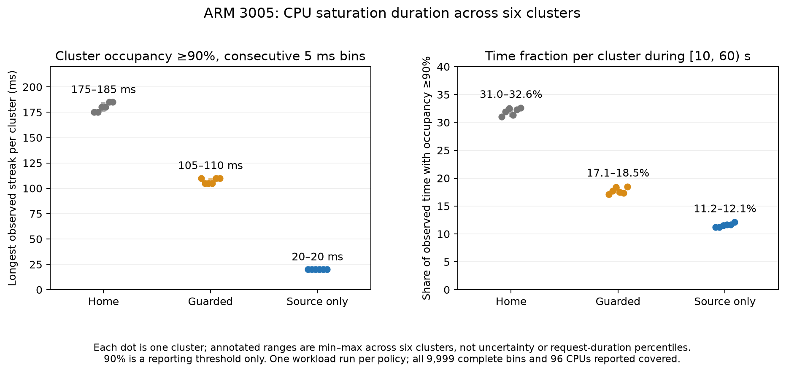
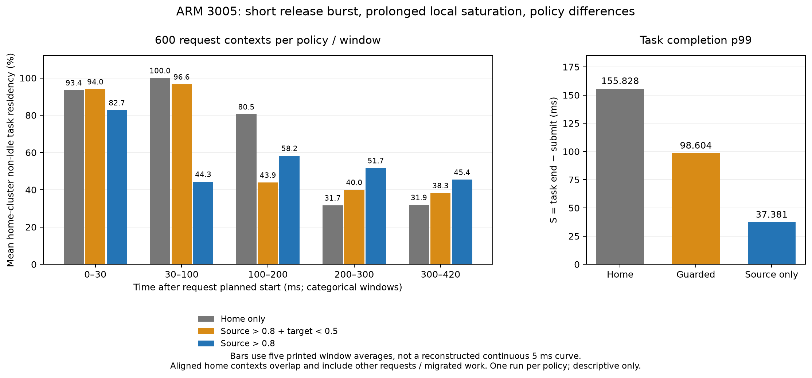

# ARM 3005 微突发 CPU 占用与分流效果

3005的高精度采集和三策略比较均通过测试机检查。**在整体平均CPU仍约50%时，home各cluster最长连续高占用达175–185ms；source_only缩短为20ms，任务完成p99从155.828ms降至37.381ms。** 这支持将收益解释为更早使用其他池的空闲CPU、缩短局部持续竞争，而不是减少计算量或消除所有CPU峰值。

本轮无需补跑。保留N/C与source_only为当前合成负载下的参考方案；目标N/C<0.5的门槛仍没有显示额外收益。N普遍优于Q、生产最优阈值、真实DAG请求收益仍不在本轮证据范围内。

## 1. 输入和采集质量

来源为用户提供的[3005.log原件](../../results/stage3-arm-3005/3005.log)，逐表提取、校验和与复现脚本见[归档说明](../../results/stage3-arm-3005/README.md)。日志中的时延报告打印两次、CPU曲线摘要打印三次，内容一致；不是重复发压。实际为home、guarded、source_only各一次60秒，按此顺序执行。

负载与3004相同：6池×128线程，每池绑定16逻辑CPU，CPU并集为0–47、192–239；12请求/s，home轮询；每请求80项初始任务在20ms内计划投递，另80项在后续400ms平缓投递。平均每项CPU预算25ms，均匀±50%、整轮精确归一化。名义需求为48 CPU秒/秒，即96逻辑CPU时间的50%。无DAG依赖、RPC、真实缓存迁移成本。

- 三策略`comparison_valid=true`，每策略分析[10,60)请求到达窗口内600请求、96000项完整任务，保留窗口后完成任务。
- 高精度捕获均为`status=ok / issues=none`，96/96 CPU覆盖，无未知CPU；每组9999/9999个完整5ms窗口有效，覆盖比例1.000。50秒区间边缘不满5ms的窗口不进入完整窗口峰值/连续时长，不能把少于10000个解释为丢失。
- 所有相对请求窗口均覆盖600/600请求；100ms CPU观测也均为ok。
- 初始实际投递跨度p99分别21.704、20.018、27.245ms；超过30ms的请求分别3、1、1个，均保留在统计中。

本地收到的是终端汇总，没有原始trace、逐任务CSV或完整5ms序列。本文复核打印的一致性与算术关系，采集完整性继承测试机分析器判断，不声称在本地重新计算了原始p99或核验了原始trace。图只展示已打印的窗口均值与摘要，不把它们插值成实时曲线。

## 2. 时延与 CPU 的联合结果

S为实际submit至任务end；L为该项计划投递时间至end。以下都是**单项任务**的时延，不是整个request或DAG的完成时延。CPU列使用调度事件重建的非idle任务驻留率；≥90%只用于描述高占用，不进入路由。

|策略|S均值 ms|S p99 ms|L p99 ms|96 CPU平均占用|各池最长连续≥90%的范围|各池≥90%时间占比范围|
|---|---:|---:|---:|---:|---:|---:|
|home，关闭分流|64.052|155.828|156.032|50.481%|175–185ms|31.0%–32.6%|
|source_only，源>0.8后选更轻池|25.101|37.381|37.575|50.219%|20ms|11.2%–12.1%|
|guarded，另要求目标<0.5|39.920|98.604|98.736|50.362%|105–110ms|17.1%–18.5%|

“最长”是在整段观测中每池最长连续5ms窗口串的统计，表中范围跨六个池；它不是每请求高占用时长的均值或p99，也不是毫秒级完全连续满载的精确持续时间。

source_only相对home的S均值下降60.812%、S p99下降76.011%；guarded分别下降37.676%、36.722%。source_only分流44.1%的任务，guarded为20.5%；guarded中约62.0%的已触发任务因没有符合目标接纳门槛的池而留home。source_only仍读取目标负载，选择严格更轻的池，并非不考虑目标负载。

|策略|W均值 submit→start ms|X均值 start→end ms|
|---|---:|---:|
|home|16.221|47.832|
|guarded|5.854|34.065|
|source_only|0.022|25.079|

source_only既减少回调开始前等待，也减少开始后的墙钟膨胀，X接近25ms的CPU预算。W包含提交和唤醒路径，不能全部称为Folly队列驻留；X包含实际计算与中途等待。此次只捕获idle边界，仍不能精确拆分某个worker的runq等待。分位数不能相加。

## 3. 微突发之后有没有平稳阶段

以下将600个请求按**计划请求到达时间**对齐，统计各请求home CPU组的平均占用。其分母固定为home的16逻辑CPU，分流后不是该request所有任务的CPU时间。

|相对请求窗口|home|guarded|source_only|
|---|---:|---:|---:|
|0–30ms|93.434%|93.985%|82.721%|
|30–100ms|99.976%|96.603%|44.345%|
|100–200ms|80.519%|43.910%|58.248%|
|200–300ms|31.653%|39.984%|51.667%|
|300–420ms|31.896%|38.284%|45.422%|

home在30–100ms仍几乎满载，100–200ms仍有明显初始积压；到200ms后的两个窗口均值约31.7%–31.9%。这与后续80项×25ms/400ms=5 CPU的到达需求一致：5/16=31.25%。**整体平均50%不意味着突发后的单池平台也应为50%。** 当前窗口均值支持后段出现较低平台，但没有原始5ms序列，不能说每个请求或每个5ms都已稳定。

guarded后段约38%–40%，与它额外接收其他home的任务相容；source_only在后段仍有起伏，因为全局每83.333ms有一个新请求，分流后的各池持续受到其他请求的初始波次影响。不能把source_only后段的几个均值称为一条恒定稳态曲线，也不能将全部home CPU占用归因于当前请求。

**20ms投递窗不等于20ms CPU峰。** 初始80项平均共需2 CPU秒，在16个逻辑CPU上即使均能立即运行也需约125ms才能完成这些CPU工作。后续每秒约消耗5 CPU的任务又同时到来。忽略爬升、随机时长及调度开销的粗略流体估算为：

`20ms + (2 CPU秒 − 16×0.020 CPU秒)/(16−5) ≈ 173ms`。

这解释了home为何出现175–185ms的长高占用区间，是量级核对，不是拟合每次请求的预测公式。如果原业务信息是“CPU只满载约30ms”，而非“30ms内完成扇出”，**当前demo只复现了后者和平均50%的压力，没有精确复现前者**；需要真实初始阶段的CPU工作量后才能判断差距，不应为让曲线看起来匹配而偷偷降低某策略工作量。

## 4. 为什么100ms与5ms峰值结论不同

|策略|100ms CPU并集采样峰值|5ms CPU并集峰值|5ms下六池各自峰值|
|---|---:|---:|---:|
|home|56.426%|85.222%|全部100%|
|guarded|55.141%|72.773%|全部100%|
|source_only|59.286%|99.878%|全部100%|

source_only在100ms下各池峰值仅63.580%–64.671%，5ms下仍全部达到100%。因此应将此前的解释限定为“降低100ms窗口的局部高占用”，**不能说分流消除了短时满载**。

source_only的CPU并集≥90%窗口占比11.5%、最长20ms，home和guarded则没有并集≥90%的5ms窗口。结合时延改善，这与“把局部长期拥塞变成跨池短时并行完成”一致：瞬时并集峰值更高，不必然导致更高p99；还要看持续时间、积压以及工作分布。CPU平均值与峰值都不足以单独评价策略。

## 5. 负载指标的结论有没有改变

N是所选池已接纳或预留而尚未完成的任务数，Q是Folly近似任务队列深度，C=16是逻辑CPU容量刻度。N包含已开始但仍未结束的任务，Q不包括已取走执行的任务；二者均非内核runq，N/C也非CPU百分比。采样发生在当前任务预留前，并关联该任务的最终S时延。

3005的home后续任务中，N/C<0.5的S p99为37.324ms，N/C≥4为154.241ms，具有风险区分信息；但初始任务即使入口N/C<0.5，p99仍为115.919ms。后续同批投递会改变已进入任务面对的竞争，这个限制没有被CPU曲线消除。

后续阶段Q/C<0.5的p99为71.860ms，但该桶覆盖38963/48000项（81.17%），N桶只覆盖28874/48000项（60.15%）。不同筛选集合不能直接作为N预测质量优于Q的证明。本轮没有Q驱动路由对照，也没有增加同样本留出预测评估。**新增CPU证据强化了分流收益的解释，没有把“可用候选指标”升级为“最优指标”。**

## 6. 采集开销与3004对照

|策略|观察进程CPU秒|其中读取线程CPU秒|事件数|原始trace字节|
|---|---:|---:|---:|---:|
|home|18.226|16.913|501003|90281578|
|guarded|20.996|19.734|592768|106721632|
|source_only|23.104|21.852|621080|112441328|

读取线程时间已经包含在观察进程时间中，不相加。以60秒发压时间仅作量级折算，观察进程约使用0.30–0.39个逻辑CPU，约为96 CPU时间预算的0.32%–0.40%；实际捕获还包含启动和排空，不能将此当作精确平均开销。该数值不包含全部内核跟踪成本，观察进程亲和为继承，也不能确定全部成本都落在所选96 CPU上。

5ms调度占用均值与100ms统计分别为home 50.481%/50.474%、guarded 50.362%/50.322%、source_only 50.219%/50.380%，总体接近。两者时间窗口边缘和中断核算不同，不要求精确相等。

相对未开启高精度跟踪的3004，同策略S p99变化约home +0.061%、guarded −0.398%、source_only +0.016%，策略排序与收益量级一致。它是跨轮结果一致性检查，**不是随机交错的采集开关实验**，不能据此认定跟踪零扰动或精确估计其成本。任务以CPU时间预算终止，固定预算下的进程CPU秒也不能证明固定业务工作量的成本无变化。

## 7. 当前动作

保留本轮原始trace、tasks、manifest和SVG即可。已有摘要足够形成上述CPU与时延的联合结论，无需再次发压、重复三次或扩展线程/阈值矩阵。测试机的`cpu-curves/<policy>/cpu_full.svg`、`cpu_zoom.svg`、`cpu_aligned.svg`保存完整图；本归档中的窗口摘要图不能替代它们。

阶段3继续以source_only为已测模型的参考策略，guarded为保守接纳对照。若以后要求精确解释每个请求的峰形，可离线读取现存曲线，无需重跑。真实DAG、内存亲和与RPC的验证仍由后续阶段处理，本次没有修改其他agent负责的工程。
