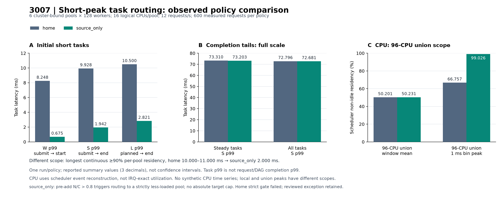

# ARM 3007：短CPU峰值下的指标与调度策略对照报告

**最小对照已完成发压；原报告遗漏了请求全部完成口径，需从已有数据离线补算，无需追加测试。** 请求收益应以每个请求全部必要子任务完成的时延为主，当前日志尚不能给出它的数值。下述数字都是子任务层面的观察：在本轮约10ms初始CPU峰、约50%平均占用的独立任务模型中，`N/C>0.8`后选择更轻池的source_only策略，将initial任务提交到完成p99从9.928ms降至1.942ms，约降低80.4%；steady完成p99基本不变。全体任务p99只降低0.158%，不能将initial收益冒充整个请求的尾延迟收益。

CPU收益与代价同时存在：各池最长连续≥90%占用由10–11ms缩至2ms，但96CPU并集的1ms峰值由66.757%升至99.026%；总CPU消耗基本不变。策略将局部等待转成更多池在更短时间内共同执行，未证明节省CPU或对所有并发业务均有利。

证据：[用户原始日志、提取CSV、校验及图](../../results/stage3-arm-3007/README.md)。本报告从终端汇总复核数值，未获得原始逐任务数据，不声称本地重新计算p99。

## 1. 本次比较的可信范围

- 3007只新增一次source_only；home复用3006。两条`SKIP home`分别来自预检和恢复，不是重复试验。报告打印两份也不增加独立样本数。
- 两组各600个请求、96000个完成任务，initial与steady各48000项。两阶段目标CPU预算均值完全相同；比较器报告`comparison_valid=true`且无问题，表示资源、工作量和观测配置可比较。
- 原home严格形态验收仍为failed，原因是83/600波触发碎峰规则。离线复核已确认所有观测高位最晚13ms结束，20–30ms及背景没有≥90%区间，因此明确记录`accepted_posthoc`后继续；没有改原计划、负载、二进制或原失败结论。详见[3006报告](ARM_3006_SHORT_PEAK_REPORT.md)。
- source_only的波形验收显示`not_applicable`，因为短峰形态门槛只用于home输入验证；候选的CPU形态是实验结果，不应要求仍有home式短峰。
- 每策略仅一轮，顺序为home后source_only，home跨会话复用；未估计重复间波动、时间漂移或统计显著性。对照通过不等于排除了所有环境变化，也不等于生产验证通过。

## 2. 负载、资源和时间口径

|项目|本轮固定条件|
|---|---|
|CPU与线程|6个Folly原生CPU池，各128worker，分别绑定不重叠的16逻辑CPU；共96CPU，两NUMA各3池|
|CPU分组|`0-15;16-31;32-47;192-207;208-223;224-239`，NUMA标识`0,0,0,2,2,2`|
|请求到达|单生产者、regular开放环12request/s，home按请求轮询；不同home相隔83.333ms，同home每500ms一请求|
|initial|每请求80个独立CPU任务，计划1ms窗口内释放；每项名义平均1.020ms CPU|
|steady|另80个独立任务，从1ms起分散到500ms窗口，末项约494.75ms释放；每项名义平均48.980ms CPU|
|随机预算|±50%波动，initial和steady分别按整轮精确归一化；种子52000；不保证每个请求预算恰好相同|
|CPU需求|名义4 CPU秒/请求，12QPS对应48 CPU秒/秒，即96逻辑CPU时间的50%；initial仅占2.04%预算，但占一半任务数|
|观察样本|生成60秒，按request计划到达时间选取[10,60)秒；保留这些请求的全部后续释放与排空完成|
|CPU观测|约100ms `/proc/stat`执行时间观测，加idle切换事件离线积分为1ms非idle驻留率；CPU不参与发压反馈或路由|

这仍然没有DAG依赖、RPC、共享业务数据或700–800ms长尾。steady按时间释放，不等待initial完成。它验证CPU需求形状与投递策略，不复现真实100ms算子的内部结构，也没有验证跨池的数据亲和损失。这里的cluster是已选择CPU分组，未执行NUMA内存绑定。

|符号|定义与边界|
|---|---|
|N|目标池已预留/接纳、尚未完成的任务数，涵盖开始前等待与已开始回调；不是当前正在CPU运行的线程数|
|Q|Folly `getTaskQueueSize()`提供的近似任务队列信号；不是Linux runq，也不覆盖全部已取出的任务|
|C|配置的逻辑CPU容量刻度，本轮每池16；不是128worker数，N/C也不是CPU百分比|
|S|当前任务应用提交入口到计算结束，`end-submit`|
|W|提交入口到回调开始，`start-submit`；含选池、add/通知、任务等待和内核调度，不能单独当成Folly容器驻留时间|
|X|回调开始到计算结束的墙钟时间，可能含执行中被抢占|
|L|当前任务计划释放到结束，`end-task_planned`，保留发生器迟到|
|D|提交迟到，`submit-task_planned`|

逐项有`S=W+X`、`L=D+S`，均值可分解，p99不能相加。上述全部都是task时延，不是整个request或DAG完成时延。

## 3. 指标采集与调度到底做了什么

N在应用包装层维护：选择目标并通过准入后，在`pool.add()`前执行原子`N++`；回调退出时`N--`，提交异常回退。回调已开始但被内核抢占时仍计入N。每项生命周期通常增加两次relaxed原子读改写，读负载为O(1)原子读取；不需要遍历任务或读取/proc。允许观测误差不等于可以并发读写普通变量；本轮没有给出独立的纳秒成本测量。

代码：[main.cpp](../../experiments/independent/src/main.cpp)中的`readLoad`、`pool.add`前预留和回调cleanup；选池见[LoadRouting.h](../../experiments/independent/src/LoadRouting.h)。单生产者先预留再投递下一项；真实多生产者同时选择同一目标的情况未覆盖。

|策略|本轮行为|
|---|---|
|home|每项都提交request原home池|
|source_only|提交前读取home的N/C；大于0.8时扫描其他5池，选择严格更轻的最轻池，否则仍选home；允许跨NUMA|
|guarded|还要求目标N/C<0.5；本轮没有运行，不把旧长峰结论当作短峰对照结果|

```text
任务到计划释放时间 → 记录submit → 读取home的N/C
    home策略或N/C≤0.8 → home
    N/C>0.8 → 扫描其他5池 → 存在严格更轻者则选它，否则home
目标池预留N++ → Folly add → 回调执行 → 完成/异常清理N--
```

同分目标按任务轮转顺序打破平局；多池读数不是同一时刻的原子快照。C=16时，严格`N/C>0.8`意味着当前任务预留前N≥13。initial和steady都执行相同选池规则；每项以request原home重新判断，不继承上一个任务的迁出池，不搬运已排队或运行中的任务。

source_only中46.4%的任务触发源阈值，41.0%实际投往其他池，即约88.4%的触发决策发生分流（由打印比率估算）。约5.4个百分点触发后仍留home，符合未找到严格更轻池的规则。`target_ineligible=0`来自关闭绝对接纳门槛，不能解释为目标都空闲或N/C<0.5。日志没有分阶段分流率及目标分值分布，不能声称41%全部来自initial。

## 4. 时延原始结果与改善来自哪里

单位ms。每阶段48000项，all为96000项；变化百分比按日志打印值近似计算，整体变化率采用原分析器输出。

|对象与指标|home|source_only|绝对变化|相对变化|
|---|---:|---:|---:|---:|
|initial S均值|4.353|1.101|−3.252|约−74.7%|
|initial S p99|9.928|1.942|−7.986|约−80.4%|
|initial W均值|3.154|0.074|−3.080|约−97.7%|
|initial W p99|8.248|0.675|−7.573|约−91.8%|
|initial L均值|4.980|1.410|−3.570|约−71.7%|
|initial L p99|10.500|2.821|−7.679|约−73.1%|
|steady S均值|49.225|49.109|−0.116|约−0.236%|
|steady S p99|73.310|73.203|−0.107|约−0.146%|
|steady W p99|5.815|0.290|−5.525|约−95.0%|
|steady L p99|73.425|73.281|−0.144|约−0.196%|
|all S均值|26.789|25.105|−1.684|−6.285%|
|all S p99|72.796|72.681|−0.115|−0.158%|
|all L均值|27.155|25.300|−1.855|−6.830%|
|all L p99|72.922|72.762|−0.160|−0.219%|

initial的平均S减少3.252ms，其中平均W减少3.080ms，主要改善发生在回调开始前；X均值也从1.199降为1.027ms。这里不能把W全部归因于某一种内核或Folly等待，现有汇总不能拆开。

steady的等待尾部也变短，但自身CPU预算约24.5–73.5ms支配完成时延，S p99的0.107ms差异应描述为本轮基本不变，不推断稳定收益。总体未观察到steady完成尾部明显受损。

**全体p99不变并非坐标轴错误。** 两阶段任务各占一半；initial均值节省按样本数折算，解释约96.6%的总体S均值节省。全体最慢1%却仍主要位于长steady任务中，因此initial变快不会等比例降低全体p99。均值可以加权解释，p99不能对两阶段取平均，也不能相减后当成“同一批尾任务节省”。

投递行为也有变化：initial实际投递跨度p99从8.880降到3.037ms；D p99从5.971降到1.656ms。保留计划释放口径L后，initial p99仍降低73.1%，因此收益不是仅在submit之后重新起表造成的假象。发生器迟到改善的具体原因未分离，不声称都是N读取或路由算法本身的成本收益。



图用汇总值绘制，无误差条；不同阶段独立展示，避免用长任务尺度掩盖initial改善，也不通过截断纵轴放大steady的微小差异。

### 4.1 修正统计主口径：每个请求全部完成

用户指出的缺项成立。对请求r，应计算`T_request(r) = max(该请求全部task.end_ns) - request_planned_ns`，再对600个请求的T求均值与p99；每个请求等权。不是把全部任务的时延求和、取最大的单项S/L，也不是整轮测试结束时间。真实应用应使用真实请求到达与响应完成埋点；当前demo用计划到达避免遗漏发生器迟到，终点是最后一项计算结束，不含响应序列化等真实请求尾部。

|统计项|含义与用途|ARM 3007数值状态|
|---|---|---|
|请求全部完成：计划到达→最后完成|主指标，判断这个合成请求是否更快完成|待离线补算，不能由现有子任务p99反推|
|请求全部完成：首项实际提交→最后完成|辅助口径，辨别发生器迟到的影响|待离线补算|
|初始80项全部完成：请求计划到达→initial最后完成|判断初始集合多久全部就绪；不是当前demo的DAG屏障|待离线补算；不等于9.928/1.942ms的单项S p99|
|initial/steady子任务W、S、L|定位等待和完成改善发生在哪类工作|已有上表|
|全体子任务p99|检查混合任务总体尾部是否回归；按任务加权，受阶段比例影响|已有；降为辅助指标|

全部600个请求按计划到达[10,60)秒选取，晚于60秒的子任务释放及完成全部保留。每个请求必须任务齐全且全部成功；缺失、失败、取消或完整性校验失败时，不得删除坏请求后只报成功者p99。600请求的最慢1%约6个观测，标记`LOW_TAIL`并保留描述性结果，不将96000任务冒充96000个请求，也不因此追加重复轮次。

**这个负载的因果结构也限制了结论。** 最后一个steady计划在请求后`1 + 500×79/80 = 494.75ms`才释放，并不随initial更早完成而提前。因此即使初始集合显著更快，完整请求也可能仍受固定释放窗口和最后一批steady支配。必须测量后如实报告请求收益；不能去掉这494.75ms、替换为initial指标或更改负载来制造收益。它仍是检验微突发CPU压力与选池机制的实验，但不是验证“初始关键路径缩短会推进后续图计算”的模型；后者属于DAG阶段。

现有`tasks.csv`含请求编号和所有必要时间戳。分析器已增加上述请求统计、逐请求`request_completion.csv`及可终端收集的`request_completion.txt`；[短峰指南](SHORT_PEAK_GUIDE.md)顶部只有一条离线分析步骤。原始文件、计划、策略、CPU采集和已有结果均保留。原C++的`bursts.csv`虽已有首提交→最后完成，但其全局汇总含预热，不能直接替代这里的请求cohort主口径。

## 5. CPU：局部高占用缩短，全局瞬时峰值提高

|口径|home|source_only|解释|
|---|---:|---:|---|
|96CPU平均执行占用，约100ms累计计数|50.330%|50.379%|+0.049个百分点，需求近似不变|
|96CPU平均非idle驻留率，事件积分|50.201%|50.231%|+0.030个百分点，与累计总量相符|
|各池平均驻留率范围|49.876%–50.533%|49.628%–50.833%|平均负载相近，不代表瞬时无拥塞|
|各池最长连续≥90%，完整1ms网格|10–11ms|2ms|局部持续竞争缩短|
|各池1ms峰值|100%|100%|峰值高度并没有全面下降|
|96CPU并集1ms峰值|66.757%|99.026%|更多池同时执行，整体瞬时用量提高|
|并集≥90%时间占比/最长段|0% / 0ms|约0.6% / 2ms|产生很短的整体高占用区间|
|进程整轮CPU时间，含预热和排空|2881.581 CPU秒|2882.201 CPU秒|+0.620 CPU秒，约+0.022%，不能据此声称节省CPU|

两组CPU覆盖均96/96、完整1ms bin为49999/49999，未报告采集问题。事件口径是调度非idle驻留率，不是IRQ精确执行占用；1ms是积分窗口，不代表所有测量误差小于1ms。观察包括选中CPU上的其他任务，依赖用户提供的隔离条件。

各请求原home池的实际首提交对齐平均值如下：

|相对时间窗口|home|source_only|
|---|---:|---:|
|0–5ms|96.738%|66.690%|
|5–10ms|89.896%|45.736%|
|10–20ms|50.212%|44.989%|
|20–30ms|49.988%|45.718%|
|30–100ms|49.926%|49.628%|
|100–200ms|49.613%|51.652%|
|200–300ms|49.079%|49.212%|
|300–500ms|49.004%|50.411%|

该表只观察每个请求原home的CPU组，不能将迁出后的home下降当成整个请求总CPU下降。source_only后段≥90%时间占比的逐波p90为1.064%、最长高位段p90为1ms，而home两项为0；这与接收其他请求的短任务分流相符，但日志不足以逐峰归因。短峰形态门槛不适用于source_only。

注意三种峰宽不能混用：3006离线检查的高位包络max=13ms；原home近起点首个连续段median/p90=8/10ms；固定整轮网格最长段=10–11ms。source_only近起点达到90%的波比例为53.667%，其中首段median/p90=1/2ms；不能把这个有条件统计当作全部600波都存在1ms峰。

观察器也有成本：observer进程CPU时间20.846→26.159秒（约+25.5%），事件数581658→657121（约+13.0%）；reader的19.551→24.884秒已包含在observer内，不再相加，内核追踪开销未完整计入。当前没有关闭采集的配对结果，不能宣称本轮测量无扰动或准确量化了路由开销。

## 6. 指标有效性与策略有效性应分别下结论

home的initial条件分桶仍是同一份3006数据，未因补跑策略而增加独立样本：

|提交前N/C|任务数|S均值ms|S p99 ms|W均值ms|
|---|---:|---:|---:|---:|
|[0,0.5)|454|1.041|1.535|0.017|
|[0.5,0.8)|3691|1.048|1.548|0.020|
|[0.8,1)|2978|1.118|2.128|0.064|
|[1,2)|10630|2.404|8.416|1.182|
|[2,4)|19418|4.916|9.413|3.640|
|≥4|10829|7.410|10.803|6.268|

观测是在当前任务预留N之前读取，并配对该任务的W/S/L，不是完成时的N，也不是维持该N不变时的稳态p99。同批后续到达仍会改变竞争。initial内存在随N增加等待变长的清楚趋势，但最低桶只有454项，尾部证据较弱。

Q也呈现类似趋势：initial的Q/C<0.5桶有12467项、S p99=2.688ms；Q/C≥4桶有1969项、S p99=11.337ms。它们与N桶选中的任务不同，不能据这些端点或六个聚合点宣布N预测更准。全体N/C<0.5桶中98.24%为steady，混合阶段曲线还受到服务成本构成影响。

|问题|当前结论|
|---|---|
|N是否提供可用的积压信号|在此initial负载中有相关趋势，维护位置和O(1)读取清楚；可作当前简单调度的候选|
|N/C+0.8+选更轻池是否有收益|本轮开关对照中initial等待和完成时延大幅下降，steady完成时延基本不变|
|当前合成请求全部完成是否更快|尚未得出；需从已有tasks.csv离线补算请求均值/p99|
|N是否优于Q或Folly active|未证明；没有同任务留出预测比较，也没有Q/active驱动的本负载策略对照|
|0.8是否最优，目标0.5是否应启用|未证明；短峰本轮只测一个固定候选，没有guarded或阈值梯度|
|cluster是否优于none或NUMA|未证明；本轮亲和性固定为cluster，没有这两种对照|
|动态选择是否优于静态spread|未证明；本轮没有静态分散策略|
|是否降低真实业务request p99|未证明；当前是独立任务、固定CPU时间预算，没有真实依赖、数据亲和和RPC|

N将约1ms与49ms任务等权，无法描述剩余CPU需求；异步等待、同步阻塞、未来扇出和其他业务占用也会影响它与时延的关系。3007支持一个可用的参考组合，不支持“找到了最好的单一指标”。

## 7. 本阶段停止边界与实际参考

**本轮只补请求级离线统计，不补发压、不重复三次、不扫描线程数/亲和性/阈值，也不修改工作负载或策略工程。** 保留N/C及source_only作为已测短峰场景的参考基线：平均约50%、错开的微突发、其他池有相对余量时，它能减少初始等待；代价是更高的全局瞬时并行需求。

0.8可以作为后续真实应用验证的初始候选，而非直接指定的最终阈值。应用验证应保留完整request时延、后段任务与其他共存业务的影响；本报告不能代替这些验收。DAG及后续阶段继续由其他agent负责，本次未修改其工程。

如以后明确要回答“N是否比Q更好”，再单独设计同任务的预测比较或同输入的策略对照；这不是当前报告的前置条件。当前已具备负载构造、home基线、一次策略对照、子任务分阶段时延和CPU证据；请求级收益仍待上述离线结果，不能提前宣布完整请求收益已验证。
