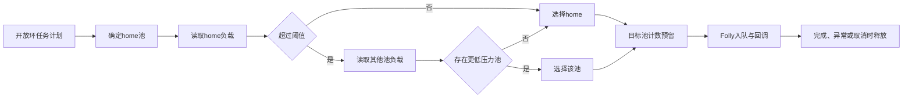

# 阶段3扩展：负载指标与阈值跨池投递

本扩展继续使用独立CPU任务与原生`folly::CPUThreadPoolExecutor`。目标是验证两个不同命题：**包含执行中工作的指标，能否比原生queue更好地描述高线程场景；基于该指标投递到其他池，能否改善相同负载的完成时延。** 指标相关性、预测能力和策略收益分别报告，不由其中一项推定另外两项。

工程在独立分支`experiment/stage3-load-balance-20261115`开发，以`b0b411a`为基线。改动局限于独立任务工程、专用分析/计划工具及阶段3文档；没有修改DAG、Folly库或另一工作的构建目录。构建直接以`experiments/independent`为CMake源目录。

## 1. 为什么增加观测，而不是放弃queue

原生queue成本低，仍是必要基线。在16个worker与16个允许逻辑CPU的历史实验中，大部分CPU争用表现为回调开始前等待，queue与时延关系明显。256个worker时，许多任务可以已经进入回调却仍在竞争16个逻辑CPU，queue没有统计这部分工作。

不过，任何提交前快照都看不到随后尚未提交的同批任务。即使当前queue/outstanding均为0，任务也可能被未来到达影响。故不能要求“某指标与所有任务的完成p99严格线性”，也不能把某桶少量高尾样本当作指标彻底无效。

本实验将`线程数`与`允许逻辑CPU数`分开表述。ARM每cluster是8物理核、16逻辑CPU，不是16个物理核；默认容量归一化服务于CPU时间预算实验，不表示SMT使有用算法吞吐翻倍。

## 2. 候选指标与成本

设一个池的归一化容量为`C`，默认`min(worker数, 允许逻辑CPU数)`，可通过`--capacities`显式指定。

|指标|原始值|路由score|涵盖的状态|主要成本与缺口|
|---|---|---|---|---|
|queue|Folly未领取工作估计Q|Q/C，task/slot|用户态队列协议|利用已有状态读，漏掉已领取/执行中工作|
|outstanding|接纳但未结束的任务数N|N/C，task/slot|未开始+已开始未完成|每池独立atomic，接纳/终态更新；不知道任务长短和进度|
|work|未完成任务完整估计预算之和B|B/(1000C)，ms|所有在途任务的估计总量|每任务接纳/终态更新；已经消耗的部分仍计入|
|remaining|估计预算扣除已发布CPU消耗后的和R|R/(1000C)，ms|估计尚需消耗的CPU量|额外进度发布；估计过小可提前归零，估计过大则残留到结束|

`outstanding`使用单独原子计数，不把不同时间读取的`pending+inflight`当成一致快照。`work/remaining`用CPU微秒计量；remaining对每任务最多扣其自身估计值，结束时补扣残额，提交失败/取消/异常同样必须释放，防止无符号下溢或计数泄漏。

这些score是压力代理，不是某个新任务的完成时延公式。尤其N/C不是“排队秒数”；B/C保留已做部分，不能称准确剩余工作。none/numa下多个池共享同一CPU域，各池容量不能相加为独占总能力。

估计分为三类：

- `constant`：所有任务使用已知类别均值，主结果采用这一较可获得的信息。此时B=N×均值，work与outstanding只是单位变换，不构成独立信息增益。
- `noisy`：在常量或任务估计上叠加独立误差，验证误差敏感性。
- `oracle`：使用合成任务的真实预算。仅用于解释上界，不冒充生产可提前获得的真值。

剩余预算的进度发布默认每消耗约5ms线程CPU更新一次。CPU预算循环可复用已有CPU时钟；固定迭代模式要为进度额外读取时钟，必须纳入成本实验。原子load与共享RMW的成本不同；允许近似不允许普通变量并发读写的数据竞争。

新增观测与原有 `--instrumentation` 独立控制：`basic` 读取queue、outstanding、work，`progress`再维护remaining，用于同一批样本比较全部候选。`minimal`只维护/读取`--load-metric`所选的新指标，其他新增字段写`-1`。例如`--instrumentation none --load-observation minimal --load-metric outstanding`只额外维护每池N；`minimal/remaining`只维护剩余估计。若同时使用原有`full`，原有计数仍保留，不能将其称作最低开销。`off`且没有路由时保留旧行为；threshold+off自动升为basic，remaining+off/basic自动升为progress，显式minimal不升级。

成本实验分两步：固定迭代下对比home/off与home/minimal/basic/progress，测观测总成本；再以相同minimal指标和插桩，对比home与threshold，测完整策略收益。`progress-us`控制共享计数的发布频率，不控制CPU时钟读取频率。元数据记录实际维护的计数器，避免把四种minimal模式当作相同成本。

## 3. 最简单的负载均衡

每个arrival仍轮询确定home池，local突发中的task共享home。策略只决定新就绪任务的投递目标，不移动已排队任务或正在运行的线程。

```text
snapshot = read_load(home)
target = home
if snapshot.score > threshold:
    扫描其他池的相同score
    选score最低且严格小于home_score-min_improvement的池
    相同最低值按循环顺序分散；没有改善则保留home
接纳检查成功后，为target预留计数
target.add(task)
提交失败或task终态：恰好释放一次
```

比较的是**当前task加入前**的score，条件严格`>`；阈值不是硬并发上限。例如C=16、阈值1时，N=16仍会留home，下一次N=17才超过阈值。snapshot是近似观测，不能宣称容量保护或线性化的最优调度。



对照组包括home、相同阈值规则下的queue/outstanding/work/remaining、静态spread。spread用于判断动态读取是否有额外价值；不能仅因为阈值路由优于集中home就宣称它优于廉价的静态分散。

当前只有一个发生器，因此后续投递能看到此前预留的目标池计数。多生产者时可能同时基于旧快照选中同一目标，本阶段不验证这种竞争；生产推广需另测并发投递与预留机制。

## 4. 可解释的测量边界

`tasks.csv`保留原字段并追加home/实际池、两边负载快照、容量、score、是否溢出、路由耗时、候选读取数及批内位置。原`pool`仍表示实际执行池；原队列字段仍表示实际池提交前快照。

```text
planned → submit → 读取与选择 → add → callback start → callback end
          |<--------------- W ----------------->|
          |<---------------------- L -------------------------->|
                                                   |<--- X ---->|
```

实际定义以时间戳为准：`W=start-submit`，`X=end-start`，`L=end-submit`，主收益口径为`end-planned`。路由读取成本包含在W和主完成时延内，不在统计时扣除。均值可相加，分位数不能相加或相减。

end记录在计算结束、scope guard释放计数之前，因此X不含计数释放尾部。清理仍占用进程CPU并可能影响后续任务；成本结论还须看固定工作量的总进程CPU和后续任务时延，不能仅看route_ns或单个回调X。

按planned到达窗口选择任务，保留窗口后完成的慢任务；未完成、拒绝、取消、失败、超时必须报告。不能通过少完成任务或删除尾部“改善p99”。每批完成从该批planned到最后一个必要task结束计算，并报告批次失败。

## 5. 先评估指标，再评估策略

### 指标质量

使用无自适应路由的home组，固定CPU域、线程数和服务/到达分布后分别分析：

1. 原始scatter关系的Pearson/Spearman只是描述，常量指标相关性应为NA。
2. 每个负载桶报告任务数、独立burst数、W/X/L的均值和p50/p95/p99；尾样本不足显式标记。
3. 以整轮seed为单位留出，训练轮确定分桶边界和均值/p99预测，测试轮评估MAE、p99 pinball loss与覆盖率。不能把同批任务随机拆到训练和验证。
4. 对比无指标的基线；自身真实预算基线只能作为oracle辅助。批内位置/剩余待投递数量属于业务上下文，须与池指标分开标识。
5. 报告读取、更新与完整插桩成本，比较额外信息是否值得其成本。

不在已经路由的流量上直接拟合home时期的“queue→时延定律”。路由会同时改变负载分布和任务间竞争；策略效果需要独立干预实验。

### 路由收益

observe、tune、evaluate使用互不重叠seed。先观察候选，tune阶段扫描少量阈值，再人工冻结指标与阈值；evaluate阶段不得看结果后重新选择“最佳阈值”。冻结记录包含来源与适用配置，跨线程数/负载外推需明确标注。

同seed的各策略保持planned序列、任务CPU预算、估计预算、CPU并集与插桩一致，顺序随机、串行运行。比较planned任务均值/p99、批次尾部、W/X、完成率、进程CPU/完成任务、溢出比例和路由成本。三轮可用于初测；至少七个独立配对seed才输出配对bootstrap区间，区间针对逐轮统计差，不把任务数当独立重复数。效果幅度仍须结合系统干扰解释。

## 6. 实验覆盖与范围

ARM主组沿用历史6池、96逻辑CPU并集、cluster亲和、每池16/256线程、local100、240 task/s、平均100ms CPU预算。名义需求约24 CPU秒/秒，保留全局余量来检验局部集中。直接改成12 arrivals/s×100×100ms会变成120 CPU秒/秒全局过载，不能用来验证单纯借用闲置池的收益。

优先运行主组；随后有针对性补：

- 平滑与静态分散，检查不需要路由时的额外成本。
- 固定/均匀/同均值长尾，区分计数与工作量信息。
- 不同burst宽度、Poisson到达与估计误差，检查阈值泛化。
- none/numa，检查已有共享CPU范围下是否仍有路由收益。
- 固定迭代工作下off/minimal/basic/progress及路由开关，测量完整观测扰动。
- 明确标记的全局高压负对照，验证均衡不能创造CPU容量。

完整组合不作默认一次性长测。计划工具打印实际轮数、窗口和名义CPU需求；测试机可先运行少量阶段并直接打印终端报告。具体命令见[BALANCE_GUIDE.md](BALANCE_GUIDE.md)。

本阶段没有共享图数据、RPC、依赖和回迁，不能给出局部性损失的生产结论。推荐候选首先是outstanding/C，因为它覆盖开始后的存活工作且不要求任务耗时真值；是否实际优于queue、阈值能获得多少收益，必须以本工程的留出与配对结果决定。
