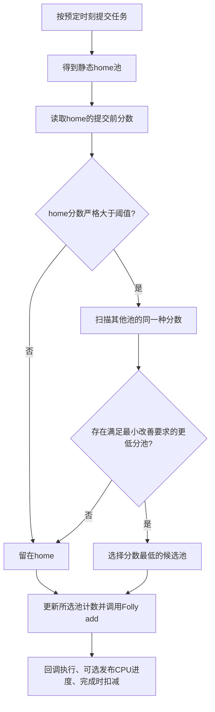

# 阶段3扩展：负载指标与最简单跨池分流的实机验证

本工程延续独立 CPU task 模型，增加提交侧负载观测和阈值分流。它不包含 DAG、RPC、节点回迁、任务窃取，也不修改 Folly。另一个工作树中的 DAG 和 Folly 开发可以继续；这里使用单独分支、构建目录和结果目录。

目标不是事先指定一个“最好指标”，而是完成两个独立检验：在新种子上，哪个指标更能预测等待/完成时延；冻结指标和阈值后，简单分流是否改善完成时延且收益覆盖计量成本。历史 queue=0 仍可能完成很晚的现象，只能否定 queue 的充分性，不能直接证明某个替代量有效。

已完成的169轮开发验证、原始证据和适用限制见[开发结果报告](BALANCE_RESULTS.md)。ARM `3001.log` 已完成 observe 18、tune 48、evaluate 56 轮，见[ARM复核报告](ARM_3001_REVIEW.md)。**已经执行到这里的测试机，请直接按[3001收尾步骤](ARM_3001_CLOSEOUT.md)重算已有数据，不要从下面重新展开矩阵。** 现有结果不要求先找到普适最优指标，才允许进入 DAG。

下文保留各类实验的参考配方，不是需要依次全部执行的清单。当前主线停止扩展；minimal 最多只补选定的 9 轮（含已完成），成本与外推暂缓。未执行的扩展不自动变成当前阶段欠缺的测试。

3002已确认别名重算成功、限定minimal 9/9完成。**这台测试机无需再补运行**，仅需离线分析这9轮，详见[3002结果与后续方向](ARM_3002_NEXT_STEPS.md)。

综合报告将同时使用已有observe的指标质量、tune/evaluate的策略效果和minimal九轮。测试机只需按[综合报告离线收集指南](ARM_REPORT_COLLECTION.md)打印三段文本，无需上传CSV或扩展矩阵。

3003及会话补充的192条分桶记录已形成[指标与策略有效性报告](ARM_3003_METRIC_POLICY_REPORT.md)。当前先审阅已有结果；后续只规划[四种组合各一次、共4轮的小对照](MINIMAL_FOLLOWUP_PLAN.md)，不展开突发大小×线程数的矩阵，不执行原minimal剩余组合，不进入DAG阶段。

## 1. 观测、分流和实验边界

令 `C_i` 为池 i 的评分归一化容量，默认 `min(固定worker数, 该池允许的逻辑CPU数)`。它是可配置的比较尺度，不是测得的物理CPU吞吐；SMT双线程不等于两倍吞吐。

|指标|维护方式|路由分数与单位|需要注意|
|---|---|---|---|
|queue|原生 `getTaskQueueSize()`|`Q_i/C_i`，task/slot|不含已经进入回调、随后等待CPU的任务|
|outstanding|单个每池原子计数，准入时加、完成/取消时减|`N_i/C_i`，task/slot|包括提交至结束整个生命周期；低估/高估短长任务差异|
|work|未完成任务的完整估计CPU预算之和|`W_i/C_i/1000`，ms|不扣已执行部分；常量估计时信息等价于N乘平均预算（独立计数快照可能短暂不一致）|
|remaining|在work基础上，周期发布已经消耗的线程CPU时间|`R_i/C_i/1000`，ms|需要更多时钟/计数更新；估计不足时可提前归零，不能当真实剩余服务时间|

`--load-observation progress` 统一采集所有候选，便于比较信息质量。`basic` 维护较便宜的计数/完整预算，`off` 不主动增加这些观测。`minimal` 仅维护 `--load-metric` 指定的指标，供最终成本和净收益验证。观察模式与原有 `--instrumentation` 是两个维度：后者仍控制原有时间戳/计数/周期样本。所有模式保留必要的准入和取消逻辑，并非零开销。兼容规则会将threshold+off提升为basic，将非minimal的remaining提升为progress；应以metadata中的有效模式为准。本runner的成本组已经避开把请求off却实际basic的行误配给off基线。

进度发布默认目标机每5000线程CPU微秒一次、开发机每500微秒一次（开发任务预算约2000微秒）；可用 `--progress-us`覆盖。周期应小于代表性任务CPU预算，否则大多任务完成前不会发布，remaining会接近work；过于频繁则增加扰动，应另做周期灵敏度对照。

计数以 relaxed 原子操作实现，不把允许近似误差解释成允许 C++ 数据竞争。字段分别读取，不承诺形成同一时刻的原子快照。每任务记录home与实际selected池快照，避免把分流之后的低selected负载当作home负载没有预测价值。



这是**提交时分流**，不是将已排队任务迁移。默认 `--min-improvement 0`；相等分数不迁移。阈值读在本任务准入前，判断为严格 `>`：例如 `N/C > 1` 不构成“最多C个任务”的硬限制，单提交者可在达到C后再放入一项，随后才触发分流。多提交者与陈旧快照还会扩大偏差；当前demo仅一个发生器。

三个路由策略：

- `home`：保留原始arrival/burst的轮询home放置。
- `threshold`：按上述条件选择其他池。
- `spread`：按任务ID轮询全部池，是无需负载信息的分散对照。

`burst-placement spread` 改变原始home，`routing spread` 改变实际投递策略，两者不要混淆。负对照故意包含已经分散的home，检查新策略是否凭空增加开销或改善极少。

## 2. 先分三阶段，再做成本和外推


默认seed分别为 `11000…`、`21000…`、`31000…`，cost为 `41000…`。四个集合互斥；自定义seed也检查互斥。同一个seed内随机打乱case顺序，各case串行执行，减小持续频率/温度漂移的固定顺序偏差。分流不能影响预生成的到达或任务预算。

|计划族|主要变化|用途|
|---|---|---|
|main|cluster、每池16/256线程、local K=100、regular、uniform|主机制和收益组|
|negative|smooth K=1、burst home已spread|同平均CPU需求，检验无须分流时的成本|
|affinity|none/numa，共同96个逻辑CPU|共享CPU域控制，不把逻辑池当独立CPU容量|
|arrival|Poisson到达|同种子策略比较保留相同实际到达；跨种子任务数可变|
|distribution|固定预算、2%长尾|exact均值归一化，隔离任务异质性|
|burst|K=20、400|保持task/s和平均预算，改变局部突发宽度|
|estimator|constant带±75%独立噪声、oracle真实合成预算|估计误差和信息上界；不混为生产可实现收益|

main默认使用constant估计 `estimate-us=100000`，所以work与outstanding仅单位不同。阈值网格也按相同倍数配对：N/Q为0.5、2 task/slot；W/R为50、200ms。只有异质估计或剩余进度才能增加不同的信息。oracle不进入主生产可行性结论；本工程没有假装存在已经训练好的生产任务类别预测器。

目标机主负载沿用历史：240 task/s、CPU预算均值100ms，总名义需求24 CPU秒/秒；K100时为2.4 arrival/s。**没有改成12×100×100ms=120 CPU秒/秒的全局过载负载。** regular各宽度、相同seed、duration60s、warmup10s时分别核对14400总task和12000分析task。Poisson只固定期望，实际数量以CSV为准。

默认目标机observe为18轮；tune全部4指标为60轮，下面的3指标为48轮，缩为2指标则36轮；evaluate在3个seed且不带queue参照时为18轮，加入queue参照则24轮。每轮默认60s、分析 `[10,60)`，另加启动/排空时间。3个seed只用于初测，确认收益建议至少7个独立seed，并查看重复间差异与尾样本量。不是样本数达到固定阈值就必然有足够统计功效。

所有阶段先 `plan`，不会自动开始大型矩阵。扩展族按问题分别运行，避免将所有维度做笛卡尔积。

## 3. 独立构建和开发机验收

在目标仓库旁建立新工作树，不切换另一agent正在使用的分支：

```bash
git fetch origin experiment/stage3-load-balance-20261115
git worktree add ../executor_demo-stage3-balance origin/experiment/stage3-load-balance-20261115
cd ../executor_demo-stage3-balance
cmake -S experiments/independent -B build-independent-balance -G Ninja \
  -DCMAKE_BUILD_TYPE=Release -DCMAKE_PREFIX_PATH=/home/bty/rank_demo/folly/_install
cmake --build build-independent-balance -j2
ctest --test-dir build-independent-balance --output-on-failure
python3 tests/test_balance_matrix.py
```

`CMAKE_PREFIX_PATH`须改成现有Folly安装的真实**绝对路径**（上例为已验证的测试机路径）；独立子项目不编译DAG，也不要求重新开发Folly。4GB环境建议 `-j2`，避免与其他构建抢内存。只更新分析/运行脚本时无需重编译；已有矩阵恢复应保留原二进制 SHA。

开发机默认最多选择当前allowed中的4个CPU，按真实NUMA节点建立人工分区；它不声称这些分区是硬件cluster。单NUMA的两个分区使用相同NUMA标签。若当前允许范围只有一个CPU，程序退化到单池，不能验证跨池收益。可显式设置 `--cpus '0;1' --numa '0,0' --threads 1,16`，但CPU必须确实可用。

```bash
python3 experiments/independent/scripts/balance_matrix.py plan \
  --phase observe --preset dev --output results/balance-dev/observe.json
python3 experiments/independent/scripts/balance_matrix.py dry-run \
  --config results/balance-dev/observe.json
python3 experiments/independent/scripts/balance_matrix.py run \
  --config results/balance-dev/observe.json --output results/balance-dev/observe \
  --binary build-independent-balance/independent_load
python3 experiments/independent/scripts/analyze_balance.py \
  --manifest results/balance-dev/observe/manifest.json \
  --output results/balance-dev/observe-analysis
```

默认3秒开发运行仅验证记录/路由/守恒和工具链。默认约2ms任务可能短于常见调度时间片，使Q与N在提交快照中几乎相同；不能据此判断100ms任务的高线程场景下哪个指标更好。它不证明稳态、生产p99收益或最佳指标。observe只有1个seed时，不能完成整seed留出预测验证；需要测试该路径可加 `--repeats 3`，仍不得将短测当性能结论。

2ms短任务可能在一次调度时间片内完成，无法充分呈现长回调中的CPU竞争。可单独加较长任务、带随机间隔的观测，例如`--families negative --arrival poisson --cpu-us 20000 --task-rate 64 --threads 16 --duration 30 --warmup 5 --repeats 3`（两个人工CPU分区时名义需求1.28 CPU秒/秒）。这同时产生smooth与burst-spread两组，用于观察后续任务到达时已有回调尚未结束的情况；按配置单独分析，不和原main混合拟合。目标机主组仍保持100ms预算。

## 4. ARM目标机逐步命令

下面使用已授权独立的 `0-47,192-239`。默认六组为 `0-15;16-31;32-47;192-207;208-223;224-239`，NUMA标签 `0,0,0,2,2,2`。仍应确认cpuset/cgroup配额、系统干扰、频率和SMT状态与历史一致。runner启动每个实验子进程前限制到这些组的并集，所有亲和方式使用相同资源。

每池cluster允许16逻辑CPU；numa每三个池共享48个；none各池允许全部96个。**none/numa的每池C仅用于评分，不能把它们加起来声称有576/288个CPU。** 全局压力和容量仍须以唯一CPU域核算。

先观察：

```bash
python3 experiments/independent/scripts/balance_matrix.py plan \
  --phase observe --preset target --output results/balance-arm/observe.json
python3 experiments/independent/scripts/balance_matrix.py dry-run \
  --config results/balance-arm/observe.json
taskset -c 0-47,192-239 python3 experiments/independent/scripts/balance_matrix.py run \
  --config results/balance-arm/observe.json --output results/balance-arm/observe \
  --binary build-independent-balance/independent_load
python3 experiments/independent/scripts/analyze_balance.py \
  --manifest results/balance-arm/observe/manifest.json \
  --output results/balance-arm/observe-analysis
cat results/balance-arm/observe-analysis/report.md
```

不要只看Pearson或把所有线程数/亲和配置混合算相关性。先按配置看queue/N/W/R对等待W、回调墙钟X、提交至完成L和计划至完成的关系；再看以整个seed留出的均值预测MAE、p99分位损失和覆盖率，是否优于只用任务预算的基线。p99是分布统计量，不是每条task有一个“p99”；每秒p99不能平均成总体p99。预测准确不保证干预有效，仍需下面的路由对照。

根据observe缩小候选后调阈值。以下保留queue策略基线并比较outstanding、remaining，不预先宣称它们胜出；需要常量估计的尺度对照可加入work：

```bash
python3 experiments/independent/scripts/balance_matrix.py plan \
  --phase tune --preset target --metrics queue,outstanding,remaining \
  --output results/balance-arm/tune.json
taskset -c 0-47,192-239 python3 experiments/independent/scripts/balance_matrix.py run \
  --config results/balance-arm/tune.json --output results/balance-arm/tune \
  --binary build-independent-balance/independent_load
python3 experiments/independent/scripts/analyze_balance.py \
  --manifest results/balance-arm/tune/manifest.json --output results/balance-arm/tune-analysis
cat results/balance-arm/tune-analysis/report.md
```

`tune-analysis/threshold_curve.csv`保留所有候选。看mean/p99、回调时间、发生器迟到、spill比例、线程CPU与完整率，以及阈值附近结果是否稳定，不能只挑某个seed最低p99。若网格没有覆盖有效区间，使用新的tune配置和新目录追加网格，例如 `--metrics outstanding --thresholds .25,.5,1,2,4`，然后冻结最后实际审阅的manifest。

下面假设人工决定选outstanding阈值2，**只是命令格式示例，必须用实际tune证据替换**：

```bash
python3 experiments/independent/scripts/balance_matrix.py freeze \
  --manifest results/balance-arm/tune/manifest.json \
  --metric outstanding --threshold 2 --queue-threshold 2 \
  --reason '填写实际tune结论和选择理由' --output results/balance-arm/selection.json
python3 experiments/independent/scripts/balance_matrix.py plan \
  --phase evaluate --preset target --selection results/balance-arm/selection.json \
  --repeats 7 --output results/balance-arm/evaluate.json
taskset -c 0-47,192-239 python3 experiments/independent/scripts/balance_matrix.py run \
  --config results/balance-arm/evaluate.json --output results/balance-arm/evaluate \
  --binary build-independent-balance/independent_load
python3 experiments/independent/scripts/analyze_balance.py \
  --manifest results/balance-arm/evaluate/manifest.json --output results/balance-arm/evaluate-analysis
cat results/balance-arm/evaluate-analysis/report.md
```

freeze要求该候选在tune配置中的所有case×seed均已成功完成且存在同工作量home基线，检查任务和计数守恒、final_outstanding归零、没有拒绝/取消/失败及采样失败/截断，保存源manifest SHA、种子和适用工作负载。它不会自动评判winner，也不能代替对趋势、p99样本量和系统干扰的人工审阅。`--queue-threshold`可额外冻结已实际调过的queue参照阈值。

如果确认后又调阈值，原evaluate就变成新调参证据，不能重复称为独立验证；重新冻结并选择新的evaluate seed，例如 `--seeds 33000,33001,33002,33003,33004,33005,33006`。

## 5. minimal净收益、固定工作量成本和外推

主比较统一progress观测，避免某个策略因为少做观测而天然占优。生产推广前仍需量测低成本观测和策略净收益，但它不阻塞简单任务阶段的机制结论。**3001这次不要再创建下面的计划，应复用已有70轮计划并按收尾指南只选择9轮。** 新实验需要 minimal 时，下面给出同样限定为256线程、3策略、3种子的配方：

```bash
python3 experiments/independent/scripts/balance_matrix.py plan \
  --phase evaluate --preset target --selection results/balance-arm/selection.json \
  --threads 256 --observation minimal --seeds 32000,32001,32002 \
  --output results/balance-arm/minimal.json
taskset -c 0-47,192-239 python3 experiments/independent/scripts/balance_matrix.py run \
  --config results/balance-arm/minimal.json --output results/balance-arm/minimal \
  --binary build-independent-balance/independent_load \
  --only-case main-t256-local-home \
  --only-case main-t256-local-outstanding-h2 \
  --only-case main-t256-local-spread-policy --only-seeds 32000,32001,32002
python3 experiments/independent/scripts/analyze_balance.py \
  --manifest results/balance-arm/minimal/manifest.json --output results/balance-arm/minimal-analysis
```

上面的 case 名对应3001已冻结的outstanding阈值2；其他冻结策略应使用计划里的实际名称。筛选保留原计划，不能把未选择的case算作已经完成。3个种子是方向性复核，不能输出正式bootstrap区间或声称微小差异；到达预设9轮后停止，不自动追加到7种子。minimal evaluate同时将原有instrumentation改为none，避免full继续维护其他旧计数；home、spread和候选均使用相同模式。minimal的home基线也维护同一个指标；如果同时冻结了queue参照，会给queue另建自己的home基线。观察配置改变在manifest标为外推，不能和progress行直接合并成更多“同配置重复”。这里其他任务日志仍存在，不等于生产零日志版本。

以下成本与外推配方仅作后续参考，3001本次暂停执行。若未来单独研究观测成本，应使用固定迭代工作量，避免CPU预算模式把计量CPU消耗吸收到固定100ms内，掩盖有效计算量下降；先限定选中指标、轮数和停止标准，不直接照抄完整cost矩阵：

```bash
python3 experiments/independent/scripts/balance_matrix.py plan \
  --phase cost --preset target --threads 16 --metrics outstanding,remaining \
  --iterations-per-us 64 --output results/balance-arm/cost.json
taskset -c 0-47,192-239 python3 experiments/independent/scripts/balance_matrix.py run \
  --config results/balance-arm/cost.json --output results/balance-arm/cost \
  --binary build-independent-balance/independent_load
python3 experiments/independent/scripts/analyze_balance.py \
  --manifest results/balance-arm/cost/manifest.json --output results/balance-arm/cost-analysis
```

`64 iterations/us`是需要先做低压力试跑校准的参数，不承诺目标机等于100ms真实服务。所有同seed成本对照固定相同迭代次数；off/basic/progress各有home基线，minimal每个指标也有匹配home，路由on/off按同观察模式配对。跨观察模式的home比较才是插桩影响，不能把一次总CPU下降直接当某个读操作的ns成本。若要比较最终选中阈值，应追加该阈值下的minimal evaluate；cost使用固定诊断阈值，不能替代冻结策略的净收益验证。

外推族单独生成，例如 `--phase evaluate --families negative,arrival,distribution --selection ... --seeds 34000,...`。默认参数仍保持task/s和名义均值；affinity、burst、estimator也各自单独开展。manifest中 `evaluation_scope=extrapolation` 标明与tune适用配置不同，报告不能将不同配置合并为一个收益百分比。

这些扩展的最小验收方向：

|条件|应核对的问题|
|---|---|
|smooth、已spread|是否无明显收益却有新增分流/计量开销？|
|Poisson、K400|是否降低局部突发时延，还是把瞬时压力扩散到全部池？|
|固定、长尾|N是否因时长差异失效？R的估计误差是否使短长任务排序反常？|
|constant、noisy、oracle|真实可获得估计下是否仍有效？oracle收益只能说明信息上界|
|none、numa|同一共享CPU域里的不同池分数是否误代表额外资源？|
|minimal、progress、固定迭代|计量本身的成本是否抵消策略收益？|

若要另做全局过载负对照，应新建独立配置和结果族、明确需求已经增加。当前推荐主流程不通过提高到12批/s悄悄改变历史负载。

## 6. 收集终端结果、失败恢复与判读门槛

测试环境不能上传CSV时，保留机器上的原始文件，先打印以下文本即可人工收集：

```bash
cat results/balance-arm/evaluate-analysis/report.md
python3 -m json.tool results/balance-arm/selection.json
python3 - <<'PY'
import json
from pathlib import Path
p=Path('results/balance-arm/evaluate/manifest.json')
m=json.loads(p.read_text())
print('binary_sha256',m['binary_sha256'])
print('config_sha256',m['config_sha256'])
print('split',m['split'],'seeds',m['seeds'])
for r in m['runs']:
    print(r['case'],r['seed'],r['status'],r['returncode'],r['path'])
PY
```

分析器也直接在终端输出每轮mean/p99、等待/回调均值、spill、配对delta和无效原因。原始task/metadata/summary保留在 `case-sSEED/attempt-NNN/run/`，日志在其上一级；终端摘要不等于我们已经收到逐任务CSV。所有统计以计划到达窗口为cohort，允许完成落在窗口之后；丢弃慢任务或仅统计窗口内完成会制造虚假收益。

结果目录禁止覆盖。中断后使用相同配置、相同二进制路径和内容：

```bash
taskset -c 0-47,192-239 python3 experiments/independent/scripts/balance_matrix.py run \
  --config results/balance-arm/evaluate.json --output results/balance-arm/evaluate \
  --binary build-independent-balance/independent_load --resume
```

resume验证配置规范化SHA和二进制SHA；完成的轮次保留，失败或超时新增attempt，不覆盖旧文件。若上一次runner或其子进程仍可能活着，会拒绝启动；先检查实际PID再操作，不要删除活进程锁。改二进制、改配置或换CPU范围应新开结果目录。不要用反复重跑只保留最快一轮的方式改善数字。

主线判断顺序：守恒/错误/截断 → 相同工作序列和资源 → 稳态趋势、发生器迟到 → 分配置整seed预测误差和尾覆盖 → 新seed配对mean/p99收益 → 如实归档并结束当前问题。minimal、固定工作量成本和新负载外推按各自目的另设预算；没有普适赢家同样是有效结论。三次重复不支持小于1%的稳定收益结论；过载、丢任务或采样不完整的结果可以用于诊断，不能作为“更快”的成功证据。
