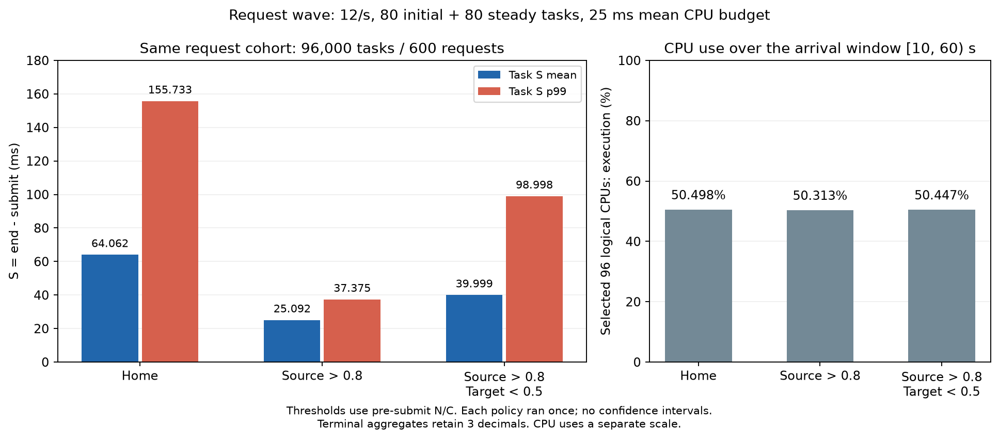

# 阶段3：负载指标与调度策略选择报告

> 最新短峰证据见[3007完整报告](ARM_3007_SHORT_PEAK_POLICY_REPORT.md)：N/C+0.8+选更轻池将initial任务S p99从9.928降至1.942ms；steady及全体完成p99基本不变。各池连续高位缩短，但全局瞬时峰值升高，总CPU近似不变。本轮最小对照已完成，无需追加矩阵。以下主体保留3003–3005长峰历史分析；尤其guarded、静态spread、none亲和和指标优劣，不能用历史数值冒充短峰对照。

本页为选型摘要。完整的业务背景、负载时间线、指标采集点、策略流程、统计口径和CPU结果见[阶段3最终分析报告](ARM_3005_CPU_CURVE_REPORT.md)。下文的N是每池已预留或接纳而尚未完成的任务数，Q是Folly近似队列深度，C是每池16逻辑CPU的容量刻度；N/C和Q/C均不是CPU利用率。

策略标识统一解释为：`home`始终投请求原始亲和池；`source_only`在原池N/C>0.8时读取其他池，选择严格更轻的最小者，没有更轻池就留原池；`guarded`另外要求目标N/C<0.5。每项都重新决策，只为新任务选目的池，不迁移已排队或执行中的任务。历史的`spread`指按任务编号直接轮询各池的静态分散策略，不读取负载决定分流。

时延标识统一解释为：`submit`是应用提交路径入口，早于选池和Folly add；S=end−submit为任务提交入口到计算结束，L=end−该项计划投递时刻，包含投递迟到。W=start−submit为开始前耗时，X=end−start为回调墙钟时长。S=W+X，L=投递迟到+S；p99不能相加，S和L也都不是整个请求的完成时延。

## 1. 当前建议与证据等级

**现有结果足够给出当前选型建议，无需补跑才交付报告。** 在已经验证的纯CPU、cluster绑定、每池线程远多于CPU、初始微突发加后续平缓到达的模型下，暂用N/C作分流信号，采用“home的N/C>0.8时选择更轻的池，无更轻池则留home”。不默认增加目标N/C<0.5门槛。CPU利用率继续作旁路观测，不进入路由。

这是已测配置下的工程参考，不是“已证明N最准确”或“0.8最优”。本报告综合[3003报告](ARM_3003_METRIC_POLICY_REPORT.md)、[3004报告](ARM_3004_REQUEST_WAVE_REPORT.md)及[3005高精度CPU报告](ARM_3005_CPU_CURVE_REPORT.md)。3003与3004工作量不同，3005沿用3004工作量并开启事件捕获，不能把跨轮差异直接当作策略或采集开销的严格配对估计。3004原始终端表、校验和与图见[证据目录](../../results/stage3-arm-3004/README.md)。未收到测试机逐任务CSV，不声称本地重算原始p99。

3005补充确认：整体CPU约50%，source_only的任务S p99相对home下降76.011%；各池最长连续≥90%占用从175–185ms缩短为20ms。**source_only在5ms尺度仍有100%的局部峰值，改善体现为缩短持续竞争，不能概括为消除了峰值。** 原有指标/策略选择保持，本轮无需新增发压。

|问题|现有证据|当前决定|
|---|---|---|
|用N的分流策略有没有收益|3003、3004各自的同输入开/关比较均有收益|可保留为参考策略|
|N是否比Q更准确预测完成时延|3003的256线程配置中两者差异很小；3004的桶成员和覆盖率不同|尚不能宣布N优于Q|
|是否改用Work或Remaining|3003固定成本估计使Work与N等价，Remaining未显示额外预测收益；3004未重新评选它们|当前没有升级依据|
|目标<0.5是否值得默认启用|3004相对source_only明显减少分流并增大p99|本场景不默认启用|
|动态均衡是否胜过静态spread|3003反而是spread更好；3004没有spread对照|不作动态策略普遍更好的结论|
|是否节省CPU或证明观测成本极低|固定CPU预算模型不等价于固定业务工作量|不能据本轮证明|

## 2. 指标选择：含义、采集与适用边界

|指标|采集位置与成本性质|本阶段用途|
|---|---|---|
|Q/C|路由时调用Folly `getTaskQueueSize()`，无需额外按任务维护Q；不遍历所有任务|保留作开始前积压诊断，不能代表已开始回调中的CPU竞争|
|N/C|应用在目标池`add`前预留N，回调退出时释放，提交失败回退；每项两次relaxed原子读改写，路由时原子读取|覆盖等待和执行中的未完成任务，当前简单分流的候选|
|Work/C|在N生命周期内维护各项预估成本之和|所有估计相同时只是N的常数倍；估计有真实区分度时才可能新增信息|
|Remaining/C|还需执行期间更新进度或估计剩余量|维护更复杂，已有证据不足以支持升级|
|CPU利用率|保留每约100ms累计时间采样；可选idle切换事件捕获，离线积分成5ms非idle驻留率|解释实际压力、局部高占用持续时间；两种口径略有差别，均不作为提交时的路由输入|

具体代码在[main.cpp](../../experiments/independent/src/main.cpp)的`readLoad`、`add`包装和回调清理处，选池逻辑在[LoadRouting.h](../../experiments/independent/src/LoadRouting.h)。Q不是内核runq，N也不是正在CPU上运行的线程数量。C=16是每池配置的逻辑CPU容量刻度，不是128个worker，也不是SMT物理吞吐的测量值。

N计数包含已经进入回调但暂时未获得CPU的工作，因而具有适合本场景的计数范围；**这个定义优势不能替代预测质量测量**。真实异步RPC应按可执行CPU片段计数，不能在等待网络期间把整个request一直当作CPU需求；同步阻塞任务和异质成本也会削弱N作为CPU需求代理的准确性。

当前没有同平台、固定有效工作量的完整成本测量，因此不填写未经测得的“每次读取多少ns”。允许近似不意味着可以把并发原子计数换成普通变量。

3004在home下的条件p99提供了以下信息：

- 后续阶段，N/C<0.5对应S p99=37.319ms；N/C≥4对应153.322ms，说明N能区分一部分风险状态。
- 初始阶段，入口N/C<0.5的p99仍为110.641ms，说明后续同批投递仍会影响已经进入的任务。
- 后续阶段N/C<0.5覆盖60.2%的任务，Q/C<0.5覆盖81.1%。两桶p99分别为37.319/71.612ms，但选择的任务不同，不能仅凭这一差异排出指标优劣。

## 3. 调度策略选择与CPU证据

3004固定6池×128线程、每池16逻辑CPU、cluster亲和、12请求/s。每请求初始80项在20ms内释放，再释放80项后续任务，窗口400ms；各项平均CPU预算25ms、均匀±50%。三策略输入一致，每组分析600请求、96000项任务，未截掉窗口后完成的慢任务。

S为实际submit至end，L为该项planned至end，均为task时延，不是DAG request完成时延。

|策略|S均值 ms|S p99 ms|L p99 ms|分流比例|所选96 CPU平均利用率|六个池各自采样峰值的范围|
|---|---:|---:|---:|---:|---:|---:|
|home|64.062|155.733|155.934|0%|50.498%|100%–100%|
|source_only：源>0.8，选更轻池|25.092|37.375|37.597|44.0%|50.313%|62.791%–65.244%|
|guarded：另要求目标<0.5|39.999|98.998|99.101|20.5%|50.447%|97.059%–100%|

source_only的S p99比home下降76.001%，guarded下降36.431%。guarded中约62%的已触发任务找不到满足门槛的目标而留home，当前观察说明0.5接纳门槛限制了有效分流。

source_only并未忽略目标负载，实际规则为：

```text
读取home提交前N/C
若不大于0.8：选home
否则：读取其他池N/C，寻找比home严格更低的最小值
有更轻目标：选该目标；否则：选home
通过准入后，在所选池预留N，再调用Folly add
```

它只为新任务选池，不搬运已排队或已执行任务。C=16时提交前N≥13触发；多池读数不是原子一致快照。当前单生产者的结果不能直接保证真实多生产者下没有同时选中同一目标的问题。

CPU结果说明：

1. **平均约50%与局部拥塞可以同时存在。** home各池平均为50.199%–51.396%，仍都观察到100%的采样峰值。
2. source_only降低各池100ms窗口的局部峰值，平均CPU需求近似不变，与把集中计算分散到其他池的解释一致。开始前等待均值从16.289降至0.018ms，回调墙钟均值从47.773降至25.074ms。3005在5ms尺度仍测得所有池峰值100%，所以峰值降低的表述只适用于上述100ms窗口。
3. 不是所有峰值都下降：96 CPU并集采样峰值从home的54.381%变为source_only的59.457%，guarded为56.202%。多个组同时工作可以提高并集峰值，同时减少单组饱和。
4. 采样约100ms，无法精确测量20ms峰形；CPU统计包含同组其他进程和中断，依赖测试隔离条件。它不参与发压或路由反馈。
5. 名义需求为`12×160×25ms=48 CPU秒/秒`，约占96逻辑CPU时间的50%。实测接近50%验证了压力设定，并不是策略节省CPU的证据。三轮进程CPU时间约2882秒；CPU预算停止条件也不能用于证明固定业务工作量的吞吐提升或全部观测成本可忽略。



## 4. 是否需要补其他场景：按尚未回答的问题决定

**完成当前报告不需要新增场景。** 如果希望进一步扩大选型结论，只保留下面两个方向，先离线、再按需补一个负载形状；不自动执行，也不重启矩阵。

### A. 先离线比较N和Q，新增发压0轮

测试机已有3004 home的逐任务数据时，可以在同一批任务上分别评价提交前N与Q。按完整请求的时间区间分开拟合与评价，避免同请求拆到两边；initial、steady分别报告。比较条件均值预测误差、条件p99损失及覆盖率，也可比较相同覆盖比例的低风险集合，并给出样本数。分桶边界与选择规则只由拟合区间确定。

这能避免“两个低负载桶筛出的任务数量不同”的比较偏差，但仍是同一运行内的描述性检验。它不能补出当前缺失的Q驱动策略干预结果，也不能证明跨场景泛化。没有逐任务数据时就保留当前结论，不从汇总p99反推这些指标。

### B. 如只补一个负载形状：相邻请求更集中到达，最多3轮

当前regular输入每83.333ms一个请求，按home轮询，同home约500ms一请求，初始波次相位很规则。应优先检验多个home的初始波次重叠时，分流目标是否仍有余量，而不是再扫几十个线程数/阈值组合。

一个可控的建议输入：每166.667ms安排两个请求，两请求相隔10ms，home继续RR。平均仍为12请求/s；保持请求总数、每项CPU预算、80+80结构、CPU集合、128线程及采样方式不变。这样改变的是到达的时间集中程度，不是通过减少工作量降低p99。该形状是压力探针，不冒充实测线上到达分布；测试机需核对实际投递时刻。

这是一组温和的双波次重叠，只覆盖两个home的初始释放窗相交，不代表六个池同时饱和；不要求由一次补测覆盖所有过载边界。

只在这个新输入下运行home、source_only、guarded各一次，共3轮，不重复三次，也不与3004直接配对计算收益。仍报告S/L均值与p99、initial/steady、分流/无目标比例、CPU并集和各池均值/采样峰值、实际投递跨度、完成数与排空完整性。即使结果没有正收益也报告，不继续搜索直到出现收益。

这三轮回答“到达更不均匀时当前策略是否仍有效，以及0.5门槛是否出现保护价值”，**不回答N是否优于Q**。如果未来决策明确要求在N与Q两种路由方案之间二选一，应另做针对性同输入策略对照；相同数值阈值不保证相同分流强度，不能用一次Q0.8对N0.8的结果声称指标本身更准确。

本段是候选设计，尚未执行，也不是可直接套入当前三策略运行器的新计划。当前运行器固定regular输入；不得手改已冻结的3004 plan或混入其分析目录。本轮不为候选设计改动发压工程。

## 5. 交付与停止边界

阶段3按当前范围完成：保留N作为简单可实现的候选，source_only作为已测模型下的参考策略，CPU只做观测；保留N/Q预测优势、动态相对静态分散价值、到达不规则性、异质成本与真实数据亲和的未知项。这里不要求补none/numa、64/256线程、40/120/160扇出和长尾的大矩阵。

本报告不把候选补测变成新的验收前置条件，也不进入其他agent负责的DAG与Folly工程。若当前目标是交付已有结论，直接使用本报告和3004原始结果即可。
