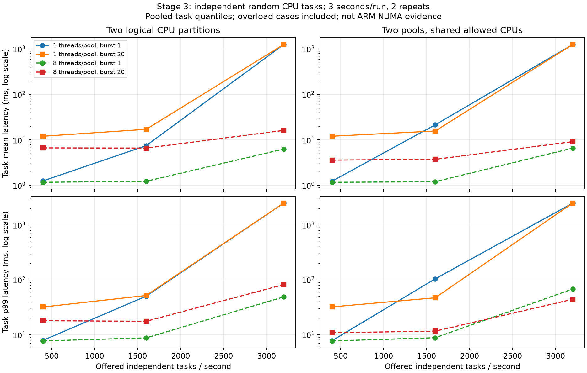

# 阶段3：独立随机任务的实际验证结果

> 本文保留早期开发机验证及当时进度，以下“尚未在ARM运行”和下一步建议不代表当前状态。用户随后回传的0001～0005已完成目标机阶段3初测与旧DAG home基线，见[第五批ARM审阅](../../docs/TARGET_PILOT_05_DAG_BASELINE_REVIEW.md)。当前可直接按[cluster v2指南](../../docs/REAL_WORKLOAD_MATRIX.md)推进，不需重跑历史步骤。

本阶段只使用原版 Folly CPUThreadPoolExecutor，没有DAG、RPC或跨池路由。开发机实际为4个逻辑CPU、单NUMA、约7.5GiB RAM；划成两个逻辑CPU分区，不是两颗ARM cluster。目标六池/双NUMA三种绑定的矩阵和操作指南已交付，尚未在真实ARM机器运行。

## 1. 数据范围与有效性

- 主矩阵48轮、249,600个独立任务：none/两分区绑定 × 每池1/8线程 × 400/1600/3200 tasks/s × burst=1/20 × 2个seed。
- 每轮3秒开放到达；任务名义CPU均值1000μs、均匀±50%抖动、2%任务乘8；每个burst投向round-robin池。
- 观测成本16轮、57,600任务：四档计量 × 4个seed，固定迭代数、1200 tasks/s，每轮3秒。
- 总计307,200任务全部完成，0拒绝、0取消、0失败；无采样截断/失败。所有同seed且同任务数场景的目标CPU序列逐项一致，平滑/突发不会重新生成另一批工作量。
- 这些是短轮次机制实验，包含明显过载配置；没有把3秒运行描述为稳态容量测试，也没有把几十万相互关联任务当成几十万独立重复。

完整[逐轮分析](../../results/staged/analysis/independent-main-analysis.md)、[配置汇总](../../results/staged/analysis/independent-summary.md)、[原始命令](../../results/staged/analysis/independent-main-manifest.json)分别保存。p99由原始任务重算，不平均各秒p99。

## 2. 平均压力相同，突发仍会增加等待

以下均为两个CPU分区、每池1线程，表中范围为两轮独立结果，不是置信区间。

|task/s|每批独立任务|task平均ms|task p99 ms|提交至开始均值ms|
|---:|---:|---:|---:|---:|
|400|1|1.25–1.26|7.76–8.30|约0.10|
|400|20|11.92–12.20|31.54–32.26|10.79–11.04|
|1600|1|6.48–8.51|28.74–58.89|5.32–7.36|
|1600|20|16.30–17.96|51.70–52.17|15.16–16.80|
|3200|1|1247–1263|2496–2541|1246–1262|

400 tasks/s时，burst20使用20 arrivals/s，burst1使用400 arrivals/s：总任务数和预算相同，只改变集中到达。此时延差能支持“平均CPU不高也可能因局部burst出现等待”，但仍不是完整request图时延。

3200 tasks/s的名义需求约3.65 CPU秒/s，而两池各1线程合计最多同时运行2个回调，持续积压符合容量约束。其高相关性同时包含随时间增长的队列和时延，不能当作稳态排队公式验证。

每池8线程时，400 tasks/s、burst20的task平均降至6.57–6.78ms；3200 tasks/s、burst20两轮为9.19和23.21ms，波动明显。增加线程在“消费者太少”时能利用更多CPU，但超过CPU数量后不增加算力；不能从这一组局部改善推出业务每池数百线程合理。

## 3. 队列信息有用，补充指标须证明增益

在1600 tasks/s、burst20中，原生queue与等待的Pearson：每池1线程约0.915–0.924，每池8线程约0.931–0.966。低压力平滑到达时queue几乎没有方差，相关系数可能为null；不把null记成0。

补充了[整轮留出预测](../../results/staged/analysis/independent-prediction.md)：同配置一个seed训练，另一整轮测试，交换后汇总。以下为预测submit→start的MAE，单位ms；每个模型都含自身已知目标服务量。

|两分区配置|仅自身target|queue|pending|queue+inflight|work+inflight|
|---|---:|---:|---:|---:|---:|
|1线程，1600 tasks/s，burst20|8.666|3.132|3.133|3.079|0.857|
|8线程，1600 tasks/s，burst20|2.314|0.560|0.554|0.561|0.831|
|8线程，3200 tasks/s，burst20|14.605|1.938|1.956|1.947|5.105|

这里queue和pending表现很接近；work在第一种配置明显有帮助，在另外两种配置反而更差。**这些数据不支持默认把queue替换成更复杂的work。** work保留正在执行任务的全额预算，且本次使用预先知道的合成预算，不能等同于准确的剩余CPU量，更不能当作生产已知信息。线性模型是描述性检验，不是最优模型比较或因果识别；完整报告保留全部24种配置的MAE、p95误差、逐折和覆盖率。

queue=0也不是立即执行的保证。例如1线程、1600 tasks/s、burst20的某轮141个queue=0样本里，4个等待超过1ms，其中1个超过5ms，最大9.26ms。它不能证明这些等待都发生在内核runq；在单消费者情况下，已取出的长任务就足以使后续提交看见空队列而仍需等待。

## 4. 四档观测成本：本机不足以分辨微小开销

固定工作量对照的四轮配对进程CPU变化，相对none：

|模式|配对CPU变化范围|说明|
|---|---:|---|
|queue|−0.192%～+0.694%|仅新增native queue读取和周期采样|
|counters|−0.103%～+3.379%|再维护pending/inflight；有一轮明显偏高|
|full|−0.148%～+0.663%|再维护work并记录线程CPU/TID|

负差值是运行波动，不是“加计量省CPU”。没有稳定的单调排序，这些轮次不足以分辨微小观测成本，更不能断言full免费。none仍保留准入/取消原子、基础时间戳及计算循环所需时钟；进程CPU区间包含投递、采样、工作线程和排空，排除初始化和最终CSV输出。详细[四档汇总](../../results/staged/analysis/observer-summary.md)和[逐轮记录](../../results/staged/analysis/observer-summary.json)保留实际值。

独立[接口成本探针](../../experiments/metrics/RESULTS.md)显示native queue的热缓存读取非常便宜；这与本任务级对照没有测出稳定微小差异并不冲突。目标机仍应按真实提交频率、线程数和NUMA重测，不能把局部微基准直接外推为完整观测成本。

## 5. 对目标机的选择建议

先保留native queue作为路由/监控的低成本基线。用阶段3固定工作和线程数验证拥塞分桶；若queue和pending近似，通常无须为替换queue额外维护pending。若运行中长任务/过量线程导致重要盲区，再比较queue+outstanding/inflight；服务差异较大时再校准work估计，并把准确性增益和计数成本一起报告。内核runq用独立系统证据解释，不混入Folly queue名称。

本阶段数据和脚本是可复现的验证起点。下一步在测试机按[设计指南](README.md)先标定负载区间，再进行6池none/numa/cluster、线程数、分布和burst对照；不能以当前开发机表格决定ARM的最佳线程数或亲和策略。
