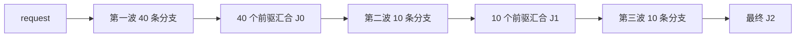

# 阶段 4：带依赖、突发扇出和异步恢复的 DAG 实验

本阶段回答“原始业务的 request 亲和、就绪算子路由、跨池借用和回迁如何取舍”。阶段 3 的独立随机任务只负责建立负载与等待的基础关系；这里有独立可执行程序、图模型、实验矩阵和验收门槛，不把两者的实验样本混合解释。

默认工程在 [`experiments/dag`](../../experiments/dag/)，使用**业务侧路由器 + 原版 Folly CPUThreadPoolExecutor**。它无需安装阶段 5 的 Folly 扩展。阶段 5 可将同一份 DAG 工作负载编译为库扩展后端，对照接入位置是否改变行为；库位置本身不是性能优化。

## 1. 从真实业务保留哪些机制

| 真实条件 | 本阶段对应 | 保留与简化 |
|---|---|---|
| IO 接收 → worker 建图 → executor 执行 | 开放到达发生器建立图后提交 executor | 只研究 executor；不模拟前两个池的排队、序列化和压缩 |
| 整体 QPS 12，多 request 同时存在 | `--qps 12`，requestID round-robin home | 以计划时间开放到达；慢请求不会降低新到达速率 |
| 初始大量 ready 算子，之后有依赖 | 初始宽波 + 链 + 多父 join + 后续 fork | 实现真实依赖计数；不是一次闭包里顺序运行全图 |
| 20～400 次子任务，平均 100 ms、少量 700～800 ms | 显式总节点预算、抖动、长尾 | 必须先核实 100 ms 是线程 CPU 时间还是墙钟时间 |
| executor 唤醒 executor | 所有节点、join、RPC continuation 独立 `add` | 允许同一工作线程下一次取到后继，但从不内联执行后继 |
| 部分算子调用下游服务 | 独立 timer 线程在延迟后重新提交 continuation | 等待不占 executor；未模拟网络和下游拥塞 |
| 六池、每池数百线程、三种绑定 | 显式六池、可变线程数、none/numa/cluster | 绑定只改变 worker 的允许 CPU；需要真实拓扑验证 |

**20～400 总算子数、初始 fanout 宽度、链深度、CPU 执行段数是四个不同量。** 不把 `fanout=400, chain_length=2` 写成“400 算子”：该配置有 800 个业务算子和 1 个 join；如果每个算子都等待一次 RPC，则产生 1,601 次 CPU 回调。CSV 明确记录这些口径。

## 2. 两种图模型及真实依赖

### 2.1 兼容图：`--graph chains`

宽度从 `[fanout-min, fanout-max]` 按 seed/requestID 确定，每条分支有 `chain-length` 个算子，所有链尾完成后提交一个 join。

- 业务算子数：`F × L`；CPU 节点数：`F × L + 1`。
- 适合先复现实验、研究一次初始爆发，以及区分总工作量和依赖深度。
- 初始分支宽度与总工作量一起变化；比较不同 F 的时延时须控制或分层总工作量。

### 2.2 多波图：`--graph waves`

`--wave-widths 40,10,10 --wave-depths 1,1,1` 表示：第一波 40 条分支；第一波全部完成后执行 J0；J0 完成后产生 10 条分支；J1 再产生 10 条分支；最终 J2 完成请求。



每波宽度为 `W_i`、每分支深度为 `D_i`：

- 业务算子数 `N = Σ W_i × D_i`。
- join 数 `K = 波数`，CPU 节点总数 `N + K`。
- CPU 回调数 `N + K + 等待 RPC 的算子数`；每个 RPC 算子拆为两段，CPU 预算总和不变。
- `--wave-depths` 省略时，所有波使用 `--chain-length`。waves 下 `fanout-min/max` 不参与构图；输出 `fanout` 是第一波宽度。
- `--join-us` 是**每个** join 的 CPU 预算。join 不抽长尾、不发 RPC，以单独控制屏障成本。
- 每条链只有前一节点完成后才提交后继；每波计数清零后才提交 join；join 的 CPU 段完成后才释放下一波。因而存在真正的多父依赖、中间 join 与二次 fanout。

这仍不是任意 DAG：波之间是完整屏障，未实现部分扇入、跨波旁路、共享中间节点的多个消费者、动态建图和依赖取消传播到任意子图。屏障模型会放大最慢分支对整波的影响。它用于分离实验变量；生产图形应按真实拓扑导入或扩展后验证。

### 2.3 随机工作量与可比性

每个算子的预算由 seed、requestID、算子 ID 决定，不由执行顺序生成。调整路由而保持图和 seed 相同，名义工作量一致。shape 矩阵的四种图均为 60 个算子、3 个 join，同 seed 时预算序列一致；可以比较“前重/均匀/后重/深链”形状。

默认 CPU 模式采用线程 CPU 时钟控制工作量。它能隔离排队，却会在缓存变慢时执行更少迭代，不能证明缓存亲和性提升吞吐。研究数据亲和成本必须单独校准并使用 `--work-mode iterations --iterations-per-us N`，保持迭代数相同；`--memory-kb` 控制每 request 只读共享数据。数据当前由发生器 first-touch，没有 NUMA 内存绑定，不能将结果直接解释成真实跨 NUMA 数据代价。

## 3. 亲和与路由的精确定义

每个 request 保留不变的 `home`。每次 CPU 回调有独立的实际 `chosen` 池，并传给后继作为 `parent`；不能用一个 request 全局可变的 currentPool 表示同时在不同池执行的多个分支。

| 策略 | 默认偏好 | 何时寻找其他池 | 研究问题 |
|---|---|---|---|
| `home` | request home | 不寻找 | 原有 request 亲和基线 |
| `borrow` | 每次都以 home 为偏好 | 每次提交 | 临时借出，后继允许回迁 |
| `sticky` | 实际 parent，初始为 home | 每次提交 | 分支沿迁移后的池继续执行，但忙时可再次转移 |
| `fanout` + `initial` | parent，初始为 home | 只在第一波初始提交 | 初始分散后，各分支、join、后续 fork/RPC 都跟随前驱 |
| `fanout` + `all` | parent，初始为 home | 每波开头 | 允许后续二次扇出再次均衡，普通链/RPC 恢复仍跟随前驱 |
| `least-load` | home 作为平分起点 | 每次提交 | 忽略迁移惩罚与收益阈值的激进参考 |

`--balance-forks initial|all` 只约束 `fanout` 策略；`borrow/sticky/least-load` 在每次提交都作决策，不能靠这个参数变成仅扇出均衡。

任务表 `is_fanout` 表示一波的初始提交位置（宽度为 1 也保留这一阶段标记）；`balance_eligible` 表示该位置是否属于 `fanout` 策略允许均衡的范围。RPC 的第二段不标记为 fork。初始一波没有真实 CPU parent，以 home 为 source；后续波以刚完成 join 的实际 chosen 为 parent。

多父 join 没有唯一亲和来源。本实现约定 **最后执行依赖计数递减、触发 join 的前驱所属池为 join parent**。该前驱不一定有最大的 CPU 段 `finish_ns`：它可能在记录结束时间后、递减计数前被抢占。这个约定通常贴近最后到达的依赖事件，但可能忽略其他输入数据的所有权；下一波再从 join chosen 开始。生产可进一步比较 home、最大输入所在池、数据所有者等规则。本实现没有声称这个约定最优。

“迁移”指新就绪节点改投池，不是搬运队列中的任务、不改变正在执行的线程 CPU 绑定，也不是强制内核迁移。`migrated` 含借出与回迁；`cross_numa` 比较来源与目标标签。相同 NUMA 上不同 cluster 的 LLC 成本未由标签充分表达。

## 4. 容量预算：先决定是否可以运行 12 QPS × 100 ms

忽略计量、路由、队列、RPC 等开销，平均 CPU 需求近似：

`D_cpu = QPS × (业务算子数 × E[单算子 CPU 秒] + 波数 × join CPU 秒)`。

例如 60 算子、3 个 100 μs join、每算子 100 ms：12 QPS 需要约 **72.0036 CPU 秒/秒**；2% 概率的 8 倍长尾使业务算子均值乘以 1.14，需求进一步升高。400 个算子 × 100 ms × 12 QPS 的端点需求约 480 CPU 秒/秒，不能在 96 个逻辑 CPU 上持续完成。业务描述的范围端点不等于每请求的平均算子数。

应先测实际算子线程 CPU 分布、图总 CPU 分布、RPC 占比和可用容量，再决定预算。SMT 的逻辑 CPU 数不等于吞吐翻倍；同 NUMA 三个池共享 mask 时，各池不能同时独占整个 NUMA。CPU quota、后台应用与留给 IO/worker/AIO 的核也要计入。

开发机使用小预算（例如 100～3000 μs）和真实可用 CPU 子集，验证因果机制与数据完整性；不要硬套生产的 100 ms/12 QPS。测试机先单池测基准，再按有效容量的约 25%、50%、75%、90%、105% 分别设计负载。超过容量的场景单列 overload：检查拒绝、截断、等待增长和排空时间，不能把短时过载数据当稳态结果。

## 5. 分步实验设计：一次只引入一个机制

| 顺序 | 固定项 | 本轮变量 | 主要判断 |
|---|---|---|---|
| 4A 功能 | 少量 request、小 CPU 预算 | chains、waves、RPC、取消 | 依赖顺序、任务次数、收尾守恒 |
| 4B 部署 | 同图、home、无尾部/RPC | none/numa/cluster × 每池线程数 | 绑定限制并行度还是减少执行成本；等待发生在哪一层 |
| 4C 路由 | 选定 4B 部署/线程数、同图/seed/工作量 | home/borrow/sticky/fanout initial/fanout all；先 queue 后 pending/work | 分散扇出是否降低请求时延，是否增加迁移成本 |
| 4D 图形 | 同 60 算子和 3 个 join、相同预算序列 | 前重、均匀、后重、深链 | 初始扇出优化是否以牺牲后续波为代价 |
| 4E 非均匀 | 固定图、部署、策略 | 分别加长尾、抖动、RPC、固定误差估计 | 性能提升是否依赖完美估计或没有长尾的条件 |
| 4F 局部性 | 固定迭代工作量、已校准算子、真实拓扑 | 请求数据大小、同/跨 NUMA 候选、迁移惩罚 | 服务 CPU/墙钟成本与排队收益如何抵消 |

线程数以资源为参照：每 cluster 实测逻辑宽度为 C，可依次比较 `C/2、C、2C、8C`（取正整数），再补业务当前数百线程配置。先找趋势，不做整个形状×线程×亲和×策略×负载的巨大笛卡尔积。4B 同 NUMA 和不绑场景的池 mask 会重叠，部署比较可先固定 `home`，避免把容量估算误差和路由策略变化混在一起。

**三种亲和对照的总 CPU 集合必须一致。** 当前 none 继承进程的整个 allowed mask；cluster/numa 使用显式 cluster masks 的并集。如果为 IO/worker/AIO 预留核，使该并集小于原 allowed mask，应先用 `taskset` 将整个实验发生器及其子进程限制到该并集，再运行全部三种亲和。否则 none 获得更多 CPU，结果混入总容量差异。demo 的发生器、timer、日志线程也继承这个限制，和真实业务分别给 IO 池绑核仍有差异，三种对照必须保持一致。

对 4C 先保持原生 queue 指标作为有价值的低成本候选，而不是预设它不可用；用同样请求、seed、容量和阈值比较 pending/work。work 默认知道合成预算，比业务更理想，所以 4E 要单独引入固定估计。当前 `--estimate-us` 只支持一致固定估计，未实现生产的按算子类型 EWMA 或随时间漂移；不要把这些已验证能力写进结论。

## 6. 构建和最小功能运行

从仓库根目录执行。构建细节见[总入口](../../README.md)。

```bash
BUILD_JOBS=1 ./scripts/build_stage.sh dag
ctest --test-dir build-dag --output-on-failure
python3 stages/04-dag/test_graph_analysis.py

build-dag/executor_demo --output results/local/dag-smoke \
  --pools 2 --threads 2 --affinity none \
  --qps 2 --duration 2 --requests 3 \
  --graph waves --wave-widths 8,2,4 --wave-depths 2,1,1 \
  --cpu-us 200 --join-us 30 --rpc-prob .2 --rpc-delay-us 1000 \
  --policy fanout --balance-forks all --metric queue \
  --max-inflight 16 --drain-seconds 5

python3 scripts/analyze.py results/local/dag-smoke --output results/local/dag-smoke-analysis
python3 stages/04-dag/analyze_graph.py results/local/dag-smoke \
  --output results/local/dag-smoke-path
```

本例有 `8×2 + 2×1 + 4×1 = 22` 个业务算子和 3 个 join，总 CPU 节点为 25。RPC 拆段会增加回调次数，但不增加逻辑算子数。程序拒绝覆盖已有结果目录；重复运行应换目录名。

## 7. 矩阵生成与执行

[`make_cases.py`](make_cases.py) 只生成 JSON，不执行负载。必须传入由拓扑检查确认的 mask，不根据 CPU 编号猜 cluster。[configs](configs/) 保留可复核的小型逻辑分区示例。

下面 `0,1;2,3` 只代表开发机两个逻辑 CPU 分区；若当前允许 CPU 不同，应替换。NUMA 标签均为 0 时，numa 模式会把两个分区合并回同一允许范围；不能把该对照宣称为双 NUMA 测试。

```bash
python3 scripts/topology.py --output results/local/dag-topology.json
python3 stages/04-dag/make_cases.py --family baseline \
  --cpus '0,1;2,3' --numa '0,0' --threads '2,16' \
  --output results/local/dag-baseline-cases.json

taskset -c 0-3 python3 scripts/run_matrix.py --binary build-dag/executor_demo \
  --cases-json results/local/dag-baseline-cases.json \
  --output results/local/dag-baseline --repeats 3 \
  --duration 10 --qps 4 --cpu-us 1000 \
  --extra --drain-seconds 10 --max-inflight 64
```

测试机三种亲和统一传**同一份六 cluster masks**和六个 NUMA 标签，例如 `0,0,0,1,1,1`；none 保留进程允许范围，cluster 使用各自 mask，numa 合并同标签的三个 cluster。实际 CPU 编号必须来自服务器，不能直接使用此处开发机编号。若 pool/cluster 只有一个可用 CPU，开发机仍可运行功能测试，但不能用该结果评价跨 cluster 均衡。

上面的 `taskset -c 0-3` 必须同步换成六个 executor cluster masks 的**精确并集**；不能沿用全部服务器 CPU。生成器发现显式并集与当前进程 allowed mask 不同会输出警告，但仍允许在开发机生成测试机配置。最终以运行记录里的 `allowed_cpus`、每池 `effective_cpus` 与拓扑信息核实公平性。

生成其他实验时替换 `--family routing|shape|stress`；运行器通过 `--only` 按名字筛选小批量实验。生成器默认每算子固定预算、无尾部/RPC，stress 每次只引入一个机制。`--extra` 放最后，会覆盖 JSON 中同名选项；在 manifest 中复核最终生效命令，避免无意覆盖需要对照的变量。

每轮同 seed 成对比较并随机化场景顺序；多轮使用不同 seed。整个矩阵串行执行，避免多个实验争用同一开发机。正式测试建议先 30～60 s 试运行检查容量，再用足够长窗口收集至少数千乃至更多 request；12 QPS 下 3 s 只有 36 次请求，不足以稳定评估 p99。记录预热段与测量段，若用当前程序全程汇总，需在独立离线分析中排除预热而不是悄悄改变统计口径。

## 8. 原始数据、依赖审计与时延分解

- `requests.csv`：计划/实际到达、首段开始、完成、延迟、状态、总业务算子 `operator_nodes`、含 join 的 `cpu_nodes`、波数、名义总 CPU。
- `tasks.csv`：算子 ID 与 RPC stage、wave、operator/join、依赖 ID、home/parent/chosen、提交/开始/结束时间、该段 CPU/墙钟、路由快照。stage 1 的同 ID 前驱指 stage 0；其他边指前驱最后一段。
- `pools.csv`：周期负载及计数。`queue_depth` 是 Folly 用户态任务队列口径；**不是 Linux runq 长度**。
- `seconds.csv`：按完成时刻归属的每秒平均和 p99；输出在结束时生成。不得平均各秒 p99 当作整轮 p99。
- `workers.csv`/外部 `proc.csv`：池与 TID 对应、低频内核 CPU/调度数据。schedstats 未启用时不能把 runq 时间 0 解读为没有调度等待。

[`analyze_graph.py`](analyze_graph.py) 从配置独立重建期望依赖，再检查所有已完成 request 的依赖先后、遗漏/多余的边、节点集合、重复 stage、所有分支的时间顺序与数据完整性，避免依赖表漏边后仍然自证通过。它沿每个 join 最晚完成前驱回溯“本次观测决定完成时刻的路径”。对每个 request 满足精确恒等式：

`请求时延 = 路径上的前驱完成至本节点提交间隙 + 提交至回调开始 + CPU 段执行墙钟 + 请求收尾`。

第一项含到达滞后、发生器逐个提交、异步 RPC 延迟和续接开销；第二项含 Folly 路由/队列/唤醒以及线程得到 CPU 前的等待，不能单独叫内核 runq；第三项含测量边界内 CPU 和被抢占/阻塞的墙钟。算子 CPU 时钟只包住合成计算，不涵盖 Folly 全部调度成本。只有结合独立内核追踪，才可进一步归因；追踪本身要评估扰动。

路径回溯选的是最大的已记录前驱 `finish_ns`，不保证与触发 join 递减计数的线程相同；二者之间的提交间隙被完整保留。因而这是与观测时间守恒的解释路径，不是“真实内核唤醒链”追踪，也不是不受调度影响的纯服务时间关键路径。

**并行任务累计等待不能直接相加解释请求时延。** 分析器同时保留全图累计量和完成路径量，以免把 400 条分支的并行等待相加成几百倍端到端时延。各分量的 p99 也不可相加；逐请求分解守恒，均值分量可相加。

基础分析器计算负载与 submit-to-start 关系、请求初始快照与请求时延关系，并按名义工作量分层。请求初始队列都为零时相关系数没有定义；不能用“零相关”反驳突发后的拥塞。DAG 就绪节点不是独立样本，同 request/同轮内有强相关；策略对照以独立运行的配对差值为主，再做按 request 或时间块的重采样。

## 9. 验收门槛与剩余限制

进入下一组实验前确认：

1. offered = accepted + rejected，accepted = completed + censored + failed，排空后各池 outstanding/pending/inflight 为 0。
2. 所有完成 request 节点数、CPU 名义预算、依赖先后通过检查；RPC continuation 在前段完成与 timer 后提交。
3. 同策略对照组有相同图、seed、请求数、工作量、到达计划；检查发生器滞后、CPU quota、后台负载和 CSV 日志吞吐。
4. 完成请求的均值/p99必须与拒绝、截断、失败、排空时长同时报告；有大量未完成请求时禁止只看剩余成功请求 p99 宣布收益。
5. 路由收益有跨轮一致性且没有通过改变工作量、降低到达率或额外拒绝获得。若差异约 0.5%～1%，先证明测量稳定度足够。
6. 面向生产接入前另验证 RequestContext 在真实 AIO 回调间传递、任务异常、deadline/取消、有界 admission、join/关闭生命周期。当前 timer 显式保留 home/parent，但不自动保存/恢复生产 RPC 的 RequestContext。

原型尚未实现任意 DAG 导入、真实 RPC、NUMA 内存绑定、在队任务搬运、抢占、后台 work stealing、按算子类型估计器、分支迁移预算/冷却时间、生产公平性与动态拓扑。不要因 demo 有提升就把这些能力视作已交付。阶段 5 再独立判断哪些通用机制适合放入 Folly，图语义和真实业务策略仍留在业务层。

本次开发机实际运行结果、依赖核验与限制见[RESULTS](RESULTS.md)。
